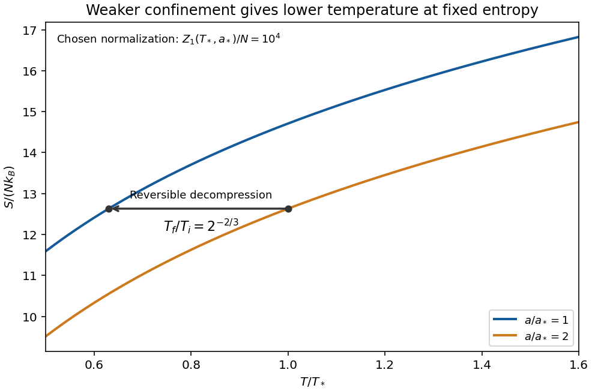

<h1 id="4/solution">Solution</h1>

↑ **Parent:** [4](../4.md)

**One particle.** Use the classical phase-space normalization of one quantum state per [volume](../../../volume.md) $h^3$, with no unspecified internal degeneracy. For $a>0$ and $\beta=1/(k_BT)$, the [canonical partition function](../../../canonical-partition-function.md) factorizes into [momentum](../../../momentum-split.md) and position integrals:

$$
Z_1=\frac1{h^3}\int e^{-\beta p^2/(2m)}d^3p
\int e^{-\beta ar}d^3r.
$$

The Gaussian [momentum](../../../momentum-split.md) integral is $(2\pi mk_BT)^{3/2}$. In [spherical coordinates](../../../spherical-coordinate-system.md), put $t=\beta ar$:

$$
\int e^{-\beta ar}d^3r
=4\pi\left(\frac{k_BT}{a}\right)^3
\int_0^\infty t^2e^{-t}\,dt
=8\pi\left(\frac{k_BT}{a}\right)^3.
$$

Therefore the [classical ideal gas in a spherical linear trap](../../../classical-ideal-gas-in-a-spherical-linear-trap.md) has

$$
\boxed{Z_1(T,a)=\frac{8\pi}{\lambda_T^3}\left(\frac{k_BT}{a}\right)^3
=\frac{8\pi(2\pi m)^{3/2}(k_BT)^{9/2}}{h^3a^3}.}
$$

Here $a$ is a force, in $\mathrm{J\,m^{-1}}$, so $k_BT/a$ is a length and $Z_1$ is dimensionless. A nonconfining $a\leq0$ would not give this finite spatial integral. As required by the classical phase-space approximation, the [temperature](../../../temperature-split.md) must exceed the trap's discrete level scale.

**Indistinguishable dilute particles.** Independent labeled particles would give $Z_1^N$. In the classical dilute regime, division by $N!$ removes the overcounting of [permutations](../../../permutation.md) of identical particles:

$$
\boxed{Z_N=\frac{Z_1^N}{N!}.}
$$

This is the Maxwell-Boltzmann limit, not an exact quantum [canonical partition function](../../../canonical-partition-function.md) at high occupation. Exchange effects cannot be captured merely by continuing this formula beyond its dilute regime.

**Free energy, energy and entropy.** The [Helmholtz free energy](../../../helmholtz-free-energy.md) is

$$
F=-k_BT\ln Z_N=-Nk_BT\ln Z_1+k_BT\ln N!.
$$

With leading [Stirling's approximation](../../../stirling-formula.md), $\ln N!\simeq N\ln N-N$, this becomes

$$
\boxed{F\simeq-Nk_BT\left[\ln\frac{Z_1}{N}+1\right].}
$$

At fixed trap strength, $\partial_T\ln Z_1=9/(2T)$. Differentiating $F$ gives the requested [entropy](../../../entropy-split.md),

$$
\boxed{S=-\left(\frac{\partial F}{\partial T}\right)_{N,a}
\simeq Nk_B\left[\ln\frac{Z_1}{N}+\frac{11}{2}\right].}
$$

The $11/2$ is $1+9/2$: the first term comes from indistinguishability through Stirling's formula, and the second from the [temperature](../../../temperature-split.md) dependence of $Z_1$. Without the large-$N$ approximation, $S=k_B[N\ln Z_1-\ln N!+(9/2)N]$. Independently,

$$
U=-\partial_\beta\ln Z_N=\frac92Nk_BT,\qquad
C_a=\frac92Nk_B.
$$

The kinetic contribution is $3Nk_BT/2$ and the linear-trap potential contribution is $3Nk_BT$, also obtained from generalized equipartition.

**Entropy curves and reversible cooling.** For a fixed $N$ and a reference pair $(T_*,a_*)$, the dependence can be written without logarithms of dimensional quantities:

$$
\frac S{Nk_B}=\frac{S_*}{Nk_B}
+\frac92\ln\frac T{T_*}-3\ln\frac a{a_*}.
$$

At each fixed $a$, the [entropy](../../../entropy-split.md) increases logarithmically and is concave downward in $T$; decreasing $a$ shifts the curve upward. Its formal classical divergence as $T\to0$ marks failure of classical statistics, not a physical negative-infinite [entropy](../../../entropy-split.md).

**[Figure 4](#4/image-original-classical-entropy-curves-for-two-linear-trap-strengths-a-horizontal-constant-entropy-arrow-shows-cooling-on-reversible-decompression-within-the-dilute-regime). Original classical entropy curves for two linear-trap strengths; a horizontal constant-entropy arrow shows cooling on reversible decompression, within the dilute regime**.

For a reversible adiabatic change, $S$ is constant at fixed $N$, so

$$
0=\frac92\,d\ln T-3\,d\ln a,
\qquad
\boxed{T_f=T_i\left(\frac{a_f}{a_i}\right)^{2/3}.}
$$

Hence reducing $a$ lowers the [temperature](../../../temperature-split.md): this is [isentropic decompression of a spherical linear trap](../../../isentropic-decompression-of-a-spherical-linear-trap.md). The gas does work on the control that weakens the trap. Equivalently $dU=\langle\partial H/\partial a\rangle da=N\langle r\rangle da$, with $\langle r\rangle=3k_BT/a$; inserting $U=9Nk_BT/2$ gives the same relation. Reversibility requires an equilibrium sequence without heat input or [entropy](../../../entropy-split.md) production. Because $Z_1$ stays constant on this adiabat, $N/Z_1$ also stays constant: this mechanism cools the cloud but does not by itself increase [quantum degeneracy](../../../degenerate-energy-levels.md).

**Chemical potential and quantum threshold.** From the extensive [free energy](../../../thermodynamic-free-energy.md),

$$
\boxed{\mu=\left(\frac{\partial F}{\partial N}\right)_{T,a}
\simeq k_BT\ln\frac{N}{Z_1}.}
$$

Thus the [quantum gas fugacity](../../../fugacity-statistical-mechanics.md) is $z=e^{\mu/(k_BT)}\simeq N/Z_1$. Classical statistics requires $z\ll1$; quantum effects become important as the [chemical potential](../../../chemical-potential-split.md) comes within order $k_BT$ of the lowest one-particle [energy](../../../energy-split.md). With the semiclassical zero at the potential minimum, the [quantum degeneracy threshold in a spherical linear trap](../../../quantum-degeneracy-threshold-in-a-spherical-linear-trap.md) is consequently

$$
\boxed{N_{\rm quantum}\sim Z_1(T,a)
=\frac{8\pi}{\lambda_T^3}\left(\frac{k_BT}{a}\right)^3.}
$$

There are no numerical values of $m,T,a$ in the paper, so this parameter-dependent estimate is the requested atom number. It also follows from the peak density: $n(0)=N/[8\pi(k_BT/a)^3]$, and degeneracy starts when $n(0)\lambda_T^3$ is order one. The criterion is a crossover estimate, not an assertion that the classical formula remains valid at $\mu=0$. For spinless [bosons](../../../boson.md) the continuum excited-state saturation is more specifically $N_c=\zeta(9/2)Z_1$, while for [fermions](../../../fermion.md) the onset is occupation constrained by exclusion. At temperatures comparable with the quantum trap spacing, the actual ground [energy](../../../energy-split.md) must be included consistently rather than identified exactly with the classical minimum.

## ↑ Ancestors (12)

1. [4](../4.md)
2. [2017](../../2017-split.md)
3. [Past exam of the thermal and statistical physics course of the University of Cambridge](../../split.md)
4. [Thermal and Statistical Physics course of the University of Cambridge](../../../thermal-and-statistical-physics-course-of-the-university-of-cambridge.md)
5. [Physics course of the year 3 of the natural sciences course of the University of Cambridge](../../../physics-course-of-the-year-3-of-the-natural-sciences-course-of-the-university-of-cambridge.md)
6. [Year 3 of the natural sciences course of the University of Cambridge](../../../year-3-of-the-natural-sciences-course-of-the-university-of-cambridge.md)
7. [Year of the natural sciences course of the University of Cambridge](../../../year-of-the-natural-sciences-course-of-the-university-of-cambridge.md)
8. [Natural sciences course of the University of Cambridge](../../../natural-sciences-course-of-the-university-of-cambridge.md)
9. [Course of the University of Cambridge](../../../course-of-the-university-of-cambridge.md)
10. [University of Cambridge](../../../university-of-cambridge-split.md)
11. [List of universities](../../../list-of-universities.md)
12. [Codex Wiki](../../../split.md)
