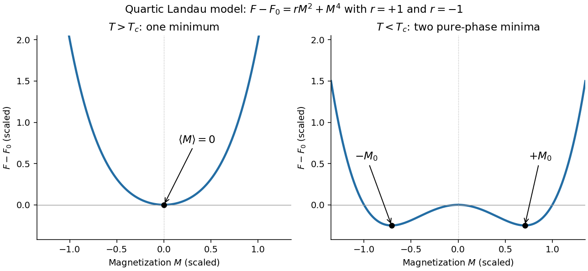

<h1 id="section-b/b4/solution">Solution</h1>

↑ **Parent:** [B4](../b4.md)

**[Order parameter](../../../../order-parameter.md) and the free-energy landscape.** In [Landau theory](../../../../landau-theory.md), take a scalar [magnetization](../../../../magnetization.md) component at fixed [volume](../../../../volume-thermodynamics.md) and composition. It is an [order parameter](../../../../order-parameter.md): its nonzero spontaneous value distinguishes an ordered phase with [ferromagnetism](../../../../ferromagnetism.md) from the symmetric high-temperature phase. One first constructs a [constrained order-parameter free energy](../../../../constrained-order-parameter-free-energy.md) at specified [magnetization](../../../../magnetization.md) by summing over microscopic states compatible with it. An external [magnetic field](../../../../magnetic-field-split.md) is an independent control, so it can also appear in that constrained function. For a total [magnetic moment](../../../../magnetic-dipole-moment.md) the conjugate term is $-BM$; if $M$ is a [magnetization](../../../../magnetization.md) density, the total-energy term is $-VBM$, or $-BM$ in [free-energy density](../../../../free-energy-density.md). Minimizing over $M$ then yields the equilibrium thermodynamic potential as a function of the imposed field.

Thus treating both $M$ and $B$ as arguments of a Landau function does not treat them as independent natural variables of the already-minimized equilibrium [free energy](../../../../thermodynamic-free-energy.md). The first is the fluctuating or constrained [order parameter](../../../../order-parameter.md), and the second its [conjugate field](../../../../field-conjugate-to-an-order-parameter.md).

At zero field, reversal symmetry requires $F(M)=F(-M)$, excluding odd powers. Near a continuous transition, assume the homogeneous constrained [free energy](../../../../thermodynamic-free-energy.md) is analytic for small $M$, that the quadratic coefficient crosses zero linearly, and that the quartic coefficient is positive. Then

$$
F(T,M)=F_0(T)+b(T-T_c)M^2+dM^4,
\qquad b>0,\quad d>0.
$$

The [temperature](../../../../temperature-split.md) $T_c$ is where the zero-field quadratic coefficient vanishes and spontaneous ordering begins in this approximation. Higher powers are negligible sufficiently close to it; spatial fluctuations are neglected in this mean-field treatment.

Stationarity gives $2M[b(T-T_c)+2dM^2]=0$. Above $T_c$, the only minimum is at zero. Below it, zero becomes a maximum and two minima appear:

$$
\boxed{M_{\mathrm{eq}}=0\quad(T>T_c),\qquad
M_{\mathrm{eq}}=\pm\sqrt{\frac{b(T_c-T)}{2d}}\quad(T<T_c).}
$$

The two signs describe [spontaneous symmetry breaking](../../../../spontaneous-symmetry-breaking.md): they are the average magnetizations in the symmetry-broken pure phases. A strictly finite system at exactly zero field samples the two wells symmetrically and has [ensemble average](../../../../expected-value-split.md) $\langle M\rangle=0$. A spontaneous pure-phase value is defined by selecting a phase, for example taking the [thermodynamic limit](../../../../thermodynamic-limit.md) before removing a small field. This qualification distinguishes a minimum's location from the average over a symmetric two-well distribution.

**[Figure 1](#section-b/b4/image-quartic-landau-free-energy-above-and-below-the-transition-showing-the-disordered-and-symmetry-broken-minima). Quartic Landau free energy above and below the transition, showing the disordered and symmetry-broken minima**.

**Minimum [free energy](../../../../thermodynamic-free-energy.md) and the heat-capacity jump.** At a nonzero minimum, $M^2=-b(T-T_c)/(2d)$. Substituting this value gives

$$
b(T-T_c)M^2+dM^4
=-\frac{b^2(T-T_c)^2}{2d}+\frac{b^2(T-T_c)^2}{4d}.
$$

Hence

$$
\boxed{F_{\min}(T)=F_0(T)-\frac{b^2(T-T_c)^2}{4d}\quad(T<T_c),}
$$

while $F_{\min}=F_0$ above the transition. Take the [temperature](../../../../temperature-split.md) [derivatives](../../../../derivative.md) only after minimizing, so the equilibrium [order parameter](../../../../order-parameter.md) is allowed to change with [temperature](../../../../temperature-split.md). With $C_0=-TF_0''(T)$,

$$
C_V=\begin{cases}
C_0+Tb^2/(2d),&T<T_c,\\
C_0,&T>T_c.
\end{cases}
$$

Therefore

$$
\boxed{\Delta C_V\equiv C_V(T_c^-)-C_V(T_c^+)=\frac{T_cb^2}{2d}.}
$$

This is the [heat-capacity jump in quartic Landau theory](../../../../heat-capacity-jump-in-quartic-landau-theory.md). The [entropy](../../../../entropy-split.md) is continuous at $T_c$, so there is no latent [heat](../../../../heat-split.md). If $F$ denotes [free-energy density](../../../../free-energy-density.md) rather than total [free energy](../../../../thermodynamic-free-energy.md), these expressions denote [heat capacity](../../../../heat-capacity.md) per unit [volume](../../../../volume-thermodynamics.md) with the same normalization.

**Stabilizing a tricritical expansion.** At a [tricritical point](../../../../tricritical-point.md), the quartic coefficient is tuned to zero at the same point where the quadratic coefficient changes sign. Reversal symmetry still excludes odd powers. The next available stabilizing term is therefore

$$
F=F_0+b(T-T_c)M^2+d'M^6,
\qquad\boxed{d'>0.}
$$

A negative or vanishing leading sextic coefficient would not stabilize this truncation for large $|M|$; a higher positive term would then be needed and the present tricritical form would be insufficient. The ordinary quartic theory has a continuous transition for $d>0$, while a stabilized theory with $d<0$ can have a first-order transition. Their meeting at zero field is what makes the simultaneous tuning tricritical.

**The tricritical minimum.** At zero field and $T<T_c$, stationarity gives

$$
\frac{\partial F}{\partial M}=2M[b(T-T_c)+3d'M^4]=0,
\qquad
\boxed{M_{\mathrm{eq}}^4=\frac{b(T_c-T)}{3d'}.}
$$

The nonzero solutions are minima: their curvature is $2b(T-T_c)+30d'M^4=8b(T_c-T)>0$. Put $t=T_c-T>0$. Since $d'M^6=(bt/3)M^2$ at stationarity,

$$
F_{\min}-F_0=-btM^2+\frac{bt}{3}M^2
=-\frac23bt\sqrt{\frac{bt}{3d'}}.
$$

Thus

$$
\boxed{F_{\min}(T)=F_0(T)-\frac{2b^{3/2}(T_c-T)^{3/2}}{\sqrt{27d'}}.}
$$

The [order parameter](../../../../order-parameter.md) now vanishes as $(T_c-T)^{1/4}$ rather than the quartic theory's square root.

**Heat-capacity singularity.** Define $K=2b^{3/2}/\sqrt{27d'}>0$, so the ordered-side singular [free energy](../../../../thermodynamic-free-energy.md) is $F_{\mathrm{sing}}=-K(T_c-T)^{3/2}$. Its [derivatives](../../../../derivative.md) are

$$
\frac{dF_{\mathrm{sing}}}{dT}=\frac32K(T_c-T)^{1/2},\qquad
\frac{d^2F_{\mathrm{sing}}}{dT^2}=-\frac34K(T_c-T)^{-1/2}.
$$

Consequently

$$
\boxed{C_V^{\mathrm{sing}}=-T\frac{d^2F_{\mathrm{sing}}}{dT^2}
=\frac{Tb^{3/2}}{2\sqrt{3d'}}(T_c-T)^{-1/2},
\qquad\alpha=\frac12.}
$$

This is the [tricritical heat-capacity amplitude in a sextic Landau expansion](../../../../tricritical-heat-capacity-amplitude-in-a-sextic-landau-expansion.md). It is positive on the ordered side and diverges as $T\to T_c^-$, rather than remaining a finite jump. This value of the [heat-capacity critical exponent](../../../../heat-capacity-critical-exponent.md) is the mean-field result along the path keeping the quartic term zero; a detuning to $d>0$ ultimately restores ordinary quartic behavior. Fluctuation corrections to the [mean-field theory](../../../../mean-field-theory.md) are not included in the stipulated [polynomial](../../../../polynomial-split.md) minimization.

## ↑ Ancestors (13)

1. [B4](../b4.md)
2. [Section B](../../section-b.md)
3. [2018](../../../2018-split.md)
4. [Past exam of the thermal and statistical physics course of the University of Cambridge](../../../split.md)
5. [Thermal and Statistical Physics course of the University of Cambridge](../../../../thermal-and-statistical-physics-course-of-the-university-of-cambridge.md)
6. [Physics course of the year 3 of the natural sciences course of the University of Cambridge](../../../../physics-course-of-the-year-3-of-the-natural-sciences-course-of-the-university-of-cambridge.md)
7. [Year 3 of the natural sciences course of the University of Cambridge](../../../../year-3-of-the-natural-sciences-course-of-the-university-of-cambridge.md)
8. [Year of the natural sciences course of the University of Cambridge](../../../../year-of-the-natural-sciences-course-of-the-university-of-cambridge.md)
9. [Natural sciences course of the University of Cambridge](../../../../natural-sciences-course-of-the-university-of-cambridge.md)
10. [Course of the University of Cambridge](../../../../course-of-the-university-of-cambridge.md)
11. [University of Cambridge](../../../../university-of-cambridge-split.md)
12. [List of universities](../../../../list-of-universities.md)
13. [Codex Wiki](../../../../split.md)
