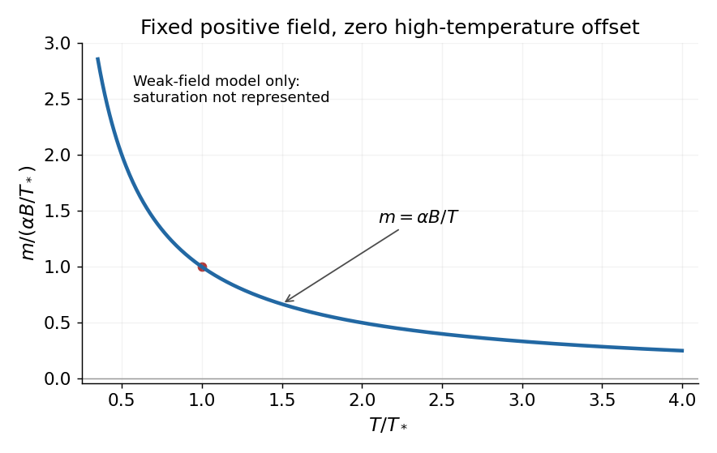
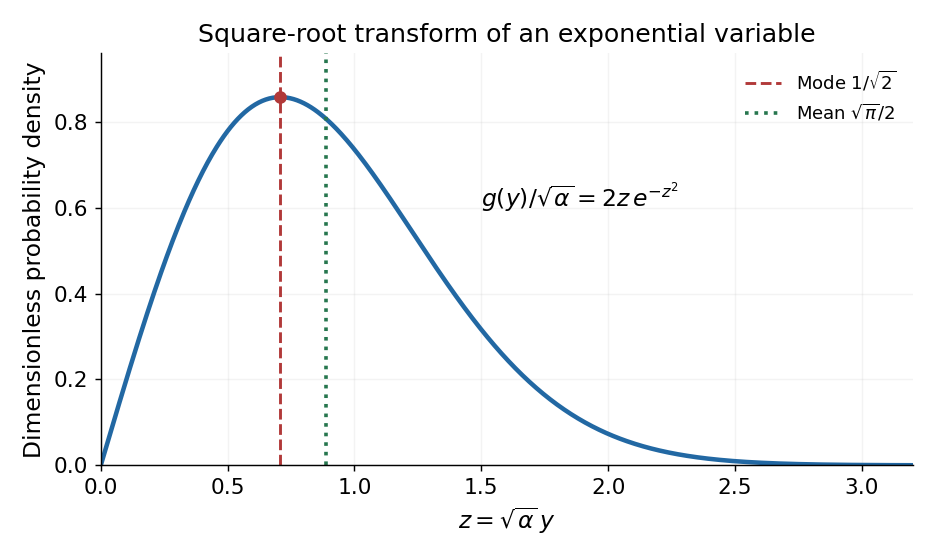
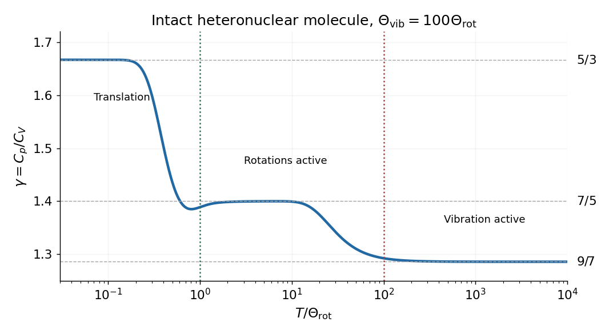
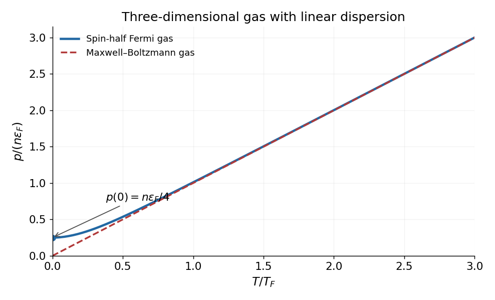
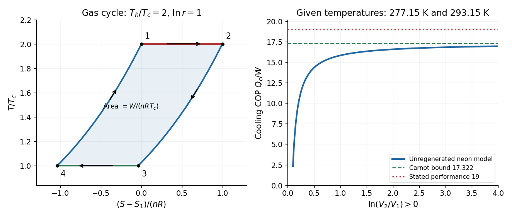

# 2016

↑ **Parent:** [Past exam of the thermal physics course of the University of Oxford](../past-exam-of-the-thermal-physics-course-of-the-university-of-oxford.md)

Source paper: [https://www.whatdotheyknow.com/request/physics_past_exam_papers_2015_16/response/973997/attach/3/Cowell%20Attachment.zip?cookie_passthrough=1](https://www.whatdotheyknow.com/request/physics_past_exam_papers_2015_16/response/973997/attach/3/Cowell%20Attachment.zip?cookie_passthrough=1)

**Table of contents**

- [1](#1)
  - [i](#1/i)
    - [Solution](#1/i/solution)
  - [ii](#1/ii)
    - [Solution](#1/ii/solution)
  - [iii](#1/iii)
    - [Solution](#1/iii/solution)
- [2](#2)
  - [Solution](#2/solution)
- [3](#3)
  - [Solution](#3/solution)
- [4](#4)
  - [Solution](#4/solution)
- [5](#5)
  - [Solution](#5/solution)
- [6](#6)
  - [Solution](#6/solution)
- [7](#7)
  - [Solution](#7/solution)
- [8](#8)
  - [Solution](#8/solution)
- [9](#9)
  - [Solution](#9/solution)
- [10](#10)
  - [Solution](#10/solution)

## 1

↑ **Parent:** [2016](2016.md)

<h3 id="1/i">i</h3>

↑ **Parent:** [1](#1)

<h4 id="1/i/solution">Solution</h4>

↑ **Parent:** [I](#1/i)

A [state function](../thermodynamics.md#state-function) is determined by the equilibrium state, rather than the path used to reach it. Its differential is exact and its change around a closed [thermodynamic cycle](../thermodynamics.md#thermodynamic-cycle) is zero. [Internal energy](../internal-energy.md), [entropy](../entropy.md) and [enthalpy](../enthalpy.md) are examples; transferred [heat](../heat.md) and [work](../energy.md#work) are not [state functions](../thermodynamics.md#state-function).

For slow expansion in contact with a large [thermal reservoir](../thermal-equilibrium.md#heat-bath), the fixed [temperature](../temperature.md) of that reservoir maintains an [isothermal process](../second-law-of-thermodynamics.md#isothermal-process). For a fixed amount of [ideal gas](../ideal-gas.md), [internal energy](../internal-energy.md) and [enthalpy](../enthalpy.md) depend only on [temperature](../temperature.md), so

$$
\boxed{T=\mathrm{constant},\qquad U=\mathrm{constant},\qquad H=\mathrm{constant}.}
$$

The [ideal gas law](../ideal-gas.md#ideal-gas-law) also gives $pV=\mathrm{constant}$. For a reversible expansion the absorbed [heat](../heat.md) equals the [work](../energy.md#work) done by the gas, while its [entropy](../entropy.md) increases by $n_{\rm mol}R\ln(V_2/V_1)$; constant [internal energy](../internal-energy.md) does not mean zero [heat transfer](../heat.md#heat-transfer).

<h3 id="1/ii">ii</h3>

↑ **Parent:** [1](#1)

<h4 id="1/ii/solution">Solution</h4>

↑ **Parent:** [Ii](#1/ii)

With a thermally insulating boundary, $\delta Q=0$. If the slow piston motion is frictionless and reversible, it is an [isentropic process](../first-law-of-thermodynamics.md#isentropic-process):

$$
\boxed{S=\mathrm{constant}.}
$$

The [first law of thermodynamics](../first-law-of-thermodynamics.md) gives $dU=-p\,dV$, so expansion lowers the [internal energy](../internal-energy.md) and [temperature](../temperature.md). For constant [heat capacity ratio](../ideal-gas.md#heat-capacity-ratio) $\gamma$, $pV^\gamma$ and $TV^{\gamma-1}$ are constant combinations of [state functions](../thermodynamics.md#state-function). Insulation alone does not guarantee constant [entropy](../entropy.md): an irreversible [adiabatic process](../first-law-of-thermodynamics.md#adiabatic-process) can produce [entropy](../entropy.md). The conclusion uses the intended reversible, quasistatic piston idealization.

<h3 id="1/iii">iii</h3>

↑ **Parent:** [1](#1)

<h4 id="1/iii/solution">Solution</h4>

↑ **Parent:** [Iii](#1/iii)

For steady insulated flow through a porous plug, neglect changes of bulk [kinetic energy](../energy.md#kinetic-energy) and gravitational [potential energy](../energy.md#potential-energy), and allow no shaft [work](../energy.md#work). Each amount of gas brings flow [work](../energy.md#work) $p_1V_1$ upstream and delivers $p_2V_2$ downstream. The steady [energy conservation](../mathematical-physics.md#conservation-of-energy) balance is

$$
U_1+p_1V_1=U_2+p_2V_2,\qquad \boxed{H_1=H_2.}
$$

Thus [enthalpy](../enthalpy.md) is conserved in this [Joule-Thomson effect](../enthalpy.md#joule-thomson-effect). For an [ideal gas](../ideal-gas.md), $H=H(T)$, so $T_1=T_2$ and $U_1=U_2$ as well. The [entropy](../entropy.md) increases:

$$
\boxed{\Delta S=n_{\rm mol}R\ln\frac{p_1}{p_2}>0.}
$$

The porous-plug process is irreversible despite being slow and insulated; it is not the reversible expansion of the preceding part.

## 2

↑ **Parent:** [2016](2016.md)

<h3 id="2/solution">Solution</h3>

↑ **Parent:** [2](#2)

In the one-mole [Van der Waals equation](../pressure.md#van-der-waals-equation), $b>0$ represents [excluded volume](../statistical-physics.md#excluded-volume): the volume available to molecular motion is $V-b$, rather than $V$. Subtracting $b$ in the denominator therefore increases the repulsive contribution to [pressure](../pressure.md). The $a>0$ term represents intermolecular attraction, which reduces the outward [momentum flux](../mathematical-physics.md#momentum-flux) at a wall and hence appears as the negative correction $-a/V^2$. The two minus signs do not mean that both physical effects lower [pressure](../pressure.md).

For a reversible [isothermal process](../second-law-of-thermodynamics.md#isothermal-process) along a homogeneous gas branch with $V_2>V_1>b$, the [work](../energy.md#work) done by the gas is

$$
W_{\rm by}=\int_{V_1}^{V_2}\left(\frac{RT}{V-b}-\frac a{V^2}\right)dV
=\boxed{RT\ln\frac{V_2-b}{V_1-b}+a\left(\frac1{V_2}-\frac1{V_1}\right).}
$$

To find the [internal energy](../internal-energy.md) change without guessing a caloric law, combine $dU=T\,dS-p\,dV$ with the [Helmholtz free energy](../thermodynamic-potential.md#helmholtz-free-energy) [Maxwell relation](../thermodynamics.md#maxwell-relations) $(\partial S/\partial V)_T=(\partial p/\partial T)_V$. This gives

$$
\left(\frac{\partial U}{\partial V}\right)_T=T\left(\frac{\partial p}{\partial T}\right)_V-p=\frac a{V^2}.
$$

Therefore

$$
\boxed{\Delta U=a\left(\frac1{V_1}-\frac1{V_2}\right)>0.}
$$

The attractive contribution $-a/V$ becomes less negative as the gas expands: separating attracting particles requires [energy](../energy.md). This differs from the [ideal gas](../ideal-gas.md) result $\Delta U=0$ at fixed [temperature](../temperature.md). The required [heat](../heat.md) is $Q=\Delta U+W_{\rm by}=RT\ln[(V_2-b)/(V_1-b)]$. Below the critical [temperature](../temperature.md), an equilibrium path crossing a liquid–gas coexistence region needs the equilibrium coexistence construction rather than the unstable homogeneous [Van der Waals isotherm](../pressure.md#van-der-waals-isotherm).

## 3

↑ **Parent:** [2016](2016.md)

<h3 id="3/solution">Solution</h3>

↑ **Parent:** [3](#3)

The [Clapeyron equation](../thermodynamic-potential.md#clausius-clapeyron-relation) for molar [latent heat](../thermodynamic-potential.md#latent-heat) $L$ is $dp/dT=L/[T(V_{\rm vap}-V_{\rm liq})]$. Neglect the liquid [molar volume](../thermodynamics.md#molar-volume), treat the vapor as an [ideal gas](../ideal-gas.md), and approximate $L$ as constant over the interval. Then

$$
\frac{d\ln p}{dT}\simeq\frac{L}{RT^2},\qquad
\ln\frac{p_h}{p_l}=\frac LR\left(\frac1{T_l}-\frac1{T_h}\right).
$$

Using one atmosphere as $101325\,\mathrm{Pa}$ gives

$$
\boxed{L\simeq\frac{R\ln(101325/133)}{1/1.2-1/4.2}=92.7\,\mathrm{J\,mol^{-1}}.}
$$

This is the effective molar [enthalpy of vaporization](../critical-phenomenon.md#enthalpy-of-vaporization) inferred from the [Integrated Clausius-Clapeyron relation](../thermodynamic-potential.md#integrated-clausius-clapeyron-relation). If $L$ varies with [temperature](../temperature.md), the inferred value is weighted by $1/T^2$, not an unweighted arithmetic mean. Real helium is not exactly an [ideal gas](../ideal-gas.md) over the whole interval, and its liquid changes superfluid state within it, so this is an estimate under the stated approximations rather than a precise temperature-independent material constant.

## 4

↑ **Parent:** [2016](2016.md)

<h3 id="4/solution">Solution</h3>

↑ **Parent:** [4](#4)

A [magnetic field](../magnetic-field.md) favors alignment of the [magnetic moments](../electromagnetism.md#magnetic-dipole-moment) of a [paramagnet](../electromagnetism.md#paramagnetic-material), reducing the number of substantially occupied magnetic configurations at fixed [temperature](../temperature.md). Its [magnetic entropy](../temperature.md#magnetic-entropy) therefore decreases as the field magnitude increases, explaining the negative sign of $(\partial S/\partial B)_T=-\alpha B/T^2$.

Choose the magnetic [Helmholtz free energy](../thermodynamic-potential.md#helmholtz-free-energy) convention $dF=-S\,dT-m\,dB$. Equality of its [mixed partial derivatives](../multivariable-calculus.md#mixed-partial-derivative) gives the magnetic [Maxwell relation](../thermodynamics.md#maxwell-relations)

$$
\left(\frac{\partial m}{\partial T}\right)_B=\left(\frac{\partial S}{\partial B}\right)_T=-\frac{\alpha B}{T^2}.
$$

The [magnetic moment inferred from an entropy derivative](../thermodynamics.md#magnetic-moment-inferred-from-an-entropy-derivative), integrated at fixed $B$, is

$$
\boxed{m(T,B)=\frac{\alpha B}{T}+m_0(B).}
$$

The given [entropy](../entropy.md) derivative alone cannot determine the temperature-independent function $m_0(B)$. With the usual independent-[paramagnet](../electromagnetism.md#paramagnetic-material) condition $m\to0$ as $T\to\infty$ at fixed $B$, $m_0(B)=0$, giving [Curie's law](../statistical-physics.md#curie-s-law), $m=\alpha B/T$. The sketch uses that additional condition. The inverse-$T$ expression applies in the weak-field regime; its divergence cannot describe the actual low-[temperature](../temperature.md) saturation of a finite set of [magnetic moments](../electromagnetism.md#magnetic-dipole-moment).

**[Figure 1](#4/image-inverse-temperature-moment-at-fixed-magnetic-field). Inverse-temperature moment at fixed magnetic field**. Original [Curie's law](../statistical-physics.md#curie-s-law) sketch under the condition of zero moment at infinite [temperature](../temperature.md). The low-temperature saturation regime is outside this approximation.

For reversible quasistatic thermal isolation, $dS=0$. With positive field-dependent [heat capacity](../heat.md#heat-capacity) $C_B=T(\partial S/\partial T)_B$,

$$
0=\frac{C_B}{T}dT-\frac{\alpha B}{T^2}dB,\qquad
\boxed{dT=\frac{\alpha B}{C_BT}\,dB.}
$$

Reducing a positive $B$ therefore lowers $T$: this is [adiabatic demagnetization](../temperature.md#adiabatic-demagnetization). Equivalently, reducing $B^2$ cools for either field sign. Reduced alignment would raise [magnetic entropy](../temperature.md#magnetic-entropy) at fixed $T$; cooling compensates so total [entropy](../entropy.md) remains constant. Insulation without reversibility would allow additional [entropy production](../stochastic-thermodynamics.md#entropy-production) and need not follow this adiabat exactly.

## 5

↑ **Parent:** [2016](2016.md)

<h3 id="5/solution">Solution</h3>

↑ **Parent:** [5](#5)

Assume a stationary [temperature](../temperature.md) profile, spatially uniform [mass density](../fluid-mechanics.md#density) and radioactive [heat generation rate](../heat.md#heat-generation-rate), constant [thermal conductivity](../heat.md#thermal-conductivity), isotropic solid [thermal conduction](../heat.md#thermal-conduction), and blackbody emission into effectively cold surroundings. The volumetric source is

$$
q_v=\rho h=4.375\times10^{-7}\,\mathrm{W\,m^{-3}}.
$$

Total radiogenic [power](../energy.md#power) equals the surface [blackbody radiation](../statistical-physics.md#black-body-radiation) loss. The [Stefan–Boltzmann law](../heat.md#stefan-boltzmann-law) gives

$$
\frac{4\pi R^3}{3}q_v=4\pi R^2\sigma_{\rm SB}T_S^4,\qquad
\boxed{T_S=\left(\frac{q_vR}{3\sigma_{\rm SB}}\right)^{1/4}=22.52\,\mathrm K.}
$$

For [steady radiogenic heating of a conducting sphere](../diffusion-equation.md#steady-radiogenic-heating-of-a-conducting-sphere), the interior [heat equation](../diffusion-equation.md#heat-equation) is

$$
\frac1{r^2}\frac d{dr}\left(r^2\kappa\frac{dT}{dr}\right)+q_v=0.
$$

Regularity at the centre removes the $1/r^2$ integration term and yields $dT/dr=-q_vr/(3\kappa)$. Matching $T(R)=T_S$ gives

$$
T(r)=T_S+\frac{q_v}{6\kappa}(R^2-r^2),\qquad
\boxed{T_C=T_S+\frac{q_vR^2}{6\kappa}=371.4\,\mathrm K.}
$$

The high central [temperature](../temperature.md) is compatible with a cold surface because finite [thermal conductivity](../heat.md#thermal-conductivity) requires a large [temperature gradient](../heat.md#temperature-gradient) to carry the accumulated interior [heat](../heat.md). A nonzero background radiation temperature $T_{\rm bg}$ replaces $T_S^4$ by $T_S^4-T_{\rm bg}^4$ in the surface balance. The calculation neglects convection, stored transient [heat](../heat.md), changing radioactive abundances, phase changes and any substantial external irradiation.

## 6

↑ **Parent:** [2016](2016.md)

<h3 id="6/solution">Solution</h3>

↑ **Parent:** [6](#6)

Normalize the [probability density function](../continuous-probability-distribution.md#probability-density-function) on $x\ge0$:

$$
1=N\int_0^\infty e^{-\alpha x}dx=\frac N\alpha,
\qquad
\boxed{N=\alpha,\qquad \langle x\rangle=\alpha\int_0^\infty xe^{-\alpha x}dx=\frac1\alpha.}
$$

For $y=\sqrt x\ge0$, the [change of variables](../multivariable-calculus.md#change-of-variables-formula) is $x=y^2$, $dx=2y\,dy$. Conservation of [probability](../probability-theory.md#probability) gives the transformed [probability density function](../continuous-probability-distribution.md#probability-density-function)

$$
\boxed{g(y)=2\alpha y e^{-\alpha y^2},\quad y\ge0,\qquad g(y)=0,\quad y<0.}
$$

It is a [Rayleigh distribution](../continuous-probability-distribution.md#rayleigh-distribution) with scale $\sigma=1/\sqrt{2\alpha}$. Its derivative is $g'(y)=2\alpha e^{-\alpha y^2}(1-2\alpha y^2)$, so it rises from zero, has one maximum, and then decays:

$$
\boxed{y_{\rm mode}=\frac1{\sqrt{2\alpha}}.}
$$

The [expected value](../expected-value.md) follows by putting $z=\sqrt\alpha\,y$:

$$
\langle y\rangle=2\alpha\int_0^\infty y^2e^{-\alpha y^2}dy
=\frac2{\sqrt\alpha}\int_0^\infty z^2e^{-z^2}dz
=\boxed{\frac{\sqrt\pi}{2\sqrt\alpha}.}
$$

Here $\int_0^\infty z^2e^{-z^2}dz=\sqrt\pi/4$, obtained from the [Gaussian integral](../integral.md#gaussian-integral) by integration by parts. In particular $\langle\sqrt x\rangle\ne\sqrt{\langle x\rangle}$, and the [mode](../probability-and-statistics.md#mode-statistics) changes under a nonlinear variable transformation because a density includes its [Jacobian determinant](../multivariable-calculus.md#jacobian-determinant).

**[Figure 2](#6/image-the-square-root-of-an-exponential-variable-has-a-positive-density-mode). The square root of an exponential variable has a positive density mode**. Original dimensionless [Rayleigh distribution](../continuous-probability-distribution.md#rayleigh-distribution) with its [mode](../probability-and-statistics.md#mode-statistics) and [expected value](../expected-value.md) marked. The density is measured per unit transformed variable, including the change-of-variable factor.

## 7

↑ **Parent:** [2016](2016.md)

<h3 id="7/solution">Solution</h3>

↑ **Parent:** [7](#7)

Let the gas have a small bulk [velocity](../classical-mechanics.md#velocity) $u_x(y)$, an approximately isotropic local thermal velocity distribution, and a [mean free path](../ideal-gas.md#mean-free-path) $\lambda$ short compared with the flow-gradient scale. A molecule transports the mean streamwise [momentum](../momentum.md) acquired near its previous collision. To first order, its nonequilibrium momentum relative to the destination layer is approximately $-m\tau_c v_y\,du_x/dy$. The resulting transverse [momentum flux](../mathematical-physics.md#momentum-flux) is

$$
\Pi_{xy}\simeq-nm\tau_c\langle v_y^2\rangle\frac{du_x}{dy}.
$$

Thus the [dynamic viscosity](../dynamic-viscosity.md) is $\eta\simeq\rho\tau_c\langle v_y^2\rangle$. With isotropy, a representative collision time $\tau_c\sim\lambda/\langle v\rangle$, and a chosen thermal speed average, this has the form

$$
\boxed{\eta=K\rho\langle v\rangle\lambda.}
$$

The dimensionless $K$ depends on how speeds and collision times are averaged; a simple one-speed estimate gives $K=1/3$. Assumptions include dilute binary collisions, a locally equilibrated distribution, weak shear, and negligible boundary slip. The [kinetic theory](../kinetic-theory.md) identity $p=\rho\langle v^2\rangle/3$ then gives

$$
\frac p\eta=\frac{\langle v^2\rangle}{3K\langle v\rangle^2}\frac{\langle v\rangle}{\lambda}.
$$

For the [Maxwell speed distribution](../quantum-ideal-gas-statistics.md#maxwell-speed-distribution), $\langle v^2\rangle/\langle v\rangle^2=3\pi/8$, so

$$
\boxed{\frac p\eta=\frac\pi{8K}\,\nu_{\rm coll},\qquad \nu_{\rm coll}\simeq\frac{\langle v\rangle}{\lambda}.}
$$

This explains both the units of inverse time and the relation to molecular collision frequency, up to the averaging convention.

In the cylinder apparatus, distinguish the vector mean molecular [velocity](../classical-mechanics.md#velocity), $\langle\mathbf v\rangle=\mathbf u$, from the mean thermal speed $\langle|\mathbf v-\mathbf u|\rangle$. For a slow nearly isothermal [Couette flow](../viscous-fluid-flow.md#couette-flow), the thermal speed is approximately position-independent, whereas the bulk mean is azimuthal and changes from the local rotating-wall speed to zero at the fixed wall. In the side gap, with $y$ measured radially from the inner wall,

$$
u_\varphi(y)\simeq\omega R\left(1-\frac yh\right),\qquad 0\le y\le h.
$$

Across either end gap, at cylindrical radius $s$, the corresponding profile is $u_\varphi(s,z)\simeq\omega s(1-z/h)$, with $z$ measured away from the moving end face. The [no-slip boundary condition](../viscous-fluid-flow.md#no-slip-boundary-condition) and small $h/R,h/H$ underlie these linear profiles.

The side-wall [shear stress](../viscous-fluid-flow.md#shear-stress) has magnitude $\eta\omega R/h$, producing resisting [torque](../momentum.md#torque) $2\pi\eta\omega R^3H/h$. **The original diagram also has a gap at both circular end faces.** At either face, the stress is $\eta\omega s/h$ and its ring contribution is

$$
d\tau_{\rm end}=s\left(\frac{\eta\omega s}{h}\right)2\pi s\,ds,
\qquad \tau_{\rm end}=\frac{\pi\eta\omega R^4}{2h}.
$$

Adding the side and both ends gives the [end-face torque in narrow-gap cylindrical viscometry](../viscous-fluid-flow.md#end-face-torque-in-narrow-gap-cylindrical-viscometry):

$$
\boxed{\tau=C\eta\omega,\qquad C=\frac\pi h\left(2R^3H+R^4\right).}
$$

The motor supplies the opposite of this viscous resisting [torque](../momentum.md#torque). Corner flow and the small axle area are neglected. Retaining only the cylindrical wall would omit the $\pi R^4/h$ term shown by the actual closed-ended geometry.

For hard-sphere Ar atoms of collision diameter $d_{\rm Ar}$, $\lambda=1/(\sqrt2n\pi d_{\rm Ar}^2)$ and $\rho=nm_{\rm Ar}$. Therefore

$$
d_{\rm Ar}=\left[\frac{K m_{\rm Ar}\langle v\rangle}{\sqrt2\pi\eta}\right]^{1/2},\qquad
\langle v\rangle=\sqrt{\frac{8k_BT}{\pi m_{\rm Ar}}}.
$$

Using $m_{\rm Ar}=40m_u$, $T=273.15\,\mathrm K$ and the simple estimate $K=1/3$ gives

$$
\boxed{\langle v\rangle\simeq380\,\mathrm{m\,s^{-1}},\qquad d_{\rm Ar}\simeq3.0\times10^{-10}\,\mathrm m.}
$$

This is a kinetic estimate with a model-dependent numerical prefactor, rather than a precise atomic size measurement. Since the density cancels and the hard-sphere collision diameter is taken constant, the prediction is $\eta\propto\sqrt T$. The collision cross-section of a real atom can vary with speed, so its exact temperature dependence need not follow this power law.

## 8

↑ **Parent:** [2016](2016.md)

<h3 id="8/solution">Solution</h3>

↑ **Parent:** [8](#8)

For a reversible [adiabatic process](../first-law-of-thermodynamics.md#adiabatic-process) of an [ideal gas](../ideal-gas.md), $\delta Q=0$ and $dU=-p\,dV$. At fixed composition and constant sample [heat capacity at constant volume](../heat.md#heat-capacity-at-constant-volume) $C_V$,

$$
C_V\,dT=-\frac{n_{\rm mol}RT}{V}\,dV,
\qquad d\ln T=-\frac{n_{\rm mol}R}{C_V}d\ln V.
$$

[Mayer's relation](../ideal-gas.md#mayer-s-relation) gives $n_{\rm mol}R=C_p-C_V$, so $TV^{\gamma-1}$ is constant and

$$
\boxed{pV^\gamma=\mathrm{constant},\qquad \gamma=\frac{C_p}{C_V}.}
$$

The finite-path power law requires approximately constant [heat capacities](../heat.md#heat-capacity) as well as reversibility. When rotational or vibrational populations change appreciably, use $\int C_V(T)\,dT/T+n_{\rm mol}R\ln V=\mathrm{constant}$ instead; the local isentropic pressure exponent remains $\gamma(T)$.

For an intact heteronuclear [diatomic gas](../ideal-gas.md#diatomic-gas), quantum excitation progressively activates molecular motion. With rotational and vibrational modes frozen, the three translational degrees of freedom give $C_{V,\rm m}=3R/2$ and $\gamma=5/3$. Two active rotations add $R$, giving $C_{V,\rm m}=5R/2$ and $\gamma=7/5$. One active harmonic vibration contributes a further $R$, through kinetic and potential terms, giving $C_{V,\rm m}=7R/2$ and $\gamma=9/7$.

For molecular [moment of inertia](../rigid-body-dynamics.md#moment-of-inertia) $I=\mu_{\rm red}r_e^2$, the [rigid rotor](../molecule.md#rigid-rotor) levels are $E_J=\hbar^2J(J+1)/(2I)$, so the rotational excitation scale is

$$
\boxed{\Theta_{\rm rot}=\frac{\hbar^2}{2Ik_B}.}
$$

The first gap corresponds to $2\Theta_{\rm rot}$, so the crossover occurs at temperatures of that order. For bond force constant $k_s$ and reduced molecular [mass](../classical-mechanics.md#mass) $\mu_{\rm red}$, the vibrational scale is

$$
\boxed{\Theta_{\rm vib}=\frac{\hbar\omega_{\rm vib}}{k_B}=\frac\hbar{k_B}\sqrt{\frac{k_s}{\mu_{\rm red}}}.}
$$

Typically $\Theta_{\rm vib}\gg\Theta_{\rm rot}$. Real gases may condense at the low-temperature end or dissociate and excite electronic states at the high-temperature end; the three plateau values describe the ideal intact-molecule model.

**[Figure 3](#8/image-translational-rotational-and-vibrational-regimes-of-the-heat-capacity-ratio). Translational, rotational and vibrational regimes of the heat capacity ratio**. Original rigid-rotor and harmonic-oscillator calculation with an illustrative ratio of vibrational to rotational temperatures of 100. The three limiting [heat capacity ratios](../ideal-gas.md#heat-capacity-ratio) are marked; detailed crossover shapes are not universal.

For the piston apparatus, mechanical equilibrium requires $p_0A=p_{\rm air}A+mg$, hence $p_0=p_{\rm air}+mg/A$. Let $x$ be a small upward displacement, so $V=V_0+Ax$. The local [isentropic compressibility](../thermodynamics.md#isentropic-compressibility) gives

$$
p-p_0\simeq-\frac{\gamma p_0A}{V_0}x,
\qquad m\ddot x=A(p-p_0)=-\frac{\gamma p_0A^2}{V_0}x.
$$

Consequently the [adiabatic gas-spring piston period](../ideal-gas.md#adiabatic-gas-spring-piston-period) is

$$
\boxed{\tau=2\pi\sqrt{\frac{B}{\gamma}},\qquad B=\frac{mV_0}{p_0A^2}.}
$$

This neglects friction, gas inertia, leakage and dissipation, with internal equilibration much faster than the oscillation and external thermal equilibration much slower. The small oscillation probes $\gamma$ locally; it need not keep $\gamma$ constant over a large temperature interval.

With $p_{\rm air}=101325\,\mathrm{Pa}$, the supplied dimensions give $p_0=101351.4\,\mathrm{Pa}$ and $B=2.20566\times10^{-5}\,\mathrm{s^2}$. Thus

$$
\boxed{\gamma_{\rm NO}=\frac{4\pi^2B}{(0.0251\,\mathrm s)^2}=1.382,\qquad
\gamma_{\rm He}=\frac{4\pi^2B}{(0.0229\,\mathrm s)^2}=1.660.}
$$

Helium is close to the monatomic [ideal gas](../ideal-gas.md) value $5/3$; NO is close to the [diatomic gas](../ideal-gas.md#diatomic-gas) value $7/5$, with rotations active and vibration largely frozen. The numbers are approximate experimental inferences, rather than exact rational values.

## 9

↑ **Parent:** [2016](2016.md)

<h3 id="9/solution">Solution</h3>

↑ **Parent:** [9](#9)

For a single-particle state of energy $\epsilon$, put $z=e^{\mu/(k_BT)}$. The equilibrium mean occupancies are

$$
\boxed{\bar n_{\rm MB}=ze^{-\epsilon/(k_BT)},\qquad
\bar n_{\rm FD}=\frac1{z^{-1}e^{\epsilon/(k_BT)}+1},\qquad
\bar n_{\rm BE}=\frac1{z^{-1}e^{\epsilon/(k_BT)}-1}.}
$$

The [Maxwell-Boltzmann distribution](../quantum-ideal-gas-statistics.md#maxwell-boltzmann-distribution) is the dilute classical limit. The [Fermi-Dirac distribution](../quantum-ideal-gas-statistics.md#fermi-dirac-distribution) applies to identical [fermions](../tensor-product-of-quantum-systems.md#fermion) with at most one particle in each complete single-particle state by the [Pauli exclusion principle](../tensor-product-of-quantum-systems.md#pauli-exclusion-principle). The [Bose-Einstein distribution](../quantum-ideal-gas-statistics.md#bose-einstein-distribution) applies to identical [bosons](../tensor-product-of-quantum-systems.md#boson) with no such upper occupation bound. The [chemical potential](../chemical-potential.md) fixes total particle number; these are mean state occupancies, not three separately normalized single-particle probability densities. For a number-conserving ideal [Bose gas](../quantum-ideal-gas-statistics.md#bose-gas), $\mu$ cannot exceed the lowest single-particle energy.

Take $\mathbf k$ to be a [wavevector](../elasticity-physics.md#wavevector) and count periodic-box states with cell volume $(2\pi)^3/V$ in [momentum space](../momentum.md#momentum-space), parameterized by $\mathbf k=\mathbf p/\hbar$. Write $g_s$ for internal degeneracy. The number of states in a spherical shell is $g_sV\,4\pi k^2dk/(2\pi)^3$. Since $\epsilon=\alpha k$,

$$
\boxed{g(\epsilon)=\frac{g_sV}{2\pi^2\alpha^3}\epsilon^2,\qquad \epsilon\ge0.}
$$

Thus the one-particle [canonical partition function](../canonical-ensemble.md#canonical-partition-function) is

$$
Z_1=\int_0^\infty g(\epsilon)e^{-\beta\epsilon}d\epsilon
=\frac{g_sV}{2\pi^2\alpha^3}\frac2{\beta^3}
=\boxed{aVT^b,\qquad a=\frac{g_sk_B^3}{\pi^2\alpha^3},\quad b=3.}
$$

Here $\beta=1/(k_BT)$, $g_s=1$ for one nondegenerate branch, and $g_s=2$ for the spin-half case below. The integral uses $\int_0^\infty u^2e^{-u}du=2$. For classical indistinguishable particles, $Z_N=Z_1^N/N!$, giving

$$
\boxed{U=-\partial_\beta\ln Z_N=3Nk_BT,\qquad p=k_BT\left(\frac{\partial\ln Z_N}{\partial V}\right)_{T,N}=\frac{Nk_BT}{V}.}
$$

The factor three in the energy arises from the linear [dispersion relation](../dispersion-relation.md) and three-dimensional state counting; the usual nonrelativistic quadratic-dispersion value $3Nk_BT/2$ does not apply.

For spin-half [fermions](../tensor-product-of-quantum-systems.md#fermion) at $T=0$, all states up to the [Fermi energy](../quantum-ideal-gas-statistics.md#fermi-energy) are occupied. With $g_s=2$,

$$
N=\frac{V\epsilon_F^3}{3\pi^2\alpha^3},\qquad
\epsilon_F=\alpha(3\pi^2n)^{1/3},\qquad n=\frac NV.
$$

Integrating the occupied energy states gives

$$
\boxed{U_0=\frac34N\epsilon_F=\frac34\alpha(3\pi^2)^{1/3}N^{4/3}V^{-1/3},\qquad
p_0=-\left(\frac{\partial U_0}{\partial V}\right)_N=\frac14n\epsilon_F=\frac{U_0}{3V}.}
$$

These are the corresponding [ultrarelativistic ideal Fermi gas](../quantum-ideal-gas-statistics.md#ultrarelativistic-ideal-fermi-gas) formulae with general slope $\alpha$. The nonzero ground-state [internal energy](../internal-energy.md) and [degeneracy pressure](../quantum-ideal-gas-statistics.md#degeneracy-pressure) reflect the [Pauli exclusion principle](../tensor-product-of-quantum-systems.md#pauli-exclusion-principle): particles cannot all occupy the lowest-momentum state. Formally extrapolating the classical equations gives $U,p\to0$, but [Maxwell–Boltzmann statistics](../quantum-ideal-gas-statistics.md#maxwell-boltzmann-statistics) is not valid at fixed positive $n$ as $T\to0$.

At large $T$, the number equation gives $z\simeq N/Z_1\ll1$, so expanding the [Fermi-Dirac distribution](../quantum-ideal-gas-statistics.md#fermi-dirac-distribution) recovers the [Maxwell-Boltzmann distribution](../quantum-ideal-gas-statistics.md#maxwell-boltzmann-distribution). A convenient crossover scale is the [Fermi temperature](../quantum-ideal-gas-statistics.md#fermi-temperature),

$$
\boxed{T_0\sim T_F=\frac\alpha{k_B}(3\pi^2n)^{1/3}.}
$$

For $T\gg T_F$, both gases have $p\simeq nk_BT$. At fixed $n$, the Fermi curve begins at $p_0=n\epsilon_F/4$, has zero initial slope, lies above the classical line, and approaches it at high temperature. For example its low-temperature expansion is $p/(n\epsilon_F)=1/4+(\pi^2/6)(T/T_F)^2+\cdots$. The plot evaluates the finite-temperature occupation integrals at fixed number density.

**[Figure 4](#9/image-pressure-of-classical-and-spin-half-fermi-gases-with-linear-dispersion). Pressure of classical and spin-half Fermi gases with linear dispersion**. Original fixed-density calculation. The Fermi curve is obtained by solving the number equation for the chemical potential at each temperature; its positive zero-temperature pressure and the shared classical limit are marked.

If the source's symbol $\mathbf k$ is interpreted literally as [momentum](../momentum.md) rather than a [wavevector](../elasticity-physics.md#wavevector), the state-space cell is $h^3/V$. In that convention replace $\alpha$ in the wavevector-based coefficients and energy scales above by $\hbar\alpha$. The dimensionless thermodynamics and the relation $p=U/(3V)$ are unchanged.

## 10

↑ **Parent:** [2016](2016.md)

<h3 id="10/solution">Solution</h3>

↑ **Parent:** [10](#10)

The [Second law of thermodynamics](../second-law-of-thermodynamics.md) states that total [entropy](../entropy.md) of an isolated composite system cannot decrease. For a cyclic [heat engine](../thermodynamics.md#heat-engine) exchanging heat only with reservoirs at $T_h>T_c>0$, it gives $-Q_h/T_h+Q_c/T_c\ge0$. Since $W=Q_h-Q_c$,

$$
\boxed{\eta=\frac W{Q_h}\le1-\frac{T_c}{T_h}=\eta_{\max}.}
$$

The bound is attained by a reversible [heat engine](../thermodynamics.md#heat-engine): no friction, no finite-temperature-difference heat exchange and no other [entropy production](../stochastic-thermodynamics.md#entropy-production). A [Carnot cycle](../second-law-of-thermodynamics.md#carnot-cycle) provides an implementation with two reversible isotherms and two reversible adiabats. All [temperatures](../temperature.md) in these ratios are absolute.

Let $n_{\rm mol}$ be the fixed gas amount, $r=V_2/V_1>1$, $\Delta T=T_h-T_c$, and let $C_V$ denote the heat capacity of the whole sample. First take the [unregenerated Stirling cycle](../thermodynamics.md#unregenerated-stirling-cycle), so that heat rejected during isochoric cooling is not stored and returned during isochoric heating. The reversible quasistatic gas work is

$$
W_{12}=n_{\rm mol}RT_h\ln r,\quad W_{23}=0,\quad
W_{34}=-n_{\rm mol}RT_c\ln r,\quad W_{41}=0,
$$

while the heat inputs are $Q_{12}=n_{\rm mol}RT_h\ln r$ and $Q_{41}=C_V\Delta T$. Hence

$$
\boxed{W=n_{\rm mol}R\Delta T\ln r,\qquad
\eta=\frac{n_{\rm mol}R\Delta T\ln r}{n_{\rm mol}RT_h\ln r+C_V\Delta T}<1-\frac{T_c}{T_h}.}
$$

The strict inequality follows because $C_V\Delta T>0$ adds heat input without additional work. Quasistatic motion alone does not make heat exchange with a single hot or cold reservoir reversible while the gas temperature changes on an isochore. Indeed, using those two reservoirs gives total external [entropy production](../stochastic-thermodynamics.md#entropy-production) $C_V\Delta T(1/T_c-1/T_h)>0$ per cycle.

The strict comparison requires the no-regeneration assumption. A perfect reversible regenerator stores $C_V\Delta T$ during $2\to3$ and returns it during $4\to1$; only the isothermal heat transfers then enter the external heat budget, giving $\eta=1-T_c/T_h$ exactly. For example, perfect regeneration with $T_h=600\,\mathrm K$, $T_c=300\,\mathrm K$ and $r=2$ gives $\eta=1/2=\eta_{\max}$. Thus the four gas paths by themselves do not enforce an efficiency strictly below the Carnot bound.

For the gas itself, the four [entropy](../entropy.md) changes are

$$
\boxed{\Delta S_{12}=n_{\rm mol}R\ln r,\quad
\Delta S_{23}=C_V\ln\frac{T_c}{T_h},\quad
\Delta S_{34}=-n_{\rm mol}R\ln r,\quad
\Delta S_{41}=C_V\ln\frac{T_h}{T_c}.}
$$

Expansion increases the available positional states; compression reverses that change. Isochoric cooling reduces thermal populations and isochoric heating restores them. The sum is zero because [entropy](../entropy.md) is a [state function](../thermodynamics.md#state-function). This does not imply zero total [entropy production](../stochastic-thermodynamics.md#entropy-production) in the gas plus external reservoirs.

Taking $S_1$ as reference, the isotherms are horizontal on a $T$–$S$ diagram. The isochore through state 1 obeys $S-S_1=C_V\ln(T/T_h)$, and the isochore through state 2 is shifted right by $n_{\rm mol}R\ln r$. For the internally reversible quasistatic gas paths, $\delta Q=T\,dS$, so

$$
\boxed{\oint T\,dS=Q_{\rm net}=W.}
$$

The enclosed area is the net work per engine cycle, with a clockwise orientation. It is not the total heat input.

**[Figure 5](#10/image-stirling-entropy-cycle-and-the-refrigerator-s-performance-bound). Stirling entropy cycle and the refrigerator's performance bound**. Original illustrative gas cycle with constant heat capacity, together with the predicted [coefficient of performance](../thermodynamics.md#coefficient-of-performance) of an unregenerated neon refrigerator. The stated performance lies above the reversible bound; no volume ratio can repair that conflict.

For the refrigerator, the stated rates give the cooling [coefficient of performance](../thermodynamics.md#coefficient-of-performance) $\mathcal C=\dot Q_c/P=1.9/0.1=19$. But the absolute reservoir temperatures are $T_c=277.15\,\mathrm K$ and $T_h=293.15\,\mathrm K$, so [Carnot's theorem](../second-law-of-thermodynamics.md#carnot-s-theorem) requires

$$
\boxed{\mathcal C\le\frac{T_c}{T_h-T_c}=17.3219.}
$$

At $0.1\,\mathrm{kW}$ input the largest allowed cooling rate is only $1.7322\,\mathrm{kW}$. Equivalently the stated $2.0\,\mathrm{kW}$ heat rejection gives the reservoir entropy rate

$$
\frac{2.0\,\mathrm{kW}}{293.15\,\mathrm K}-\frac{1.9\,\mathrm{kW}}{277.15\,\mathrm K}
=-0.03305\,\mathrm{W\,K^{-1}}<0,
$$

a direct violation of the [Second law of thermodynamics](../second-law-of-thermodynamics.md) for this cyclic two-reservoir device.

The unregenerated neon model makes the algebraic obstruction explicit. With $C_V/(n_{\rm mol}R)=3/2$, reversing the cycle gives

$$
\mathcal C=\frac{n_{\rm mol}RT_c\ln r-C_V\Delta T}{n_{\rm mol}R\Delta T\ln r}
=\frac{T_c}{\Delta T}-\frac{3}{2\ln r}.
$$

Setting this to 19 produces $\ln r=-0.89385$, or $r=0.4091$, contradicting the required expansion ratio $r>1$. Perfect regeneration can raise performance only to the Carnot bound and does not fix the problem. **There is no physically admissible $V_2/V_1$ for the stated data.**

## ↑ Ancestors (9)

1. [Past exam of the thermal physics course of the University of Oxford](../past-exam-of-the-thermal-physics-course-of-the-university-of-oxford.md)
2. [Thermal physics course of the University of Oxford](../university-of-oxford.md#thermal-physics-course-of-the-university-of-oxford)
3. [Year 2 of the physics course of the University of Oxford](../university-of-oxford.md#year-2-of-the-physics-course-of-the-university-of-oxford)
4. [Physics course of the University of Oxford](../university-of-oxford.md#physics-course-of-the-university-of-oxford)
5. [Undergraduate course of the University of Oxford](../university-of-oxford.md#undergraduate-course-of-the-university-of-oxford)
6. [Course of the University of Oxford](../university-of-oxford.md#course-of-the-university-of-oxford)
7. [University of Oxford](../university-of-oxford.md)
8. [List of universities](../README.md#list-of-universities)
9. [Codex Wiki](../README.md)
