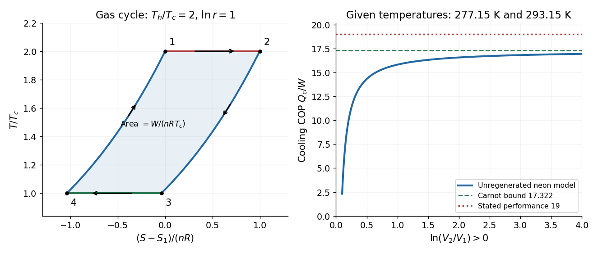

<h1 id="10/solution">Solution</h1>

↑ **Parent:** [10](../10.md)

The [Second law of thermodynamics](../../../second-law-of-thermodynamics-split.md) states that total [entropy](../../../entropy-split.md) of an isolated composite system cannot decrease. For a cyclic [heat engine](../../../heat-engine.md) exchanging heat only with reservoirs at $T_h>T_c>0$, it gives $-Q_h/T_h+Q_c/T_c\ge0$. Since $W=Q_h-Q_c$,

$$
\boxed{\eta=\frac W{Q_h}\le1-\frac{T_c}{T_h}=\eta_{\max}.}
$$

The bound is attained by a reversible [heat engine](../../../heat-engine.md): no friction, no finite-temperature-difference heat exchange and no other [entropy production](../../../entropy-production.md). A [Carnot cycle](../../../carnot-cycle.md) provides an implementation with two reversible isotherms and two reversible adiabats. All [temperatures](../../../temperature-split.md) in these ratios are absolute.

Let $n_{\rm mol}$ be the fixed gas amount, $r=V_2/V_1>1$, $\Delta T=T_h-T_c$, and let $C_V$ denote the heat capacity of the whole sample. First take the [unregenerated Stirling cycle](../../../unregenerated-stirling-cycle.md), so that heat rejected during isochoric cooling is not stored and returned during isochoric heating. The reversible quasistatic gas work is

$$
W_{12}=n_{\rm mol}RT_h\ln r,\quad W_{23}=0,\quad
W_{34}=-n_{\rm mol}RT_c\ln r,\quad W_{41}=0,
$$

while the heat inputs are $Q_{12}=n_{\rm mol}RT_h\ln r$ and $Q_{41}=C_V\Delta T$. Hence

$$
\boxed{W=n_{\rm mol}R\Delta T\ln r,\qquad
\eta=\frac{n_{\rm mol}R\Delta T\ln r}{n_{\rm mol}RT_h\ln r+C_V\Delta T}<1-\frac{T_c}{T_h}.}
$$

The strict inequality follows because $C_V\Delta T>0$ adds heat input without additional work. Quasistatic motion alone does not make heat exchange with a single hot or cold reservoir reversible while the gas temperature changes on an isochore. Indeed, using those two reservoirs gives total external [entropy production](../../../entropy-production.md) $C_V\Delta T(1/T_c-1/T_h)>0$ per cycle.

The strict comparison requires the no-regeneration assumption. A perfect reversible regenerator stores $C_V\Delta T$ during $2\to3$ and returns it during $4\to1$; only the isothermal heat transfers then enter the external heat budget, giving $\eta=1-T_c/T_h$ exactly. For example, perfect regeneration with $T_h=600\,\mathrm K$, $T_c=300\,\mathrm K$ and $r=2$ gives $\eta=1/2=\eta_{\max}$. Thus the four gas paths by themselves do not enforce an efficiency strictly below the Carnot bound.

For the gas itself, the four [entropy](../../../entropy-split.md) changes are

$$
\boxed{\Delta S_{12}=n_{\rm mol}R\ln r,\quad
\Delta S_{23}=C_V\ln\frac{T_c}{T_h},\quad
\Delta S_{34}=-n_{\rm mol}R\ln r,\quad
\Delta S_{41}=C_V\ln\frac{T_h}{T_c}.}
$$

Expansion increases the available positional states; compression reverses that change. Isochoric cooling reduces thermal populations and isochoric heating restores them. The sum is zero because [entropy](../../../entropy-split.md) is a [state function](../../../state-function.md). This does not imply zero total [entropy production](../../../entropy-production.md) in the gas plus external reservoirs.

Taking $S_1$ as reference, the isotherms are horizontal on a $T$–$S$ diagram. The isochore through state 1 obeys $S-S_1=C_V\ln(T/T_h)$, and the isochore through state 2 is shifted right by $n_{\rm mol}R\ln r$. For the internally reversible quasistatic gas paths, $\delta Q=T\,dS$, so

$$
\boxed{\oint T\,dS=Q_{\rm net}=W.}
$$

The enclosed area is the net work per engine cycle, with a clockwise orientation. It is not the total heat input.

**[Figure 5](#10/image-stirling-entropy-cycle-and-the-refrigerator-s-performance-bound). Stirling entropy cycle and the refrigerator's performance bound**. Original illustrative gas cycle with constant heat capacity, together with the predicted [coefficient of performance](../../../coefficient-of-performance.md) of an unregenerated neon refrigerator. The stated performance lies above the reversible bound; no volume ratio can repair that conflict.

For the refrigerator, the stated rates give the cooling [coefficient of performance](../../../coefficient-of-performance.md) $\mathcal C=\dot Q_c/P=1.9/0.1=19$. But the absolute reservoir temperatures are $T_c=277.15\,\mathrm K$ and $T_h=293.15\,\mathrm K$, so [Carnot's theorem](../../../carnot-s-theorem.md) requires

$$
\boxed{\mathcal C\le\frac{T_c}{T_h-T_c}=17.3219.}
$$

At $0.1\,\mathrm{kW}$ input the largest allowed cooling rate is only $1.7322\,\mathrm{kW}$. Equivalently the stated $2.0\,\mathrm{kW}$ heat rejection gives the reservoir entropy rate

$$
\frac{2.0\,\mathrm{kW}}{293.15\,\mathrm K}-\frac{1.9\,\mathrm{kW}}{277.15\,\mathrm K}
=-0.03305\,\mathrm{W\,K^{-1}}<0,
$$

a direct violation of the [Second law of thermodynamics](../../../second-law-of-thermodynamics-split.md) for this cyclic two-reservoir device.

The unregenerated neon model makes the algebraic obstruction explicit. With $C_V/(n_{\rm mol}R)=3/2$, reversing the cycle gives

$$
\mathcal C=\frac{n_{\rm mol}RT_c\ln r-C_V\Delta T}{n_{\rm mol}R\Delta T\ln r}
=\frac{T_c}{\Delta T}-\frac{3}{2\ln r}.
$$

Setting this to 19 produces $\ln r=-0.89385$, or $r=0.4091$, contradicting the required expansion ratio $r>1$. Perfect regeneration can raise performance only to the Carnot bound and does not fix the problem. **There is no physically admissible $V_2/V_1$ for the stated data.**

## ↑ Ancestors (11)

1. [10](../10.md)
2. [2016](../../2016-split.md)
3. [Past exam of the thermal physics course of the University of Oxford](../../split.md)
4. [Thermal physics course of the University of Oxford](../../../thermal-physics-course-of-the-university-of-oxford.md)
5. [Year 2 of the physics course of the University of Oxford](../../../year-2-of-the-physics-course-of-the-university-of-oxford.md)
6. [Physics course of the University of Oxford](../../../physics-course-of-the-university-of-oxford.md)
7. [Undergraduate course of the University of Oxford](../../../undergraduate-course-of-the-university-of-oxford.md)
8. [Course of the University of Oxford](../../../course-of-the-university-of-oxford.md)
9. [University of Oxford](../../../university-of-oxford-split.md)
10. [List of universities](../../../list-of-universities.md)
11. [Codex Wiki](../../../split.md)
