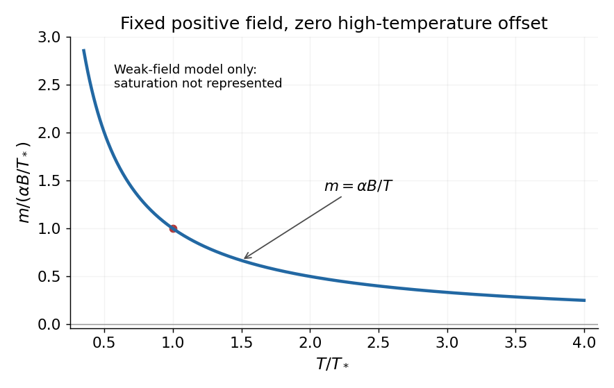

<h1 id="4/solution">Solution</h1>

↑ **Parent:** [4](../4.md)

A [magnetic field](../../../magnetic-field-split.md) favors alignment of the [magnetic moments](../../../magnetic-dipole-moment.md) of a [paramagnet](../../../paramagnetic-material.md), reducing the number of substantially occupied magnetic configurations at fixed [temperature](../../../temperature-split.md). Its [magnetic entropy](../../../magnetic-entropy.md) therefore decreases as the field magnitude increases, explaining the negative sign of $(\partial S/\partial B)_T=-\alpha B/T^2$.

Choose the magnetic [Helmholtz free energy](../../../helmholtz-free-energy.md) convention $dF=-S\,dT-m\,dB$. Equality of its [mixed partial derivatives](../../../mixed-partial-derivative.md) gives the magnetic [Maxwell relation](../../../maxwell-relations.md)

$$
\left(\frac{\partial m}{\partial T}\right)_B=\left(\frac{\partial S}{\partial B}\right)_T=-\frac{\alpha B}{T^2}.
$$

The [magnetic moment inferred from an entropy derivative](../../../magnetic-moment-inferred-from-an-entropy-derivative.md), integrated at fixed $B$, is

$$
\boxed{m(T,B)=\frac{\alpha B}{T}+m_0(B).}
$$

The given [entropy](../../../entropy-split.md) derivative alone cannot determine the temperature-independent function $m_0(B)$. With the usual independent-[paramagnet](../../../paramagnetic-material.md) condition $m\to0$ as $T\to\infty$ at fixed $B$, $m_0(B)=0$, giving [Curie's law](../../../curie-s-law.md), $m=\alpha B/T$. The sketch uses that additional condition. The inverse-$T$ expression applies in the weak-field regime; its divergence cannot describe the actual low-[temperature](../../../temperature-split.md) saturation of a finite set of [magnetic moments](../../../magnetic-dipole-moment.md).

**[Figure 1](#4/image-inverse-temperature-moment-at-fixed-magnetic-field). Inverse-temperature moment at fixed magnetic field**. Original [Curie's law](../../../curie-s-law.md) sketch under the condition of zero moment at infinite [temperature](../../../temperature-split.md). The low-temperature saturation regime is outside this approximation.

For reversible quasistatic thermal isolation, $dS=0$. With positive field-dependent [heat capacity](../../../heat-capacity.md) $C_B=T(\partial S/\partial T)_B$,

$$
0=\frac{C_B}{T}dT-\frac{\alpha B}{T^2}dB,\qquad
\boxed{dT=\frac{\alpha B}{C_BT}\,dB.}
$$

Reducing a positive $B$ therefore lowers $T$: this is [adiabatic demagnetization](../../../adiabatic-demagnetization.md). Equivalently, reducing $B^2$ cools for either field sign. Reduced alignment would raise [magnetic entropy](../../../magnetic-entropy.md) at fixed $T$; cooling compensates so total [entropy](../../../entropy-split.md) remains constant. Insulation without reversibility would allow additional [entropy production](../../../entropy-production.md) and need not follow this adiabat exactly.

## ↑ Ancestors (11)

1. [4](../4.md)
2. [2016](../../2016-split.md)
3. [Past exam of the thermal physics course of the University of Oxford](../../split.md)
4. [Thermal physics course of the University of Oxford](../../../thermal-physics-course-of-the-university-of-oxford.md)
5. [Year 2 of the physics course of the University of Oxford](../../../year-2-of-the-physics-course-of-the-university-of-oxford.md)
6. [Physics course of the University of Oxford](../../../physics-course-of-the-university-of-oxford.md)
7. [Undergraduate course of the University of Oxford](../../../undergraduate-course-of-the-university-of-oxford.md)
8. [Course of the University of Oxford](../../../course-of-the-university-of-oxford.md)
9. [University of Oxford](../../../university-of-oxford-split.md)
10. [List of universities](../../../list-of-universities.md)
11. [Codex Wiki](../../../split.md)
