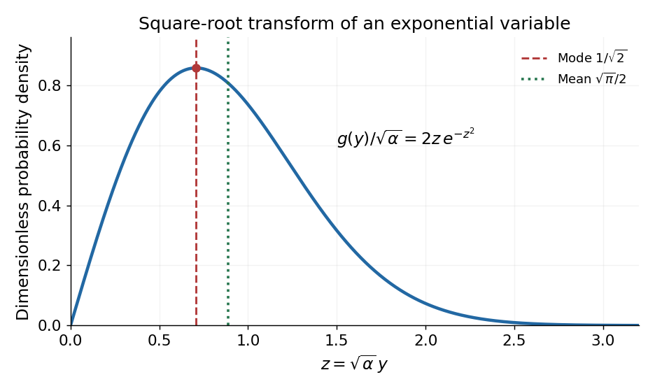

<h1 id="6/solution">Solution</h1>

↑ **Parent:** [6](../6.md)

Normalize the [probability density function](../../../probability-density-function.md) on $x\ge0$:

$$
1=N\int_0^\infty e^{-\alpha x}dx=\frac N\alpha,
\qquad
\boxed{N=\alpha,\qquad \langle x\rangle=\alpha\int_0^\infty xe^{-\alpha x}dx=\frac1\alpha.}
$$

For $y=\sqrt x\ge0$, the [change of variables](../../../change-of-variables-formula.md) is $x=y^2$, $dx=2y\,dy$. Conservation of [probability](../../../probability.md) gives the transformed [probability density function](../../../probability-density-function.md)

$$
\boxed{g(y)=2\alpha y e^{-\alpha y^2},\quad y\ge0,\qquad g(y)=0,\quad y<0.}
$$

It is a [Rayleigh distribution](../../../rayleigh-distribution.md) with scale $\sigma=1/\sqrt{2\alpha}$. Its derivative is $g'(y)=2\alpha e^{-\alpha y^2}(1-2\alpha y^2)$, so it rises from zero, has one maximum, and then decays:

$$
\boxed{y_{\rm mode}=\frac1{\sqrt{2\alpha}}.}
$$

The [expected value](../../../expected-value-split.md) follows by putting $z=\sqrt\alpha\,y$:

$$
\langle y\rangle=2\alpha\int_0^\infty y^2e^{-\alpha y^2}dy
=\frac2{\sqrt\alpha}\int_0^\infty z^2e^{-z^2}dz
=\boxed{\frac{\sqrt\pi}{2\sqrt\alpha}.}
$$

Here $\int_0^\infty z^2e^{-z^2}dz=\sqrt\pi/4$, obtained from the [Gaussian integral](../../../gaussian-integral.md) by integration by parts. In particular $\langle\sqrt x\rangle\ne\sqrt{\langle x\rangle}$, and the [mode](../../../mode-statistics.md) changes under a nonlinear variable transformation because a density includes its [Jacobian determinant](../../../jacobian-determinant.md).

**[Figure 2](#6/image-the-square-root-of-an-exponential-variable-has-a-positive-density-mode). The square root of an exponential variable has a positive density mode**. Original dimensionless [Rayleigh distribution](../../../rayleigh-distribution.md) with its [mode](../../../mode-statistics.md) and [expected value](../../../expected-value-split.md) marked. The density is measured per unit transformed variable, including the change-of-variable factor.

## ↑ Ancestors (11)

1. [6](../6.md)
2. [2016](../../2016-split.md)
3. [Past exam of the thermal physics course of the University of Oxford](../../split.md)
4. [Thermal physics course of the University of Oxford](../../../thermal-physics-course-of-the-university-of-oxford.md)
5. [Year 2 of the physics course of the University of Oxford](../../../year-2-of-the-physics-course-of-the-university-of-oxford.md)
6. [Physics course of the University of Oxford](../../../physics-course-of-the-university-of-oxford.md)
7. [Undergraduate course of the University of Oxford](../../../undergraduate-course-of-the-university-of-oxford.md)
8. [Course of the University of Oxford](../../../course-of-the-university-of-oxford.md)
9. [University of Oxford](../../../university-of-oxford-split.md)
10. [List of universities](../../../list-of-universities.md)
11. [Codex Wiki](../../../split.md)
