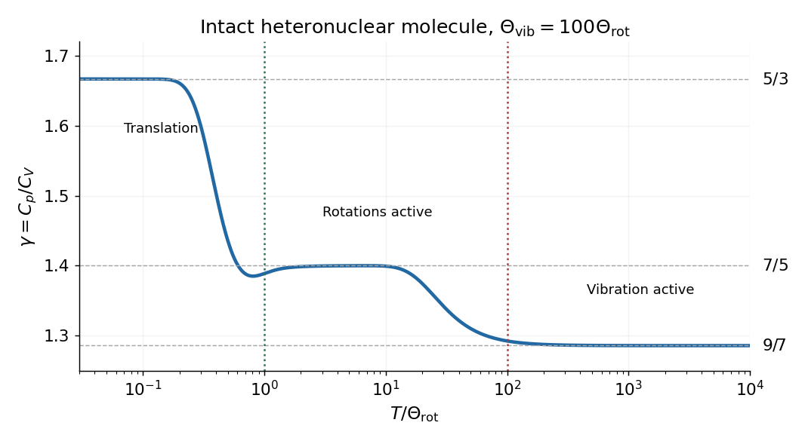

<h1 id="8/solution">Solution</h1>

↑ **Parent:** [8](../8.md)

For a reversible [adiabatic process](../../../adiabatic-process.md) of an [ideal gas](../../../ideal-gas-split.md), $\delta Q=0$ and $dU=-p\,dV$. At fixed composition and constant sample [heat capacity at constant volume](../../../heat-capacity-at-constant-volume.md) $C_V$,

$$
C_V\,dT=-\frac{n_{\rm mol}RT}{V}\,dV,
\qquad d\ln T=-\frac{n_{\rm mol}R}{C_V}d\ln V.
$$

[Mayer's relation](../../../mayer-s-relation.md) gives $n_{\rm mol}R=C_p-C_V$, so $TV^{\gamma-1}$ is constant and

$$
\boxed{pV^\gamma=\mathrm{constant},\qquad \gamma=\frac{C_p}{C_V}.}
$$

The finite-path power law requires approximately constant [heat capacities](../../../heat-capacity.md) as well as reversibility. When rotational or vibrational populations change appreciably, use $\int C_V(T)\,dT/T+n_{\rm mol}R\ln V=\mathrm{constant}$ instead; the local isentropic pressure exponent remains $\gamma(T)$.

For an intact heteronuclear [diatomic gas](../../../diatomic-gas.md), quantum excitation progressively activates molecular motion. With rotational and vibrational modes frozen, the three translational degrees of freedom give $C_{V,\rm m}=3R/2$ and $\gamma=5/3$. Two active rotations add $R$, giving $C_{V,\rm m}=5R/2$ and $\gamma=7/5$. One active harmonic vibration contributes a further $R$, through kinetic and potential terms, giving $C_{V,\rm m}=7R/2$ and $\gamma=9/7$.

For molecular [moment of inertia](../../../moment-of-inertia.md) $I=\mu_{\rm red}r_e^2$, the [rigid rotor](../../../rigid-rotor.md) levels are $E_J=\hbar^2J(J+1)/(2I)$, so the rotational excitation scale is

$$
\boxed{\Theta_{\rm rot}=\frac{\hbar^2}{2Ik_B}.}
$$

The first gap corresponds to $2\Theta_{\rm rot}$, so the crossover occurs at temperatures of that order. For bond force constant $k_s$ and reduced molecular [mass](../../../mass.md) $\mu_{\rm red}$, the vibrational scale is

$$
\boxed{\Theta_{\rm vib}=\frac{\hbar\omega_{\rm vib}}{k_B}=\frac\hbar{k_B}\sqrt{\frac{k_s}{\mu_{\rm red}}}.}
$$

Typically $\Theta_{\rm vib}\gg\Theta_{\rm rot}$. Real gases may condense at the low-temperature end or dissociate and excite electronic states at the high-temperature end; the three plateau values describe the ideal intact-molecule model.

**[Figure 3](#8/image-translational-rotational-and-vibrational-regimes-of-the-heat-capacity-ratio). Translational, rotational and vibrational regimes of the heat capacity ratio**. Original rigid-rotor and harmonic-oscillator calculation with an illustrative ratio of vibrational to rotational temperatures of 100. The three limiting [heat capacity ratios](../../../heat-capacity-ratio.md) are marked; detailed crossover shapes are not universal.

For the piston apparatus, mechanical equilibrium requires $p_0A=p_{\rm air}A+mg$, hence $p_0=p_{\rm air}+mg/A$. Let $x$ be a small upward displacement, so $V=V_0+Ax$. The local [isentropic compressibility](../../../isentropic-compressibility.md) gives

$$
p-p_0\simeq-\frac{\gamma p_0A}{V_0}x,
\qquad m\ddot x=A(p-p_0)=-\frac{\gamma p_0A^2}{V_0}x.
$$

Consequently the [adiabatic gas-spring piston period](../../../adiabatic-gas-spring-piston-period.md) is

$$
\boxed{\tau=2\pi\sqrt{\frac{B}{\gamma}},\qquad B=\frac{mV_0}{p_0A^2}.}
$$

This neglects friction, gas inertia, leakage and dissipation, with internal equilibration much faster than the oscillation and external thermal equilibration much slower. The small oscillation probes $\gamma$ locally; it need not keep $\gamma$ constant over a large temperature interval.

With $p_{\rm air}=101325\,\mathrm{Pa}$, the supplied dimensions give $p_0=101351.4\,\mathrm{Pa}$ and $B=2.20566\times10^{-5}\,\mathrm{s^2}$. Thus

$$
\boxed{\gamma_{\rm NO}=\frac{4\pi^2B}{(0.0251\,\mathrm s)^2}=1.382,\qquad
\gamma_{\rm He}=\frac{4\pi^2B}{(0.0229\,\mathrm s)^2}=1.660.}
$$

Helium is close to the monatomic [ideal gas](../../../ideal-gas-split.md) value $5/3$; NO is close to the [diatomic gas](../../../diatomic-gas.md) value $7/5$, with rotations active and vibration largely frozen. The numbers are approximate experimental inferences, rather than exact rational values.

## ↑ Ancestors (11)

1. [8](../8.md)
2. [2016](../../2016-split.md)
3. [Past exam of the thermal physics course of the University of Oxford](../../split.md)
4. [Thermal physics course of the University of Oxford](../../../thermal-physics-course-of-the-university-of-oxford.md)
5. [Year 2 of the physics course of the University of Oxford](../../../year-2-of-the-physics-course-of-the-university-of-oxford.md)
6. [Physics course of the University of Oxford](../../../physics-course-of-the-university-of-oxford.md)
7. [Undergraduate course of the University of Oxford](../../../undergraduate-course-of-the-university-of-oxford.md)
8. [Course of the University of Oxford](../../../course-of-the-university-of-oxford.md)
9. [University of Oxford](../../../university-of-oxford-split.md)
10. [List of universities](../../../list-of-universities.md)
11. [Codex Wiki](../../../split.md)
