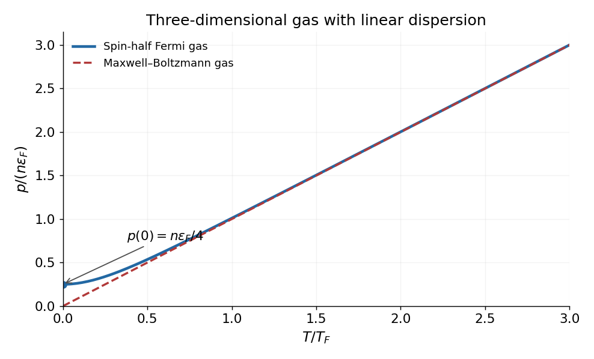

<h1 id="9/solution">Solution</h1>

↑ **Parent:** [9](../9.md)

For a single-particle state of energy $\epsilon$, put $z=e^{\mu/(k_BT)}$. The equilibrium mean occupancies are

$$
\boxed{\bar n_{\rm MB}=ze^{-\epsilon/(k_BT)},\qquad
\bar n_{\rm FD}=\frac1{z^{-1}e^{\epsilon/(k_BT)}+1},\qquad
\bar n_{\rm BE}=\frac1{z^{-1}e^{\epsilon/(k_BT)}-1}.}
$$

The [Maxwell-Boltzmann distribution](../../../maxwell-boltzmann-distribution.md) is the dilute classical limit. The [Fermi-Dirac distribution](../../../fermi-dirac-distribution.md) applies to identical [fermions](../../../fermion.md) with at most one particle in each complete single-particle state by the [Pauli exclusion principle](../../../pauli-exclusion-principle.md). The [Bose-Einstein distribution](../../../bose-einstein-distribution.md) applies to identical [bosons](../../../boson.md) with no such upper occupation bound. The [chemical potential](../../../chemical-potential-split.md) fixes total particle number; these are mean state occupancies, not three separately normalized single-particle probability densities. For a number-conserving ideal [Bose gas](../../../bose-gas.md), $\mu$ cannot exceed the lowest single-particle energy.

Take $\mathbf k$ to be a [wavevector](../../../wavevector.md) and count periodic-box states with cell volume $(2\pi)^3/V$ in [momentum space](../../../momentum-space.md), parameterized by $\mathbf k=\mathbf p/\hbar$. Write $g_s$ for internal degeneracy. The number of states in a spherical shell is $g_sV\,4\pi k^2dk/(2\pi)^3$. Since $\epsilon=\alpha k$,

$$
\boxed{g(\epsilon)=\frac{g_sV}{2\pi^2\alpha^3}\epsilon^2,\qquad \epsilon\ge0.}
$$

Thus the one-particle [canonical partition function](../../../canonical-partition-function.md) is

$$
Z_1=\int_0^\infty g(\epsilon)e^{-\beta\epsilon}d\epsilon
=\frac{g_sV}{2\pi^2\alpha^3}\frac2{\beta^3}
=\boxed{aVT^b,\qquad a=\frac{g_sk_B^3}{\pi^2\alpha^3},\quad b=3.}
$$

Here $\beta=1/(k_BT)$, $g_s=1$ for one nondegenerate branch, and $g_s=2$ for the spin-half case below. The integral uses $\int_0^\infty u^2e^{-u}du=2$. For classical indistinguishable particles, $Z_N=Z_1^N/N!$, giving

$$
\boxed{U=-\partial_\beta\ln Z_N=3Nk_BT,\qquad p=k_BT\left(\frac{\partial\ln Z_N}{\partial V}\right)_{T,N}=\frac{Nk_BT}{V}.}
$$

The factor three in the energy arises from the linear [dispersion relation](../../../dispersion-relation-split.md) and three-dimensional state counting; the usual nonrelativistic quadratic-dispersion value $3Nk_BT/2$ does not apply.

For spin-half [fermions](../../../fermion.md) at $T=0$, all states up to the [Fermi energy](../../../fermi-energy.md) are occupied. With $g_s=2$,

$$
N=\frac{V\epsilon_F^3}{3\pi^2\alpha^3},\qquad
\epsilon_F=\alpha(3\pi^2n)^{1/3},\qquad n=\frac NV.
$$

Integrating the occupied energy states gives

$$
\boxed{U_0=\frac34N\epsilon_F=\frac34\alpha(3\pi^2)^{1/3}N^{4/3}V^{-1/3},\qquad
p_0=-\left(\frac{\partial U_0}{\partial V}\right)_N=\frac14n\epsilon_F=\frac{U_0}{3V}.}
$$

These are the corresponding [ultrarelativistic ideal Fermi gas](../../../ultrarelativistic-ideal-fermi-gas.md) formulae with general slope $\alpha$. The nonzero ground-state [internal energy](../../../internal-energy-split.md) and [degeneracy pressure](../../../degeneracy-pressure.md) reflect the [Pauli exclusion principle](../../../pauli-exclusion-principle.md): particles cannot all occupy the lowest-momentum state. Formally extrapolating the classical equations gives $U,p\to0$, but [Maxwell–Boltzmann statistics](../../../maxwell-boltzmann-statistics.md) is not valid at fixed positive $n$ as $T\to0$.

At large $T$, the number equation gives $z\simeq N/Z_1\ll1$, so expanding the [Fermi-Dirac distribution](../../../fermi-dirac-distribution.md) recovers the [Maxwell-Boltzmann distribution](../../../maxwell-boltzmann-distribution.md). A convenient crossover scale is the [Fermi temperature](../../../fermi-temperature.md),

$$
\boxed{T_0\sim T_F=\frac\alpha{k_B}(3\pi^2n)^{1/3}.}
$$

For $T\gg T_F$, both gases have $p\simeq nk_BT$. At fixed $n$, the Fermi curve begins at $p_0=n\epsilon_F/4$, has zero initial slope, lies above the classical line, and approaches it at high temperature. For example its low-temperature expansion is $p/(n\epsilon_F)=1/4+(\pi^2/6)(T/T_F)^2+\cdots$. The plot evaluates the finite-temperature occupation integrals at fixed number density.

**[Figure 4](#9/image-pressure-of-classical-and-spin-half-fermi-gases-with-linear-dispersion). Pressure of classical and spin-half Fermi gases with linear dispersion**. Original fixed-density calculation. The Fermi curve is obtained by solving the number equation for the chemical potential at each temperature; its positive zero-temperature pressure and the shared classical limit are marked.

If the source's symbol $\mathbf k$ is interpreted literally as [momentum](../../../momentum-split.md) rather than a [wavevector](../../../wavevector.md), the state-space cell is $h^3/V$. In that convention replace $\alpha$ in the wavevector-based coefficients and energy scales above by $\hbar\alpha$. The dimensionless thermodynamics and the relation $p=U/(3V)$ are unchanged.

## ↑ Ancestors (11)

1. [9](../9.md)
2. [2016](../../2016-split.md)
3. [Past exam of the thermal physics course of the University of Oxford](../../split.md)
4. [Thermal physics course of the University of Oxford](../../../thermal-physics-course-of-the-university-of-oxford.md)
5. [Year 2 of the physics course of the University of Oxford](../../../year-2-of-the-physics-course-of-the-university-of-oxford.md)
6. [Physics course of the University of Oxford](../../../physics-course-of-the-university-of-oxford.md)
7. [Undergraduate course of the University of Oxford](../../../undergraduate-course-of-the-university-of-oxford.md)
8. [Course of the University of Oxford](../../../course-of-the-university-of-oxford.md)
9. [University of Oxford](../../../university-of-oxford-split.md)
10. [List of universities](../../../list-of-universities.md)
11. [Codex Wiki](../../../split.md)
