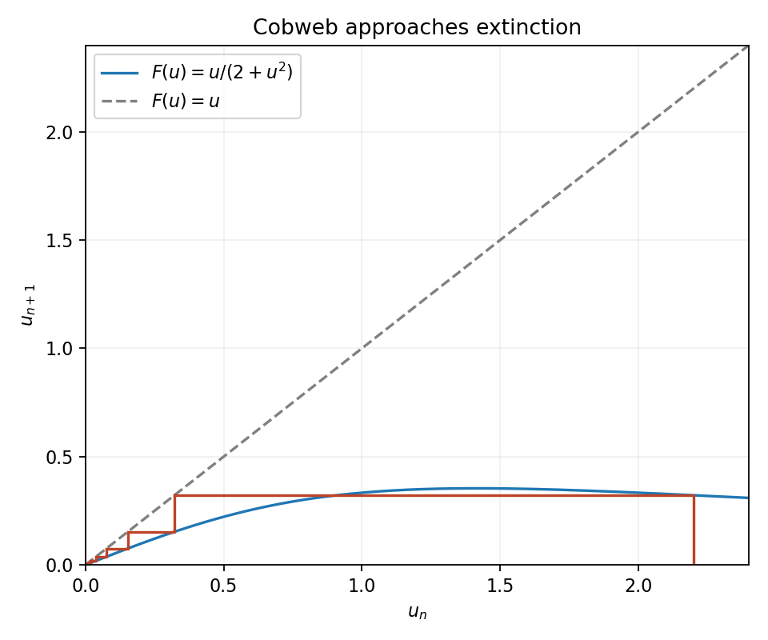
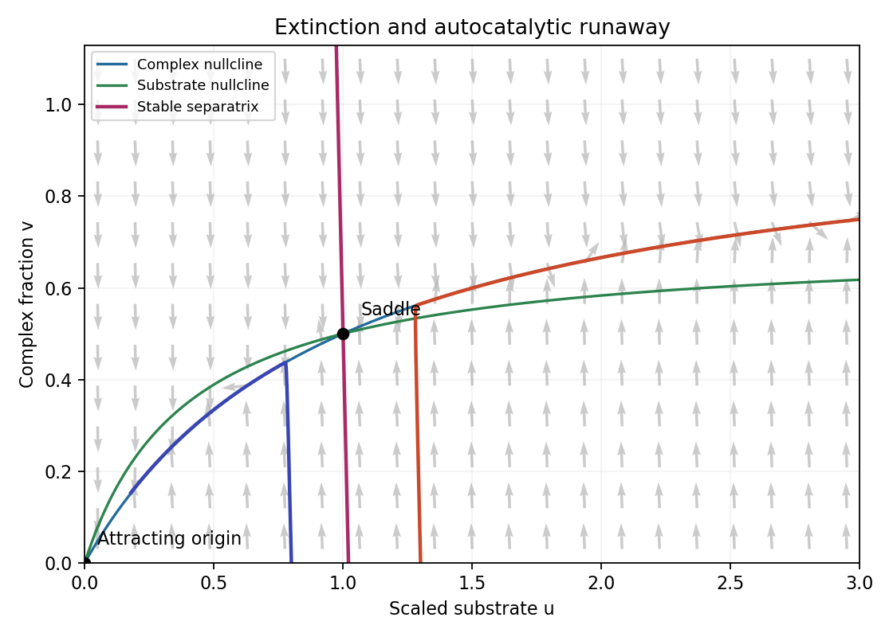
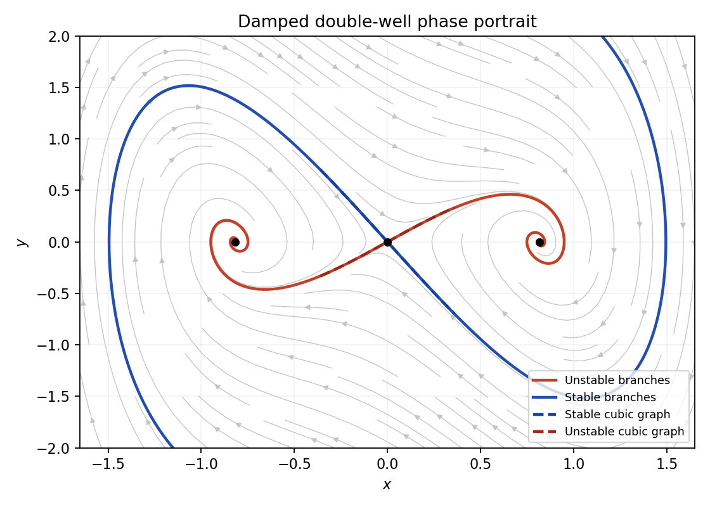
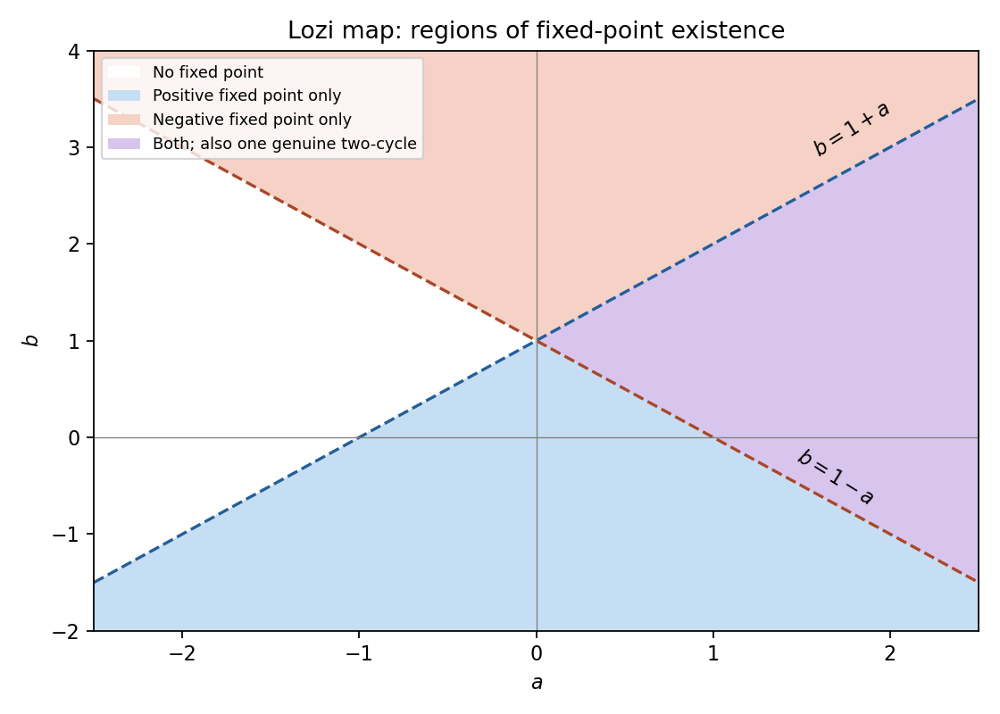
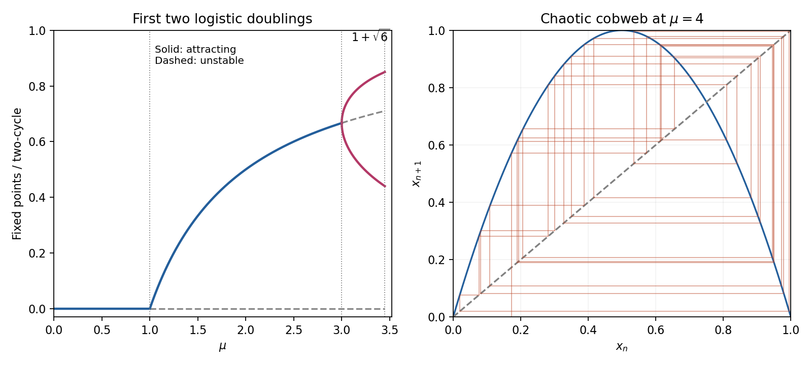

# 2007

↑ **Parent:** [Past exam of the topics in applied mathematics course of the University of Oxford](../past-exam-of-the-topics-in-applied-mathematics-course-of-the-university-of-oxford.md)

Original solutions to the paper released at [the source request](https://www.whatdotheyknow.com/request/maths_past_papers_3). The complete editable transcription is retained in the private examination archive.

**Table of contents**

- [A](#a)
  - [1](#a/1)
    - [i](#a/1/i)
      - [Solution](#a/1/i/solution)
    - [ii](#a/1/ii)
      - [Solution](#a/1/ii/solution)
    - [iii](#a/1/iii)
      - [Solution](#a/1/iii/solution)
    - [iv](#a/1/iv)
      - [Solution](#a/1/iv/solution)
    - [v](#a/1/v)
      - [Solution](#a/1/v/solution)
  - [2](#a/2)
    - [i](#a/2/i)
      - [Solution](#a/2/i/solution)
    - [ii](#a/2/ii)
      - [Solution](#a/2/ii/solution)
    - [iii](#a/2/iii)
      - [Solution](#a/2/iii/solution)
    - [iv](#a/2/iv)
      - [a](#a/2/iv/a)
        - [Solution](#a/2/iv/a/solution)
      - [b](#a/2/iv/b)
        - [Solution](#a/2/iv/b/solution)
  - [3](#a/3)
    - [i](#a/3/i)
      - [a](#a/3/i/a)
        - [Solution](#a/3/i/a/solution)
      - [b](#a/3/i/b)
        - [Solution](#a/3/i/b/solution)
      - [c](#a/3/i/c)
        - [Solution](#a/3/i/c/solution)
    - [ii](#a/3/ii)
      - [a](#a/3/ii/a)
        - [Solution](#a/3/ii/a/solution)
      - [b](#a/3/ii/b)
        - [Solution](#a/3/ii/b/solution)
      - [c](#a/3/ii/c)
        - [Solution](#a/3/ii/c/solution)
  - [4](#a/4)
    - [i](#a/4/i)
      - [Solution](#a/4/i/solution)
    - [ii](#a/4/ii)
      - [Solution](#a/4/ii/solution)
    - [iii](#a/4/iii)
      - [Solution](#a/4/iii/solution)
    - [iv](#a/4/iv)
      - [Solution](#a/4/iv/solution)
    - [v](#a/4/v)
      - [Solution](#a/4/v/solution)
    - [vi](#a/4/vi)
      - [Solution](#a/4/vi/solution)
- [B](#b)
  - [5](#b/5)
    - [a](#b/5/a)
      - [Solution](#b/5/a/solution)
    - [b](#b/5/b)
      - [Solution](#b/5/b/solution)
    - [c](#b/5/c)
      - [Solution](#b/5/c/solution)
    - [Solution](#b/5/solution)
  - [6](#b/6)
    - [Solution](#b/6/solution)
  - [7](#b/7)
    - [i](#b/7/i)
      - [Solution](#b/7/i/solution)
    - [ii](#b/7/ii)
      - [Solution](#b/7/ii/solution)
    - [iii](#b/7/iii)
      - [Solution](#b/7/iii/solution)
    - [Solution](#b/7/solution)
  - [8](#b/8)
    - [Solution](#b/8/solution)

## A

↑ **Parent:** [2007](2007.md)

<h3 id="a/1">1</h3>

↑ **Parent:** [A](#a)

<h4 id="a/1/i">i</h4>

↑ **Parent:** [1](#a/1)

<h5 id="a/1/i/solution">Solution</h5>

↑ **Parent:** [I](#a/1/i)

The [iteration of a map](../discrete-dynamical-system.md#iterated-function) is $F(u)=u/(2+u^2)$. For every $u>0$, $0<F(u)<u/2$, so $0<u_n\leq2^{-n}u_0$ and $\boxed{u_n\to0}$. A cobweb alternates vertical steps to the graph and horizontal steps to the diagonal, approaching the origin monotonically.

**[Figure 1](#a/1/i/image-resource-limited-population-cobweb-every-positive-orbit-approaches-extinction). Resource-limited population cobweb: every positive orbit approaches extinction**.

More precisely $u_{n+1}/u_n\to1/2$. The product $2^nu_n=u_0\prod_{j<n}(1+u_j^2/2)^{-1}$ has a finite strictly positive limit because $\sum_ju_j^2<\infty$. Thus $\boxed{u_n\sim C(u_0)2^{-n}}$ for a positive constant depending on the initial [biological population](../ecology.md#population-biology).

<h4 id="a/1/ii">ii</h4>

↑ **Parent:** [1](#a/1)

<h5 id="a/1/ii/solution">Solution</h5>

↑ **Parent:** [Ii](#a/1/ii)

A positive [fixed point](../function.md#fixed-point) requires $\beta+u_*^\gamma=\alpha$, so it exists exactly when $\boxed{\alpha>\beta}$ and is $u_*=(\alpha-\beta)^{1/\gamma}$. Differentiating the map at it gives

$$
\boxed{F'(u_*)=1-\gamma\left(1-\frac\beta\alpha\right).}
$$

For $1<\gamma\leq2$ and $0<\beta/\alpha<1$, this [fixed-point multiplier](../discrete-dynamical-system.md#multiplier-of-a-periodic-orbit-of-an-iteration) is strictly between $-1$ and $1$. Hence the positive [fixed point](../function.md#fixed-point) is linearly asymptotically stable, including $\gamma=2$; positivity of $\beta$ makes the lower bound strict.

<h4 id="a/1/iii">iii</h4>

↑ **Parent:** [1](#a/1)

<h5 id="a/1/iii/solution">Solution</h5>

↑ **Parent:** [Iii](#a/1/iii)

The [fixed-point multiplier](../discrete-dynamical-system.md#multiplier-of-a-periodic-orbit-of-an-iteration) decreases continuously with $\gamma$ and first reaches the [unit circle](../complex-analysis.md#complex-unit-circle) at $-1$. Solving $1-\gamma_*(1-\beta/\alpha)=-1$ gives

$$
\boxed{\gamma_*=\frac{2\alpha}{\alpha-\beta}>2.}
$$

It is stable for $1<\gamma<\gamma_*$ and unstable for $\gamma>\gamma_*$. At the critical value [linear stability](../dynamical-systems.md#linear-stability) is inconclusive. The crossing at $-1$ is the local signature of a [period-doubling bifurcation](../discrete-dynamical-system.md#period-doubling-bifurcation), rather than a crossing through $+1$.

<h4 id="a/1/iv">iv</h4>

↑ **Parent:** [1](#a/1)

<h5 id="a/1/iv/solution">Solution</h5>

↑ **Parent:** [Iv](#a/1/iv)

At low density the per-generation growth factor is approximately $\alpha/\beta$. The power $\gamma$ controls how sharply crowding reduces recruitment or survival when resources become limiting; at high density $F(u)\sim\alpha u^{1-\gamma}$. Larger $\gamma$ therefore means a stronger [overcompensation in a population model](../mathematical-biology.md#overcompensation-in-a-population-model).

The flip threshold says that sufficiently strong density feedback can destabilize a constant positive [biological population](../ecology.md#population-biology) and create alternating generations, under the usual nondegeneracy conditions. **A local loss of fixed-point stability alone does not establish [chaos](../dynamical-systems.md#chaos)**, nor does it prove every ecological system with stronger crowding must follow the same route.

<h4 id="a/1/v">v</h4>

↑ **Parent:** [1](#a/1)

<h5 id="a/1/v/solution">Solution</h5>

↑ **Parent:** [V](#a/1/v)

A [fixed point](../function.md#fixed-point) of $F$ is also a [fixed point](../function.md#fixed-point) of $F\circ F$. By the [chain rule](../calculus.md#chain-rule),

$$
\boxed{(F\circ F)'(u_*)=F'(F(u_*))F'(u_*)=[F'(u_*)]^2.}
$$

If the original [fixed-point multiplier](../discrete-dynamical-system.md#multiplier-of-a-periodic-orbit-of-an-iteration) has modulus greater than one, its square also exceeds one, so the same [fixed point](../function.md#fixed-point) is unstable for the twice-iterated map. New stable [fixed points](../function.md#fixed-point) of the twice-iterated map, if present, must be different points; they can represent a genuine [two-cycle](../dynamical-systems.md#period-two-orbit) of the original map.

<h3 id="a/2">2</h3>

↑ **Parent:** [A](#a)

<h4 id="a/2/i">i</h4>

↑ **Parent:** [2](#a/2)

<h5 id="a/2/i/solution">Solution</h5>

↑ **Parent:** [I](#a/2/i)

[Law of mass action](../mathematical-biology.md#law-of-mass-action) assigns net [substrate](../enzyme.md#substrate-biochemistry) gain $k_0s$ to autocatalytic replication, [substrate](../enzyme.md#substrate-biochemistry)-[enzyme](../enzyme.md) binding flux $k_1se$, dissociation flux $k_{-1}c$ and product-formation flux $k_2c$. Therefore

$$
\boxed{\dot s=k_0s-k_1se+k_{-1}c,\quad
\dot c=k_1se-(k_{-1}+k_2)c,\quad
\dot e=-k_1se+(k_{-1}+k_2)c.}
$$

Complex breakdown to product restores free [enzyme](../enzyme.md) but does not restore [substrate](../enzyme.md#substrate-biochemistry). Product [concentration](../mathematical-physics.md#concentration), if required, satisfies $\dot p=k_2c$.

<h4 id="a/2/ii">ii</h4>

↑ **Parent:** [2](#a/2)

<h5 id="a/2/ii/solution">Solution</h5>

↑ **Parent:** [Ii](#a/2/ii)

Adding the last two equations gives $d(e+c)/dt=0$. The initial conditions therefore imply $\boxed{e+c=e_0}$, or $e=e_0-c$. Substitute this in the first two balances:

$$
\boxed{\dot s=(k_0-k_1e_0)s+(k_{-1}+k_1s)c,\qquad
\dot c=k_1e_0s-(k_1s+k_{-1}+k_2)c.}
$$

The [enzyme](../enzyme.md) inventory is conserved even while [substrate](../enzyme.md#substrate-biochemistry) can grow autocatalytically.

<h4 id="a/2/iii">iii</h4>

↑ **Parent:** [2](#a/2)

<h5 id="a/2/iii/solution">Solution</h5>

↑ **Parent:** [Iii](#a/2/iii)

Use $s=s_0u$, $c=e_0v$ and slow time $\boxed{\tau=k_1e_0t}$. Dividing the equations by their respective [concentration](../mathematical-physics.md#concentration) and [time scales](../mathematical-physics.md#time-scale) gives

$$
\boxed{\epsilon=\frac{e_0}{s_0},\quad
K=\frac{k_{-1}+k_2}{k_1s_0},\quad\lambda=\frac{k_2}{k_1s_0},\quad
\eta=\frac{k_0}{k_1e_0}.}
$$

Thus $u'=\eta u-u+uv+(K-\lambda)v$ and $\epsilon v'=u-uv-Kv$. Notice that $K>\lambda>0$ and the physical [enzyme](../enzyme.md) fraction satisfies $0\leq v\leq1$. The initial values are $u(0)=1$, $v(0)=0$ for this particular normalization; the threshold analysis compares different initial [substrate](../enzyme.md#substrate-biochemistry) abundances using a fixed reference scale.

<h4 id="a/2/iv">iv</h4>

↑ **Parent:** [2](#a/2)

<h5 id="a/2/iv/a">a</h5>

↑ **Parent:** [Iv](#a/2/iv)

<h6 id="a/2/iv/a/solution">Solution</h6>

↑ **Parent:** [A](#a/2/iv/a)

At equilibrium $v=u/(u+K)$ and adding $u'+\epsilon v'$ gives $0=\eta u-\lambda v$. The positive equilibrium is

$$
\boxed{u_e=\frac\lambda\eta-K,\quad v_e=1-\frac{\eta K}\lambda,\quad
0<\eta<\frac\lambda K,\qquad
0<k_0<\frac{k_1e_0k_2}{k_{-1}+k_2}.}
$$

This condition also gives $\eta<1$. The [nullclines](../dynamical-systems.md#nullcline) are $v=u/(u+K)$ and $v=(1-\eta)u/(u+K-\lambda)$. The second lies above the first for $0<u<u_e$ and below it for $u>u_e$. Below the first [nullcline](../dynamical-systems.md#nullcline) $v'>0$; above it $v'<0$. Below the second [nullcline](../dynamical-systems.md#nullcline) $u'<0$; above it $u'>0$.

At the origin the Jacobian has [trace](../linear-algebra.md#matrix-trace) $\eta-1-K/\epsilon<0$ and [determinant](../multilinear-algebra.md#determinant) $(\lambda-\eta K)/\epsilon>0$. Its off-diagonal entries are positive, making the [eigenvalues](../linear-operator-theory.md#eigenvalue) real, so this is an attracting node. At the positive equilibrium the slow reduced [derivative](../calculus.md#derivative) is $\eta-\lambda K/(u_e+K)^2=\eta v_e>0$, while the fast [derivative](../calculus.md#derivative) is $-(u_e+K)/\epsilon<0$; equivalently the full Jacobian [determinant](../multilinear-algebra.md#determinant) is negative. Thus the positive point is a [saddle equilibrium](../dynamical-systems.md#saddle-equilibrium). Its [stable manifold](../dynamical-systems.md#stable-manifold) separates extinction from unbounded [substrate](../enzyme.md#substrate-biochemistry) growth.

**[Figure 2](#a/2/iv/a/image-autocatalytic-enzyme-phase-plane-a-fast-complex-fraction-and-a-saddle-threshold-separate-extinction-from-substrate-runaway). Autocatalytic enzyme phase plane: a fast complex fraction and a saddle threshold separate extinction from substrate runaway**.

<h5 id="a/2/iv/b">b</h5>

↑ **Parent:** [Iv](#a/2/iv)

<h6 id="a/2/iv/b/solution">Solution</h6>

↑ **Parent:** [B](#a/2/iv/b)

After an [initial layer](../singular-perturbation.md#initial-layer) of duration $O(\epsilon)$ in slow time, $v\simeq u/(u+K)$ while $u$ changes only slightly. The reduced [substrate](../enzyme.md#substrate-biochemistry) equation is

$$
\boxed{u'\simeq\eta u-\frac{\lambda u}{u+K}
=\frac{\eta u(u-u_e)}{u+K}.}
$$

Below $u_e$ it decreases to zero; above $u_e$ it increases without bound. The exact threshold for initial $v=0$ is the intersection of the [saddle equilibrium](../dynamical-systems.md#saddle-equilibrium)'s [stable manifold](../dynamical-systems.md#stable-manifold) with that axis. For small $\epsilon$ it is

$$
\boxed{u_*\simeq u_e=\frac{k_2e_0}{k_0s_0}-\frac{k_{-1}+k_2}{k_1s_0}.}
$$

In dimensional initial-[substrate](../enzyme.md#substrate-biochemistry) units the leading threshold is $s_0u_*\simeq k_2e_0/k_0-(k_{-1}+k_2)/k_1$. Comparing the actual initial value $u(0)=1$ to this threshold determines its fate; the reference scale can be held fixed when varying the initial [concentration](../mathematical-physics.md#concentration).

The initial sequestration produces an $O(\epsilon)$ correction if desired. Write the [stable manifold](../dynamical-systems.md#stable-manifold) as $u=u_e+\epsilon\phi(v)+O(\epsilon^2)$. The invariance equation at leading order gives $\phi'(v)=F(u_e,v)/G(u_e,v)=-(1-\eta)$ and $\phi(v_e)=0$. Hence

$$
\boxed{u_*=u_e+\epsilon(1-\eta)v_e+O(\epsilon^2),}
$$

for fixed [parameters](../mathematics.md#parameter) away from degenerate limits. The positive correction reflects the [substrate](../enzyme.md#substrate-biochemistry) consumed in building complexes from the initially [enzyme](../enzyme.md)-free-complex state.

The physical strip $u\geq0$, $0\leq v\leq1$ is invariant, and the off-diagonal [derivatives](../calculus.md#derivative) are nonnegative there, so ordered initial [substrate](../enzyme.md#substrate-biochemistry) values remain ordered. There are only the attracting origin and the [saddle equilibrium](../dynamical-systems.md#saddle-equilibrium). With [Dulac function](../dynamical-systems.md#dulac-function) $1/u$, the divergence of the weighted vector field is $-(K-\lambda)v/u^2-(1+K/u)/\epsilon<0$, excluding [periodic orbits](../dynamical-systems.md#periodic-orbit) in its interior. The [saddle equilibrium](../dynamical-systems.md#saddle-equilibrium) [separatrix](../dynamical-systems.md#separatrix) therefore gives the unique threshold on the initial axis: below it solutions tend to extinction, at it they tend to the [saddle equilibrium](../dynamical-systems.md#saddle-equilibrium), and above it they escape to infinity. Growth is at most exponential, so this is $u\to\infty$ as time tends to infinity, not a [finite-time blowup](../differential-equation.md#finite-time-blowup). This is [autocatalytic enzyme clearance with a saddle threshold](../mathematical-biology.md#autocatalytic-enzyme-clearance-with-a-saddle-threshold).

<h3 id="a/3">3</h3>

↑ **Parent:** [A](#a)

<h4 id="a/3/i">i</h4>

↑ **Parent:** [3](#a/3)

<h5 id="a/3/i/a">a</h5>

↑ **Parent:** [I](#a/3/i)

<h6 id="a/3/i/a/solution">Solution</h6>

↑ **Parent:** [A](#a/3/i/a)

The travelling coordinate has $A_t=-ca'$, $A_{xx}=a''$. Therefore the profile equation is

$$
\boxed{a''+ca'+f(a)=0,\qquad f(a)=\frac{a(\eta^2-a^2)}{1+a^2},\quad
 a(-\infty)=\eta,\ a(+\infty)=0.}
$$

The wave moves right with speed $c$. It joins a populated equilibrium behind to an empty equilibrium ahead.

<h5 id="a/3/i/b">b</h5>

↑ **Parent:** [I](#a/3/i)

<h6 id="a/3/i/b/solution">Solution</h6>

↑ **Parent:** [B](#a/3/i/b)

The phase-plane equations are $a'=b$, $b'=-cb-f(a)$. Nonnegative equilibria require $b=0$ and $f(a)=0$, hence only $\boxed{(0,0),\ (\eta,0)}$. At the origin $f'(0)=\eta^2$, so the linear [eigenvalues](../linear-operator-theory.md#eigenvalue) solve

$$
\lambda^2+c\lambda+\eta^2=0,\qquad
\boxed{\lambda_\pm=(-c\pm\sqrt{c^2-4\eta^2})/2.}
$$

For $0<c<2\eta$ the roots are complex with negative real part, giving a [stable focus](../dynamical-systems.md#stable-spiral). For $c>2\eta$ both are negative real numbers, giving a [stable node](../dynamical-systems.md#stable-node). Equality is the repeated-root threshold and is not covered by either strict classification.

<h5 id="a/3/i/c">c</h5>

↑ **Parent:** [I](#a/3/i)

<h6 id="a/3/i/c/solution">Solution</h6>

↑ **Parent:** [C](#a/3/i/c)

A nonconstant trajectory approaching a [stable focus](../dynamical-systems.md#stable-spiral) winds around it infinitely often. Its $a$ coordinate therefore changes sign repeatedly near zero. Since the [biological population](../ecology.md#population-biology) profile must remain nonnegative, such a trajectory cannot represent the wave. The only nonnegative trajectory avoiding that winding at the origin would be the equilibrium itself, which cannot join the populated state. Thus $\boxed{\text{no nonnegative front for }0<c<2\eta}$.

<h4 id="a/3/ii">ii</h4>

↑ **Parent:** [3](#a/3)

<h5 id="a/3/ii/a">a</h5>

↑ **Parent:** [Ii](#a/3/ii)

<h6 id="a/3/ii/a/solution">Solution</h6>

↑ **Parent:** [A](#a/3/ii/a)

For $0<a<\eta$, $f(a)=a(\eta^2-a^2)/(1+a^2)>0$. On the horizontal edge $b=0$,

$$
\boxed{b'=-f(a)<0.}
$$

The vector field points downward into the proposed [trapping region](../dynamical-systems.md#trapping-region).

<h5 id="a/3/ii/b">b</h5>

↑ **Parent:** [Ii](#a/3/ii)

<h6 id="a/3/ii/b/solution">Solution</h6>

↑ **Parent:** [B](#a/3/ii/b)

On $b=-\eta a$ with $a>0$,

$$
\frac{db}{da}=\frac{-cb-f(a)}b=-c+\frac{f(a)}{\eta a}
=-c+\frac{\eta^2-a^2}{\eta(1+a^2)}\leq-c+\eta<-\eta.
$$

Thus $\boxed{db/da<-\eta}$. Since $a'=b<0$, comparing slopes alone can reverse one's intuition about crossing direction. More directly, for $H=b+\eta a$ the inward test is

$$
H'=b'+\eta a'=\eta(c-\eta)a-f(a)\geq\eta(c-2\eta)a>0,
$$

so the sloping edge also points into $H\geq0$.

<h5 id="a/3/ii/c">c</h5>

↑ **Parent:** [Ii](#a/3/ii)

<h6 id="a/3/ii/c/solution">Solution</h6>

↑ **Parent:** [C](#a/3/ii/c)

The top edge points down by (a), the sloping edge points upward in the inward normal sense by (b), and on $a=\eta$ the velocity $a'=b\leq0$ points left. At $a=0$ the region contains only the equilibrium $(0,0)$. Thus the closed triangle is forward invariant.

The given unstable [saddle equilibrium](../dynamical-systems.md#saddle-equilibrium) branch enters its interior from $(\eta,0)$ and stays in this compact region. Along it $a'=b\leq0$, so $a$ decreases and has a limit. An interior limiting orbit with $b\ne0$ would keep changing $a$, while an interior point with $b=0$, $0<a<\eta$ has $b'<0$ and is not an equilibrium. Hence the only possible forward limit is $(0,0)$. Ordinary-differential-equation uniqueness prevents reaching and leaving an equilibrium in finite profile coordinate. The whole orbit therefore joins $(\eta,0)$ at $y=-\infty$ to $(0,0)$ at $y=+\infty$ with $a\geq0$ and $a'=b\leq0$.

Consequently $\boxed{\text{a nonnegative monotone front exists for every }c>2\eta}$. This proves the requested strict-speed result without claiming an unproved conclusion at the repeated-root threshold. It is a [trapping triangle for a saturating monostable invasion front](../analysis.md#trapping-triangle-for-a-saturating-monostable-invasion-front).

<h3 id="a/4">4</h3>

↑ **Parent:** [A](#a)

<h4 id="a/4/i">i</h4>

↑ **Parent:** [4](#a/4)

<h5 id="a/4/i/solution">Solution</h5>

↑ **Parent:** [I](#a/4/i)

At a homogeneous equilibrium, add the two reaction equations: $f+g=1-b=0$, so $b=1$. Then $f=0$ gives $a=3/4$. Thus $\boxed{(a_*,b_*)=(3/4,1)}$.

<h4 id="a/4/ii">ii</h4>

↑ **Parent:** [4](#a/4)

<h5 id="a/4/ii/solution">Solution</h5>

↑ **Parent:** [Ii](#a/4/ii)

The reaction Jacobian is

$$
\boxed{J=\begin{pmatrix}-b^2&-2ab\\b^2&-1+2ab\end{pmatrix}_{(3/4,1)}
=\begin{pmatrix}-1&-3/2\\1&1/2\end{pmatrix}.}
$$

Its [trace](../linear-algebra.md#matrix-trace) is $-1/2$ and [determinant](../multilinear-algebra.md#determinant) is $1$, so both [eigenvalues](../linear-operator-theory.md#eigenvalue) have negative real parts. Explicitly they are $(-1\pm i\sqrt{15})/4$. Therefore the homogeneous reaction equilibrium is a [stable focus](../dynamical-systems.md#stable-spiral) in the absence of diffusion.

<h4 id="a/4/iii">iii</h4>

↑ **Parent:** [4](#a/4)

<h5 id="a/4/iii/solution">Solution</h5>

↑ **Parent:** [Iii](#a/4/iii)

The cosine modes satisfy both zero-flux endpoint conditions and $\partial_x^2\cos(k_nx)=-k_n^2\cos(k_nx)$. Linearizing the reaction terms gives $f_a\delta a+f_b\delta b$ and $g_a\delta a+g_b\delta b$. Cancelling the common mode factor yields

$$
\boxed{\lambda\binom{a_n}{b_n}=\left[J-\begin{pmatrix}k_n^2&0\\0&Dk_n^2\end{pmatrix}\right]\binom{a_n}{b_n},\qquad k_n=n\pi/L.}
$$

The [derivatives](../calculus.md#derivative) are exactly the entries of the matrix computed in (ii). The zero mode reproduces the stable homogeneous perturbation; positive integers give the possible spatial instabilities.

<h4 id="a/4/iv">iv</h4>

↑ **Parent:** [4](#a/4)

<h5 id="a/4/iv/solution">Solution</h5>

↑ **Parent:** [Iv](#a/4/iv)

Put $q=k_n^2$. The mode matrix has [trace](../linear-algebra.md#matrix-trace) $-1/2-(1+D)q<0$, so a growing [eigenvalue](../linear-operator-theory.md#eigenvalue) occurs exactly when its [determinant](../multilinear-algebra.md#determinant) is negative:

$$
\boxed{\Delta(q)=Dq^2+(D-1/2)q+1<0.}
$$

This upward quadratic has two positive roots only if $D<1/2$ and $D^2-5D+1/4>0$. Within $0<D<1$ this is

$$
\boxed{0<D<D_c=\frac{5-\sqrt{24}}2.}
$$

For such $D$, define

$$
\boxed{q_\pm=\frac{1/2-D\pm\sqrt{D^2-5D+1/4}}{2D}.}
$$

The unstable modes satisfy $\boxed{\sqrt{q_-}<k_n<\sqrt{q_+}}$. These are strict inequalities: at either endpoint the leading [eigenvalue](../linear-operator-theory.md#eigenvalue) is zero rather than positive.

<h4 id="a/4/v">v</h4>

↑ **Parent:** [4](#a/4)

<h5 id="a/4/v/solution">Solution</h5>

↑ **Parent:** [V](#a/4/v)

If $D\geq1/2$, both nonconstant coefficients of $\Delta(q)$ are nonnegative, so it is positive for $q\geq0$. If $D_c<D<1/2$, its [discriminant](../polynomial.md#discriminant) is negative, so it is again strictly positive. Therefore $\boxed{D>D_c\implies\text{no diffusion-driven instability}}$.

At $D=D_c$ the double root can only give a neutral zero [eigenvalue](../linear-operator-theory.md#eigenvalue) if it coincides with an allowed spatial mode; it still gives no positive growth rate. This is the finite-[wavenumber](../wave-equation.md#wavenumber) onset of a [Turing instability](../diffusion-equation.md#turing-instability), not an oscillatory crossing since the mode [trace](../linear-algebra.md#matrix-trace) stays negative.

<h4 id="a/4/vi">vi</h4>

↑ **Parent:** [4](#a/4)

<h5 id="a/4/vi/solution">Solution</h5>

↑ **Parent:** [Vi](#a/4/vi)

Small $L$ makes every nonzero $k_n=n\pi/L$ large, placing them above the finite instability band, where diffusion dominates reaction. The homogeneous zero mode is already stable.

For $0<D<D_c$, the first possible band entry as $L$ increases is $n=1$ crossing $k_1=\sqrt{q_+}$. Hence the critical length is

$$
\boxed{L_c=\frac\pi{\sqrt{q_+}}
=\pi\sqrt{\frac{2D}{1/2-D+\sqrt{D^2-5D+1/4}}}.}
$$

At equality the mode is neutral; it is unstable just above this value, while $\pi/\sqrt{q_+}<L<\pi/\sqrt{q_-}$. Thus strictly positive growth has infimum $L_c$, with no attained smallest length if “unstable” means $\operatorname{Re}\lambda>0$. The conventional threshold answer is $L_c$. Larger modes cannot enter earlier because their first-entry lengths are $nL_c$.

<h2 id="b">B</h2>

↑ **Parent:** [2007](2007.md)

<h3 id="b/5">5</h3>

↑ **Parent:** [B](#b)

<h4 id="b/5/a">a</h4>

↑ **Parent:** [5](#b/5)

<h5 id="b/5/a/solution">Solution</h5>

↑ **Parent:** [A](#b/5/a)

A [saddle-node bifurcation](../bifurcation-theory.md#saddle-node-bifurcation) creates or destroys two equilibria when a real [eigenvalue](../linear-operator-theory.md#eigenvalue) passes through zero with a nonzero quadratic normal-form term. With a [parameter](../mathematics.md#parameter) orientation chosen so the pair appears for $\mu>0$, use

$$
\boxed{\dot q=\mu-q^2.}
$$

There are no equilibria for $\mu<0$, a double nonhyperbolic equilibrium at zero, and equilibria $q=\pm\sqrt\mu$ for $\mu>0$. The positive branch is stable and the negative branch unstable in the active direction; additional hyperbolic directions can make them a node and a [saddle equilibrium](../dynamical-systems.md#saddle-equilibrium). “Supercritical” for a fold depends on this chosen [parameter](../mathematics.md#parameter) orientation; unlike the pitchfork and Hopf cases it is not an intrinsic distinction between the stability of two possible cubic branches.

<h4 id="b/5/b">b</h4>

↑ **Parent:** [5](#b/5)

<h5 id="b/5/b/solution">Solution</h5>

↑ **Parent:** [B](#b/5/b)

The supercritical pitchfork [normal form of a dynamical system](../bifurcation-theory.md#normal-form-dynamical-systems) is

$$
\boxed{\dot q=\mu q-q^3.}
$$

The symmetric equilibrium $q=0$ is stable for $\mu<0$ and unstable for $\mu>0$. Two new stable equilibria $q=\pm\sqrt\mu$ emerge on the unstable side of the original branch. Reflection [symmetry](../physics.md#symmetry-physics) $q\mapsto-q$ preserves the pair. The new equilibria approach zero continuously as the [parameter](../mathematics.md#parameter) reaches the threshold.

<h4 id="b/5/c">c</h4>

↑ **Parent:** [5](#b/5)

<h5 id="b/5/c/solution">Solution</h5>

↑ **Parent:** [C](#b/5/c)

A [Hopf bifurcation](../bifurcation-theory.md#hopf-bifurcation) occurs when a simple pair of [complex conjugate](../complex-analysis.md#complex-conjugate) [eigenvalues](../linear-operator-theory.md#eigenvalue) crosses the imaginary axis at nonzero frequency. A supercritical [normal form of a dynamical system](../bifurcation-theory.md#normal-form-dynamical-systems) is

$$
\boxed{\dot z=(\mu+i\omega_0)z-|z|^2z,\qquad\omega_0\ne0.}
$$

Writing $z=re^{i\theta}$ gives $\dot r=\mu r-r^3$ and $\dot\theta=\omega_0$. A stable [periodic orbit](../dynamical-systems.md#periodic-orbit) of radius $\sqrt\mu$ is born for $\mu>0$ as the equilibrium loses stability. In contrast, a subcritical Hopf has an unstable small [periodic orbit](../dynamical-systems.md#periodic-orbit) on the side where the equilibrium is still stable.

<h4 id="b/5/solution">Solution</h4>

↑ **Parent:** [5](#b/5)

The Lorenz equilibria satisfy $y=x$, $z=x^2/b$ and $x(r-1-z)=0$. Thus

$$
\boxed{O=(0,0,0),\qquad C_\pm=(\pm\sqrt{b(r-1)},\pm\sqrt{b(r-1)},r-1)\quad(r>1).}
$$

At the origin the third [eigenvalue](../linear-operator-theory.md#eigenvalue) is $-b$ and the other two solve $\lambda^2+(\sigma+1)\lambda+\sigma(1-r)=0$. Hence the origin is stable for $r<1$, has one zero [eigenvalue](../linear-operator-theory.md#eigenvalue) at $r=1$, and becomes a [saddle equilibrium](../dynamical-systems.md#saddle-equilibrium) with one unstable direction for $r>1$. The [symmetry](../physics.md#symmetry-physics) $(x,y,z)\mapsto(-x,-y,z)$ interchanges the new branches.

The nonzero-equilibrium characteristic polynomial is

$$
\boxed{P(\lambda)=\lambda^3+(\sigma+b+1)\lambda^2+b(\sigma+r)\lambda+2\sigma b(r-1).}
$$

Near $r=1$ its Routh-Hurwitz inequalities are strict, so both new branches are stable. More explicitly, center-manifold projection at $r=1$ gives

$$
\dot q=\frac\sigma{\sigma+1}(r-1)q-\frac\sigma{b(\sigma+1)}q^3+
O((r-1)^2q,(r-1)q^3,q^5).
$$

The linear coefficient crosses positively and the cubic coefficient is negative. Therefore **the equilibrium [bifurcation](../bifurcation-theory.md#bifurcation) is a supercritical pitchfork at $r=1$**, not a [saddle equilibrium](../dynamical-systems.md#saddle-equilibrium)-node.

For completeness, the later stability boundary satisfies

$$
(\sigma+b+1)(\sigma+r)=2\sigma(r-1).
$$

If $\sigma\leq b+1$, the nonzero branches remain linearly stable for all $r>1$. If $\sigma>b+1$, they lose stability at

$$
\boxed{r_H=\frac{\sigma(\sigma+b+3)}{\sigma-b-1},\qquad
\omega_H^2=b(\sigma+r_H).}
$$

At that point $P=(\lambda+\sigma+b+1)(\lambda^2+\omega_H^2)$ and

$$
\left.\frac{d\operatorname{Re}\lambda}{dr}\right|_H
=\frac{b(\sigma-b-1)}{2[\omega_H^2+(\sigma+b+1)^2]}>0.
$$

This establishes a genuine transverse Hopf crossing. It is **subcritical** for these positive [parameters](../mathematics.md#parameter), so it is not the supercritical Hopf [normal form of a dynamical system](../bifurcation-theory.md#normal-form-dynamical-systems) from (c). One way to check its nonlinear sign is the cubic Hopf formula. At $C_+$ write $s=\sqrt{b(r_H-1)}$ and

$$
A=\begin{pmatrix}-\sigma&\sigma&0\\1&-1&-s\\s&s&-b\end{pmatrix},\qquad
B(v,w)=(0,-v_1w_3-v_3w_1,v_1w_2+v_2w_1).
$$

For right and adjoint eigenvectors $Aq=i\omega_Hq$, $A^*p=-i\omega_Hp$, $\langle p,q\rangle=1$, the cubic coefficient has the sign of

$$
\operatorname{Re}\langle p,
B(\bar q,(2i\omega_HI-A)^{-1}B(q,q))
-2B(q,A^{-1}B(q,\bar q))\rangle.
$$

Substitution and clearing positive factors reduces its sign to that of the following polynomial in $h=\sigma-b-1>0$:

$$
9h^4+2(9b+28)h^3+4(5b^2+29b+31)h^2+
4(b+1)(b+2)(5b+14)h+8(b+1)^2(b+2)^2.
$$

Every term is positive. The radial cubic is therefore positive, giving the unstable small cycle on the stable-equilibrium side. There is no [saddle equilibrium](../dynamical-systems.md#saddle-equilibrium)-node among the equilibrium branches for $\sigma,b,r>0$: the only zero-[eigenvalue](../linear-operator-theory.md#eigenvalue) branch intersection is the [symmetry](../physics.md#symmetry-physics)-forced pitchfork. This does not rule out separate global [bifurcations](../bifurcation-theory.md#bifurcation) of [periodic orbits](../dynamical-systems.md#periodic-orbit).

<h3 id="b/6">6</h3>

↑ **Parent:** [B](#b)

<h4 id="b/6/solution">Solution</h4>

↑ **Parent:** [6](#b/6)

The equilibria are $\boxed{(0,0),\ (\pm\sqrt{2/3},0)}$. The Jacobian is $J=\bigl(\begin{smallmatrix}0&1\\2-9x^2&-1\end{smallmatrix}\bigr)$. At the origin it has [eigenvalues](../linear-operator-theory.md#eigenvalue) $1,-2$ and tangent eigenvectors $(1,1)$ and $(1,-2)$, so the origin is a [saddle equilibrium](../dynamical-systems.md#saddle-equilibrium). At either nonzero point the [eigenvalues](../linear-operator-theory.md#eigenvalue) are $\boxed{(-1\pm i\sqrt{15})/2}$, giving stable foci.

The [energy](../energy.md)-like function $H=y^2/2-x^2+3x^4/4$ has $\dot H=-y^2\leq0$. It is coercive at large distance, so trajectories remain bounded; there are no [periodic orbits](../dynamical-systems.md#periodic-orbit) because their [energy](../energy.md) could not return to its starting value unless $y\equiv0$. The [stable manifold](../dynamical-systems.md#stable-manifold) of the [saddle equilibrium](../dynamical-systems.md#saddle-equilibrium) separates the two attracting basins. Its unstable branches leave the origin and approach the right and left foci, respectively. Their negative [energy](../energy.md) near the origin prevents crossing back through $x=0$.

For either invariant manifold write $y=h(x)=sx+cx^3+O(x^5)$. Odd [symmetry](../physics.md#symmetry-physics) rules out even powers. Tangency to the vector field requires $h'(x)h(x)=2x-h(x)-3x^3$. Matching coefficients yields $s^2+s-2=0$ and $c(4s+1)=-3$. Hence

$$
\boxed{W^u:\ y=x-\frac35x^3+O(x^5),\qquad
W^s:\ y=-2x+\frac37x^3+O(x^5).}
$$

These are local graphs, not globally exact cubic curves.

**[Figure 3](#b/6/image-damped-double-well-phase-portrait-a-saddle-separates-two-stable-foci-with-cubic-local-invariant-manifolds). Damped double-well phase portrait: a saddle separates two stable foci, with cubic local invariant manifolds**.

<h3 id="b/7">7</h3>

↑ **Parent:** [B](#b)

<h4 id="b/7/i">i</h4>

↑ **Parent:** [7](#b/7)

<h5 id="b/7/i/solution">Solution</h5>

↑ **Parent:** [I](#b/7/i)

At a differentiable [fixed point](../function.md#fixed-point), linear perturbations advance by the [Jacobian matrix](../multivariable-calculus.md#jacobian-matrix). A hyperbolic **[source fixed point of a map](../dynamical-systems.md#source-fixed-point-of-a-map)** has both [eigenvalues](../linear-operator-theory.md#eigenvalue) of modulus greater than one, so nearby perturbations expand under forward [iteration of a map](../discrete-dynamical-system.md#iterated-function). Real signs can cause alternating directions and a complex pair can cause spiral expansion. [Eigenvalues](../linear-operator-theory.md#eigenvalue) on the [unit circle](../complex-analysis.md#complex-unit-circle) are excluded from this linear classification.

<h4 id="b/7/ii">ii</h4>

↑ **Parent:** [7](#b/7)

<h5 id="b/7/ii/solution">Solution</h5>

↑ **Parent:** [Ii](#b/7/ii)

A hyperbolic **[sink fixed point of a map](../dynamical-systems.md#sink-fixed-point-of-a-map)** has both Jacobian [eigenvalues](../linear-operator-theory.md#eigenvalue) strictly inside the [unit circle](../complex-analysis.md#complex-unit-circle). Its iterates locally attract nearby initial states; complex [fixed-point multipliers](../discrete-dynamical-system.md#multiplier-of-a-periodic-orbit-of-an-iteration) can make the approach spiral. Zero [fixed-point multipliers](../discrete-dynamical-system.md#multiplier-of-a-periodic-orbit-of-an-iteration) are strongly contracting and can occur for [noninvertible maps](../discrete-dynamical-system.md#noninvertible-map). A [fixed-point multiplier](../discrete-dynamical-system.md#multiplier-of-a-periodic-orbit-of-an-iteration) of modulus one requires nonlinear or exact analysis.

<h4 id="b/7/iii">iii</h4>

↑ **Parent:** [7](#b/7)

<h5 id="b/7/iii/solution">Solution</h5>

↑ **Parent:** [Iii](#b/7/iii)

A hyperbolic **[saddle fixed point of a map](../dynamical-systems.md#saddle-fixed-point-of-a-map)** has one [eigenvalue](../linear-operator-theory.md#eigenvalue) of modulus less than one and one greater than one. The corresponding stable and unstable directions persist locally as [invariant sets](../ergodic-theory.md#invariant-set-of-a-measure-preserving-transformation) or manifolds under the usual smoothness and invertibility assumptions. For a [noninvertible map](../discrete-dynamical-system.md#noninvertible-map) a zero stable [fixed-point multiplier](../discrete-dynamical-system.md#multiplier-of-a-periodic-orbit-of-an-iteration) is possible, and the word [saddle fixed point of a map](../dynamical-systems.md#saddle-fixed-point-of-a-map) describes forward contraction in one direction and expansion in the other; backward dynamics may not be unique.

<h4 id="b/7/solution">Solution</h4>

↑ **Parent:** [7](#b/7)

A [fixed point](../function.md#fixed-point) $X_*$ satisfies $F(X_*)=X_*$. The [Jacobian matrix](../multivariable-calculus.md#jacobian-matrix) is $DF=\bigl(\begin{smallmatrix}f_x&f_y\\g_x&g_y\end{smallmatrix}\bigr)$; its [eigenvalues](../linear-operator-theory.md#eigenvalue) are the linear [fixed-point multipliers](../discrete-dynamical-system.md#multiplier-of-a-periodic-orbit-of-an-iteration) used in (i)–(iii).

For the [Lozi map](../discrete-dynamical-system.md#lozi-map), $y=bx$ and $x=1+bx-a|x|$. At a positive point this gives $(1+a-b)x=1$, and at a negative point $(1-a-b)x=1$. Therefore

$$
\boxed{X_+=\frac{(1,b)}{1+a-b}\quad\text{when }b<1+a,\qquad
X_-=\frac{(1,b)}{1-a-b}\quad\text{when }b>1-a.}
$$

There is no [fixed point](../function.md#fixed-point) at $x=0$, because then $y=0$ and the first component would be one. On an equality boundary the corresponding scalar equation is $0=1$, so that branch is absent, not a line of [fixed points](../function.md#fixed-point).

**[Figure 4](#b/7/image-lozi-fixed-point-existence-regions-positive-and-negative-branches-lie-in-distinct-half-planes-that-can-overlap). Lozi fixed-point existence regions: positive and negative branches lie in distinct half-planes that can overlap**.

For $x\ne0$, $DF=\bigl(\begin{smallmatrix}-a\operatorname{sgn}x&1\\b&0\end{smallmatrix}\bigr)$. If $a=0$, there is exactly one [fixed point](../function.md#fixed-point) $(1,b)/(1-b)$ unless $b=1$, when there is none. Its [eigenvalues](../linear-operator-theory.md#eigenvalue) satisfy $\lambda^2=b$. It is a [sink fixed point of a map](../dynamical-systems.md#sink-fixed-point-of-a-map) for $|b|<1$ and a [source fixed point of a map](../dynamical-systems.md#source-fixed-point-of-a-map) for $|b|>1$. At $b=-1$, the affine map about its [fixed point](../function.md#fixed-point) is a quarter turn, $DF^2=-I$ and $F^4=I$, so it is neutral, not attracting. At $b=1$ no [fixed point](../function.md#fixed-point) exists. The positive/negative branch labels follow the sign of $1-b$.

If $b=0$, $X_+=(1/(1+a),0)$ exists for $a>-1$ with [fixed-point multipliers](../discrete-dynamical-system.md#multiplier-of-a-periodic-orbit-of-an-iteration) $-a,0$. It is a [sink fixed point of a map](../dynamical-systems.md#sink-fixed-point-of-a-map) for $-1<a<1$ and a forward [saddle fixed point of a map](../dynamical-systems.md#saddle-fixed-point-of-a-map) for $a>1$. At $a=1$ the [fixed-point multiplier](../discrete-dynamical-system.md#multiplier-of-a-periodic-orbit-of-an-iteration) $-1$ is neutral; on the invariant axis the interval $0\leq x\leq1$ is mapped by $x\mapsto1-x$, giving [two-cycles](../dynamical-systems.md#period-two-orbit) and the fixed midpoint. The negative point $X_-=(1/(1-a),0)$ exists only for $a>1$ and has [fixed-point multipliers](../discrete-dynamical-system.md#multiplier-of-a-periodic-orbit-of-an-iteration) $a,0$, again a forward [saddle fixed point of a map](../dynamical-systems.md#saddle-fixed-point-of-a-map). For $a\leq-1$ there is no [fixed point](../function.md#fixed-point). At $a=b=0$, both [fixed-point multipliers](../discrete-dynamical-system.md#multiplier-of-a-periodic-orbit-of-an-iteration) vanish and two iterates send all initial points to the [fixed point](../function.md#fixed-point).

For a genuine [two-cycle](../dynamical-systems.md#period-two-orbit) let the first coordinates be $x_1,x_2$ and put $h=1-b$. The two equations are $hx_2=1-a|x_1|$, $hx_1=1-a|x_2|$. If both first coordinates had the same sign $s$, subtracting would give $(h-as)(x_2-x_1)=0$. Since distinct cycle points must have different first coordinates, this contradicts $a^2\ne h^2$. If one coordinate were zero, the remaining equations would instead force $a=\pm h$, also excluded. Hence $\boxed{x_1x_2<0}$.

Choose $x_1>0>x_2$. Solving $ax_1+hx_2=1$, $hx_1-ax_2=1$ gives

$$
\boxed{x_1=\frac{a+h}{a^2+h^2},\qquad x_2=\frac{h-a}{a^2+h^2},\qquad
X_1=(x_1,bx_2),\quad X_2=(x_2,bx_1).}
$$

The required signs hold exactly when $\boxed{a>|1-b|}$. This is the unique [two-cycle](../dynamical-systems.md#period-two-orbit) up to interchanging its two points, under the stipulated nondegeneracy. Borderline [parameter](../mathematics.md#parameter) lines can carry different degenerate families and were explicitly excluded. These are [Lozi fixed points and the alternating-sign two-cycle](../discrete-dynamical-system.md#lozi-fixed-points-and-the-alternating-sign-two-cycle).

<h3 id="b/8">8</h3>

↑ **Parent:** [B](#b)

<h4 id="b/8/solution">Solution</h4>

↑ **Parent:** [8](#b/8)

On the invariant [biological population](../ecology.md#population-biology) interval $0\leq x\leq1$, the [fixed points](../function.md#fixed-point) are $0$ and $x_*=1-1/\mu$ when meaningful. The zero [fixed-point multiplier](../discrete-dynamical-system.md#multiplier-of-a-periodic-orbit-of-an-iteration) is $\mu$: extinction attracts for $0\leq\mu<1$. At $\mu=1$, the nonzero branch crosses the origin in the full real-line family, giving a [transcritical bifurcation](../dynamical-systems.md#transcritical-bifurcation). The nonzero point lies in the [biological population](../ecology.md#population-biology) interval for $\mu>1$ and has [fixed-point multiplier](../discrete-dynamical-system.md#multiplier-of-a-periodic-orbit-of-an-iteration) $2-\mu$, so it is stable for $1<\mu<3$ and loses stability through $-1$ at $\mu=3$.

Factoring $F^2(x)-x$ and removing the [fixed points](../function.md#fixed-point) gives the [two-cycle](../dynamical-systems.md#period-two-orbit)

$$
\boxed{x_\pm=\frac{\mu+1\pm\sqrt{(\mu-3)(\mu+1)}}{2\mu},\qquad\mu>3.}
$$

Its two-step [fixed-point multiplier](../discrete-dynamical-system.md#multiplier-of-a-periodic-orbit-of-an-iteration) is

$$
\boxed{F'(x_+)F'(x_-)=-\mu^2+2\mu+4.}
$$

It lies between $-1$ and $1$ exactly for $3<\mu<1+\sqrt6$. At the upper endpoint it crosses $-1$, creating the next period doubling. The [two-cycle](../dynamical-systems.md#period-two-orbit) amplitude tends to zero like $\sqrt{\mu-3}$ at its birth, so the first flip is supercritical. At the equality endpoints linear [fixed-point multipliers](../discrete-dynamical-system.md#multiplier-of-a-periodic-orbit-of-an-iteration) alone do not establish [asymptotic stability](../dynamical-systems.md#asymptotic-stability).

**[Figure 5](#b/8/image-logistic-fixed-points-and-the-first-stable-two-cycle-through-the-second-period-doubling-threshold). Logistic fixed points and the first stable two-cycle through the second period-doubling threshold**.

[Period-doubling cascade](../discrete-dynamical-system.md#period-doubling-cascade) universality concerns the continuation of this [period-doubling cascade](../discrete-dynamical-system.md#period-doubling-cascade) in smooth unimodal maps with a quadratic maximum. After suitable rescalings their repeated two-step maps approach the same limiting shape; successive [parameter](../mathematics.md#parameter) spacings have the Feigenbaum ratio approximately $4.6692$ and the spatial rescaling has magnitude approximately $2.5029$. These are asymptotic statements involving later doublings, not numbers that can be established from the first two thresholds alone. The accumulation near $\mu\simeq3.56995$ is outside the first interval considered here. One should not claim [chaos](../dynamical-systems.md#chaos) throughout the stable [two-cycle](../dynamical-systems.md#period-two-orbit) interval.

Four useful dynamical properties to distinguish are **sensitivity to initial conditions**, **[topological transitivity](../dynamical-systems.md#topological-transitivity) or mixing**, **[dense periodic points](../dynamical-systems.md#dense-periodic-points)**, and **[aperiodic orbits](../discrete-dynamical-system.md#aperiodic-orbit) with persistent complex evolution**. They concern the [invariant set](../ergodic-theory.md#invariant-set-of-a-measure-preserving-transformation), not an assertion that every orbit must be aperiodic. A positive [Lyapunov exponent](../dynamical-systems.md#lyapunov-exponent) for typical initial data is an additional quantitative diagnostic.

At $\mu=4$, set $x_0=\sin^2\theta_0$. The double-angle identity gives the exact solution

$$
\boxed{x_n=\sin^2(2^n\theta_0),\qquad\theta_0=\arcsin\sqrt{x_0}.}
$$

For a direct topological proof use the [homeomorphism](../topology.md#homeomorphism) $h(y)=\sin^2(\pi y/2)$ of $[0,1]$. Then $F_4\circ h=h\circ T$, where the full [tent map](../discrete-dynamical-system.md#tent-map) is

$$
T(y)=\begin{cases}2y,&0\leq y\leq1/2,\\2(1-y),&1/2\leq y\leq1.\end{cases}
$$

Every branch doubles interval length until it crosses a fold; the finite binary cylinders have length $2^{-n}$ and map onto the whole interval after $n$ steps. Thus every open interval eventually has an iterate covering the full interval: the map is topologically mixing and sensitive. Repeating a finite left/right branch word gives a periodic itinerary; arbitrarily long prescribed prefixes locate such periodic points in arbitrarily small cylinders, proving density. Nonperiodic binary itineraries yield uncountably many [aperiodic orbits](../discrete-dynamical-system.md#aperiodic-orbit). Conjugacy transfers these properties to $F_4$, proving chaotic behaviour while retaining its dense special [periodic orbits](../dynamical-systems.md#periodic-orbit).

As a metric check, its [invariant measure](../ergodic-theory.md#invariant-measure) has density $1/[\pi\sqrt{x(1-x)}]$ and its typical [Lyapunov exponent](../dynamical-systems.md#lyapunov-exponent) is $\log2>0$. This is a typical-orbit assertion, not a claim about the [derivative](../calculus.md#derivative) along every exceptional critical or preperiodic orbit. The explicit trigonometric solution and tent-map conjugacy explain why deterministic [iteration of a map](../discrete-dynamical-system.md#iterated-function) can nevertheless amplify uncertainty.

## ↑ Ancestors (9)

1. [Past exam of the topics in applied mathematics course of the University of Oxford](../past-exam-of-the-topics-in-applied-mathematics-course-of-the-university-of-oxford.md)
2. [Topics in applied mathematics course of the University of Oxford](../university-of-oxford.md#topics-in-applied-mathematics-course-of-the-university-of-oxford)
3. [Year 3 of the mathematics course of the University of Oxford](../university-of-oxford.md#year-3-of-the-mathematics-course-of-the-university-of-oxford)
4. [Mathematics course of the University of Oxford](../university-of-oxford.md#mathematics-course-of-the-university-of-oxford)
5. [Undergraduate course of the University of Oxford](../university-of-oxford.md#undergraduate-course-of-the-university-of-oxford)
6. [Course of the University of Oxford](../university-of-oxford.md#course-of-the-university-of-oxford)
7. [University of Oxford](../university-of-oxford.md)
8. [List of universities](../README.md#list-of-universities)
9. [Codex Wiki](../README.md)
