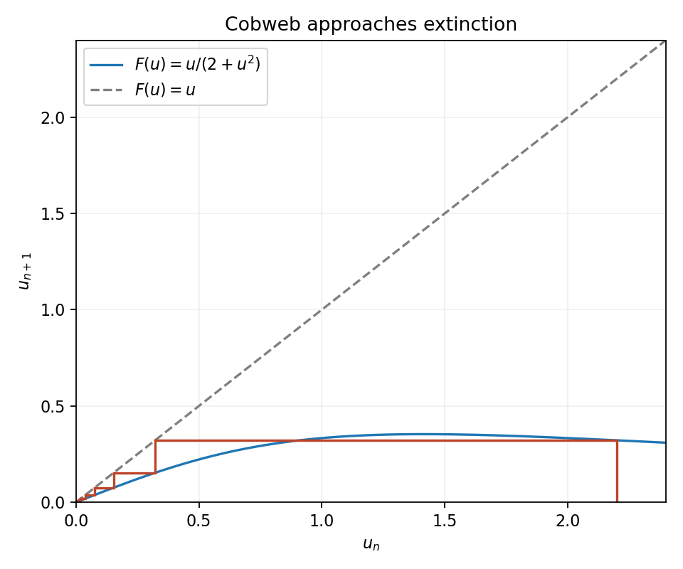

<h1 id="a/1/i/solution">Solution</h1>

↑ **Parent:** [I](../i.md)

The [iteration of a map](../../../../../iterated-function.md) is $F(u)=u/(2+u^2)$. For every $u>0$, $0<F(u)<u/2$, so $0<u_n\leq2^{-n}u_0$ and $\boxed{u_n\to0}$. A cobweb alternates vertical steps to the graph and horizontal steps to the diagonal, approaching the origin monotonically.

**[Figure 1](#a/1/i/image-resource-limited-population-cobweb-every-positive-orbit-approaches-extinction). Resource-limited population cobweb: every positive orbit approaches extinction**.

More precisely $u_{n+1}/u_n\to1/2$. The product $2^nu_n=u_0\prod_{j<n}(1+u_j^2/2)^{-1}$ has a finite strictly positive limit because $\sum_ju_j^2<\infty$. Thus $\boxed{u_n\sim C(u_0)2^{-n}}$ for a positive constant depending on the initial [biological population](../../../../../population-biology.md).

## ↑ Ancestors (13)

1. [I](../i.md)
2. [1](../../1.md)
3. [A](../../../a.md)
4. [2007](../../../../2007-split.md)
5. [Past exam of the topics in applied mathematics course of the University of Oxford](../../../../split.md)
6. [Topics in applied mathematics course of the University of Oxford](../../../../../topics-in-applied-mathematics-course-of-the-university-of-oxford.md)
7. [Year 3 of the mathematics course of the University of Oxford](../../../../../year-3-of-the-mathematics-course-of-the-university-of-oxford.md)
8. [Mathematics course of the University of Oxford](../../../../../mathematics-course-of-the-university-of-oxford.md)
9. [Undergraduate course of the University of Oxford](../../../../../undergraduate-course-of-the-university-of-oxford.md)
10. [Course of the University of Oxford](../../../../../course-of-the-university-of-oxford.md)
11. [University of Oxford](../../../../../university-of-oxford-split.md)
12. [List of universities](../../../../../list-of-universities.md)
13. [Codex Wiki](../../../../../split.md)
