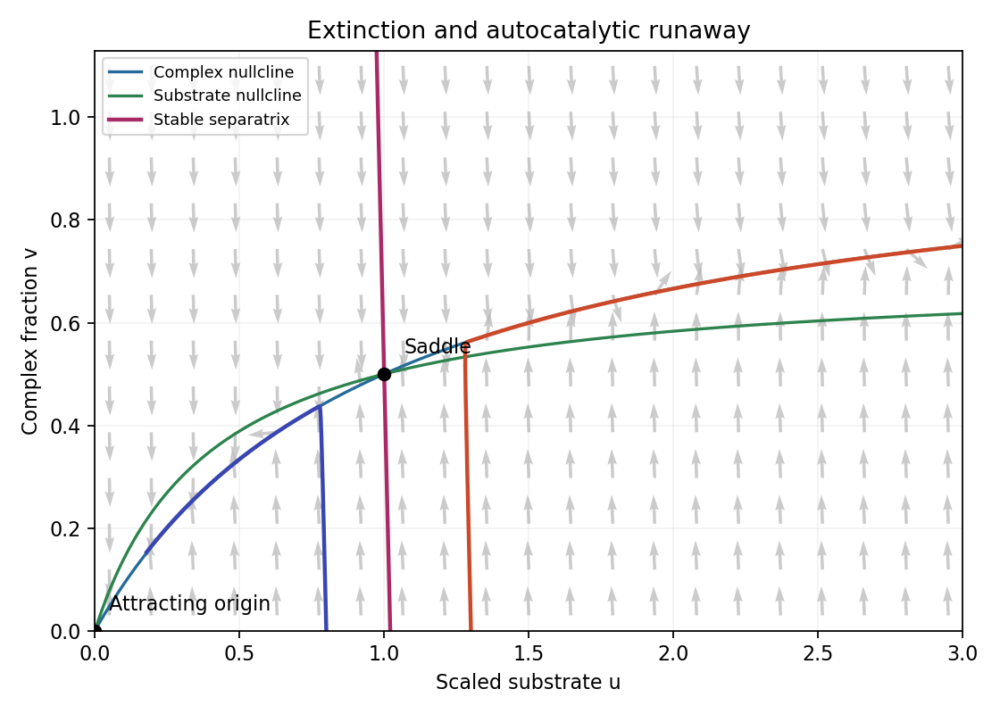

<h1 id="a/2/iv/a/solution">Solution</h1>

↑ **Parent:** [A](../a.md)

At equilibrium $v=u/(u+K)$ and adding $u'+\epsilon v'$ gives $0=\eta u-\lambda v$. The positive equilibrium is

$$
\boxed{u_e=\frac\lambda\eta-K,\quad v_e=1-\frac{\eta K}\lambda,\quad
0<\eta<\frac\lambda K,\qquad
0<k_0<\frac{k_1e_0k_2}{k_{-1}+k_2}.}
$$

This condition also gives $\eta<1$. The [nullclines](../../../../../../nullcline.md) are $v=u/(u+K)$ and $v=(1-\eta)u/(u+K-\lambda)$. The second lies above the first for $0<u<u_e$ and below it for $u>u_e$. Below the first [nullcline](../../../../../../nullcline.md) $v'>0$; above it $v'<0$. Below the second [nullcline](../../../../../../nullcline.md) $u'<0$; above it $u'>0$.

At the origin the Jacobian has [trace](../../../../../../matrix-trace.md) $\eta-1-K/\epsilon<0$ and [determinant](../../../../../../determinant.md) $(\lambda-\eta K)/\epsilon>0$. Its off-diagonal entries are positive, making the [eigenvalues](../../../../../../eigenvalue.md) real, so this is an attracting node. At the positive equilibrium the slow reduced [derivative](../../../../../../derivative.md) is $\eta-\lambda K/(u_e+K)^2=\eta v_e>0$, while the fast [derivative](../../../../../../derivative.md) is $-(u_e+K)/\epsilon<0$; equivalently the full Jacobian [determinant](../../../../../../determinant.md) is negative. Thus the positive point is a [saddle equilibrium](../../../../../../saddle-equilibrium.md). Its [stable manifold](../../../../../../stable-manifold.md) separates extinction from unbounded [substrate](../../../../../../substrate-biochemistry.md) growth.

**[Figure 2](#a/2/iv/a/image-autocatalytic-enzyme-phase-plane-a-fast-complex-fraction-and-a-saddle-threshold-separate-extinction-from-substrate-runaway). Autocatalytic enzyme phase plane: a fast complex fraction and a saddle threshold separate extinction from substrate runaway**.

## ↑ Ancestors (14)

1. [A](../a.md)
2. [Iv](../../iv.md)
3. [2](../../../2.md)
4. [A](../../../../a.md)
5. [2007](../../../../../2007-split.md)
6. [Past exam of the topics in applied mathematics course of the University of Oxford](../../../../../split.md)
7. [Topics in applied mathematics course of the University of Oxford](../../../../../../topics-in-applied-mathematics-course-of-the-university-of-oxford.md)
8. [Year 3 of the mathematics course of the University of Oxford](../../../../../../year-3-of-the-mathematics-course-of-the-university-of-oxford.md)
9. [Mathematics course of the University of Oxford](../../../../../../mathematics-course-of-the-university-of-oxford.md)
10. [Undergraduate course of the University of Oxford](../../../../../../undergraduate-course-of-the-university-of-oxford.md)
11. [Course of the University of Oxford](../../../../../../course-of-the-university-of-oxford.md)
12. [University of Oxford](../../../../../../university-of-oxford-split.md)
13. [List of universities](../../../../../../list-of-universities.md)
14. [Codex Wiki](../../../../../../split.md)
