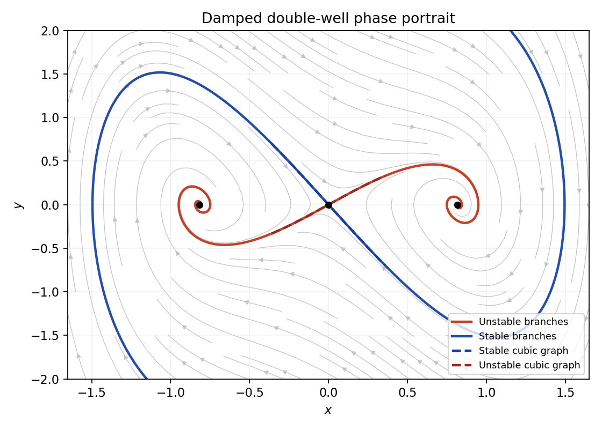

<h1 id="b/6/solution">Solution</h1>

↑ **Parent:** [6](../6.md)

The equilibria are $\boxed{(0,0),\ (\pm\sqrt{2/3},0)}$. The Jacobian is $J=\bigl(\begin{smallmatrix}0&1\\2-9x^2&-1\end{smallmatrix}\bigr)$. At the origin it has [eigenvalues](../../../../eigenvalue.md) $1,-2$ and tangent eigenvectors $(1,1)$ and $(1,-2)$, so the origin is a [saddle equilibrium](../../../../saddle-equilibrium.md). At either nonzero point the [eigenvalues](../../../../eigenvalue.md) are $\boxed{(-1\pm i\sqrt{15})/2}$, giving stable foci.

The [energy](../../../../energy-split.md)-like function $H=y^2/2-x^2+3x^4/4$ has $\dot H=-y^2\leq0$. It is coercive at large distance, so trajectories remain bounded; there are no [periodic orbits](../../../../periodic-orbit.md) because their [energy](../../../../energy-split.md) could not return to its starting value unless $y\equiv0$. The [stable manifold](../../../../stable-manifold.md) of the [saddle equilibrium](../../../../saddle-equilibrium.md) separates the two attracting basins. Its unstable branches leave the origin and approach the right and left foci, respectively. Their negative [energy](../../../../energy-split.md) near the origin prevents crossing back through $x=0$.

For either invariant manifold write $y=h(x)=sx+cx^3+O(x^5)$. Odd [symmetry](../../../../symmetry-physics.md) rules out even powers. Tangency to the vector field requires $h'(x)h(x)=2x-h(x)-3x^3$. Matching coefficients yields $s^2+s-2=0$ and $c(4s+1)=-3$. Hence

$$
\boxed{W^u:\ y=x-\frac35x^3+O(x^5),\qquad
W^s:\ y=-2x+\frac37x^3+O(x^5).}
$$

These are local graphs, not globally exact cubic curves.

**[Figure 3](#b/6/image-damped-double-well-phase-portrait-a-saddle-separates-two-stable-foci-with-cubic-local-invariant-manifolds). Damped double-well phase portrait: a saddle separates two stable foci, with cubic local invariant manifolds**.

## ↑ Ancestors (12)

1. [6](../6.md)
2. [B](../../b.md)
3. [2007](../../../2007-split.md)
4. [Past exam of the topics in applied mathematics course of the University of Oxford](../../../split.md)
5. [Topics in applied mathematics course of the University of Oxford](../../../../topics-in-applied-mathematics-course-of-the-university-of-oxford.md)
6. [Year 3 of the mathematics course of the University of Oxford](../../../../year-3-of-the-mathematics-course-of-the-university-of-oxford.md)
7. [Mathematics course of the University of Oxford](../../../../mathematics-course-of-the-university-of-oxford.md)
8. [Undergraduate course of the University of Oxford](../../../../undergraduate-course-of-the-university-of-oxford.md)
9. [Course of the University of Oxford](../../../../course-of-the-university-of-oxford.md)
10. [University of Oxford](../../../../university-of-oxford-split.md)
11. [List of universities](../../../../list-of-universities.md)
12. [Codex Wiki](../../../../split.md)
