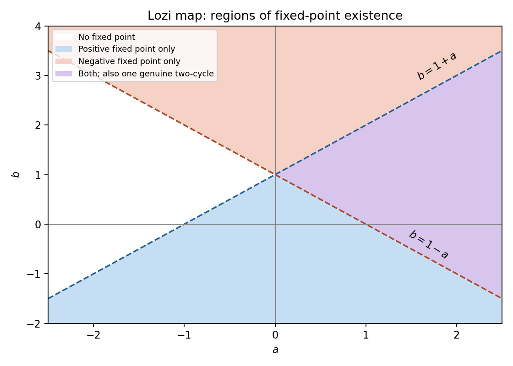

<h1 id="b/7/solution">Solution</h1>

↑ **Parent:** [7](../7.md)

A [fixed point](../../../../fixed-point.md) $X_*$ satisfies $F(X_*)=X_*$. The [Jacobian matrix](../../../../jacobian-matrix.md) is $DF=\bigl(\begin{smallmatrix}f_x&f_y\\g_x&g_y\end{smallmatrix}\bigr)$; its [eigenvalues](../../../../eigenvalue.md) are the linear [fixed-point multipliers](../../../../multiplier-of-a-periodic-orbit-of-an-iteration.md) used in (i)–(iii).

For the [Lozi map](../../../../lozi-map.md), $y=bx$ and $x=1+bx-a|x|$. At a positive point this gives $(1+a-b)x=1$, and at a negative point $(1-a-b)x=1$. Therefore

$$
\boxed{X_+=\frac{(1,b)}{1+a-b}\quad\text{when }b<1+a,\qquad
X_-=\frac{(1,b)}{1-a-b}\quad\text{when }b>1-a.}
$$

There is no [fixed point](../../../../fixed-point.md) at $x=0$, because then $y=0$ and the first component would be one. On an equality boundary the corresponding scalar equation is $0=1$, so that branch is absent, not a line of [fixed points](../../../../fixed-point.md).

**[Figure 4](#b/7/image-lozi-fixed-point-existence-regions-positive-and-negative-branches-lie-in-distinct-half-planes-that-can-overlap). Lozi fixed-point existence regions: positive and negative branches lie in distinct half-planes that can overlap**.

For $x\ne0$, $DF=\bigl(\begin{smallmatrix}-a\operatorname{sgn}x&1\\b&0\end{smallmatrix}\bigr)$. If $a=0$, there is exactly one [fixed point](../../../../fixed-point.md) $(1,b)/(1-b)$ unless $b=1$, when there is none. Its [eigenvalues](../../../../eigenvalue.md) satisfy $\lambda^2=b$. It is a [sink fixed point of a map](../../../../sink-fixed-point-of-a-map.md) for $|b|<1$ and a [source fixed point of a map](../../../../source-fixed-point-of-a-map.md) for $|b|>1$. At $b=-1$, the affine map about its [fixed point](../../../../fixed-point.md) is a quarter turn, $DF^2=-I$ and $F^4=I$, so it is neutral, not attracting. At $b=1$ no [fixed point](../../../../fixed-point.md) exists. The positive/negative branch labels follow the sign of $1-b$.

If $b=0$, $X_+=(1/(1+a),0)$ exists for $a>-1$ with [fixed-point multipliers](../../../../multiplier-of-a-periodic-orbit-of-an-iteration.md) $-a,0$. It is a [sink fixed point of a map](../../../../sink-fixed-point-of-a-map.md) for $-1<a<1$ and a forward [saddle fixed point of a map](../../../../saddle-fixed-point-of-a-map.md) for $a>1$. At $a=1$ the [fixed-point multiplier](../../../../multiplier-of-a-periodic-orbit-of-an-iteration.md) $-1$ is neutral; on the invariant axis the interval $0\leq x\leq1$ is mapped by $x\mapsto1-x$, giving [two-cycles](../../../../period-two-orbit.md) and the fixed midpoint. The negative point $X_-=(1/(1-a),0)$ exists only for $a>1$ and has [fixed-point multipliers](../../../../multiplier-of-a-periodic-orbit-of-an-iteration.md) $a,0$, again a forward [saddle fixed point of a map](../../../../saddle-fixed-point-of-a-map.md). For $a\leq-1$ there is no [fixed point](../../../../fixed-point.md). At $a=b=0$, both [fixed-point multipliers](../../../../multiplier-of-a-periodic-orbit-of-an-iteration.md) vanish and two iterates send all initial points to the [fixed point](../../../../fixed-point.md).

For a genuine [two-cycle](../../../../period-two-orbit.md) let the first coordinates be $x_1,x_2$ and put $h=1-b$. The two equations are $hx_2=1-a|x_1|$, $hx_1=1-a|x_2|$. If both first coordinates had the same sign $s$, subtracting would give $(h-as)(x_2-x_1)=0$. Since distinct cycle points must have different first coordinates, this contradicts $a^2\ne h^2$. If one coordinate were zero, the remaining equations would instead force $a=\pm h$, also excluded. Hence $\boxed{x_1x_2<0}$.

Choose $x_1>0>x_2$. Solving $ax_1+hx_2=1$, $hx_1-ax_2=1$ gives

$$
\boxed{x_1=\frac{a+h}{a^2+h^2},\qquad x_2=\frac{h-a}{a^2+h^2},\qquad
X_1=(x_1,bx_2),\quad X_2=(x_2,bx_1).}
$$

The required signs hold exactly when $\boxed{a>|1-b|}$. This is the unique [two-cycle](../../../../period-two-orbit.md) up to interchanging its two points, under the stipulated nondegeneracy. Borderline [parameter](../../../../parameter.md) lines can carry different degenerate families and were explicitly excluded. These are [Lozi fixed points and the alternating-sign two-cycle](../../../../lozi-fixed-points-and-the-alternating-sign-two-cycle.md).

## ↑ Ancestors (12)

1. [7](../7.md)
2. [B](../../b.md)
3. [2007](../../../2007-split.md)
4. [Past exam of the topics in applied mathematics course of the University of Oxford](../../../split.md)
5. [Topics in applied mathematics course of the University of Oxford](../../../../topics-in-applied-mathematics-course-of-the-university-of-oxford.md)
6. [Year 3 of the mathematics course of the University of Oxford](../../../../year-3-of-the-mathematics-course-of-the-university-of-oxford.md)
7. [Mathematics course of the University of Oxford](../../../../mathematics-course-of-the-university-of-oxford.md)
8. [Undergraduate course of the University of Oxford](../../../../undergraduate-course-of-the-university-of-oxford.md)
9. [Course of the University of Oxford](../../../../course-of-the-university-of-oxford.md)
10. [University of Oxford](../../../../university-of-oxford-split.md)
11. [List of universities](../../../../list-of-universities.md)
12. [Codex Wiki](../../../../split.md)
