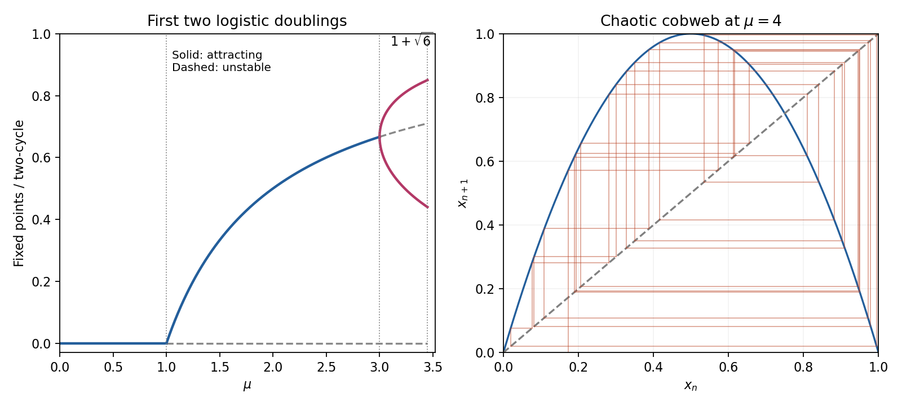

<h1 id="b/8/solution">Solution</h1>

↑ **Parent:** [8](../8.md)

On the invariant [biological population](../../../../population-biology.md) interval $0\leq x\leq1$, the [fixed points](../../../../fixed-point.md) are $0$ and $x_*=1-1/\mu$ when meaningful. The zero [fixed-point multiplier](../../../../multiplier-of-a-periodic-orbit-of-an-iteration.md) is $\mu$: extinction attracts for $0\leq\mu<1$. At $\mu=1$, the nonzero branch crosses the origin in the full real-line family, giving a [transcritical bifurcation](../../../../transcritical-bifurcation.md). The nonzero point lies in the [biological population](../../../../population-biology.md) interval for $\mu>1$ and has [fixed-point multiplier](../../../../multiplier-of-a-periodic-orbit-of-an-iteration.md) $2-\mu$, so it is stable for $1<\mu<3$ and loses stability through $-1$ at $\mu=3$.

Factoring $F^2(x)-x$ and removing the [fixed points](../../../../fixed-point.md) gives the [two-cycle](../../../../period-two-orbit.md)

$$
\boxed{x_\pm=\frac{\mu+1\pm\sqrt{(\mu-3)(\mu+1)}}{2\mu},\qquad\mu>3.}
$$

Its two-step [fixed-point multiplier](../../../../multiplier-of-a-periodic-orbit-of-an-iteration.md) is

$$
\boxed{F'(x_+)F'(x_-)=-\mu^2+2\mu+4.}
$$

It lies between $-1$ and $1$ exactly for $3<\mu<1+\sqrt6$. At the upper endpoint it crosses $-1$, creating the next period doubling. The [two-cycle](../../../../period-two-orbit.md) amplitude tends to zero like $\sqrt{\mu-3}$ at its birth, so the first flip is supercritical. At the equality endpoints linear [fixed-point multipliers](../../../../multiplier-of-a-periodic-orbit-of-an-iteration.md) alone do not establish [asymptotic stability](../../../../asymptotic-stability.md).

**[Figure 5](#b/8/image-logistic-fixed-points-and-the-first-stable-two-cycle-through-the-second-period-doubling-threshold). Logistic fixed points and the first stable two-cycle through the second period-doubling threshold**.

[Period-doubling cascade](../../../../period-doubling-cascade.md) universality concerns the continuation of this [period-doubling cascade](../../../../period-doubling-cascade.md) in smooth unimodal maps with a quadratic maximum. After suitable rescalings their repeated two-step maps approach the same limiting shape; successive [parameter](../../../../parameter.md) spacings have the Feigenbaum ratio approximately $4.6692$ and the spatial rescaling has magnitude approximately $2.5029$. These are asymptotic statements involving later doublings, not numbers that can be established from the first two thresholds alone. The accumulation near $\mu\simeq3.56995$ is outside the first interval considered here. One should not claim [chaos](../../../../chaos.md) throughout the stable [two-cycle](../../../../period-two-orbit.md) interval.

Four useful dynamical properties to distinguish are **sensitivity to initial conditions**, **[topological transitivity](../../../../topological-transitivity.md) or mixing**, **[dense periodic points](../../../../dense-periodic-points.md)**, and **[aperiodic orbits](../../../../aperiodic-orbit.md) with persistent complex evolution**. They concern the [invariant set](../../../../invariant-set-of-a-measure-preserving-transformation.md), not an assertion that every orbit must be aperiodic. A positive [Lyapunov exponent](../../../../lyapunov-exponent.md) for typical initial data is an additional quantitative diagnostic.

At $\mu=4$, set $x_0=\sin^2\theta_0$. The double-angle identity gives the exact solution

$$
\boxed{x_n=\sin^2(2^n\theta_0),\qquad\theta_0=\arcsin\sqrt{x_0}.}
$$

For a direct topological proof use the [homeomorphism](../../../../homeomorphism.md) $h(y)=\sin^2(\pi y/2)$ of $[0,1]$. Then $F_4\circ h=h\circ T$, where the full [tent map](../../../../tent-map.md) is

$$
T(y)=\begin{cases}2y,&0\leq y\leq1/2,\\2(1-y),&1/2\leq y\leq1.\end{cases}
$$

Every branch doubles interval length until it crosses a fold; the finite binary cylinders have length $2^{-n}$ and map onto the whole interval after $n$ steps. Thus every open interval eventually has an iterate covering the full interval: the map is topologically mixing and sensitive. Repeating a finite left/right branch word gives a periodic itinerary; arbitrarily long prescribed prefixes locate such periodic points in arbitrarily small cylinders, proving density. Nonperiodic binary itineraries yield uncountably many [aperiodic orbits](../../../../aperiodic-orbit.md). Conjugacy transfers these properties to $F_4$, proving chaotic behaviour while retaining its dense special [periodic orbits](../../../../periodic-orbit.md).

As a metric check, its [invariant measure](../../../../invariant-measure.md) has density $1/[\pi\sqrt{x(1-x)}]$ and its typical [Lyapunov exponent](../../../../lyapunov-exponent.md) is $\log2>0$. This is a typical-orbit assertion, not a claim about the [derivative](../../../../derivative.md) along every exceptional critical or preperiodic orbit. The explicit trigonometric solution and tent-map conjugacy explain why deterministic [iteration of a map](../../../../iterated-function.md) can nevertheless amplify uncertainty.

## ↑ Ancestors (12)

1. [8](../8.md)
2. [B](../../b.md)
3. [2007](../../../2007-split.md)
4. [Past exam of the topics in applied mathematics course of the University of Oxford](../../../split.md)
5. [Topics in applied mathematics course of the University of Oxford](../../../../topics-in-applied-mathematics-course-of-the-university-of-oxford.md)
6. [Year 3 of the mathematics course of the University of Oxford](../../../../year-3-of-the-mathematics-course-of-the-university-of-oxford.md)
7. [Mathematics course of the University of Oxford](../../../../mathematics-course-of-the-university-of-oxford.md)
8. [Undergraduate course of the University of Oxford](../../../../undergraduate-course-of-the-university-of-oxford.md)
9. [Course of the University of Oxford](../../../../course-of-the-university-of-oxford.md)
10. [University of Oxford](../../../../university-of-oxford-split.md)
11. [List of universities](../../../../list-of-universities.md)
12. [Codex Wiki](../../../../split.md)
