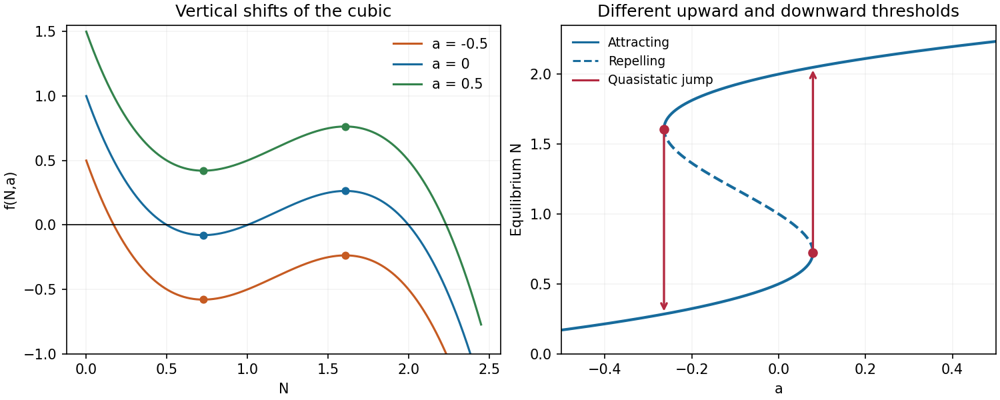
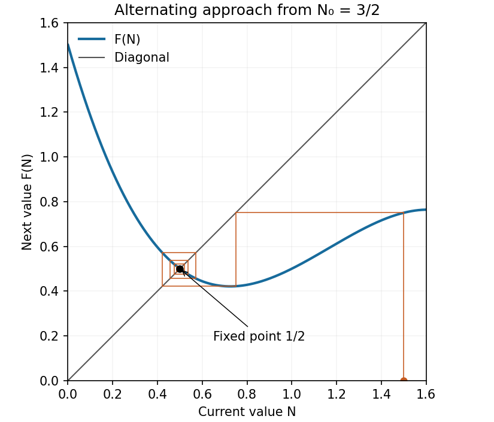
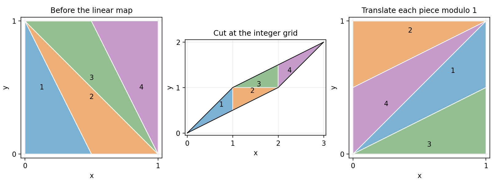

# 2008

↑ **Parent:** [Past exam of the topics in applied mathematics course of the University of Oxford](../past-exam-of-the-topics-in-applied-mathematics-course-of-the-university-of-oxford.md)

This [University of Oxford](../university-of-oxford.md) Part B paper is cross-listed for Mathematics and Mathematics and Statistics. Section A concerns [mathematical biology](../mathematical-biology.md), and section B concerns [dynamical systems](../dynamical-systems.md). [Source release](https://www.whatdotheyknow.com/request/maths_past_papers_3) The archive contains the complete editable eight-page transcription. Bounded searches of official sources found no advertised answers to this exact paper. The original solutions cover every source leaf and every unnumbered task in questions 5–8.

**Table of contents**

- [A](#a)
  - [1](#a/1)
    - [a](#a/1/a)
      - [Solution](#a/1/a/solution)
    - [b](#a/1/b)
      - [i](#a/1/b/i)
        - [Solution](#a/1/b/i/solution)
      - [ii](#a/1/b/ii)
        - [Solution](#a/1/b/ii/solution)
    - [c](#a/1/c)
      - [i](#a/1/c/i)
        - [Solution](#a/1/c/i/solution)
      - [ii](#a/1/c/ii)
        - [Solution](#a/1/c/ii/solution)
      - [iii](#a/1/c/iii)
        - [Solution](#a/1/c/iii/solution)
  - [2](#a/2)
    - [a](#a/2/a)
      - [i](#a/2/a/i)
        - [Solution](#a/2/a/i/solution)
      - [ii](#a/2/a/ii)
        - [Solution](#a/2/a/ii/solution)
    - [b](#a/2/b)
      - [i](#a/2/b/i)
        - [Solution](#a/2/b/i/solution)
      - [ii](#a/2/b/ii)
        - [Solution](#a/2/b/ii/solution)
      - [iii](#a/2/b/iii)
        - [Solution](#a/2/b/iii/solution)
  - [3](#a/3)
    - [a](#a/3/a)
      - [Solution](#a/3/a/solution)
    - [b](#a/3/b)
      - [Solution](#a/3/b/solution)
    - [c](#a/3/c)
      - [Solution](#a/3/c/solution)
    - [d](#a/3/d)
      - [Solution](#a/3/d/solution)
    - [e](#a/3/e)
      - [i](#a/3/e/i)
        - [Solution](#a/3/e/i/solution)
      - [ii](#a/3/e/ii)
        - [Solution](#a/3/e/ii/solution)
      - [iii](#a/3/e/iii)
        - [Solution](#a/3/e/iii/solution)
  - [4](#a/4)
    - [a](#a/4/a)
      - [Solution](#a/4/a/solution)
    - [b](#a/4/b)
      - [Solution](#a/4/b/solution)
    - [c](#a/4/c)
      - [Solution](#a/4/c/solution)
    - [d](#a/4/d)
      - [Solution](#a/4/d/solution)
    - [e](#a/4/e)
      - [Solution](#a/4/e/solution)
- [B](#b)
  - [5](#b/5)
    - [Solution](#b/5/solution)
  - [6](#b/6)
    - [Solution](#b/6/solution)
  - [7](#b/7)
    - [Solution](#b/7/solution)
  - [8](#b/8)
    - [Solution](#b/8/solution)

## A

↑ **Parent:** [2008](2008.md)

<h3 id="a/1">1</h3>

↑ **Parent:** [A](#a)

<h4 id="a/1/a">a</h4>

↑ **Parent:** [1](#a/1)

<h5 id="a/1/a/solution">Solution</h5>

↑ **Parent:** [A](#a/1/a)

Write $P(N)=f(N,0)$. Its three positive [zeros of a function](../polynomial.md#zero-of-a-function) are $1/2,1,2$, and expansion and [differentiation](../calculus.md#differentiation) give

$$
P(N)=-N^3+\frac72N^2-\frac72N+1,\qquad P'(N)=-3N^2+7N-\frac72.
$$

Thus its [local minimum](../analysis.md#local-minimum) and maximum occur respectively at

$$
N_m=\frac{7-\sqrt7}{6},\qquad N_M=\frac{7+\sqrt7}{6},
$$

with values

$$
P(N_m)=\frac5{54}-\frac{7\sqrt7}{108}\simeq-0.0788913,\qquad
P(N_M)=\frac5{54}+\frac{7\sqrt7}{108}\simeq0.264076.
$$

The [function graph](../function.md#graph-of-a-function) approaches the value $1$ as $N\downarrow0$, decreases through its first zero to the minimum, increases through its second zero to the maximum, and then decreases through $2$ to $-\infty$. This fixes the shape and all axis crossings of the [cubic polynomial](../polynomial.md#cubic-polynomial).

Changing $a$ translates the [function graph](../function.md#graph-of-a-function) vertically without moving either [stationary point](../calculus-of-variations.md#stationary-point). For $a=1/2$ both extrema are above the horizontal axis: their heights are approximately $0.421109$ and $0.764076$. For $a=-1/2$ both are below it, at approximately $-0.578891$ and $-0.235924$. The [function graph](../function.md#graph-of-a-function) for $a=1/2$ therefore has only its final positive-axis crossing, whereas the [function graph](../function.md#graph-of-a-function) for $a=-1/2$ has only its first positive-axis crossing. The original plots mark the extrema and also show the [equilibrium point](../dynamical-systems.md#equilibrium-point-of-a-dynamical-system) branches used below.

**[Figure 1](#a/1/a/image-cubic-graphs-and-equilibrium-branches). Cubic graphs and equilibrium branches**.

<h4 id="a/1/b">b</h4>

↑ **Parent:** [1](#a/1)

<h5 id="a/1/b/i">i</h5>

↑ **Parent:** [B](#a/1/b)

<h6 id="a/1/b/i/solution">Solution</h6>

↑ **Parent:** [I](#a/1/b/i)

Put $F(N)=f(N,1/2)$. A [cobweb plot](../dynamical-systems.md#cobweb-plot) alternates a vertical move to the [function graph](../function.md#graph-of-a-function) $y=F(N)$ with a horizontal move to the diagonal $y=N$. Beginning at $N_0=3/2$, the first [iterates](../discrete-dynamical-system.md#iterate) are

$$
N_1=\frac34,\qquad N_2=\frac{27}{64}\simeq0.421875,\qquad N_3\simeq0.571278.
$$

The diagram shows the ensuing approach to $1/2$ with alternating deviations. More precisely, if $e_t=N_t-1/2$, [Taylor expansion](../calculus.md#taylor-expansion) at the [fixed point](../function.md#fixed-point) gives

$$
e_{t+1}=-\frac34e_t+O(e_t^2).
$$

For sufficiently small nonzero deviations the sign reverses each step and their magnitudes contract. **The local approach is an alternating, geometrically damped oscillation**, with asymptotic contraction factor $3/4$ per iterate.

**[Figure 2](#a/1/b/i/image-cobweb-approaching-the-attracting-fixed-point). Cobweb approaching the attracting fixed point**.

<h5 id="a/1/b/ii">ii</h5>

↑ **Parent:** [B](#a/1/b)

<h6 id="a/1/b/ii/solution">Solution</h6>

↑ **Parent:** [Ii](#a/1/b/ii)

First establish a uniform upper bound. Direct subtraction gives

$$
F(N)-\frac32=-\frac N2(2N^2-7N+7)<0\qquad(N>0),
$$

because the [quadratic polynomial](../polynomial.md#quadratic-polynomial) has positive leading coefficient and [discriminant](../polynomial.md#discriminant) $49-56=-7$. The assumed positivity of $F(N_0)$ therefore places $N_1$ in $(0,3/2)$.

This interval is [forward invariant](../dynamical-systems.md#forward-invariant-set). On $[0,1/2]$ and on $[1,3/2]$, the three factors in $P(N)$ have nonnegative product, hence $F(N)\ge1/2$. On $[1/2,1]$ the product is nonpositive, but

$$
|P(N)|=(N-\tfrac12)(1-N)(2-N)\le\frac12\frac12\frac32=\frac38,
$$

so $F(N)\ge1/8>0$. Together with the upper bound this proves $F((0,3/2))\subset(0,3/2)$. Induction now gives

$$
\boxed{N_t>0\quad\text{for every }t\ge0.}
$$

The hypothesis on the first image is essential for initial values outside that [invariant interval](../dynamical-systems.md#invariant-interval).

<h4 id="a/1/c">c</h4>

↑ **Parent:** [1](#a/1)

<h5 id="a/1/c/i">i</h5>

↑ **Parent:** [C](#a/1/c)

<h6 id="a/1/c/i/solution">Solution</h6>

↑ **Parent:** [I](#a/1/c/i)

For an autonomous scalar differential equation, [linear stability](../dynamical-systems.md#linear-stability) of a simple [equilibrium point](../dynamical-systems.md#equilibrium-point-of-a-dynamical-system) $N_e$ is determined by the [derivative](../calculus.md#derivative) $f_N(N_e,a)=P'(N_e)$: a negative [derivative](../calculus.md#derivative) attracts nearby solutions and a positive [derivative](../calculus.md#derivative) gives [repulsion in a dynamical system](../dynamical-systems.md#repulsion-in-a-dynamical-system) of nearby solutions.

Here $f(0,a)=1+a\ge1/2>0$ throughout the prescribed [mathematical model parameter](../mathematics.md#mathematical-model-parameter) range, while $f(N,a)\to-\infty$ as $N\to\infty$. If there is only one [equilibrium point](../dynamical-systems.md#equilibrium-point-of-a-dynamical-system), the [function graph](../function.md#graph-of-a-function) must cross the axis on one of its decreasing branches, outside the interval between its two extrema. The crossing is simple and $P'(N_e)<0$. Thus **the unique [equilibrium point](../dynamical-systems.md#equilibrium-point-of-a-dynamical-system) is linearly [asymptotically stable](../dynamical-systems.md#asymptotic-stability)**. At a [saddle-node bifurcation](../bifurcation-theory.md#saddle-node-bifurcation) there are two distinct [equilibrium points](../dynamical-systems.md#equilibrium-point-of-a-dynamical-system), one of them double, so that case does not fall under the one-equilibrium hypothesis.

<h5 id="a/1/c/ii">ii</h5>

↑ **Parent:** [C](#a/1/c)

<h6 id="a/1/c/ii/solution">Solution</h6>

↑ **Parent:** [Ii](#a/1/c/ii)

With three distinct positive [roots of an equation](../polynomial.md#root-of-an-equation), the negative-leading [cubic polynomial](../polynomial.md#cubic-polynomial) has the sign pattern

$$
+\quad N_*\quad-\quad N_{**}\quad+\quad N_{***}\quad-.
$$

Equivalently its [derivative](../calculus.md#derivative) is negative at the first [root of an equation](../polynomial.md#root-of-an-equation), positive at the middle [root of an equation](../polynomial.md#root-of-an-equation), and negative at the final [root of an equation](../polynomial.md#root-of-an-equation). The [phase line](../dynamical-systems.md#phase-line) arrows therefore point toward the two outer [equilibrium points](../dynamical-systems.md#equilibrium-point-of-a-dynamical-system) and away from the middle one:

$$
\boxed{N_*\text{ stable},\qquad N_{**}\text{ unstable},\qquad N_{***}\text{ stable}.}
$$

The middle [equilibrium point](../dynamical-systems.md#equilibrium-point-of-a-dynamical-system) separates the two [basin of attraction](../dynamical-systems.md#basin-of-attraction) in the [bistability](../dynamical-systems.md#bistability) [mathematical model parameter](../mathematics.md#mathematical-model-parameter) interval.

<h5 id="a/1/c/iii">iii</h5>

↑ **Parent:** [C](#a/1/c)

<h6 id="a/1/c/iii/solution">Solution</h6>

↑ **Parent:** [Iii](#a/1/c/iii)

**Yes: there is a quasistatic [hysteresis](../critical-phenomenon.md#hysteresis) loop.** [Equilibrium points](../dynamical-systems.md#equilibrium-point-of-a-dynamical-system) lie on the [mathematical model parameter](../mathematics.md#mathematical-model-parameter) curve $a=-P(N)$. Its two [saddle-node bifurcations](../bifurcation-theory.md#saddle-node-bifurcation) occur at the [stationary points](../calculus-of-variations.md#stationary-point) computed in part (a), at [mathematical model parameter](../mathematics.md#mathematical-model-parameter) values

$$
a_{\rm down}=-P(N_M)=-\frac5{54}-\frac{7\sqrt7}{108}\simeq-0.264076,
$$

$$
a_{\rm up}=-P(N_m)=-\frac5{54}+\frac{7\sqrt7}{108}\simeq0.0788913.
$$

Between these values there are two [attracting](../dynamical-systems.md#attraction-in-a-dynamical-system) branches separated by a [repelling](../dynamical-systems.md#repulsion-in-a-dynamical-system) branch. Starting below $a_{\rm down}$ and increasing $a$ slowly, a solution follows the lower [attracting](../dynamical-systems.md#attraction-in-a-dynamical-system) branch. This branch persists through the [bistability](../dynamical-systems.md#bistability) interval and ends only at $a_{\rm up}$, where it meets the [repelling](../dynamical-systems.md#repulsion-in-a-dynamical-system) branch in a [saddle-node bifurcation](../bifurcation-theory.md#saddle-node-bifurcation). The solution then moves to the upper [attracting](../dynamical-systems.md#attraction-in-a-dynamical-system) branch.

If the direction of [mathematical model parameter](../mathematics.md#mathematical-model-parameter) change is reversed, the upper branch persists until $a_{\rm down}$, where a different [saddle-node bifurcation](../bifurcation-theory.md#saddle-node-bifurcation) forces the downward transition. The two transition values differ, and both lie inside the allowed range $[-1/2,1/2]$. Thus the [biological population](../ecology.md#population-biology) selected at an intermediate [mathematical model parameter](../mathematics.md#mathematical-model-parameter) value depends on its prior branch. This is the [equilibrium point](../dynamical-systems.md#equilibrium-point-of-a-dynamical-system) [hysteresis](../critical-phenomenon.md#hysteresis) shown in the branch diagram; finite-rate passage can additionally delay the jumps near the [saddle-node bifurcations](../bifurcation-theory.md#saddle-node-bifurcation).

<h3 id="a/2">2</h3>

↑ **Parent:** [A](#a)

<h4 id="a/2/a">a</h4>

↑ **Parent:** [2](#a/2)

<h5 id="a/2/a/i">i</h5>

↑ **Parent:** [A](#a/2/a)

<h6 id="a/2/a/i/solution">Solution</h6>

↑ **Parent:** [I](#a/2/a/i)

The term $rIS$ is a mass-action incidence rate: each [infective individual](../mathematical-biology.md#infective-individual) makes potentially transmitting contacts with [susceptible individuals](../mathematical-biology.md#susceptible-individual), and the total rate is proportional to the product of the two [compartment](../mathematical-biology.md#compartment) sizes. An [infection](../biology.md#infection) transfers one animal from $S$ to $I$, accounting for opposite signs in their equations. The [per-capita mortality rate](../mathematical-biology.md#per-capita-mortality-rate) of an [infective individual](../mathematical-biology.md#infective-individual) is $a$, giving transfer $aI$ from $I$ to $R$.

There are no births, recoveries or additional deaths in this model. Adding the three equations gives $\dot S+\dot I+\dot R=0$, so the total initial [biological population](../ecology.md#population-biology) is conserved when the dead [compartment](../mathematical-biology.md#compartment) is included. Before [quarantine](../mathematical-biology.md#quarantine), $S$ decreases whenever $I,S>0$; after effective isolation no further transmission is permitted.

<h5 id="a/2/a/ii">ii</h5>

↑ **Parent:** [A](#a/2/a)

<h6 id="a/2/a/ii/solution">Solution</h6>

↑ **Parent:** [Ii](#a/2/a/ii)

Write $S_0=S_{initial}$ and $I_0=I_{initial}$. Until [quarantine](../mathematical-biology.md#quarantine) and while $I,S>0$, division of the equations gives

$$
\frac{dI}{dS}=-1+\frac{a}{rS}.
$$

[Integration](../integral.md) from the initial state yields the [first integral](../differential-equation.md#first-integral)

$$
I+S-\frac ar\log S=I_0+S_0-\frac ar\log S_0.
$$

Let $S_*$ be the [susceptible](../mathematical-biology.md#susceptible-individual) count at the first time $I=I_*$. It is the [root of an equation](../polynomial.md#root-of-an-equation) reached on the decreasing-$S$ outbreak trajectory of

$$
\boxed{I_*+S_*-\frac ar\log S_*=I_0+S_0-\frac ar\log S_0.}
$$

For a strictly rising threshold crossing this is the larger admissible [root of an equation](../polynomial.md#root-of-an-equation), with $a/r<S_*<S_0$; if the threshold equals the peak, $S_*=a/r$. The assumption that [quarantine](../mathematical-biology.md#quarantine) is reached selects the physically relevant branch and excludes a merely hypothetical declining-branch crossing after an earlier one.

Since there is no [incubation period](../mathematical-biology.md#incubation-period) here, all removals from $S$ have already become [infection cases](../biology.md#infection-case) by [quarantine](../mathematical-biology.md#quarantine). No further [susceptible individuals](../mathematical-biology.md#susceptible-individual) are [infected](../biology.md#infection) after isolation. The requested number among the initially [susceptible individuals](../mathematical-biology.md#susceptible-individual) is therefore

$$
\boxed{S_0-S_*.}
$$

<h4 id="a/2/b">b</h4>

↑ **Parent:** [2](#a/2)

<h5 id="a/2/b/i">i</h5>

↑ **Parent:** [B](#a/2/b)

<h6 id="a/2/b/i/solution">Solution</h6>

↑ **Parent:** [I](#a/2/b/i)

The delayed influx $rI(t-\tau)S(t-\tau)$ represents animals exposed one [incubation period](../mathematical-biology.md#incubation-period) earlier who enter the [infective individual](../mathematical-biology.md#infective-individual) [compartment](../mathematical-biology.md#compartment) now. They die at the instantaneous rate $aI(t)$ once in that [compartment](../mathematical-biology.md#compartment). The displayed bookkeeping removes an animal from $S$ at the same delayed time that it enters $I$, preserving $S+I+R$.

For this bookkeeping, $S$ must include the exposed animals which have not yet completed [incubation period](../mathematical-biology.md#incubation-period). If $S$ were instead defined as strictly unexposed [susceptible individuals](../mathematical-biology.md#susceptible-individual), its loss term would be the current exposure rate and a separate latent compartment would be needed. The calculations here follow the printed [delay differential equation](../differential-equation.md#delay-differential-equation). A full initial-value problem for a [delay differential equation](../differential-equation.md#delay-differential-equation) also needs a history on $[-\tau,0]$; the following [small-delay expansion of an epidemic transfer rate](../differential-equation.md#small-delay-expansion-of-an-epidemic-transfer-rate) concerns a smooth compatible history and the regular regime assumed by the question.

<h5 id="a/2/b/ii">ii</h5>

↑ **Parent:** [B](#a/2/b)

<h6 id="a/2/b/ii/solution">Solution</h6>

↑ **Parent:** [Ii](#a/2/b/ii)

In the first-order [Taylor expansion](../calculus.md#taylor-expansion) correction it suffices to use the zeroth-order [derivatives](../calculus.md#derivative). They give

$$
\dot I\,S+I\dot S=(rIS-aI)S+I(-rIS)=IS\{r(S-I)-a\}.
$$

The delayed product is consequently

$$
I(t-\tau)S(t-\tau)=IS+\tau IS\{a+r(I-S)\}+O(\tau^2).
$$

Multiplying by $r$ and substituting into the two transfer equations produces

$$
\boxed{f(I,S,r,a)=r\{a+r(I-S)\},\qquad g(I,S,r,a)=-r\{a+r(I-S)\}.}
$$

The opposite signs of $f$ and $g$ are also required by [conservation law](../mathematical-physics.md#conservation-law) of $S+I+R$: this correction changes the timing of the transfer between $S$ and $I$, while leaving the instantaneous death term unchanged.

<h5 id="a/2/b/iii">iii</h5>

↑ **Parent:** [B](#a/2/b)

<h6 id="a/2/b/iii/solution">Solution</h6>

↑ **Parent:** [Iii](#a/2/b/iii)

At the retained order define $K=1+\tau r(I-S)$. Neglecting terms of order $a\tau$ in the incidence correction gives

$$
\dot I=rISK-aI,\qquad \dot S=-rISK.
$$

Dividing and expanding consistently,

$$
\frac{dI}{dS}=-1+\frac{a}{rSK}
=-1+\frac{a}{rS}+O(a\tau,\tau^2).
$$

Thus the [susceptible](../mathematical-biology.md#susceptible-individual) count $S_*$ at the first threshold crossing obeys the same retained-order equation as before:

$$
I_*+S_*-\frac ar\log S_*=I_0+S_0-\frac ar\log S_0.
$$

It is important to distinguish completed case transfers at [quarantine](../mathematical-biology.md#quarantine) from all [infections](../biology.md#infection) already initiated. Let the [quarantine](../mathematical-biology.md#quarantine) time be $T$. Isolation prevents exposures after $T$, but animals exposed during $(T-\tau,T)$ still finish their [incubation period](../mathematical-biology.md#incubation-period) during $(T,T+\tau)$. Their number, in the printed bookkeeping, is

$$
E_* =\int_{T-\tau}^{T}rI(s)S(s)\,ds
=\tau rI_*S_*+O(\tau^2).
$$

The [infection cases](../biology.md#infection-case) transferred by time $T$ among the initial $S$ class number $S_0-S_*$. Adding those pending [infection cases](../biology.md#infection-case) gives the eventual number who catch the [infectious disease](../biology.md#infectious-disease):

$$
\boxed{S_0-S_*+\tau rI_*S_*\quad\text{to the retained order}.}
$$

This adds only [infections](../biology.md#infection) caused by exposures before isolation; it does not allow secondary transmission after [quarantine](../mathematical-biology.md#quarantine). If one asks instead only for the transfers completed by the instant of [quarantine](../mathematical-biology.md#quarantine), the answer is $S_0-S_*$. The distinction is necessary because the model keeps incubating animals in its $S$ [compartment](../mathematical-biology.md#compartment).

<h3 id="a/3">3</h3>

↑ **Parent:** [A](#a)

<h4 id="a/3/a">a</h4>

↑ **Parent:** [3](#a/3)

<h5 id="a/3/a/solution">Solution</h5>

↑ **Parent:** [A](#a/3/a)

An unbiased [random walk](../random-walk.md) of [bacteria](../organism.md#bacteria) leads, on the continuum scale, to [diffusion](../thermodynamics.md#diffusion) with coefficient $D$, represented by $DB_{XX}$. The [cell proliferation](../biological-cell.md#cell-proliferation) rate $\nu GB$ is proportional both to the available [biological growth factor](../signal-transduction.md#biological-growth-factor) concentration and to the [bacterial density](../statistical-physics.md#bacterial-density). Consumption of [biological growth factor](../signal-transduction.md#biological-growth-factor) at rate $\mu GB$ gives its negative reaction term.

There is no [diffusion](../thermodynamics.md#diffusion) term for $G$ because the [biological growth factor](../signal-transduction.md#biological-growth-factor) is attached to the substrate rather than freely transported. There is also no [chemotactic drift](../mathematical-biology.md#chemotactic-drift) in this model: the specified motion is random, while the [biological growth factor](../signal-transduction.md#biological-growth-factor) changes [cell proliferation](../biological-cell.md#cell-proliferation) rather than directional movement. Both reaction terms vanish if either [bacteria](../organism.md#bacteria) or [biological growth factor](../signal-transduction.md#biological-growth-factor) are absent.

<h4 id="a/3/b">b</h4>

↑ **Parent:** [3](#a/3)

<h5 id="a/3/b/solution">Solution</h5>

↑ **Parent:** [B](#a/3/b)

Choose a positive reference [biological growth factor](../signal-transduction.md#biological-growth-factor) concentration $G_{ref}$, for example its [concentration](../mathematical-physics.md#concentration) ahead of the [travelling wave](../analysis.md#travelling-wave). Set

$$
T=T_0t,\quad X=X_0x,\quad G=G_{ref}g,\quad B=B_0b,
$$

where

$$
\boxed{T_0=\frac1{\nu G_{ref}},\qquad X_0=\sqrt{\frac D{\nu G_{ref}}},\qquad B_0=\frac{\nu G_{ref}}\mu.}
$$

The [chain rule](../calculus.md#chain-rule) then transforms the equations into

$$
b_t=\frac{DT_0}{X_0^2}b_{xx}+\nu G_{ref}T_0gb,\qquad g_t=-\mu B_0T_0gb.
$$

Each displayed coefficient is one with the chosen scales. Hence the [dimensionless](../physics.md#dimensionless-quantity) system is

$$
\boxed{b_t=b_{xx}+gb,\qquad g_t=-gb.}
$$

The free choice of $G_{ref}$ expresses the freedom to normalize the as-yet unspecified [concentration](../mathematical-physics.md#concentration) scale.

<h4 id="a/3/c">c</h4>

↑ **Parent:** [3](#a/3)

<h5 id="a/3/c/solution">Solution</h5>

↑ **Parent:** [C](#a/3/c)

Take profiles $b=b(y)$ and $g=g(y)$ with $y=x-ct$, and use a prime for [differentiation](../calculus.md#differentiation) with respect to $y$. The [chain rule](../calculus.md#chain-rule) gives $b_t=-cb'$, $b_{xx}=b''$ and $g_t=-cg'$. Therefore

$$
\boxed{b''+cb'+gb=0,\qquad cg'=gb.}
$$

These are coupled [ordinary differential equations](../differential-equation.md#ordinary-differential-equation) for a right-moving [travelling wave](../analysis.md#travelling-wave) with speed $c>0$. A first-order formulation, using $v=b'$, is $b'=v$, $v'=-cv-gb$, $g'=gb/c$. In particular a positive profile has $g'>0$, consistent with depleted substrate behind the [travelling front](../analysis.md#travelling-front) and fresh [biological growth factor](../signal-transduction.md#biological-growth-factor) ahead.

<h4 id="a/3/d">d</h4>

↑ **Parent:** [3](#a/3)

<h5 id="a/3/d/solution">Solution</h5>

↑ **Parent:** [D](#a/3/d)

Substitute $gb=cg'$ into the [bacterial](../organism.md#bacteria) profile equation. This gives

$$
b''+cb'+cg'=0,
$$

which integrates once to

$$
b'+c(b+g)=C.
$$

At the asymptotic constant states the profile [derivative](../calculus.md#derivative) tends to zero. The state ahead of the [travelling wave](../analysis.md#travelling-wave), where $b\to0$ and $g\to1$, therefore gives $C=c$. The state behind it, where $g\to0$ and $b\to b_0$, gives $C=cb_0$. Since $c>0$,

$$
\boxed{b_0=1,\qquad b'+c(b+g)=c.}
$$

This [first integral](../differential-equation.md#first-integral) expresses the matching between biomass produced and [biological growth factor](../signal-transduction.md#biological-growth-factor) consumed after the chosen [nondimensionalization](../mathematical-physics.md#nondimensionalization).

<h4 id="a/3/e">e</h4>

↑ **Parent:** [3](#a/3)

<h5 id="a/3/e/i">i</h5>

↑ **Parent:** [E](#a/3/e)

<h6 id="a/3/e/i/solution">Solution</h6>

↑ **Parent:** [I](#a/3/e/i)

At the leading edge $b\to0$ and $g\to1$. The linearized [bacterial](../organism.md#bacteria) equation is

$$
b''+cb'+b=0,
$$

with [characteristic exponents](../linear-ordinary-differential-equation.md#characteristic-exponent)

$$
\lambda_\pm=\frac{-c\pm\sqrt{c^2-4}}2.
$$

For $0<c<2$ they form a [nonreal](../complex-analysis.md#nonreal-complex-number) [complex conjugate](../complex-analysis.md#complex-conjugate) pair. A nonzero profile approaching the [travelling front](../analysis.md#travelling-front) then has an exponentially decaying oscillatory leading term, and repeatedly changes sign. This is incompatible with the assumed positive [bacterial density](../statistical-physics.md#bacterial-density). The leading edge must therefore have real [characteristic exponents](../linear-ordinary-differential-equation.md#characteristic-exponent), requiring

$$
\boxed{c\ge2.}
$$

At $c=2$ the repeated [characteristic exponent](../linear-ordinary-differential-equation.md#characteristic-exponent) is $-1$ and [polynomial](../polynomial.md) factors in the asymptotic profile may occur. The argument supplies a necessary lower bound; it is not an independent existence proof for every speed satisfying it.

<h5 id="a/3/e/ii">ii</h5>

↑ **Parent:** [E](#a/3/e)

<h6 id="a/3/e/ii/solution">Solution</h6>

↑ **Parent:** [Ii](#a/3/e/ii)

The [first integral](../differential-equation.md#first-integral) and $b_0=1$ yield the linear identity $b'+cb=c(1-g)$. Multiply by the [integrating factor](../linear-ordinary-differential-equation.md#integrating-factor) $e^{cy}$ and integrate from $-\infty$. Since the bounded limit $b(-\infty)=1$ makes $e^{cy}b(y)\to0$ there,

$$
b(y)=c\int_{-\infty}^{y}e^{-c(y-s)}(1-g(s))\,ds
=1-c\int_{-\infty}^{y}e^{-c(y-s)}g(s)\,ds.
$$

Positivity of $g$ makes the last [integral](../integral.md) nonnegative, and strictly positive at any finite point of a strictly positive [travelling wave](../analysis.md#travelling-wave). Thus

$$
\boxed{0<b(y)<b_0=1\quad\text{for finite }y,}
$$

with equality approached only at the far-behind boundary. This bound uses the [first integral](../differential-equation.md#first-integral) rather than an unsupported assumption that the [bacterial](../organism.md#bacteria) profile is monotone.

<h5 id="a/3/e/iii">iii</h5>

↑ **Parent:** [E](#a/3/e)

<h6 id="a/3/e/iii/solution">Solution</h6>

↑ **Parent:** [Iii](#a/3/e/iii)

For the modified strain the [travelling wave](../analysis.md#travelling-wave) equations are

$$
b''+cb'+gb(1-\eta b)=0,\qquad cg'=gb.
$$

Integrating the second across the entire [travelling wave](../analysis.md#travelling-wave) gives $\int_{\mathbb R}gb\,dy=c$, since the [biological growth factor](../signal-transduction.md#biological-growth-factor) profile still goes from $0$ to $1$. Integrating the first, using the constant asymptotic states and vanishing [derivative](../calculus.md#derivative) at infinity, gives

$$
cb_1=\int_{\mathbb R}gb(1-\eta b)\,dy
=c-\eta\int_{\mathbb R}gb^2\,dy.
$$

Consequently

$$
\boxed{b_1=1-\frac\eta c\int_{\mathbb R}g(y)b(y)^2\,dy<1=b_0.}
$$

The subtracted [integral](../integral.md) is strictly positive because the profiles are positive and $\eta>0$. It is finite: $b$ is bounded by continuity and its finite endpoint limits, and $\int gb=c$. The additional density-dependent inhibition therefore reduces the [bacterial density](../statistical-physics.md#bacterial-density) left behind; positivity of $b_1$ is part of the assumed positive-wave solution.

<h3 id="a/4">4</h3>

↑ **Parent:** [A](#a)

<h4 id="a/4/a">a</h4>

↑ **Parent:** [4](#a/4)

<h5 id="a/4/a/solution">Solution</h5>

↑ **Parent:** [A](#a/4/a)

The term $\alpha\nabla^2q$ is cell [diffusion](../thermodynamics.md#diffusion) arising from random movement. [Chemotaxis](../mathematical-biology.md#chemotaxis) up the [concentration gradient](../mathematical-physics.md#concentration-gradient) gives the cell [flux](../mathematical-physics.md#flux) $\beta q\nabla c$, whose negative [divergence](../multivariable-calculus.md#divergence) is the transport contribution $-\beta\nabla\cdot(q\nabla c)$. The reaction term $q(1-q)$ gives growth governed by the [logistic differential equation](../differential-equation.md#logistic-differential-equation) with [dimensionless](../physics.md#dimensionless-quantity) [carrying capacity](../mathematical-biology.md#carrying-capacity) one.

The [chemoattractant](../mathematical-biology.md#chemoattractant) itself diffuses, is produced by cells at rate $\kappa\eta q$, and decays at rate $\kappa c$. The homogeneous [Neumann boundary conditions](../differential-equation.md#neumann-boundary-condition) suppress the normal [diffusive](../thermodynamics.md#diffusion) [flux](../mathematical-physics.md#flux) of each quantity. They also suppress the normal [chemotactic cell flux](../mathematical-biology.md#chemotactic-flux) because the normal [derivative](../calculus.md#derivative) of $c$ vanishes. Thus the rectangular boundary is impermeable, and the spatially integrated cell count changes through [cell proliferation](../biological-cell.md#cell-proliferation) rather than transport across that boundary.

<h4 id="a/4/b">b</h4>

↑ **Parent:** [4](#a/4)

<h5 id="a/4/b/solution">Solution</h5>

↑ **Parent:** [B](#a/4/b)

For spatially homogeneous [perturbations](../asymptotic-expansion.md#perturbation) write $q=1+u$ and $c=\eta+v$. The linearized reaction equations are

$$
\begin{pmatrix}\dot u\\\dot v\end{pmatrix}
=J\begin{pmatrix}u\\v\end{pmatrix},\qquad
\boxed{J=\begin{pmatrix}-1&0\\\kappa\eta&-\kappa\end{pmatrix}.}
$$

This [triangular matrix](../linear-algebra.md#triangular-matrix) has [eigenvalues](../linear-operator-theory.md#eigenvalue) $-1$ and $-\kappa$, both negative. Hence the [homogeneous steady state](../dynamical-systems.md#homogeneous-equilibrium) is linearly [asymptotically stable](../dynamical-systems.md#asymptotic-stability) against homogeneous [perturbations](../asymptotic-expansion.md#perturbation). Even when $\kappa=1$, where the two [eigenvalues](../linear-operator-theory.md#eigenvalue) coincide and a [polynomial](../polynomial.md) factor may occur in the [matrix exponential](../linear-operator-theory.md#matrix-exponential), all such [perturbations](../asymptotic-expansion.md#perturbation) still decay.

<h4 id="a/4/c">c</h4>

↑ **Parent:** [4](#a/4)

<h5 id="a/4/c/solution">Solution</h5>

↑ **Parent:** [C](#a/4/c)

For the [cosine](../geometry-and-topology.md#cosine) mode in the question, the [Laplacian](../multivariable-calculus.md#laplacian) acts by multiplication by $-s$, where

$$
s=k_{n,m}^2=\pi^2\left(\frac{n^2}{L_1^2}+\frac{m^2}{L_2^2}\right).
$$

These modes obey the [Neumann boundary conditions](../differential-equation.md#neumann-boundary-condition). In the [chemotactic](../mathematical-biology.md#chemotaxis) term, put $q=1+u$, $c=\eta+v$. Then $\nabla c=\nabla v$, and $q\nabla c=\nabla v+u\nabla v$; the second product is a [quadratic polynomial](../polynomial.md#quadratic-polynomial) in [perturbation](../asymptotic-expansion.md#perturbation) amplitude. Thus the [linearized equations](../differential-equation.md#linearized-equation) are

$$
u_t=\alpha\nabla^2u-\beta\nabla^2v-u,\qquad
v_t=\nabla^2v+\kappa\eta u-\kappa v.
$$

Substituting the modal time dependence gives

$$
\lambda\begin{pmatrix}q_{n,m}\\c_{n,m}\end{pmatrix}
=\begin{pmatrix}-1-\alpha s&\beta s\\\kappa\eta&-\kappa-s\end{pmatrix}
\begin{pmatrix}q_{n,m}\\c_{n,m}\end{pmatrix}.
$$

Separating this [matrix](../vector-space.md#matrix) into its transport part and the reaction [Jacobian matrix](../multivariable-calculus.md#jacobian-matrix) gives the required form, with the same $J$ as above.

<h4 id="a/4/d">d</h4>

↑ **Parent:** [4](#a/4)

<h5 id="a/4/d/solution">Solution</h5>

↑ **Parent:** [D](#a/4/d)

For the modal [matrix](../vector-space.md#matrix) $M(s)$, $s\ge0$, its [trace](../linear-algebra.md#matrix-trace) is always negative:

$$
\operatorname{tr}M(s)=-(1+\kappa)-(\alpha+1)s<0.
$$

Its [determinant](../multilinear-algebra.md#determinant) is

$$
D(s)=(1+\alpha s)(\kappa+s)-\beta\kappa\eta s
=\alpha s^2+(1+\alpha\kappa-\beta\kappa\eta)s+\kappa.
$$

The proposed inequality is exactly $\beta\kappa\eta<\alpha\kappa+1$. It makes the coefficient of $s$ positive, while the leading and constant coefficients are already positive. Therefore $D(s)>0$ for every $s\ge0$, independent of which discrete wave numbers the domain allows.

A real two-by-two [matrix](../vector-space.md#matrix) with negative [trace](../linear-algebra.md#matrix-trace) and positive [determinant](../multilinear-algebra.md#determinant) has both [eigenvalues](../linear-operator-theory.md#eigenvalue) with negative [real part](../complex-analysis.md#real-part): if they are real they have positive product and negative sum, and if [nonreal](../complex-analysis.md#nonreal-complex-number) their common [real part](../complex-analysis.md#real-part) is half the [trace](../linear-algebra.md#matrix-trace). Every mode therefore decays, proving **[linear stability](../dynamical-systems.md#linear-stability) for all domain sizes** under the stated sufficient condition.

<h4 id="a/4/e">e</h4>

↑ **Parent:** [4](#a/4)

<h5 id="a/4/e/solution">Solution</h5>

↑ **Parent:** [E](#a/4/e)

Here $L_1=1$ and $L_2=1/2$, so a [perturbation](../asymptotic-expansion.md#perturbation) varying in both coordinates has $n,m\ge1$ and

$$
s=\pi^2(n^2+4m^2)\ge5\pi^2.
$$

With the given unit coefficients the [determinant](../multilinear-algebra.md#determinant) becomes $D(s)=(1+s)^2-\beta s$. The [trace](../linear-algebra.md#matrix-trace) remains negative, so [instability](../dynamical-systems.md#instability) occurs precisely when $D(s)<0$, or

$$
\beta>s+2+\frac1s.
$$

The right-hand side is strictly increasing for $s>1$, since its [derivative](../calculus.md#derivative) is $1-s^{-2}>0$. Its smallest allowed value is attained by the mode $(n,m)=(1,1)$, giving the onset threshold

$$
\boxed{\beta_{\rm crit}=5\pi^2+2+\frac1{5\pi^2}\simeq51.3683.}
$$

At this value the first mixed mode has a zero [eigenvalue](../linear-operator-theory.md#eigenvalue); it becomes [unstable](../dynamical-systems.md#instability) for $\beta>\beta_{\rm crit}$. Thus the critical value is the infimum of the strictly [unstable](../dynamical-systems.md#instability) range, rather than a strictly [unstable](../dynamical-systems.md#instability) point itself. Its spatial factor is $\cos(\pi x)\cos(2\pi y)$.

<h2 id="b">B</h2>

↑ **Parent:** [2008](2008.md)

<h3 id="b/5">5</h3>

↑ **Parent:** [B](#b)

<h4 id="b/5/solution">Solution</h4>

↑ **Parent:** [5](#b/5)

A [fixed point](../function.md#fixed-point) $x_*$ satisfies $f(x_*,\mu)=x_*$. A [perturbation](../asymptotic-expansion.md#perturbation) obeys $u_{n+1}=m u_n+O(u_n^2)$, where the [periodic-orbit multiplier](../discrete-dynamical-system.md#multiplier-of-a-periodic-orbit-of-an-iteration) is $m=f_x(x_*,\mu)$. It is linearly [attracting](../dynamical-systems.md#attraction-in-a-dynamical-system) for $|m|<1$ and [repelling](../dynamical-systems.md#repulsion-in-a-dynamical-system) for $|m|>1$; at $m=\pm1$ nonlinear terms decide [Lyapunov stability](../dynamical-systems.md#lyapunov-stability). A crossing through $+1$ can produce a saddle-node, transcritical or [pitchfork bifurcation](../bifurcation-theory.md#pitchfork-bifurcation-normal-form), depending on the [mathematical model parameter](../mathematics.md#mathematical-model-parameter) dependence and [symmetry](../physics.md#symmetry-physics). A crossing through $-1$ generically gives a [period-doubling bifurcation](../discrete-dynamical-system.md#period-doubling-bifurcation). A real one-dimensional [function](../function.md) cannot have the [complex conjugate](../complex-analysis.md#complex-conjugate) pair needed for a [Neimark–Sacker bifurcation](../bifurcation-theory.md#neimark-sacker-bifurcation).

For a genuine [period-two orbit](../dynamical-systems.md#period-two-orbit), study the [return map](../dynamical-systems.md#poincare-map) $f\circ f$ at either point. By the [chain rule](../calculus.md#chain-rule) its [periodic-orbit multiplier](../discrete-dynamical-system.md#multiplier-of-a-periodic-orbit-of-an-iteration) is

$$
\boxed{m_2=f_x(x_1,\mu)f_x(x_2,\mu).}
$$

Its modulus determines [linear stability](../dynamical-systems.md#linear-stability) by the same criterion, now per two [iterates](../discrete-dynamical-system.md#iterate).

For the [real quadratic iteration map](../discrete-dynamical-system.md#real-quadratic-iteration-map), the fixed-point equation gives

$$
x_\pm=\frac{-1\pm\sqrt{1+4\mu}}2,\qquad \mu\ge-\frac14.
$$

The [derivative](../calculus.md#derivative) is $-2x$. The lower branch $x_-$ is [repelling](../dynamical-systems.md#repulsion-in-a-dynamical-system) whenever $\mu>-1/4$. The upper branch satisfies $|-2x_+|<1$ exactly for

$$
\boxed{-\frac14<\mu<\frac34.}
$$

At $\mu=-1/4$ the two [fixed points](../function.md#fixed-point) merge in a [saddle-node bifurcation](../bifurcation-theory.md#saddle-node-bifurcation). With $u=x+1/2$ at that [mathematical model parameter](../mathematics.md#mathematical-model-parameter), $u'=u-u^2$, so the point attracts from the right and is [repelling](../dynamical-systems.md#repulsion-in-a-dynamical-system) from the left. At $\mu=3/4$, $x_+=1/2$ has [periodic-orbit multiplier](../discrete-dynamical-system.md#multiplier-of-a-periodic-orbit-of-an-iteration) $-1$ and undergoes a [period-doubling bifurcation](../discrete-dynamical-system.md#period-doubling-bifurcation). At the threshold itself $u'= -u-u^2$ and the two-step return is $u''=u-2u^3-u^4$, proving weak [asymptotic stability](../dynamical-systems.md#asymptotic-stability) there despite the inconclusive linear test.

Factor the second-iterate equation:

$$
f(f(x),\mu)-x=-(x^2+x-\mu)(x^2-x+1-\mu).
$$

Removing the fixed-point factor yields the [periodic orbit](../dynamical-systems.md#periodic-orbit) points

$$
x_1=\frac{1-\sqrt{4\mu-3}}2,\qquad x_2=\frac{1+\sqrt{4\mu-3}}2.
$$

They are distinct and exchanged by $f$ exactly when $\mu>3/4$; at equality they coincide with the [fixed point](../function.md#fixed-point). Their product is $1-\mu$, hence their [periodic-orbit multiplier](../discrete-dynamical-system.md#multiplier-of-a-periodic-orbit-of-an-iteration) is $4(1-\mu)$. Thus

$$
\boxed{\text{the two-cycle exists for }\mu>\frac34,\quad\text{and is linearly attracting for }\frac34<\mu<\frac54.}
$$

It is [repelling](../dynamical-systems.md#repulsion-in-a-dynamical-system) for $\mu>5/4$ and reaches its next [period-doubling bifurcation](../discrete-dynamical-system.md#period-doubling-bifurcation) threshold at $\mu=5/4$. At that exact endpoint it is weakly [attracting](../dynamical-systems.md#attraction-in-a-dynamical-system): if $f^2$ is expanded about either [periodic orbit](../dynamical-systems.md#periodic-orbit) point as $v'=-v+Av^2+Bv^3+O(v^4)$, then $A=2\mu-6x_i^2$, $B=-4x_i$, and $A^2+B=20\pm10\sqrt2>0$. Its second return is $v''=v-2(A^2+B)v^3+O(v^4)$.

At $\mu=2$ put $h(y)=4\sin^2(\pi y)-2=-2\cos(2\pi y)$. The double-angle identity gives

$$
f(h(y),2)=2-4\cos^2(2\pi y)=-2\cos(4\pi y)=h(2y\bmod1).
$$

This verifies the printed relation to the [Bernoulli shift](../ergodic-theory.md#bernoulli-shift). Precisely, it is a [semiconjugacy](../dynamical-systems.md#semiconjugacy-of-dynamical-systems): $h(y)=h(1-y)$, so it is not invertible on the circle. To obtain a genuine interval [topological conjugacy](../dynamical-systems.md#topological-conjugacy), use the [homeomorphism](../topology.md#homeomorphism) $H(u)=-2\cos(\pi u)$ from $[0,1]$ onto $[-2,2]$, and the full [tent map](../discrete-dynamical-system.md#tent-map)

$$
T(u)=\begin{cases}2u,&0\le u\le1/2,\\2-2u,&1/2\le u\le1.\end{cases}
$$

The same identity proves $f(H(u),2)=H(T(u))$.

The full [tent map](../discrete-dynamical-system.md#tent-map) has [dense periodic points](../dynamical-systems.md#dense-periodic-points), is [topologically mixing](../dynamical-systems.md#topological-mixing) and has [sensitive dependence on initial conditions](../dynamical-systems.md#butterfly-effect). To see these properties directly, its $n$th iterate has $2^n$ monotone branches on dyadic intervals of length $2^{-n}$, each mapping onto $[0,1]$. Every nonempty open interval contains such a branch domain, and a later iterate covers all of $[0,1]$, proving [topological mixing](../dynamical-systems.md#topological-mixing). On any branch, the [function graph](../function.md#graph-of-a-function) of the iterate has a [fixed point](../function.md#fixed-point) by the [intermediate value theorem](../calculus.md#intermediate-value-theorem), so [periodic points](../complex-dynamics.md#periodic-point) occur in every open interval. Given any initial point and any neighborhood, some iterate of that neighborhood covers the interval; one can choose a nearby point whose image differs from the initial point's image by at least a fixed positive distance. This proves [sensitive dependence on initial conditions](../dynamical-systems.md#butterfly-effect). [Uniform continuity](../topological-analysis.md#uniform-continuity) of the inverse [homeomorphism](../topology.md#homeomorphism) transfers these properties to $f$ on $[-2,2]$.

Consequently the [real quadratic iteration map](../discrete-dynamical-system.md#real-quadratic-iteration-map) is [chaotic](../dynamical-systems.md#chaos) on its [invariant interval](../dynamical-systems.md#invariant-interval) in the Devaney sense: **[topological transitivity](../dynamical-systems.md#topological-transitivity), [dense periodic points](../dynamical-systems.md#dense-periodic-points) and [sensitive dependence on initial conditions](../dynamical-systems.md#butterfly-effect)**, with all these orbits bounded. There are also aperiodic orbits: [periodic points](../complex-dynamics.md#periodic-point) form a countable union of finite sets of [roots of an equation](../polynomial.md#root-of-an-equation) of the equations $f^n(x)=x$, whereas the interval is uncountable. The [semiconjugacy](../dynamical-systems.md#semiconjugacy-of-dynamical-systems) alone would not justify treating $h$ as invertible; the tent-map argument supplies the missing rigorous transfer.

<h3 id="b/6">6</h3>

↑ **Parent:** [B](#b)

<h4 id="b/6/solution">Solution</h4>

↑ **Parent:** [6](#b/6)

For [integers](../integer.md) $k,l$,

$$
A\begin{pmatrix}x+k\\y+l\end{pmatrix}-A\begin{pmatrix}x\\y\end{pmatrix}
=\begin{pmatrix}2k+l\\k+l\end{pmatrix}\in\mathbb Z^2.
$$

Thus reducing coordinates [modulo one](../modular-arithmetic.md#reduction-modulo-one) gives a well-defined [function](../function.md) on the [torus](../topological-surface.md#torus) $\mathbb R^2/\mathbb Z^2$. Its [determinant](../multilinear-algebra.md#determinant) is one and its inverse [matrix](../vector-space.md#matrix) is the [integer matrix](../vector-space.md#integer-matrix) $\begin{pmatrix}1&-1\\-1&2\end{pmatrix}$, so it induces a [bijection](../function.md#bijection) of the [torus](../topological-surface.md#torus). The [Jacobian determinant](../multivariable-calculus.md#jacobian-determinant) one makes this [bijection](../function.md#bijection) [area-preserving](../discrete-dynamical-system.md#area-preserving-map).

Its [eigenvalues](../linear-operator-theory.md#eigenvalue) solve $\lambda^2-3\lambda+1=0$, giving

$$
\boxed{\lambda_+=\frac{3+\sqrt5}{2}>1,\qquad\lambda_-=\frac{3-\sqrt5}{2}=\lambda_+^{-1}<1.}
$$

There are therefore expanding and contracting [eigendirections](../linear-operator-theory.md#eigendirection) and no [eigenvalue](../linear-operator-theory.md#eigenvalue) on the [unit circle](../complex-analysis.md#complex-unit-circle): the [function](../function.md) is a [hyperbolic toral automorphism](../dynamical-systems.md#hyperbolic-toral-automorphism). The [Lyapunov exponents](../dynamical-systems.md#lyapunov-exponent) per iterate are

$$
\boxed{\chi_+=\log\frac{3+\sqrt5}{2},\qquad\chi_-=-\log\frac{3+\sqrt5}{2}.}
$$

They sum to zero, as required by [area preservation](../discrete-dynamical-system.md#area-preserving-map).

The four vertices of the unit [square](../euclidean-geometry.md#square) map to $(0,0),(2,1),(3,2),(1,1)$, the vertices of an area-one [parallelogram](../euclidean-geometry.md#parallelogram). To reduce it [modulo one](../modular-arithmetic.md#reduction-modulo-one), cut it by the [integer](../integer.md) grid. For each piece in the cell $[j,j+1]\times[k,k+1]$, translate by $(-j,-k)$. Up to boundary identifications these translated pieces partition the unit [square](../euclidean-geometry.md#square), because the inverse [integer matrix](../vector-space.md#integer-matrix) gives exactly one [torus](../topological-surface.md#torus) preimage to every point. The colored pieces in the original diagram show the same pieces before and after these translations.

**[Figure 3](#b/6/image-area-preserving-torus-map-by-cutting-and-translating-its-parallelogram). Area-preserving torus map by cutting and translating its parallelogram**.

For the [Fibonacci](../sequence-and-series.md#fibonacci-number) identity, at $n=1$ the claimed [matrix](../vector-space.md#matrix) is $\begin{pmatrix}F_2&F_1\\F_1&F_0\end{pmatrix}=A$. If the identity holds at $n$, multiplication on the right by $A$ gives

$$
A^{n+1}=\begin{pmatrix}2F_{2n}+F_{2n-1}&F_{2n}+F_{2n-1}\\2F_{2n-1}+F_{2n-2}&F_{2n-1}+F_{2n-2}\end{pmatrix}
=\begin{pmatrix}F_{2n+2}&F_{2n+1}\\F_{2n+1}&F_{2n}\end{pmatrix}.
$$

Each equality uses $F_{j+1}=F_j+F_{j-1}$, with the specified indexing $F_0=F_1=1$. This proves the formula for every positive [integer](../integer.md) $n$.

A [fixed point](../function.md#fixed-point) satisfies $(A-I)v\in\mathbb Z^2$. Since $A-I=\begin{pmatrix}1&1\\1&0\end{pmatrix}$ has an inverse [integer matrix](../vector-space.md#integer-matrix), this forces $v\in\mathbb Z^2$, so **the origin is the only [fixed point](../function.md#fixed-point) [modulo one](../modular-arithmetic.md#reduction-modulo-one)**.

For period dividing two,

$$
(A^2-I)v=\begin{pmatrix}4&3\\3&1\end{pmatrix}\begin{pmatrix}x\\y\end{pmatrix}\in\mathbb Z^2.
$$

The second congruence gives $y=-3x\pmod1$; inserting it into the first gives $5x=0\pmod1$. Thus the complete list is

$$
(x,y)=\left(\frac j5,-\frac{3j}5\bmod1\right),\qquad j=0,1,2,3,4.
$$

The first is the fixed origin. Direct application of $A$ exchanges the other four in exactly two pairs:

$$
\boxed{\{(1/5,2/5),(4/5,3/5)\},\qquad\{(3/5,1/5),(2/5,4/5)\}.}
$$

This both verifies the [periodic orbits](../dynamical-systems.md#periodic-orbit) and excludes additional ones.

Finally, if $v$ is fixed by $F^p$, then $(A^p-I)v=m$ for an [integer](../integer.md) vector $m$. The [eigenvalues](../linear-operator-theory.md#eigenvalue) of $A^p-I$ are $\lambda_+^p-1$ and $\lambda_-^p-1$, neither zero. Hence its inverse exists and has [rational](../number-theory.md#rational-number) entries by the [adjugate matrix](../linear-algebra.md#adjugate-matrix) formula for an [integer matrix](../vector-space.md#integer-matrix). Therefore $v=(A^p-I)^{-1}m$ has [rational](../number-theory.md#rational-number) coordinates. The [derivative](../calculus.md#derivative) of the [return map](../dynamical-systems.md#poincare-map) is $A^p$, with [eigenvalues](../linear-operator-theory.md#eigenvalue) $\lambda_+^p>1$ and $0<\lambda_-^p<1$. **Every [periodic point](../complex-dynamics.md#periodic-point) is a hyperbolic [saddle fixed point of a map](../dynamical-systems.md#saddle-fixed-point-of-a-map) and is [unstable](../dynamical-systems.md#instability)**, although [perturbations](../asymptotic-expansion.md#perturbation) in its [stable](../dynamical-systems.md#lyapunov-stability) [eigendirection](../linear-operator-theory.md#eigendirection) contract.

<h3 id="b/7">7</h3>

↑ **Parent:** [B](#b)

<h4 id="b/7/solution">Solution</h4>

↑ **Parent:** [7](#b/7)

For $r>0$, differentiate $r^2=x^2+y^2$ and use the two differential equations:

$$
\dot r=\frac{x\dot x+y\dot y}{r}=r(a-f(x,y)),\qquad
\dot\theta=\frac{x\dot y-y\dot x}{r^2}=1.
$$

Substituting $x=r\cos\theta$, $y=r\sin\theta$ gives the required equations in [polar coordinates](../multivariable-calculus.md#polar-coordinates). The origin is handled in [Cartesian coordinates](../linear-algebra.md#cartesian-coordinate-system), where it is an [equilibrium point](../dynamical-systems.md#equilibrium-point-of-a-dynamical-system); an angular coordinate is not defined there.

A [Lyapunov function](../dynamical-systems.md#lyapunov-function) near an [equilibrium point](../dynamical-systems.md#equilibrium-point-of-a-dynamical-system) is a continuously differentiable [positive-definite scalar function](../dynamical-systems.md#positive-definite-scalar-function) $V$ whose [derivative](../calculus.md#derivative) along solutions is nonpositive. This implies local [Lyapunov stability](../dynamical-systems.md#lyapunov-stability) under the usual comparison bounds; if its [derivative](../calculus.md#derivative) is negative definite, the [Second Lyapunov theorem](../dynamical-systems.md#second-lyapunov-theorem) gives local [asymptotic stability](../dynamical-systems.md#asymptotic-stability). Here take

$$
V(x,y)=\frac12(x^2+y^2),\qquad \dot V=r^2(a-f(x,y)).
$$

If $a<f(0,0)$, continuity gives a small ball and $\delta>0$ such that $f(x,y)-a\ge\delta$ inside it. Consequently $\dot V\le-2\delta V$. A sufficiently small initial sublevel set stays inside the ball, and $V(t)\le V(0)e^{-2\delta t}$. **The origin is [asymptotically stable](../dynamical-systems.md#asymptotic-stability)**, in fact locally [exponentially stable](../dynamical-systems.md#exponential-stability). If $a>f(0,0)$, continuity instead gives $\dot V\ge2\delta V$ in a small ball. Every nonzero initial point there exits that ball in forward time, proving **[instability](../dynamical-systems.md#instability) of the origin**. These inequalities hold along all local solutions; continuity of $f$ alone need not supply uniqueness for a general [vector field](../multivariable-calculus.md#vector-field).

If $f=g(r)$, a nonzero constant radius $r_0$ satisfying $a=g(r_0)$ gives a [periodic orbit](../dynamical-systems.md#periodic-orbit) of period $2\pi$, since $\dot\theta=1$. Linearizing the scalar radial equation there gives

$$
\dot\rho=-r_0g'(r_0)\rho+O(\rho^2).
$$

Thus the [periodic orbit](../dynamical-systems.md#periodic-orbit) is [orbitally asymptotically stable](../dynamical-systems.md#orbital-asymptotic-stability) for $g'(r_0)>0$ and [unstable](../dynamical-systems.md#instability) for $g'(r_0)<0$. The direction along the [periodic orbit](../dynamical-systems.md#periodic-orbit) is neutral, as expected for an autonomous [periodic orbit](../dynamical-systems.md#periodic-orbit); [orbital asymptotic stability](../dynamical-systems.md#orbital-asymptotic-stability) means [attraction in a dynamical system](../dynamical-systems.md#attraction-in-a-dynamical-system) to the orbit with a possible phase shift.

For the specified radial response,

$$
g(0)=\frac32,\qquad g'(r)=\frac{-2(r-1)}{[1+(r-1)^2]^2}.
$$

The origin is therefore [stable](../dynamical-systems.md#lyapunov-stability) for $0<a<3/2$ and [unstable](../dynamical-systems.md#instability) for $a>3/2$. The nonzero-radius equation has [roots of an equation](../polynomial.md#root-of-an-equation)

$$
\boxed{r_\pm=1\pm\sqrt{\frac{2-a}{a-1}},\qquad1<a\le2,}
$$

retaining only positive radii. For $1<a<3/2$, the [square root](../algebra.md#square-root) exceeds one, so only $r_+>1$ exists and $g'(r_+)<0$: the [periodic orbit](../dynamical-systems.md#periodic-orbit) is [unstable](../dynamical-systems.md#instability). For $3/2<a<2$, both radii are positive; $0<r_-<1$ gives $g'(r_-)>0$ and a [stable](../dynamical-systems.md#lyapunov-stability) [periodic orbit](../dynamical-systems.md#periodic-orbit), while $r_+>1$ remains [unstable](../dynamical-systems.md#instability).

As $a$ increases through $3/2$, the [stable](../dynamical-systems.md#lyapunov-stability) small-radius [periodic orbit](../dynamical-systems.md#periodic-orbit) emerges from the origin while the origin loses [Lyapunov stability](../dynamical-systems.md#lyapunov-stability). This is the supercritical [Hopf-type transition with a nonsmooth radial response](../bifurcation-theory.md#hopf-type-transition-with-a-nonsmooth-radial-response) requested. It follows directly from the explicit radial dynamics. There is a regularity qualification: $g(r)=3/2+r/2+O(r^2)$ near zero, so the [vector field](../multivariable-calculus.md#vector-field) in [Cartesian coordinates](../linear-algebra.md#cartesian-coordinate-system) contains $x\sqrt{x^2+y^2}$ and $y\sqrt{x^2+y^2}$ terms. It is continuously differentiable but not generally twice differentiable at the origin, and the [periodic orbit](../dynamical-systems.md#periodic-orbit) radius grows as $r_-\sim2(a-3/2)$ rather than the square-root law of a generic smooth [Hopf normal form](../bifurcation-theory.md#hopf-normal-form). One should therefore use the explicit computation here rather than invoke a smooth [Hopf bifurcation](../bifurcation-theory.md#hopf-bifurcation) theorem with unmet hypotheses. At $a=3/2$ itself the origin is still weakly [attracting](../dynamical-systems.md#attraction-in-a-dynamical-system), because $a-g(r)<0$ for small positive $r$.

<h3 id="b/8">8</h3>

↑ **Parent:** [B](#b)

<h4 id="b/8/solution">Solution</h4>

↑ **Parent:** [8](#b/8)

Let $S(x,y,z)=(-x,-y,z)$. In the first two components of the [vector field](../multivariable-calculus.md#vector-field), replacing $x,y$ by their negatives changes the sign of the whole component; in the third, the product $xy$ is unchanged. Thus $F(Sv)=SF(v)$, establishing the [symmetry](../physics.md#symmetry-physics), with solutions mapped to solutions by $S$.

At an [equilibrium point](../dynamical-systems.md#equilibrium-point-of-a-dynamical-system), positivity of $a$ makes $y=x$. The remaining equations give $x(2c-a-z)=0$ and $z=x^2/b$. Hence

$$
\boxed{O=(0,0,0),\qquad P_\pm=(\pm\sqrt{b(2c-a)},\ \pm\sqrt{b(2c-a)},\ 2c-a),}
$$

where the two nonzero [equilibrium points](../dynamical-systems.md#equilibrium-point-of-a-dynamical-system) exist when $0<a<2c$. They merge with the origin at $a_p=2c$, in a [pitchfork bifurcation](../bifurcation-theory.md#pitchfork-bifurcation-normal-form).

At the origin the [Jacobian matrix](../multivariable-calculus.md#jacobian-matrix) and its [eigenvalues](../linear-operator-theory.md#eigenvalue) are

$$
J_O=\begin{pmatrix}-a&a&0\\c-a&c&0\\0&0&-b\end{pmatrix},\qquad
\lambda_z=-b,\quad\lambda_\pm=\frac{c-a\pm\sqrt{c^2+6ac-3a^2}}2.
$$

At $a=2c$ these are $0,-c,-b$. To see the local [pitchfork bifurcation](../bifurcation-theory.md#pitchfork-bifurcation-normal-form) dynamics more explicitly put $\delta=2c-a$, $y=x+v$, and use $z=x^2/b+\cdots$ on the [center manifold](../dynamical-systems.md#center-manifold). The equations become

$$
\dot x=av,\qquad \dot v=\delta x+(c-a)v-xz,\qquad
\dot z=x^2+xv-bz.
$$

At $\delta=0$, invariance at cubic order gives $v=-x^3/(bc)+\cdots$, hence the reduced equation is

$$
\dot x=2\delta x-\frac2b x^3+\text{higher-order terms}.
$$

It has the supercritical [pitchfork bifurcation](../bifurcation-theory.md#pitchfork-bifurcation-normal-form) form as $\delta$ increases, with the two branches $x\simeq\pm\sqrt{b\delta}$ [attracting](../dynamical-systems.md#attraction-in-a-dynamical-system) near onset while the origin becomes [unstable](../dynamical-systems.md#instability).

For $0<a<2c$, the [determinant](../multilinear-algebra.md#determinant) of the planar block is $a(a-2c)<0$, so the origin has one positive and two negative [eigenvalues](../linear-operator-theory.md#eigenvalue) and is a [saddle equilibrium](../dynamical-systems.md#saddle-equilibrium). At $a=c$, the planar [eigenvalues](../linear-operator-theory.md#eigenvalue) are explicitly $\pm c$. For $a>2c$, the planar [trace](../linear-algebra.md#matrix-trace) $c-a$ is negative and its [determinant](../multilinear-algebra.md#determinant) positive, so the origin is [asymptotically stable](../dynamical-systems.md#asymptotic-stability). To distinguish its type put

$$
a_*=c\left(1+\frac{2\sqrt3}{3}\right).
$$

For $2c<a<a_*$ both planar [eigenvalues](../linear-operator-theory.md#eigenvalue) are real negative, giving a [stable node](../dynamical-systems.md#stable-node). At $a=a_*$ they coincide at $-c/\sqrt3$; the planar block is not a scalar [matrix](../vector-space.md#matrix), so it is a defective [stable node](../dynamical-systems.md#stable-node). For $a>a_*$ they are [nonreal](../complex-analysis.md#nonreal-complex-number) with negative [real part](../complex-analysis.md#real-part), giving a [stable](../dynamical-systems.md#lyapunov-stability) spiral in the planar block together with the [stable](../dynamical-systems.md#lyapunov-stability) third direction. This refines the requested node-versus-saddle classification.

The origin cannot have a [Hopf bifurcation](../bifurcation-theory.md#hopf-bifurcation): a planar imaginary pair would require [trace](../linear-algebra.md#matrix-trace) zero, namely $a=c$, but the [determinant](../multilinear-algebra.md#determinant) there is $-c^2<0$, so the pair is real and of opposite signs.

For either nonzero [equilibrium point](../dynamical-systems.md#equilibrium-point-of-a-dynamical-system) put $s=\pm\sqrt{b(2c-a)}$. The [Jacobian matrix](../multivariable-calculus.md#jacobian-matrix) is

$$
J_\pm=\begin{pmatrix}-a&a&0\\-c&c&-s\\s&s&-b\end{pmatrix}.
$$

Its [characteristic polynomial](../linear-operator-theory.md#characteristic-polynomial) is

$$
p(\lambda)=\lambda^3+A\lambda^2+B\lambda+C,\qquad
A=a+b-c,\quad B=bc,\quad C=2ab(2c-a).
$$

A nonzero imaginary [root of an equation](../polynomial.md#root-of-an-equation) $i\omega$ requires, by separating real and imaginary parts, $\omega^2=B$ and $AB=C$. Equivalently

$$
2a^2-3ac+bc-c^2=0,
$$

so the candidate [Hopf bifurcation](../bifurcation-theory.md#hopf-bifurcation) values are

$$
\boxed{a_h=\frac{3c\pm\sqrt{17c^2-8bc}}4.}
$$

At such an admissible value the factorization is $p(\lambda)=(\lambda+A)(\lambda^2+bc)$, giving the pair $\pm i\sqrt{bc}$ and a negative third [eigenvalue](../linear-operator-theory.md#eigenvalue) $-A$, since $A=C/B>0$ on the nonzero branches.

The [mathematical model parameter](../mathematics.md#mathematical-model-parameter) restrictions matter. A real candidate requires $b/c\le17/8$, and the nonzero [equilibrium points](../dynamical-systems.md#equilibrium-point-of-a-dynamical-system) also require $0<a_h<2c$. The upper-sign value is admissible for $0<b/c<17/8$; the lower-sign value additionally requires $b/c>1$. For fixed $b,c$, [differentiation](../calculus.md#differentiation) of the characteristic equation at the imaginary [root of an equation](../polynomial.md#root-of-an-equation) gives the [eigenvalue crossing speed](../bifurcation-theory.md#eigenvalue-crossing-speed)

$$
\left.\frac{d\operatorname{Re}\lambda}{da}\right|_{a_h}
=-\frac{b(4a_h-3c)}{2\{bc+(a_h+b-c)^2\}}.
$$

Thus the [transverse eigenvalue crossing](../bifurcation-theory.md#transverse-eigenvalue-crossing) condition holds except at the coincident-root case $b/c=17/8$, $a_h=3c/4$. At a [transverse eigenvalue crossing](../bifurcation-theory.md#transverse-eigenvalue-crossing), a generic nonzero [first Lyapunov coefficient](../bifurcation-theory.md#first-lyapunov-coefficient) gives a [Hopf bifurcation](../bifurcation-theory.md#hopf-bifurcation). The displayed radical is the spectral threshold; it does not justify an unconditional generic-Hopf claim for all positive [mathematical model parameters](../mathematics.md#mathematical-model-parameter), nor does it by itself exclude a degenerate [Hopf bifurcation](../bifurcation-theory.md#hopf-bifurcation) point. For example $b>17c/8$ yields no real candidate at all. The cubic [Routh-Hurwitz stability criterion](../dynamical-systems.md#routh-hurwitz-stability-criterion) gives local [Lyapunov stability](../dynamical-systems.md#lyapunov-stability) on the side with $A>0$ and $AB-C>0$, where

$$
AB-C=b(2a^2-3ac+bc-c^2).
$$

For the modified equation, the planar block at the origin is $\begin{pmatrix}-a&a\\c&c\end{pmatrix}$, with [determinant](../multilinear-algebra.md#determinant) $-2ac<0$ for the stipulated positive [mathematical model parameters](../mathematics.md#mathematical-model-parameter). Thus the origin is always a [saddle equilibrium](../dynamical-systems.md#saddle-equilibrium) for nonzero $a,c$ in that [mathematical model parameter](../mathematics.md#mathematical-model-parameter) range. The nonzero [equilibrium points](../dynamical-systems.md#equilibrium-point-of-a-dynamical-system) now satisfy $y=x$, $z=2c$ and $x^2=2bc$, so they are

$$
(\pm\sqrt{2bc},\ \pm\sqrt{2bc},\ 2c).
$$

For $b,c>0$ these branches stay a positive distance from the origin and do not merge with it as $a$ varies. The origin also has no zero [eigenvalue](../linear-operator-theory.md#eigenvalue) for $a,c>0$. Therefore **the [pitchfork bifurcation](../bifurcation-theory.md#pitchfork-bifurcation-normal-form) is absent in the modified system**.

## ↑ Ancestors (9)

1. [Past exam of the topics in applied mathematics course of the University of Oxford](../past-exam-of-the-topics-in-applied-mathematics-course-of-the-university-of-oxford.md)
2. [Topics in applied mathematics course of the University of Oxford](../university-of-oxford.md#topics-in-applied-mathematics-course-of-the-university-of-oxford)
3. [Year 3 of the mathematics course of the University of Oxford](../university-of-oxford.md#year-3-of-the-mathematics-course-of-the-university-of-oxford)
4. [Mathematics course of the University of Oxford](../university-of-oxford.md#mathematics-course-of-the-university-of-oxford)
5. [Undergraduate course of the University of Oxford](../university-of-oxford.md#undergraduate-course-of-the-university-of-oxford)
6. [Course of the University of Oxford](../university-of-oxford.md#course-of-the-university-of-oxford)
7. [University of Oxford](../university-of-oxford.md)
8. [List of universities](../README.md#list-of-universities)
9. [Codex Wiki](../README.md)
