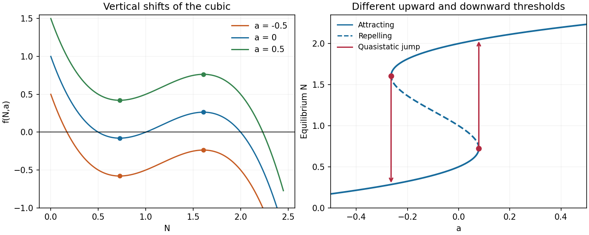

<h1 id="a/1/a/solution">Solution</h1>

↑ **Parent:** [A](../a.md)

Write $P(N)=f(N,0)$. Its three positive [zeros of a function](../../../../../zero-of-a-function.md) are $1/2,1,2$, and expansion and [differentiation](../../../../../differentiation.md) give

$$
P(N)=-N^3+\frac72N^2-\frac72N+1,\qquad P'(N)=-3N^2+7N-\frac72.
$$

Thus its [local minimum](../../../../../local-minimum.md) and maximum occur respectively at

$$
N_m=\frac{7-\sqrt7}{6},\qquad N_M=\frac{7+\sqrt7}{6},
$$

with values

$$
P(N_m)=\frac5{54}-\frac{7\sqrt7}{108}\simeq-0.0788913,\qquad
P(N_M)=\frac5{54}+\frac{7\sqrt7}{108}\simeq0.264076.
$$

The [function graph](../../../../../graph-of-a-function.md) approaches the value $1$ as $N\downarrow0$, decreases through its first zero to the minimum, increases through its second zero to the maximum, and then decreases through $2$ to $-\infty$. This fixes the shape and all axis crossings of the [cubic polynomial](../../../../../cubic-polynomial.md).

Changing $a$ translates the [function graph](../../../../../graph-of-a-function.md) vertically without moving either [stationary point](../../../../../stationary-point.md). For $a=1/2$ both extrema are above the horizontal axis: their heights are approximately $0.421109$ and $0.764076$. For $a=-1/2$ both are below it, at approximately $-0.578891$ and $-0.235924$. The [function graph](../../../../../graph-of-a-function.md) for $a=1/2$ therefore has only its final positive-axis crossing, whereas the [function graph](../../../../../graph-of-a-function.md) for $a=-1/2$ has only its first positive-axis crossing. The original plots mark the extrema and also show the [equilibrium point](../../../../../equilibrium-point-of-a-dynamical-system.md) branches used below.

**[Figure 1](#a/1/a/image-cubic-graphs-and-equilibrium-branches). Cubic graphs and equilibrium branches**.

## ↑ Ancestors (13)

1. [A](../a.md)
2. [1](../../1.md)
3. [A](../../../a.md)
4. [2008](../../../../2008-split.md)
5. [Past exam of the topics in applied mathematics course of the University of Oxford](../../../../split.md)
6. [Topics in applied mathematics course of the University of Oxford](../../../../../topics-in-applied-mathematics-course-of-the-university-of-oxford.md)
7. [Year 3 of the mathematics course of the University of Oxford](../../../../../year-3-of-the-mathematics-course-of-the-university-of-oxford.md)
8. [Mathematics course of the University of Oxford](../../../../../mathematics-course-of-the-university-of-oxford.md)
9. [Undergraduate course of the University of Oxford](../../../../../undergraduate-course-of-the-university-of-oxford.md)
10. [Course of the University of Oxford](../../../../../course-of-the-university-of-oxford.md)
11. [University of Oxford](../../../../../university-of-oxford-split.md)
12. [List of universities](../../../../../list-of-universities.md)
13. [Codex Wiki](../../../../../split.md)
