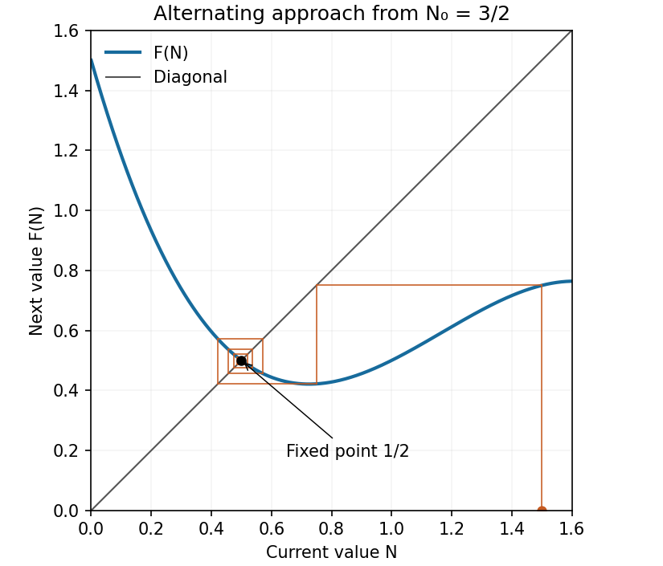

<h1 id="a/1/b/i/solution">Solution</h1>

↑ **Parent:** [I](../i.md)

Put $F(N)=f(N,1/2)$. A [cobweb plot](../../../../../../cobweb-plot.md) alternates a vertical move to the [function graph](../../../../../../graph-of-a-function.md) $y=F(N)$ with a horizontal move to the diagonal $y=N$. Beginning at $N_0=3/2$, the first [iterates](../../../../../../iterate.md) are

$$
N_1=\frac34,\qquad N_2=\frac{27}{64}\simeq0.421875,\qquad N_3\simeq0.571278.
$$

The diagram shows the ensuing approach to $1/2$ with alternating deviations. More precisely, if $e_t=N_t-1/2$, [Taylor expansion](../../../../../../taylor-expansion.md) at the [fixed point](../../../../../../fixed-point.md) gives

$$
e_{t+1}=-\frac34e_t+O(e_t^2).
$$

For sufficiently small nonzero deviations the sign reverses each step and their magnitudes contract. **The local approach is an alternating, geometrically damped oscillation**, with asymptotic contraction factor $3/4$ per iterate.

**[Figure 2](#a/1/b/i/image-cobweb-approaching-the-attracting-fixed-point). Cobweb approaching the attracting fixed point**.

## ↑ Ancestors (14)

1. [I](../i.md)
2. [B](../../b.md)
3. [1](../../../1.md)
4. [A](../../../../a.md)
5. [2008](../../../../../2008-split.md)
6. [Past exam of the topics in applied mathematics course of the University of Oxford](../../../../../split.md)
7. [Topics in applied mathematics course of the University of Oxford](../../../../../../topics-in-applied-mathematics-course-of-the-university-of-oxford.md)
8. [Year 3 of the mathematics course of the University of Oxford](../../../../../../year-3-of-the-mathematics-course-of-the-university-of-oxford.md)
9. [Mathematics course of the University of Oxford](../../../../../../mathematics-course-of-the-university-of-oxford.md)
10. [Undergraduate course of the University of Oxford](../../../../../../undergraduate-course-of-the-university-of-oxford.md)
11. [Course of the University of Oxford](../../../../../../course-of-the-university-of-oxford.md)
12. [University of Oxford](../../../../../../university-of-oxford-split.md)
13. [List of universities](../../../../../../list-of-universities.md)
14. [Codex Wiki](../../../../../../split.md)
