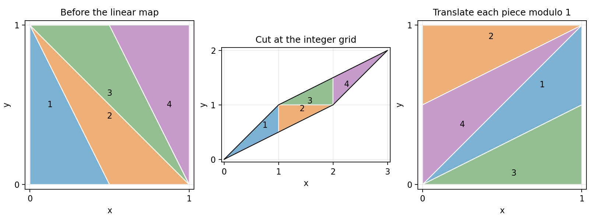

<h1 id="b/6/solution">Solution</h1>

↑ **Parent:** [6](../6.md)

For [integers](../../../../integer-split.md) $k,l$,

$$
A\begin{pmatrix}x+k\\y+l\end{pmatrix}-A\begin{pmatrix}x\\y\end{pmatrix}
=\begin{pmatrix}2k+l\\k+l\end{pmatrix}\in\mathbb Z^2.
$$

Thus reducing coordinates [modulo one](../../../../reduction-modulo-one.md) gives a well-defined [function](../../../../function-split.md) on the [torus](../../../../torus.md) $\mathbb R^2/\mathbb Z^2$. Its [determinant](../../../../determinant.md) is one and its inverse [matrix](../../../../matrix.md) is the [integer matrix](../../../../integer-matrix.md) $\begin{pmatrix}1&-1\\-1&2\end{pmatrix}$, so it induces a [bijection](../../../../bijection.md) of the [torus](../../../../torus.md). The [Jacobian determinant](../../../../jacobian-determinant.md) one makes this [bijection](../../../../bijection.md) [area-preserving](../../../../area-preserving-map.md).

Its [eigenvalues](../../../../eigenvalue.md) solve $\lambda^2-3\lambda+1=0$, giving

$$
\boxed{\lambda_+=\frac{3+\sqrt5}{2}>1,\qquad\lambda_-=\frac{3-\sqrt5}{2}=\lambda_+^{-1}<1.}
$$

There are therefore expanding and contracting [eigendirections](../../../../eigendirection.md) and no [eigenvalue](../../../../eigenvalue.md) on the [unit circle](../../../../complex-unit-circle.md): the [function](../../../../function-split.md) is a [hyperbolic toral automorphism](../../../../hyperbolic-toral-automorphism.md). The [Lyapunov exponents](../../../../lyapunov-exponent.md) per iterate are

$$
\boxed{\chi_+=\log\frac{3+\sqrt5}{2},\qquad\chi_-=-\log\frac{3+\sqrt5}{2}.}
$$

They sum to zero, as required by [area preservation](../../../../area-preserving-map.md).

The four vertices of the unit [square](../../../../square.md) map to $(0,0),(2,1),(3,2),(1,1)$, the vertices of an area-one [parallelogram](../../../../parallelogram.md). To reduce it [modulo one](../../../../reduction-modulo-one.md), cut it by the [integer](../../../../integer-split.md) grid. For each piece in the cell $[j,j+1]\times[k,k+1]$, translate by $(-j,-k)$. Up to boundary identifications these translated pieces partition the unit [square](../../../../square.md), because the inverse [integer matrix](../../../../integer-matrix.md) gives exactly one [torus](../../../../torus.md) preimage to every point. The colored pieces in the original diagram show the same pieces before and after these translations.

**[Figure 3](#b/6/image-area-preserving-torus-map-by-cutting-and-translating-its-parallelogram). Area-preserving torus map by cutting and translating its parallelogram**.

For the [Fibonacci](../../../../fibonacci-number.md) identity, at $n=1$ the claimed [matrix](../../../../matrix.md) is $\begin{pmatrix}F_2&F_1\\F_1&F_0\end{pmatrix}=A$. If the identity holds at $n$, multiplication on the right by $A$ gives

$$
A^{n+1}=\begin{pmatrix}2F_{2n}+F_{2n-1}&F_{2n}+F_{2n-1}\\2F_{2n-1}+F_{2n-2}&F_{2n-1}+F_{2n-2}\end{pmatrix}
=\begin{pmatrix}F_{2n+2}&F_{2n+1}\\F_{2n+1}&F_{2n}\end{pmatrix}.
$$

Each equality uses $F_{j+1}=F_j+F_{j-1}$, with the specified indexing $F_0=F_1=1$. This proves the formula for every positive [integer](../../../../integer-split.md) $n$.

A [fixed point](../../../../fixed-point.md) satisfies $(A-I)v\in\mathbb Z^2$. Since $A-I=\begin{pmatrix}1&1\\1&0\end{pmatrix}$ has an inverse [integer matrix](../../../../integer-matrix.md), this forces $v\in\mathbb Z^2$, so **the origin is the only [fixed point](../../../../fixed-point.md) [modulo one](../../../../reduction-modulo-one.md)**.

For period dividing two,

$$
(A^2-I)v=\begin{pmatrix}4&3\\3&1\end{pmatrix}\begin{pmatrix}x\\y\end{pmatrix}\in\mathbb Z^2.
$$

The second congruence gives $y=-3x\pmod1$; inserting it into the first gives $5x=0\pmod1$. Thus the complete list is

$$
(x,y)=\left(\frac j5,-\frac{3j}5\bmod1\right),\qquad j=0,1,2,3,4.
$$

The first is the fixed origin. Direct application of $A$ exchanges the other four in exactly two pairs:

$$
\boxed{\{(1/5,2/5),(4/5,3/5)\},\qquad\{(3/5,1/5),(2/5,4/5)\}.}
$$

This both verifies the [periodic orbits](../../../../periodic-orbit.md) and excludes additional ones.

Finally, if $v$ is fixed by $F^p$, then $(A^p-I)v=m$ for an [integer](../../../../integer-split.md) vector $m$. The [eigenvalues](../../../../eigenvalue.md) of $A^p-I$ are $\lambda_+^p-1$ and $\lambda_-^p-1$, neither zero. Hence its inverse exists and has [rational](../../../../rational-number.md) entries by the [adjugate matrix](../../../../adjugate-matrix.md) formula for an [integer matrix](../../../../integer-matrix.md). Therefore $v=(A^p-I)^{-1}m$ has [rational](../../../../rational-number.md) coordinates. The [derivative](../../../../derivative.md) of the [return map](../../../../poincare-map.md) is $A^p$, with [eigenvalues](../../../../eigenvalue.md) $\lambda_+^p>1$ and $0<\lambda_-^p<1$. **Every [periodic point](../../../../periodic-point.md) is a hyperbolic [saddle fixed point of a map](../../../../saddle-fixed-point-of-a-map.md) and is [unstable](../../../../instability.md)**, although [perturbations](../../../../perturbation.md) in its [stable](../../../../lyapunov-stability.md) [eigendirection](../../../../eigendirection.md) contract.

## ↑ Ancestors (12)

1. [6](../6.md)
2. [B](../../b.md)
3. [2008](../../../2008-split.md)
4. [Past exam of the topics in applied mathematics course of the University of Oxford](../../../split.md)
5. [Topics in applied mathematics course of the University of Oxford](../../../../topics-in-applied-mathematics-course-of-the-university-of-oxford.md)
6. [Year 3 of the mathematics course of the University of Oxford](../../../../year-3-of-the-mathematics-course-of-the-university-of-oxford.md)
7. [Mathematics course of the University of Oxford](../../../../mathematics-course-of-the-university-of-oxford.md)
8. [Undergraduate course of the University of Oxford](../../../../undergraduate-course-of-the-university-of-oxford.md)
9. [Course of the University of Oxford](../../../../course-of-the-university-of-oxford.md)
10. [University of Oxford](../../../../university-of-oxford-split.md)
11. [List of universities](../../../../list-of-universities.md)
12. [Codex Wiki](../../../../split.md)
