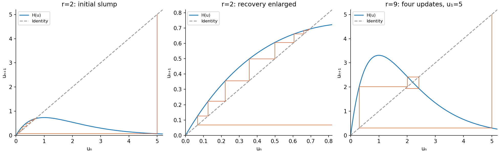
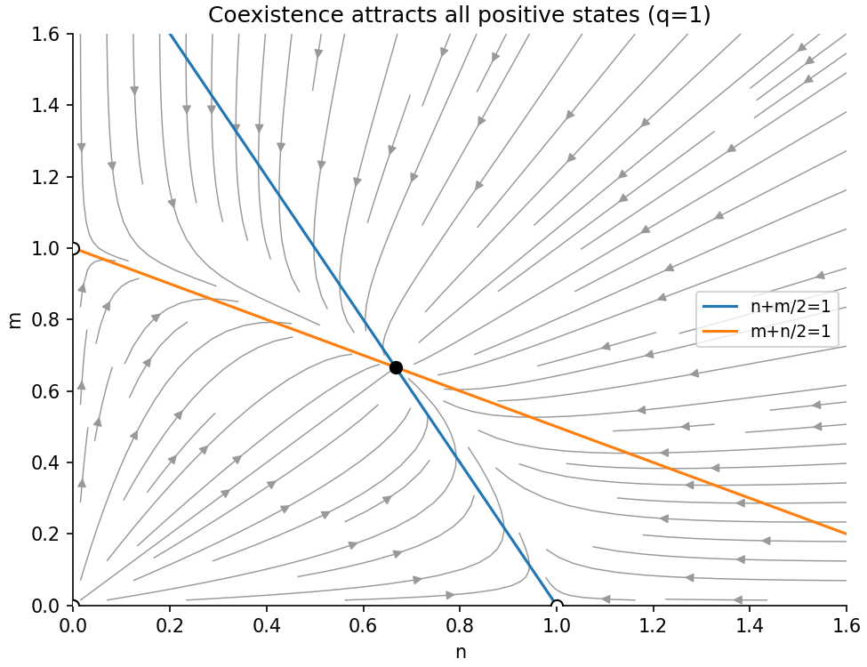
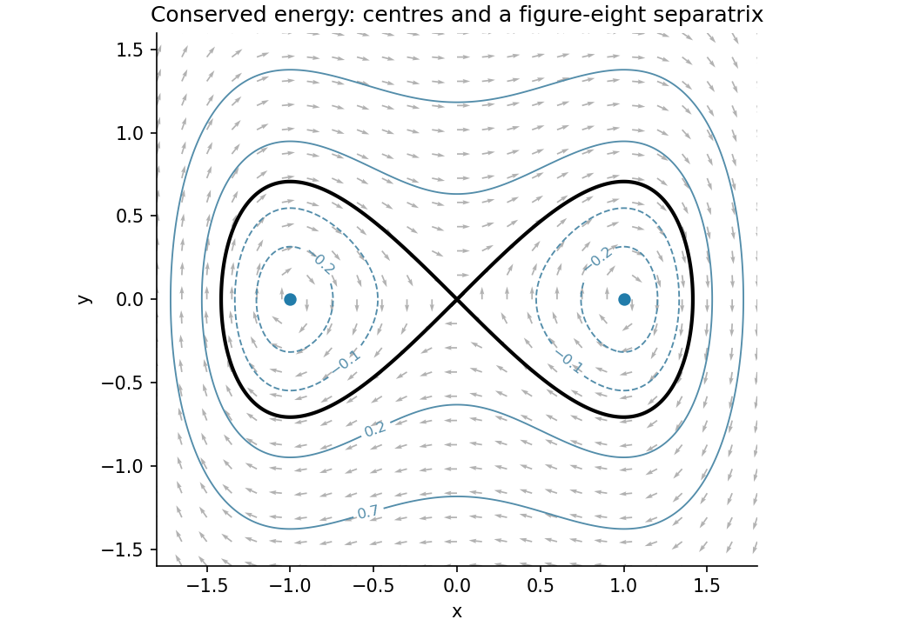
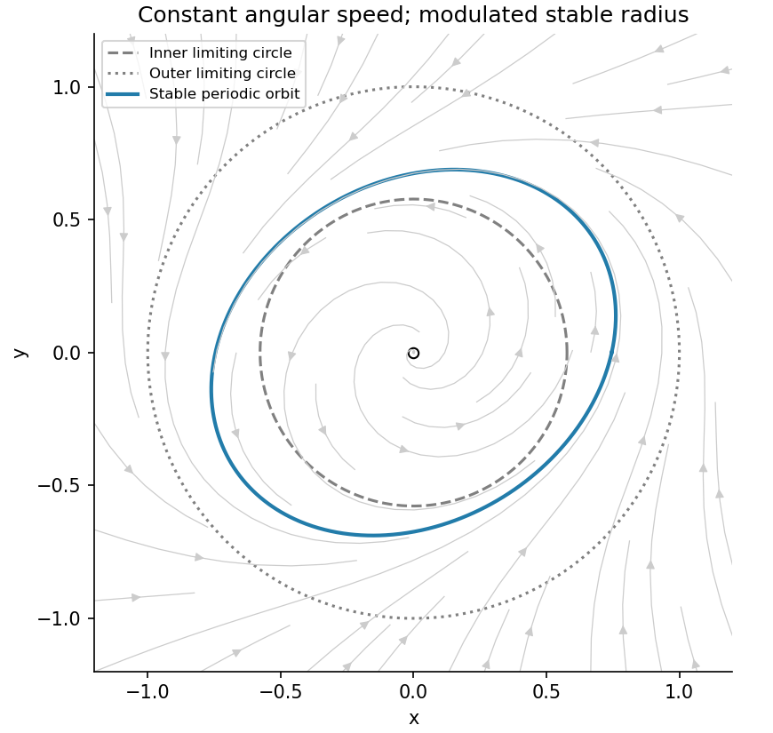
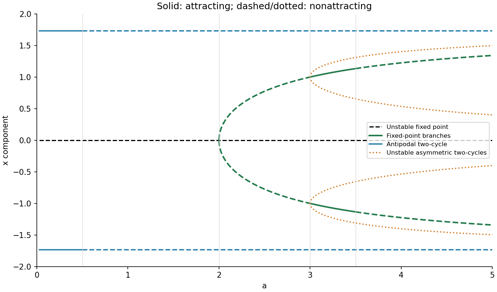
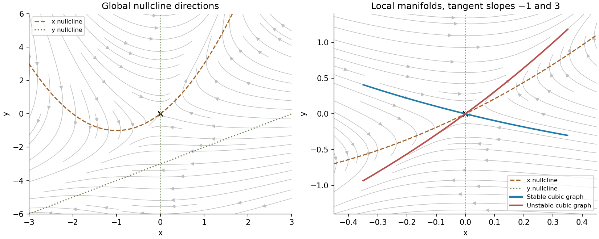

# 2009

↑ **Parent:** [Past exam of the topics in applied mathematics course of the University of Oxford](../past-exam-of-the-topics-in-applied-mathematics-course-of-the-university-of-oxford.md)

This [University of Oxford](../university-of-oxford.md) Part B paper covers Mathematical Ecology and Biology in section A and Nonlinear Systems in section B. It is cross-listed for Mathematics, Mathematics and Computer Science, and Mathematics and Statistics. [Source release](https://www.whatdotheyknow.com/request/maths_past_papers_3) A bounded official-source search found no advertised answers for this exact paper. The complete archive transcription retains its supplied graph and printed map; the solutions include the antipodal [two-cycle](../dynamical-systems.md#period-two-orbit) lost by the proposed quadratic reduction.

**Table of contents**

- [A](#a)
  - [1](#a/1)
    - [a](#a/1/a)
      - [Solution](#a/1/a/solution)
    - [b](#a/1/b)
      - [i](#a/1/b/i)
        - [Solution](#a/1/b/i/solution)
      - [ii](#a/1/b/ii)
        - [Solution](#a/1/b/ii/solution)
    - [c](#a/1/c)
      - [i](#a/1/c/i)
        - [Solution](#a/1/c/i/solution)
      - [ii](#a/1/c/ii)
        - [Solution](#a/1/c/ii/solution)
      - [iii](#a/1/c/iii)
        - [Solution](#a/1/c/iii/solution)
  - [2](#a/2)
    - [a](#a/2/a)
      - [i](#a/2/a/i)
        - [Solution](#a/2/a/i/solution)
      - [ii](#a/2/a/ii)
        - [Solution](#a/2/a/ii/solution)
    - [b](#a/2/b)
      - [i](#a/2/b/i)
        - [Solution](#a/2/b/i/solution)
      - [ii](#a/2/b/ii)
        - [Solution](#a/2/b/ii/solution)
    - [c](#a/2/c)
      - [i](#a/2/c/i)
        - [Solution](#a/2/c/i/solution)
      - [ii](#a/2/c/ii)
        - [Solution](#a/2/c/ii/solution)
  - [3](#a/3)
    - [a](#a/3/a)
      - [i](#a/3/a/i)
        - [Solution](#a/3/a/i/solution)
      - [ii](#a/3/a/ii)
        - [Solution](#a/3/a/ii/solution)
      - [iii](#a/3/a/iii)
        - [Solution](#a/3/a/iii/solution)
    - [b](#a/3/b)
      - [i](#a/3/b/i)
        - [Solution](#a/3/b/i/solution)
      - [ii](#a/3/b/ii)
        - [Solution](#a/3/b/ii/solution)
- [B](#b)
  - [4](#b/4)
    - [a](#b/4/a)
      - [i](#b/4/a/i)
        - [Solution](#b/4/a/i/solution)
      - [ii](#b/4/a/ii)
        - [Solution](#b/4/a/ii/solution)
      - [iii](#b/4/a/iii)
        - [Solution](#b/4/a/iii/solution)
    - [b](#b/4/b)
      - [i](#b/4/b/i)
        - [Solution](#b/4/b/i/solution)
      - [ii](#b/4/b/ii)
        - [Solution](#b/4/b/ii/solution)
      - [iii](#b/4/b/iii)
        - [Solution](#b/4/b/iii/solution)
  - [5](#b/5)
    - [a](#b/5/a)
      - [Solution](#b/5/a/solution)
    - [b](#b/5/b)
      - [Solution](#b/5/b/solution)
    - [c](#b/5/c)
      - [Solution](#b/5/c/solution)
  - [6](#b/6)
    - [Solution](#b/6/solution)

## A

↑ **Parent:** [2009](2009.md)

<h3 id="a/1">1</h3>

↑ **Parent:** [A](#a)

<h4 id="a/1/a">a</h4>

↑ **Parent:** [1](#a/1)

<h5 id="a/1/a/solution">Solution</h5>

↑ **Parent:** [A](#a/1/a)

For the [Ricker population map](../mathematical-biology.md#ricker-population-map) $H(u)=rue^{-u}$, [fixed points](../function.md#fixed-point) satisfy $u=0$ or $re^{-u}=1$. Thus zero exists for all $r>0$, while $u_*=\log r$ is positive exactly when $r>1$. Since $H'(u)=re^{-u}(1-u)$, the respective [periodic-orbit multipliers](../discrete-dynamical-system.md#multiplier-of-a-periodic-orbit-of-an-iteration) are $r$ and $1-\log r$.

Consequently **zero is linearly attracting for $0<r<1$ and repelling for $r>1$; the positive [biological population](../ecology.md#population-biology) is linearly attracting for $1<r<e^2$ and repelling for $r>e^2$**. The [periodic-orbit multiplier](../discrete-dynamical-system.md#multiplier-of-a-periodic-orbit-of-an-iteration) of the positive point is positive below $r=e$ and negative above it, distinguishing monotone from alternating local convergence. At $r=1$, the coincident zero state has unit [periodic-orbit multiplier](../discrete-dynamical-system.md#multiplier-of-a-periodic-orbit-of-an-iteration) but $0<H(u)<u$ for every $u>0$, giving nonlinear attraction from the physical right side. At $r=e^2$ the [periodic-orbit multiplier](../discrete-dynamical-system.md#multiplier-of-a-periodic-orbit-of-an-iteration) is $-1$ and [linearization](../algebra.md#linearization) is inconclusive. Writing $u=2+\eta$, the second iterate has expansion $\eta\mapsto\eta-\eta^3/3+O(\eta^4)$, so the critical point is weakly attracting; beyond it a period-doubling instability occurs.

<h4 id="a/1/b">b</h4>

↑ **Parent:** [1](#a/1)

<h5 id="a/1/b/i">i</h5>

↑ **Parent:** [B](#a/1/b)

<h6 id="a/1/b/i/solution">Solution</h6>

↑ **Parent:** [I](#a/1/b/i)

A large initial [biological population](../ecology.md#population-biology) maps to a very small positive [biological population](../ecology.md#population-biology) because $ue^{-u}\to0$ at large $u$: the initial slump is followed by recovery. Cobwebbing alternates a vertical step from $(u_n,u_n)$ to $(u_n,H(u_n))$ with a horizontal step to the diagonal at $(u_{n+1},u_{n+1})$. The figure uses the explicit illustrative choice $u_1=5$.

For $r=2$, every positive [orbit](../dynamical-systems.md#orbit-dynamical-system) subsequently lies below the maximum $H(1)=2/e<1$. On $[0,2/e]$ the map is increasing, with the unique positive [fixed point](../function.md#fixed-point) $\log2$. Below that point $H(u)>u$ and $H(u)<\log2$; above it $H(u)<u$ and $H(u)>\log2$. Therefore the trapped iterates approach the [fixed point](../function.md#fixed-point) monotonically from whichever side they enter. In particular

$$
\boxed{u_n\longrightarrow\log2\quad\text{for every }u_1>0.}
$$

The extinction initial value remains zero, but exact extinction is never reached from a positive finite [biological population](../ecology.md#population-biology) in this deterministic model.

**[Figure 1](#a/1/b/i/image-ricker-cobwebs-after-a-large-initial-population-with-the-first-five-generations-at-r-equals-nine). Ricker cobwebs after a large initial population, with the first five generations at r equals nine**.

<h5 id="a/1/b/ii">ii</h5>

↑ **Parent:** [B](#a/1/b)

<h6 id="a/1/b/ii/solution">Solution</h6>

↑ **Parent:** [Ii](#a/1/b/ii)

Apply the same vertical-then-horizontal cobweb construction to $H(u)=9ue^{-u}$. Since no numerical value of the large initial [biological population](../ecology.md#population-biology) is prescribed, an exact five-generation list is $u_1$, $H(u_1)$, $H^2(u_1)$, $H^3(u_1)$, $H^4(u_1)$. For the plotted example $u_1=5$, these values are

$$
\boxed{5,\quad0.303208,\quad2.015121,\quad2.417618,\quad1.939421.}
$$

The initial slump is followed by rapid growth and an alternating overshoot about $\log9\simeq2.197225$, which is now unstable because its [periodic-orbit multiplier](../discrete-dynamical-system.md#multiplier-of-a-periodic-orbit-of-an-iteration) $1-\log9<-1$. A still larger initial [biological population](../ecology.md#population-biology) can remain extremely small for more than these four updates; the example illustrates the requested construction without imposing an unstated universal numerical starting value.

<h4 id="a/1/c">c</h4>

↑ **Parent:** [1](#a/1)

<h5 id="a/1/c/i">i</h5>

↑ **Parent:** [C](#a/1/c)

<h6 id="a/1/c/i/solution">Solution</h6>

↑ **Parent:** [I](#a/1/c/i)

For $u>0$, the second-iterate equation $H^2(u)=u$ is equivalent to $u+H(u)=2\log r$. Write $L=\log r$ and let paired points be $L-d,L+d$. The condition $H(L-d)=L+d$ becomes $\tanh(d/2)=d/L$. At $r=9$, $L=2\log3>2$, so [strict concavity](../real-analysis.md#strict-concavity) of the positive [hyperbolic tangent](../calculus.md#hyperbolic-tangent) gives one nonzero positive $d$, as well as $d=0$. Here it is exactly $d=\log3$.

Thus the four nonnegative [fixed points](../function.md#fixed-point) of $H^2$ are

$$
\boxed{0,\quad\log3,\quad2\log3,\quad3\log3.}
$$

Zero has [periodic-orbit multiplier](../discrete-dynamical-system.md#multiplier-of-a-periodic-orbit-of-an-iteration) $81$ and the central point has [periodic-orbit multiplier](../discrete-dynamical-system.md#multiplier-of-a-periodic-orbit-of-an-iteration) $(1-2\log3)^2>1$, so both are unstable. The outer two points are exchanged by $H$, since $H(\log3)=3\log3$ and $H(3\log3)=\log3$. Their common second-iterate [periodic-orbit multiplier](../discrete-dynamical-system.md#multiplier-of-a-periodic-orbit-of-an-iteration) is

$$
M=H'(\log3)H'(3\log3)=(1-\log3)(1-3\log3)\simeq0.226398.
$$

Its magnitude is below one, so both outer [fixed points](../function.md#fixed-point) of $H^2$ are stable. This verifies the crossings and stability in the supplied graph rather than reading stability from crossing direction alone.

<h5 id="a/1/c/ii">ii</h5>

↑ **Parent:** [C](#a/1/c)

<h6 id="a/1/c/ii/solution">Solution</h6>

↑ **Parent:** [Ii](#a/1/c/ii)

The [Ricker population map two-cycle](../mathematical-biology.md#ricker-population-map-two-cycle) consists of the two stable points of the second iterate, exchanged by the original map. Thus generic positive [orbits](../dynamical-systems.md#orbit-dynamical-system) approach alternating values

$$
\boxed{\log3\ \longleftrightarrow\ 3\log3.}
$$

There are exceptions: zero stays extinct, while an [orbit](../dynamical-systems.md#orbit-dynamical-system) starting at $\log9$ or at one of its finite preimages eventually stays at that unstable [fixed point](../function.md#fixed-point).

To justify the large-time conclusion, put $b=9/e$ and $a=H(b)\simeq1.087>1$. Every first image is at most $b$. A positive [orbit](../dynamical-systems.md#orbit-dynamical-system) below $a$ grows until it enters $[a,b]$; if it never entered, its monotone limit below $a<\log9$ would contradict the fixed-point equation. The interval $[a,b]$ is invariant. On it $H$ is decreasing, so $H^2$ is increasing. Its only [fixed points](../function.md#fixed-point) there are the three positive points already found; its graph signs make iterations below the unstable middle point converge to the lower stable point, and those above converge to the upper stable point. Interchanging even and odd subsequences under $H$ then gives the stated [two-cycle](../dynamical-systems.md#period-two-orbit). This is regular period-two behaviour, not chaos at this parameter.

<h5 id="a/1/c/iii">iii</h5>

↑ **Parent:** [C](#a/1/c)

<h6 id="a/1/c/iii/solution">Solution</h6>

↑ **Parent:** [Iii](#a/1/c/iii)

Let $L=\log r$. The given expansion implies $u_*=2L+O(L/r)$ and therefore

$$
e^{-u_*}=r^{-2}[1+O(L/r)].
$$

Using $H'(u)=re^{-u}(1-u)$ gives precisely

$$
\boxed{H'(u_*)=\frac1r[1-2L+O(L/r)][1+O(L/r)].}
$$

The paired low value is $v_*=H(u_*)=(2L/r)[1+O(L/r)]$. It is small, so $e^{-v_*}(1-v_*)=1+O(L/r)$ and

$$
\boxed{H'(H(u_*))=r[1+O(L/r)]\sim r.}
$$

By the [chain rule](../calculus.md#chain-rule) the second-iterate [periodic-orbit multiplier](../discrete-dynamical-system.md#multiplier-of-a-periodic-orbit-of-an-iteration) is their product:

$$
(H^2)'(u_*)=1-2L+O(L^2/r).
$$

Since $L^2/r\to0$ while $L\to\infty$, this tends to $-\infty$ and eventually has magnitude above one. Thus **the large second-iterate [fixed point](../function.md#fixed-point), and hence its associated [two-cycle](../dynamical-systems.md#period-two-orbit), is unstable for sufficiently large $r$**. The high state's small [derivative](../calculus.md#derivative) alone does not imply stability: the low state's [derivative](../calculus.md#derivative) supplies the compensating factor of order $r$.

<h3 id="a/2">2</h3>

↑ **Parent:** [A](#a)

<h4 id="a/2/a">a</h4>

↑ **Parent:** [2](#a/2)

<h5 id="a/2/a/i">i</h5>

↑ **Parent:** [A](#a/2/a)

<h6 id="a/2/a/i/solution">Solution</h6>

↑ **Parent:** [I](#a/2/a/i)

The [law of mass action](../mathematical-biology.md#law-of-mass-action) assigns [infection](../biology.md#infection) rate $rIS$, death rate $aI$, and [vaccination](../biology.md#vaccination) rate $pIS$. [Vaccination](../biology.md#vaccination) consumes a susceptible animal and produces a vaccinated one while leaving the triggering infected animal present. In dimensional time $T$,

$$
\boxed{I_T=rIS-aI,\quad S_T=-(r+p)IS,\quad V_T=pIS,\quad R_T=aI.}
$$

All compartment counts remain nonnegative. Adding the equations gives $(I+S+V+R)_T=0$; deaths are retained in the bookkeeping compartment rather than removed from that conserved count. There is no recovery class of live immune survivors in the [infection](../biology.md#infection) reaction: in this particular model every animal that becomes infected ultimately dies.

<h5 id="a/2/a/ii">ii</h5>

↑ **Parent:** [A](#a/2/a)

<h6 id="a/2/a/ii/solution">Solution</h6>

↑ **Parent:** [Ii](#a/2/a/ii)

Use $t=aT$ and scale each count by the susceptible [infection](../biology.md#infection) threshold $a/r$:

$$
(I,S,V,R)=\frac ar(q,s,v,m),\qquad\eta=\frac pr.
$$

For example $I_T=(a^2/r)q_t$, while $rIS=(a^2/r)qs$. Dividing all equations by $a^2/r$ therefore gives

$$
\boxed{q_t=q(s-1),\quad s_t=-(1+\eta)qs,\quad v_t=\eta qs,\quad m_t=q.}
$$

Thus $\eta$ measures the [vaccination](../biology.md#vaccination) response relative to transmission in this mass-action model. The total dimensionless count $q+s+v+m$ is conserved, and the instantaneous [infection](../biology.md#infection) growth threshold is $s=1$.

<h4 id="a/2/b">b</h4>

↑ **Parent:** [2](#a/2)

<h5 id="a/2/b/i">i</h5>

↑ **Parent:** [B](#a/2/b)

<h6 id="a/2/b/i/solution">Solution</h6>

↑ **Parent:** [I](#a/2/b/i)

While $q>0$ and $s>0$, division of the equations gives $dq/ds=(1-s)/[(1+\eta)s]$ and $dv/ds=-\eta/(1+\eta)$. Integrating from the initial data yields

$$
q(s)=q_0+\frac{s_0-s+\log(s/s_0)}{1+\eta},\qquad v(s)=\frac\eta{1+\eta}(s_0-s).
$$

Let $s_\infty$ be the final susceptible level. Using $q_\infty=0$ gives

$$
\boxed{s_\infty-\log s_\infty=s_0-\log s_0+(1+\eta)q_0,\qquad0<s_\infty<\min(s_0,1).}
$$

This is the smaller positive root selected by decreasing susceptibility; the function $s-\log s$ is decreasing on $(0,1)$, so that selected root is unique. Its upper bound below $s_0$ also follows directly because the added positive term moves the decreasing-branch root left.

Conservation of the total count, or integration of $m_t=q$, then gives the number killed, including those initially infected:

$$
\boxed{m_\infty=q_0+\frac{s_0-s_\infty}{1+\eta}.}
$$

The remaining susceptible loss is split between [infection](../biology.md#infection) and [vaccination](../biology.md#vaccination) in fixed ratio $1:\eta$; this explains the factor multiplying $s_0-s_\infty$.

<h5 id="a/2/b/ii">ii</h5>

↑ **Parent:** [B](#a/2/b)

<h6 id="a/2/b/ii/solution">Solution</h6>

↑ **Parent:** [Ii](#a/2/b/ii)

Rearrange the final-size equation as $s_\infty=s_0\exp[s_\infty-s_0-(1+\eta)q_0]$. With fixed $q_0>0,s_0>0$ and $\eta\to\infty$, the selected root is exponentially small:

$$
s_\infty\sim s_0e^{-s_0-(1+\eta)q_0}.
$$

Substitution into the death count yields

$$
\boxed{m_\infty=q_0+\frac{s_0}{\eta}+O(\eta^{-2})+O(e^{-\eta q_0}/\eta).}
$$

Thus strong [vaccination](../biology.md#vaccination) suppresses most secondary fatal infections but cannot save the $q_0$ animals already infected, as required by the stated reaction scheme. The limit holds for the fixed positive initial [infection](../biology.md#infection) assumed here; it need not be uniform if $q_0$ is allowed to shrink with increasing $\eta$.

<h4 id="a/2/c">c</h4>

↑ **Parent:** [2](#a/2)

<h5 id="a/2/c/i">i</h5>

↑ **Parent:** [C](#a/2/c)

<h6 id="a/2/c/i/solution">Solution</h6>

↑ **Parent:** [I](#a/2/c/i)

For the [vaccinated epidemic-wave final size](../mathematical-biology.md#vaccinated-epidemic-wave-final-size), write $s_-=s(-\infty)$. From the travelling-wave equations, $dv/ds=-\eta/(1+\eta)$ and $dm/ds=-1/[(1+\eta)s]$. Using the ahead-of-wave boundary data gives

$$
v(z)=\frac\eta{1+\eta}[s^*-s(z)],\qquad m(z)=\frac1{1+\eta}\log\frac{s^*}{s(z)}.
$$

Adding the four wave equations yields $q''+c(q+s+v+m)'=0$. Integrate once and use $q'(\infty)=0$ to obtain $q'+c(q+s+v+m)=cs^*$. At minus infinity the assumptions $q=q'=0$ therefore give $s_-+v_-+m_-=s^*$.

Combining these identities shows that $s_-$ satisfies

$$
\boxed{\log(s^*/s_-)=s^*-s_-.}
$$

The nontrivial positive epidemic-wave root has $0<s_-<1<s^*$; the other root $s_-=s^*$ is the disease-free solution. The assumed positive wave consequently requires $s^*>1$; for $s^*\leq1$ the displayed relation has no distinct smaller root.

At the back of the pulse there are no infectives, so the live [biological population](../ecology.md#population-biology) consists of susceptible and vaccinated animals:

$$
\boxed{s_-+v_-=\frac{s_-+\eta s^*}{1+\eta}.}
$$

The final-size root is independent of [vaccination](../biology.md#vaccination) strength in this travelling-wave problem; [vaccination](../biology.md#vaccination) instead changes the split between deaths and survivors for the total [biological population](../ecology.md#population-biology) lost from susceptibility.

<h5 id="a/2/c/ii">ii</h5>

↑ **Parent:** [C](#a/2/c)

<h6 id="a/2/c/ii/solution">Solution</h6>

↑ **Parent:** [Ii](#a/2/c/ii)

From the preceding conservation identity,

$$
\boxed{m_- =s^*-(s_-+v_-)=\frac{s^*-s_-}{1+\eta}=\frac1{1+\eta}\log\frac{s^*}{s_-}.}
$$

The nontrivial root $s_-$ depends only on $s^*$, through $\log(s^*/s_-)=s^*-s_-$. Therefore the coefficient $s^*-s_-$ is independent of $\eta$, proving the exact requested proportionality to $(1+\eta)^{-1}$, conditional on existence of the positive wave. This is stronger than an asymptotic estimate and differs from the spatially homogeneous problem with a fixed positive initially infected count.

<h3 id="a/3">3</h3>

↑ **Parent:** [A](#a)

<h4 id="a/3/a">a</h4>

↑ **Parent:** [3](#a/3)

<h5 id="a/3/a/i">i</h5>

↑ **Parent:** [A](#a/3/a)

<h6 id="a/3/a/i/solution">Solution</h6>

↑ **Parent:** [I](#a/3/a/i)

Set $N=Kn$, $M=Km$ and $t=rT$. Then $dN/dT=rK\,dn/dt$ and $dM/dT=rK\,dm/dt$, giving

$$
\boxed{n_t=n(1-n-m/2),\qquad m_t=qm(1-m-n/2),\qquad q=p/r>0.}
$$

The common carrying-capacity scale becomes one, while $q$ is the ratio of the two intrinsic growth rates. Intraspecific competition is twice as strong as the cross-species effect in these dimensionless equations.

<h5 id="a/3/a/ii">ii</h5>

↑ **Parent:** [A](#a/3/a)

<h6 id="a/3/a/ii/solution">Solution</h6>

↑ **Parent:** [Ii](#a/3/a/ii)

In coordinate order $(n,m)$ the [Jacobian matrix](../multivariable-calculus.md#jacobian-matrix) is

$$
J(n,m)=\begin{pmatrix}1-2n-m/2&-n/2\\-qm/2&q(1-2m-n/2)\end{pmatrix}.
$$

At the origin it is $\operatorname{diag}(1,q)$, giving a repelling [node equilibrium](../dynamical-systems.md#node-dynamical-systems); when $q=1$ the repeated positive [eigenvalue](../linear-operator-theory.md#eigenvalue) is semisimple. At coexistence it is

$$
J_*=-\frac13\begin{pmatrix}2&1\\q&2q\end{pmatrix}.
$$

Its [trace](../linear-algebra.md#matrix-trace) is $-2(1+q)/3$, [determinant](../multilinear-algebra.md#determinant) $q/3$, and characteristic [discriminant](../polynomial.md#discriminant) $4(q^2-q+1)/9>0$. Hence both [eigenvalues](../linear-operator-theory.md#eigenvalue) are real and negative, proving a stable [node equilibrium](../dynamical-systems.md#node-dynamical-systems) for every $q>0$.

The other [equilibria](../dynamical-systems.md#equilibrium-point-of-a-dynamical-system) are $(1,0)$ and $(0,1)$. Their triangular Jacobians have [eigenvalues](../linear-operator-theory.md#eigenvalue) $(-1,q/2)$ and $(1/2,-q)$ respectively. Thus **both single-species [equilibria](../dynamical-systems.md#equilibrium-point-of-a-dynamical-system) are saddles**, with their attracting directions on the corresponding coordinate axes and unstable directions allowing invasion by the other species. There are no further nonnegative [equilibria](../dynamical-systems.md#equilibrium-point-of-a-dynamical-system) because the two non-axis [nullclines](../dynamical-systems.md#nullcline) intersect only at $(2/3,2/3)$.

<h5 id="a/3/a/iii">iii</h5>

↑ **Parent:** [A](#a/3/a)

<h6 id="a/3/a/iii/solution">Solution</h6>

↑ **Parent:** [Iii](#a/3/a/iii)

The non-axis [nullclines](../dynamical-systems.md#nullcline) are $n+m/2=1$ and $m+n/2=1$, intersecting at $(2/3,2/3)$. Each [biological population](../ecology.md#population-biology) grows below its own line and decreases above it. The axes are invariant; along a positive axis the surviving species follows logistic growth towards its unit [carrying capacity](../mathematical-biology.md#carrying-capacity). The origin remains fixed.

All strictly positive initial states converge to coexistence. An [entropy-shaped Lyapunov function for weak competition](../mathematical-biology.md#entropy-shaped-lyapunov-function-for-weak-competition) proves the global conclusion beyond the local arrows: put $k=2/3$ and use

$$
V=n-k-k\log(n/k)+\frac1q[m-k-k\log(m/k)].
$$

Each bracket is nonnegative, vanishing only at its [equilibrium](../dynamical-systems.md#equilibrium-point-of-a-dynamical-system) value, and tends to infinity at zero or infinity. Differentiation gives

$$
\dot V=-(n-k)^2-(m-k)^2-(n-k)(m-k)\leq-\tfrac12[(n-k)^2+(m-k)^2].
$$

Thus positive trajectories remain in a [compact](../topology.md#compact-space) level set inside the quadrant and approach its unique zero-derivative state. Therefore

$$
\boxed{(n,m)\to(2/3,2/3)\text{ for }n(0),m(0)>0.}
$$

The [phase portrait](../dynamical-systems.md#phase-portrait) shows the stable coexistence point, invading directions near the axis saddles, and the two straight [nullclines](../dynamical-systems.md#nullcline).

**[Figure 2](#a/3/a/iii/image-competing-populations-converge-to-coexistence-in-the-positive-quadrant). Competing populations converge to coexistence in the positive quadrant**.

<h4 id="a/3/b">b</h4>

↑ **Parent:** [3](#a/3)

<h5 id="a/3/b/i">i</h5>

↑ **Parent:** [B](#a/3/b)

<h6 id="a/3/b/i/solution">Solution</h6>

↑ **Parent:** [I](#a/3/b/i)

The coexistence [Jacobian matrix](../multivariable-calculus.md#jacobian-matrix) calculated in part (a) has negative diagonal entries and positive [determinant](../multilinear-algebra.md#determinant). For any spatial mode with squared [wave number](../wave-equation.md#wavenumber) $k^2\geq0$, the linearized [matrix](../vector-space.md#matrix) is $J_*-k^2\operatorname{diag}(1,\eta)$. Its [trace](../linear-algebra.md#matrix-trace) is more negative than before, and its [determinant](../multilinear-algebra.md#determinant) is

$$
\boxed{\frac q3+\frac{2(\eta+q)}3k^2+\eta k^4>0.}
$$

Hence both [eigenvalues](../linear-operator-theory.md#eigenvalue) retain negative real parts for every mode and every $\eta>0$. This is the mechanism by which [negative self-response excludes two-species Turing instability](../diffusion-equation.md#negative-self-response-excludes-two-species-turing-instability), excluding diffusion-driven instability using only the reaction [Jacobian matrix](../multivariable-calculus.md#jacobian-matrix) already computed, together with the diagonal diffusive [damping](../wave-equation.md#damping). In particular unequal [diffusion](../thermodynamics.md#diffusion) is not enough to produce a [Turing pattern](../diffusion-equation.md#turing-pattern) when both local self-responses are negative in this two-species competitive model.

<h5 id="a/3/b/ii">ii</h5>

↑ **Parent:** [B](#a/3/b)

<h6 id="a/3/b/ii/solution">Solution</h6>

↑ **Parent:** [Ii](#a/3/b/ii)

For $q=\eta=1$, $J_*$ has [eigenvectors](../linear-operator-theory.md#eigenvector) $(1,1)$ and $(1,-1)$ with [eigenvalues](../linear-operator-theory.md#eigenvalue) $-1$ and $-1/3$. The Neumann spatial modes are $\cos(j\pi x/L)$, $j=0,1,\ldots$. Combining each with those two reaction directions gives temporal rates

$$
-1-(j\pi/L)^2,\qquad-1/3-(j\pi/L)^2.
$$

Every linear perturbation therefore decays at least as fast as $e^{-t/3}$. The slowest mode is the spatially uniform antisymmetric change of the two [biological populations](../ecology.md#population-biology). Thus

$$
\boxed{m-2/3=O(e^{-t/3}),\qquad n-2/3=O(e^{-t/3}).}
$$

Small nonlinear perturbations have the same bound, not just a formal mode calculation. In one spatial dimension take sufficiently small smooth Neumann data, or small data in a norm such as $H^1$ that controls quadratic products. The linear semigroup decays at rate $1/3$, and the nonlinear remainder is quadratic. Standard small-data variation-of-constants estimates first give decay $e^{-ct}$ for any fixed $c<1/3$. Choose $1/6<c<1/3$; then the remainder is $O(e^{-2ct})$, and its Duhamel convolution with $e^{-(t-s)/3}$ is $O(e^{-t/3})$ because $2c>1/3$. This sharpens the preliminary bound to the displayed rate. Special initial data with no slow-mode component may decay faster, but the general estimate cannot be improved uniformly.

<h2 id="b">B</h2>

↑ **Parent:** [2009](2009.md)

<h3 id="b/4">4</h3>

↑ **Parent:** [B](#b)

<h4 id="b/4/a">a</h4>

↑ **Parent:** [4](#b/4)

<h5 id="b/4/a/i">i</h5>

↑ **Parent:** [A](#b/4/a)

<h6 id="b/4/a/i/solution">Solution</h6>

↑ **Parent:** [I](#b/4/a/i)

An [equilibrium](../dynamical-systems.md#equilibrium-point-of-a-dynamical-system) is [asymptotically stable](../dynamical-systems.md#asymptotic-stability) when it is Lyapunov stable and attracts every initial state in some neighbourhood. [Lyapunov stability](../dynamical-systems.md#lyapunov-stability) means that sufficiently small initial displacement stays small for all future times; attraction additionally requires convergence to the [equilibrium](../dynamical-systems.md#equilibrium-point-of-a-dynamical-system). A [Lyapunov function](../dynamical-systems.md#lyapunov-function) is a differentiable positive-definite scalar function near the [equilibrium](../dynamical-systems.md#equilibrium-point-of-a-dynamical-system) whose [derivative](../calculus.md#derivative) along solutions is nonpositive. Strict negativity, or an appropriate invariant-set argument for a non-strict [derivative](../calculus.md#derivative), gives [asymptotic stability](../dynamical-systems.md#asymptotic-stability).

For $\nu=-1$, [equilibria](../dynamical-systems.md#equilibrium-point-of-a-dynamical-system) satisfy $y=0$ and $x+x^3=0$, so only $(0,0)$ is real. Its [Jacobian matrix](../multivariable-calculus.md#jacobian-matrix) is $\left(\begin{smallmatrix}0&1\\-1&0\end{smallmatrix}\right)$, with [eigenvalues](../linear-operator-theory.md#eigenvalue) $\pm i$ for every $\kappa$. It is a linear [centre equilibrium](../dynamical-systems.md#center-equilibrium), so [linearization](../algebra.md#linearization) alone cannot decide nonlinear attraction.

Use the positive proper [energy](../energy.md)

$$
E=\tfrac12y^2+\tfrac12x^2+\tfrac14x^4,\qquad\boxed{\dot E=\kappa x^2y^2.}
$$

For $\kappa<0$, [energy](../energy.md) sublevel sets are [compact](../topology.md#compact-space) and invariant. The zero-derivative set is the union of the axes, but its only invariant subset is the origin: on $x=0,y\ne0$ one immediately leaves that axis, and on $y=0,x\ne0$ one has $\dot y=-x-x^3\ne0$. [LaSalle's invariance principle](../dynamical-systems.md#lasalle-s-invariance-principle) therefore proves global [asymptotic stability](../dynamical-systems.md#asymptotic-stability). At $\kappa=0$ the conserved [energy](../energy.md) levels are closed [periodic orbits](../dynamical-systems.md#periodic-orbit), giving a nonlinear [centre equilibrium](../dynamical-systems.md#center-equilibrium). For $\kappa>0$, time reversal together with $y\mapsto-y$ converts the system to the attracting negative-$\kappa$ case, so the origin is a nonlinear repeller and is unstable. Nonzero forward trajectories cannot remain bounded; this does not assert existence for all time if finite-time escape occurs.

<h5 id="b/4/a/ii">ii</h5>

↑ **Parent:** [A](#b/4/a)

<h6 id="b/4/a/ii/solution">Solution</h6>

↑ **Parent:** [Ii](#b/4/a/ii)

For $\nu=1$, the [equilibria](../dynamical-systems.md#equilibrium-point-of-a-dynamical-system) are $(0,0)$ and $(\pm1,0)$. At the origin the [eigenvalues](../linear-operator-theory.md#eigenvalue) are $1,-1$, so it is a saddle for every $\kappa$.

At either nonzero point the [Jacobian matrix](../multivariable-calculus.md#jacobian-matrix) is $\left(\begin{smallmatrix}0&1\\-2&\kappa\end{smallmatrix}\right)$, with [eigenvalues](../linear-operator-theory.md#eigenvalue)

$$
\boxed{\lambda_\pm=\frac{\kappa\pm\sqrt{\kappa^2-8}}2.}
$$

Both points are attracting for $\kappa<0$ and repelling for $\kappa>0$. For $-2\sqrt2<\kappa<0$ they are [stable foci](../dynamical-systems.md#stable-spiral); for $\kappa<-2\sqrt2$ [stable nodes](../dynamical-systems.md#stable-node). For $0<\kappa<2\sqrt2$ they are [unstable foci](../dynamical-systems.md#unstable-spiral); for $\kappa>2\sqrt2$ [unstable nodes](../dynamical-systems.md#unstable-node). At the two repeated-root boundaries they are [degenerate nodes](../dynamical-systems.md#degenerate-node). At $\kappa=0$, [linearization](../algebra.md#linearization) has purely imaginary [eigenvalues](../linear-operator-theory.md#eigenvalue); the conserved [energy](../energy.md) in the next part shows that they are actual nonlinear [centres](../dynamical-systems.md#center-equilibrium). Thus the zero-real-part case is resolved by an additional [first integral](../differential-equation.md#first-integral), rather than by the linear test alone.

<h5 id="b/4/a/iii">iii</h5>

↑ **Parent:** [A](#b/4/a)

<h6 id="b/4/a/iii/solution">Solution</h6>

↑ **Parent:** [Iii](#b/4/a/iii)

For $\nu=1,\kappa=0$, the [first integral](../differential-equation.md#first-integral) is

$$
\boxed{E=\tfrac12y^2-\tfrac12x^2+\tfrac14x^4.}
$$

Its minimum $-1/4$ occurs at the two [centres](../dynamical-systems.md#center-equilibrium). Levels between $-1/4$ and $0$ give a [periodic orbit](../dynamical-systems.md#periodic-orbit) around each [centre equilibrium](../dynamical-systems.md#center-equilibrium); positive levels give larger [periodic orbits](../dynamical-systems.md#periodic-orbit) surrounding both wells. The zero level is the figure-eight [separatrix](../dynamical-systems.md#separatrix) through the saddle, with two homoclinic loops.

On $E=0$, $y^2=x^2(1-x^2/2)$. The printed parametrization $x=\pm\sqrt2\operatorname{sech}z$, $y=\pm\sqrt2\operatorname{sech}z\tanh z$, taking matching signs, satisfies this identity because $1-\operatorname{sech}^2z=\tanh^2z$. It also has $dx/dz=-y$ and $dy/dz=-(x-x^3)$, so **its parameter is physical reversed time, $z=-t+\text{constant}$**, rather than $z=t$. It is nonetheless exactly a parametrization of the requested [trajectory](../classical-mechanics.md#trajectory). In physical forward time one can use $x(t)=\sqrt2\operatorname{sech}t$, $y(t)=-\sqrt2\operatorname{sech}t\tanh t$ on the right loop.

Approach to the origin requires $z\to\pm\infty$, hence infinite physical time. Equivalently $|y|\sim x$ near the right-loop endpoint, so the elapsed time contains the divergent integral $\int_0^\delta dx/x$. The point at $x=\sqrt2$ is reached in finite time from any interior point; it is the asymptotic saddle endpoints, not that turning point, that cause the infinite total traversal time.

**[Figure 3](#b/4/a/iii/image-double-well-energy-levels-and-the-two-homoclinic-loops-through-the-saddle). Double-well energy levels and the two homoclinic loops through the saddle**.

<h4 id="b/4/b">b</h4>

↑ **Parent:** [4](#b/4)

<h5 id="b/4/b/i">i</h5>

↑ **Parent:** [B](#b/4/b)

<h6 id="b/4/b/i/solution">Solution</h6>

↑ **Parent:** [I](#b/4/b/i)

The cubic terms vanish in the [linearization](../algebra.md#linearization), leaving $J_0=\left(\begin{smallmatrix}1&-2\\2&1\end{smallmatrix}\right)$. Its [eigenvalues](../linear-operator-theory.md#eigenvalue) are $1\pm2i$, so **the origin is a repelling [focus equilibrium](../dynamical-systems.md#focus-dynamical-systems)**. The nonzero imaginary part gives [rotation](../riemannian-geometry.md#rotation-mathematics), while the positive real part makes small amplitudes grow. In particular it cannot be the forward limit of nearby nonzero trajectories, which motivates looking for an attracting [periodic orbit](../dynamical-systems.md#periodic-orbit) away from the origin.

<h5 id="b/4/b/ii">ii</h5>

↑ **Parent:** [B](#b/4/b)

<h6 id="b/4/b/ii/solution">Solution</h6>

↑ **Parent:** [Ii](#b/4/b/ii)

Use $x=r\cos\theta$, $y=r\sin\theta$ with $r>0$. Dotting the [vector field](../multivariable-calculus.md#vector-field) with the radial direction and taking its angular cross-product gives

$$
\boxed{\dot r=r[1-r^2(\cos^2\theta+3\sin^2\theta)]=r[1-r^2(2-\cos2\theta)],\qquad\dot\theta=2.}
$$

The angular factor ranges from one to three. Hence every radial component is outward for $0<r<1/\sqrt3$, and every radial component is inward for $r>1$. The limiting radii are

$$
\boxed{r_1=1/\sqrt3,\qquad r_2=1.}
$$

There is a minor strictness point in the wording. At $r_1$ the outward inequality is non-strict, with tangencies where $\sin^2\theta=1$; at $r_2$ the inward inequality is non-strict, with tangencies where $\sin\theta=0$. Thus these are the supremum and infimum for strict crossing at all angles. The weak inequalities at the endpoints are exactly what is needed for the closed trapping [annulus](../topology.md#annulus-mathematics) in the next part.

<h5 id="b/4/b/iii">iii</h5>

↑ **Parent:** [B](#b/4/b)

<h6 id="b/4/b/iii/solution">Solution</h6>

↑ **Parent:** [Iii](#b/4/b/iii)

The closed [annulus](../topology.md#annulus-mathematics) $1/\sqrt3\leq r\leq1$ is positively invariant by the radial signs, and $\dot\theta=2$ excludes [equilibria](../dynamical-systems.md#equilibrium-point-of-a-dynamical-system) there. Poincaré-Bendixson therefore yields a [periodic orbit](../dynamical-systems.md#periodic-orbit). Its stability can be established explicitly rather than inferred merely from trapping.

For the [exact anisotropic radial limit cycle](../dynamical-systems.md#exact-anisotropic-radial-limit-cycle), set $w=r^{-2}$. Then $\dot w=-2w+4-2\cos2\theta$, or $dw/d\theta+w=2-\cos2\theta$. Its unique periodic solution is

$$
w_p(\theta)=2-\frac{\cos2\theta+2\sin2\theta}{5},\qquad\boxed{r_p(\theta)=\left[2-\frac{\cos2\theta+2\sin2\theta}{5}\right]^{-1/2}.}
$$

It is positive and stays within the trapping [annulus](../topology.md#annulus-mathematics). Any other solution at the same phase has $w-w_p=Ce^{-2t}$, proving radial attraction and uniqueness of the positive [periodic orbit](../dynamical-systems.md#periodic-orbit). The full planar period is $\pi$, since a full angular revolution takes that time; the half-turn [symmetry](../physics.md#symmetry-physics) of the radius does not halve the period of the position vector. The nontrivial return [periodic-orbit multiplier](../discrete-dynamical-system.md#multiplier-of-a-periodic-orbit-of-an-iteration) is $e^{-2\pi}<1$. Thus **the [periodic orbit](../dynamical-systems.md#periodic-orbit) is [asymptotically stable](../dynamical-systems.md#asymptotic-stability)**, and all nonzero forward trajectories approach it up to phase.

**[Figure 4](#b/4/b/iii/image-the-trapping-annulus-and-the-explicitly-attracting-angularly-modulated-limit-cycle). The trapping annulus and the explicitly attracting angularly modulated limit cycle**.

<h3 id="b/5">5</h3>

↑ **Parent:** [B](#b)

<h4 id="b/5/a">a</h4>

↑ **Parent:** [5](#b/5)

<h5 id="b/5/a/solution">Solution</h5>

↑ **Parent:** [A](#b/5/a)

A [fixed point](../function.md#fixed-point) $z_*$ of a map $F:\mathbb R^2\to\mathbb R^2$ satisfies $F(z_*)=z_*$. Its linear perturbations evolve by the [Jacobian matrix](../multivariable-calculus.md#jacobian-matrix) $DF(z_*)$: both [eigenvalues](../linear-operator-theory.md#eigenvalue) must lie strictly inside the [unit disk](../euclidean-geometry.md#unit-disk) for linear [asymptotic stability](../dynamical-systems.md#asymptotic-stability). One inside and one outside gives a saddle; both outside give a repeller. Unit-modulus [eigenvalues](../linear-operator-theory.md#eigenvalue) require nonlinear analysis, unlike the continuous-time test using signs of real parts.

Here a [fixed point](../function.md#fixed-point) has $x=y=p$ and $2p=a(p-p^3/3)$. Therefore

$$
\boxed{p=0\text{ for all }a>0,\qquad p=\pm\sqrt{3-6/a}\text{ for }a>2.}
$$

At zero the characteristic equation is $\lambda^2+\lambda-a=0$. Its negative root is less than $-1$ for every $a>0$, while its positive root crosses $+1$ at $a=2$. Thus zero is a saddle for $0<a<2$ and a real repeller for $a>2$, with a pitchfork of fixed-point branches at $a=2$.

At either nonzero point the characteristic equation is $\lambda^2+\lambda+2a-6=0$, whose [discriminant](../polynomial.md#discriminant) is $25-8a$. For $2<a<3$ the [fixed points](../function.md#fixed-point) are saddles. At $a=3$ their [periodic-orbit multipliers](../discrete-dynamical-system.md#multiplier-of-a-periodic-orbit-of-an-iteration) are $0,-1$, giving a flip threshold. For $3<a<25/8$ they are attracting real nodes; at $25/8$ repeated-eigenvalue [degenerate nodes](../dynamical-systems.md#degenerate-node); and for $25/8<a<7/2$ attracting foci. The [Jury stability criterion](../discrete-dynamical-system.md#jury-stability-criterion) conditions reduce to $a>3$ and $a<7/2$, confirming the full stable interval.

At $a=7/2$ the [periodic-orbit multipliers](../discrete-dynamical-system.md#multiplier-of-a-periodic-orbit-of-an-iteration) are $e^{\pm2\pi i/3}$. For larger $a$ they form a repelling [focus equilibrium](../dynamical-systems.md#focus-dynamical-systems). This is a unit-circle crossing at a [strong resonance of a planar map](../bifurcation-theory.md#strong-resonance-of-a-planar-map) with ratio $1:3$; [linearization](../algebra.md#linearization) alone does not justify asserting a generic nonresonant Neimark-Sacker bifurcation. The period-two branch at the flip threshold is derived next, including an additional family absent from the source's proposed quadratic.

<h4 id="b/5/b">b</h4>

↑ **Parent:** [5](#b/5)

<h5 id="b/5/b/solution">Solution</h5>

↑ **Parent:** [B](#b/5/b)

A genuine [two-cycle](../dynamical-systems.md#period-two-orbit) must have the form $(x,y)\mapsto(y,x)$ with $x\ne y$. Hence $a(x-x^3/3)=x+y=a(y-y^3/3)$. Subtracting gives

$$
x^2+xy+y^2=3.
$$

Let $S=x+y$ and $P=xy$. Using $x^3=3x-PS$ in either original equation gives $S(aP/3-1)=0$. The [cubic swap-map two-cycle factorization](../dynamical-systems.md#cubic-swap-map-two-cycle-factorization) exhibits two cases, so cancellation of $S$ would lose an actual branch.

If $S\ne0$, then $P=3/a$ and $S^2=3+3/a$. Thus the source's quadratic holds for this family, with

$$
\boxed{A=S=\pm\sqrt{3+3/a},\qquad X_\pm=\frac{A\pm\sqrt{3-9/a}}2.}
$$

There are two reflected genuine cycles for $a>3$, coalescing with the [fixed points](../function.md#fixed-point) $p=\pm1$ at $a=3$. For their two-step [Jacobian matrix](../multivariable-calculus.md#jacobian-matrix), $\operatorname{tr}DF^2=4-a$ and $\det DF^2=-2a^2+3a+9$. The unit-disk necessary inequality $1-\operatorname{tr}DF^2+\det DF^2>0$ fails, since it is $-2(a-3)(a+1)<0$. Therefore **these quadratic-family cycles are unstable for every $a>3$**. For these [unstable asymmetric cycles of a cubic swap map](../dynamical-systems.md#unstable-asymmetric-cycles-of-a-cubic-swap-map), their [periodic-orbit multipliers](../discrete-dynamical-system.md#multiplier-of-a-periodic-orbit-of-an-iteration) are real: one exceeds $1$, while the other crosses $-1$ at $a=(1+\sqrt{29})/2$. They are saddles before that secondary threshold and repelling beyond it. Their presence on the stable side of the fixed-point flip identifies the unstable branch of a subcritical flip.

If $S=0$, then $y=-x$ and the preceding quadratic identity gives $x^2=3$. Hence there is also the exact cycle

$$
\boxed{(\sqrt3,-\sqrt3)\ \longleftrightarrow\ (-\sqrt3,\sqrt3),\qquad\text{for every }a>0.}
$$

This [antipodal cycle of a cubic swap map](../dynamical-systems.md#antipodal-cycle-of-a-cubic-swap-map) does not satisfy the printed $P=3/a$ condition: its product is $-3$. Along it the one-step [Jacobian matrix](../multivariable-calculus.md#jacobian-matrix) is the same [matrix](../vector-space.md#matrix) $B=\left(\begin{smallmatrix}0&1\\-2a&-1\end{smallmatrix}\right)$ at both points, so the cycle [periodic-orbit multipliers](../discrete-dynamical-system.md#multiplier-of-a-periodic-orbit-of-an-iteration) are the squares of the roots of $\lambda^2+\lambda+2a=0$. The [Jury stability criterion](../discrete-dynamical-system.md#jury-stability-criterion) conditions give

$$
\boxed{\text{antipodal cycle attracting for }0<a<1/2,\quad\text{repelling for }a>1/2.}
$$

At $a=1/2$ its [periodic-orbit multipliers](../discrete-dynamical-system.md#multiplier-of-a-periodic-orbit-of-an-iteration) are on the unit circle and [linearization](../algebra.md#linearization) is inconclusive. Its real-to-complex transition occurs at $a=1/8$. Thus the printed assertion about all period-two components is incomplete: it describes only $S\ne0$, whereas the omitted antipodal cycle supplies the actual stable period-two interval.

<h4 id="b/5/c">c</h4>

↑ **Parent:** [5](#b/5)

<h5 id="b/5/c/solution">Solution</h5>

↑ **Parent:** [C](#b/5/c)

The fixed-point branches are $x=0$ and $x=\pm\sqrt{3-6/a}$ beginning at $a=2$. Zero is a saddle before that threshold and repelling afterwards. The nonzero branches are saddles until $a=3$, attracting for $3<a<7/2$, and repelling beyond their resonant unit-circle crossing. Solid portions in the diagram mark attracting states; dashed portions mark saddles or repellers.

At $a=3$, the two asymmetric [two-cycles](../dynamical-systems.md#period-two-orbit) split from $x=\pm1$ with components $[\pm\sqrt{3+3/a}\pm\sqrt{3-9/a}]/2$, pairing the two values with the same first sign. These branches are always unstable. In addition, the antipodal [two-cycle](../dynamical-systems.md#period-two-orbit) occupies the constant component levels $x=\pm\sqrt3$ for every $a>0$, attracting only below $a=1/2$. It must be included for the actual printed map, even though the quadratic proposed in the previous part misses it. At a given parameter the two component levels represent one cycle, rather than two independent [fixed points](../function.md#fixed-point).

**[Figure 5](#b/5/c/image-fixed-point-branches-and-both-families-of-period-two-cycles-for-the-printed-two-dimensional-map). Fixed-point branches and both families of period-two cycles for the printed two-dimensional map**.

<h3 id="b/6">6</h3>

↑ **Parent:** [B](#b)

<h4 id="b/6/solution">Solution</h4>

↑ **Parent:** [6](#b/6)

For an [equilibrium](../dynamical-systems.md#equilibrium-point-of-a-dynamical-system) at zero, the local [stable manifold](../dynamical-systems.md#stable-manifold) consists of nearby points whose forward trajectories remain nearby and tend to zero; the local [unstable manifold](../dynamical-systems.md#unstable-manifold) is defined by backward trajectories with the analogous property. For a smooth system $\dot z=Az+f(z)$ with $f(0)=0$, $Df(0)=0$ and no zero-real-part [eigenvalues](../linear-operator-theory.md#eigenvalue), the stable-manifold theorem gives manifolds tangent to the negative- and positive-real-part eigenspaces. Their dimensions are the corresponding [eigenvalue](../linear-operator-theory.md#eigenvalue) counts. Real distinct [eigenvalues](../linear-operator-theory.md#eigenvalue) alone are insufficient if one is zero; then a [centre equilibrium](../dynamical-systems.md#center-equilibrium) direction requires additional analysis. In the saddle case each manifold is a curve, found by imposing invariance on a power-series graph through the relevant [eigenvector](../linear-operator-theory.md#eigenvector).

In this system, the $x$ [nullcline](../dynamical-systems.md#nullcline) is $y=x^2+2x$ and the $y$ [nullclines](../dynamical-systems.md#nullcline) are $x=0$ and $y=x-3$. Substituting the first into the second gives $x(x^2+x+3)=0$. Since the quadratic has [discriminant](../polynomial.md#discriminant) $-11$, **the origin is the only real [equilibrium](../dynamical-systems.md#equilibrium-point-of-a-dynamical-system)**. Its [Jacobian matrix](../multivariable-calculus.md#jacobian-matrix) $\left(\begin{smallmatrix}-2&1\\3&0\end{smallmatrix}\right)$ has [eigenvalues](../linear-operator-theory.md#eigenvalue) $-3,1$, with [eigenvectors](../linear-operator-theory.md#eigenvector) $(1,-1)$ and $(1,3)$. It is therefore a hyperbolic saddle.

Set $y=h(x)$ for either manifold. Invariance requires

$$
h'(x)[-2x+h(x)-x^2]=3x+xh(x)-x^2.
$$

For $h=sx+bx^2+cx^3+O(x^4)$, matching the linear coefficient gives $s=-1$ or $s=3$. The quadratic and cubic coefficients respectively satisfy

$$
(3s-4)b=2s-1,\qquad(4s-6)c=b-2b(b-1).
$$

For the stable slope $s=-1$, this yields $b=3/7$, $c=-9/98$; for the unstable slope $s=3$, it gives $b=1$, $c=1/6$. Thus

$$
\boxed{W^s:\ y=-x+\frac37x^2-\frac9{98}x^3+O(x^4),\qquad W^u:\ y=3x+x^2+\frac16x^3+O(x^4).}
$$

Substituting back into $\dot x$ gives the reduced dynamics

$$
\boxed{\dot x|_{W^s}=-3x-\frac47x^2-\frac9{98}x^3+O(x^4),\qquad\dot x|_{W^u}=x+\frac16x^3+O(x^4).}
$$

The signs of the linear terms confirm attraction and repulsion along the respective curves.

In the [phase portrait](../dynamical-systems.md#phase-portrait), $\dot x$ is positive above its parabolic [nullcline](../dynamical-systems.md#nullcline) and negative below it; $\dot y$ has sign $x(3+y-x)$. The stable branches approach the saddle and the unstable branches leave it in opposite directions. There can be no [periodic orbit](../dynamical-systems.md#periodic-orbit), since such an [orbit](../dynamical-systems.md#orbit-dynamical-system) would require total enclosed [equilibrium](../dynamical-systems.md#equilibrium-point-of-a-dynamical-system) index $+1$, while the only [equilibrium](../dynamical-systems.md#equilibrium-point-of-a-dynamical-system) has index $-1$. There is no homoclinic excursion either: eliminating $y$ gives $\ddot x+(2+x)\dot x=x(x^2+x+3)$, so a positive turning point is a strict local minimum and a negative one a strict local maximum. A loop returning to zero would require the opposite extremum somewhere. Hence bounded forward trajectories lie on the [stable manifold](../dynamical-systems.md#stable-manifold) and approach zero; other trajectories eventually leave [compact](../topology.md#compact-space) regions, without a claimed universal rate or infinite-time existence at infinity. The figure shows the global [nullclines](../dynamical-systems.md#nullcline) and the local cubic manifold approximations; the latter are used only near zero.

**[Figure 6](#b/6/image-the-unique-saddle-its-nullclines-and-the-local-stable-and-unstable-manifold-approximations). The unique saddle, its nullclines and the local stable and unstable manifold approximations**.

## ↑ Ancestors (9)

1. [Past exam of the topics in applied mathematics course of the University of Oxford](../past-exam-of-the-topics-in-applied-mathematics-course-of-the-university-of-oxford.md)
2. [Topics in applied mathematics course of the University of Oxford](../university-of-oxford.md#topics-in-applied-mathematics-course-of-the-university-of-oxford)
3. [Year 3 of the mathematics course of the University of Oxford](../university-of-oxford.md#year-3-of-the-mathematics-course-of-the-university-of-oxford)
4. [Mathematics course of the University of Oxford](../university-of-oxford.md#mathematics-course-of-the-university-of-oxford)
5. [Undergraduate course of the University of Oxford](../university-of-oxford.md#undergraduate-course-of-the-university-of-oxford)
6. [Course of the University of Oxford](../university-of-oxford.md#course-of-the-university-of-oxford)
7. [University of Oxford](../university-of-oxford.md)
8. [List of universities](../README.md#list-of-universities)
9. [Codex Wiki](../README.md)
