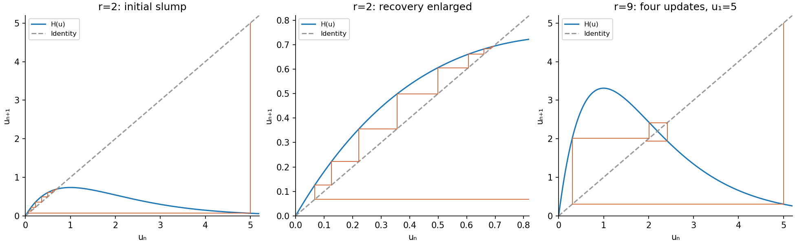

<h1 id="a/1/b/i/solution">Solution</h1>

↑ **Parent:** [I](../i.md)

A large initial [biological population](../../../../../../population-biology.md) maps to a very small positive [biological population](../../../../../../population-biology.md) because $ue^{-u}\to0$ at large $u$: the initial slump is followed by recovery. Cobwebbing alternates a vertical step from $(u_n,u_n)$ to $(u_n,H(u_n))$ with a horizontal step to the diagonal at $(u_{n+1},u_{n+1})$. The figure uses the explicit illustrative choice $u_1=5$.

For $r=2$, every positive [orbit](../../../../../../orbit-dynamical-system.md) subsequently lies below the maximum $H(1)=2/e<1$. On $[0,2/e]$ the map is increasing, with the unique positive [fixed point](../../../../../../fixed-point.md) $\log2$. Below that point $H(u)>u$ and $H(u)<\log2$; above it $H(u)<u$ and $H(u)>\log2$. Therefore the trapped iterates approach the [fixed point](../../../../../../fixed-point.md) monotonically from whichever side they enter. In particular

$$
\boxed{u_n\longrightarrow\log2\quad\text{for every }u_1>0.}
$$

The extinction initial value remains zero, but exact extinction is never reached from a positive finite [biological population](../../../../../../population-biology.md) in this deterministic model.

**[Figure 1](#a/1/b/i/image-ricker-cobwebs-after-a-large-initial-population-with-the-first-five-generations-at-r-equals-nine). Ricker cobwebs after a large initial population, with the first five generations at r equals nine**.

## ↑ Ancestors (14)

1. [I](../i.md)
2. [B](../../b.md)
3. [1](../../../1.md)
4. [A](../../../../a.md)
5. [2009](../../../../../2009-split.md)
6. [Past exam of the topics in applied mathematics course of the University of Oxford](../../../../../split.md)
7. [Topics in applied mathematics course of the University of Oxford](../../../../../../topics-in-applied-mathematics-course-of-the-university-of-oxford.md)
8. [Year 3 of the mathematics course of the University of Oxford](../../../../../../year-3-of-the-mathematics-course-of-the-university-of-oxford.md)
9. [Mathematics course of the University of Oxford](../../../../../../mathematics-course-of-the-university-of-oxford.md)
10. [Undergraduate course of the University of Oxford](../../../../../../undergraduate-course-of-the-university-of-oxford.md)
11. [Course of the University of Oxford](../../../../../../course-of-the-university-of-oxford.md)
12. [University of Oxford](../../../../../../university-of-oxford-split.md)
13. [List of universities](../../../../../../list-of-universities.md)
14. [Codex Wiki](../../../../../../split.md)
