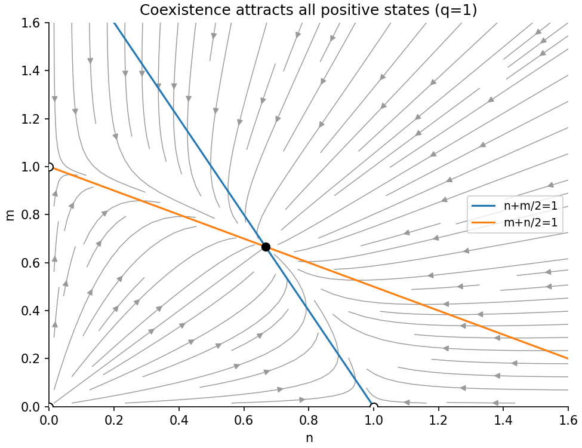

<h1 id="a/3/a/iii/solution">Solution</h1>

↑ **Parent:** [Iii](../iii.md)

The non-axis [nullclines](../../../../../../nullcline.md) are $n+m/2=1$ and $m+n/2=1$, intersecting at $(2/3,2/3)$. Each [biological population](../../../../../../population-biology.md) grows below its own line and decreases above it. The axes are invariant; along a positive axis the surviving species follows logistic growth towards its unit [carrying capacity](../../../../../../carrying-capacity.md). The origin remains fixed.

All strictly positive initial states converge to coexistence. An [entropy-shaped Lyapunov function for weak competition](../../../../../../entropy-shaped-lyapunov-function-for-weak-competition.md) proves the global conclusion beyond the local arrows: put $k=2/3$ and use

$$
V=n-k-k\log(n/k)+\frac1q[m-k-k\log(m/k)].
$$

Each bracket is nonnegative, vanishing only at its [equilibrium](../../../../../../equilibrium-point-of-a-dynamical-system.md) value, and tends to infinity at zero or infinity. Differentiation gives

$$
\dot V=-(n-k)^2-(m-k)^2-(n-k)(m-k)\leq-\tfrac12[(n-k)^2+(m-k)^2].
$$

Thus positive trajectories remain in a [compact](../../../../../../compact-space.md) level set inside the quadrant and approach its unique zero-derivative state. Therefore

$$
\boxed{(n,m)\to(2/3,2/3)\text{ for }n(0),m(0)>0.}
$$

The [phase portrait](../../../../../../phase-portrait.md) shows the stable coexistence point, invading directions near the axis saddles, and the two straight [nullclines](../../../../../../nullcline.md).

**[Figure 2](#a/3/a/iii/image-competing-populations-converge-to-coexistence-in-the-positive-quadrant). Competing populations converge to coexistence in the positive quadrant**.

## ↑ Ancestors (14)

1. [Iii](../iii.md)
2. [A](../../a.md)
3. [3](../../../3.md)
4. [A](../../../../a.md)
5. [2009](../../../../../2009-split.md)
6. [Past exam of the topics in applied mathematics course of the University of Oxford](../../../../../split.md)
7. [Topics in applied mathematics course of the University of Oxford](../../../../../../topics-in-applied-mathematics-course-of-the-university-of-oxford.md)
8. [Year 3 of the mathematics course of the University of Oxford](../../../../../../year-3-of-the-mathematics-course-of-the-university-of-oxford.md)
9. [Mathematics course of the University of Oxford](../../../../../../mathematics-course-of-the-university-of-oxford.md)
10. [Undergraduate course of the University of Oxford](../../../../../../undergraduate-course-of-the-university-of-oxford.md)
11. [Course of the University of Oxford](../../../../../../course-of-the-university-of-oxford.md)
12. [University of Oxford](../../../../../../university-of-oxford-split.md)
13. [List of universities](../../../../../../list-of-universities.md)
14. [Codex Wiki](../../../../../../split.md)
