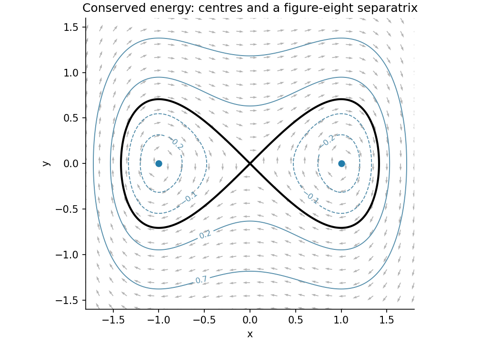

<h1 id="b/4/a/iii/solution">Solution</h1>

↑ **Parent:** [Iii](../iii.md)

For $\nu=1,\kappa=0$, the [first integral](../../../../../../first-integral.md) is

$$
\boxed{E=\tfrac12y^2-\tfrac12x^2+\tfrac14x^4.}
$$

Its minimum $-1/4$ occurs at the two [centres](../../../../../../center-equilibrium.md). Levels between $-1/4$ and $0$ give a [periodic orbit](../../../../../../periodic-orbit.md) around each [centre equilibrium](../../../../../../center-equilibrium.md); positive levels give larger [periodic orbits](../../../../../../periodic-orbit.md) surrounding both wells. The zero level is the figure-eight [separatrix](../../../../../../separatrix.md) through the saddle, with two homoclinic loops.

On $E=0$, $y^2=x^2(1-x^2/2)$. The printed parametrization $x=\pm\sqrt2\operatorname{sech}z$, $y=\pm\sqrt2\operatorname{sech}z\tanh z$, taking matching signs, satisfies this identity because $1-\operatorname{sech}^2z=\tanh^2z$. It also has $dx/dz=-y$ and $dy/dz=-(x-x^3)$, so **its parameter is physical reversed time, $z=-t+\text{constant}$**, rather than $z=t$. It is nonetheless exactly a parametrization of the requested [trajectory](../../../../../../trajectory.md). In physical forward time one can use $x(t)=\sqrt2\operatorname{sech}t$, $y(t)=-\sqrt2\operatorname{sech}t\tanh t$ on the right loop.

Approach to the origin requires $z\to\pm\infty$, hence infinite physical time. Equivalently $|y|\sim x$ near the right-loop endpoint, so the elapsed time contains the divergent integral $\int_0^\delta dx/x$. The point at $x=\sqrt2$ is reached in finite time from any interior point; it is the asymptotic saddle endpoints, not that turning point, that cause the infinite total traversal time.

**[Figure 3](#b/4/a/iii/image-double-well-energy-levels-and-the-two-homoclinic-loops-through-the-saddle). Double-well energy levels and the two homoclinic loops through the saddle**.

## ↑ Ancestors (14)

1. [Iii](../iii.md)
2. [A](../../a.md)
3. [4](../../../4.md)
4. [B](../../../../b.md)
5. [2009](../../../../../2009-split.md)
6. [Past exam of the topics in applied mathematics course of the University of Oxford](../../../../../split.md)
7. [Topics in applied mathematics course of the University of Oxford](../../../../../../topics-in-applied-mathematics-course-of-the-university-of-oxford.md)
8. [Year 3 of the mathematics course of the University of Oxford](../../../../../../year-3-of-the-mathematics-course-of-the-university-of-oxford.md)
9. [Mathematics course of the University of Oxford](../../../../../../mathematics-course-of-the-university-of-oxford.md)
10. [Undergraduate course of the University of Oxford](../../../../../../undergraduate-course-of-the-university-of-oxford.md)
11. [Course of the University of Oxford](../../../../../../course-of-the-university-of-oxford.md)
12. [University of Oxford](../../../../../../university-of-oxford-split.md)
13. [List of universities](../../../../../../list-of-universities.md)
14. [Codex Wiki](../../../../../../split.md)
