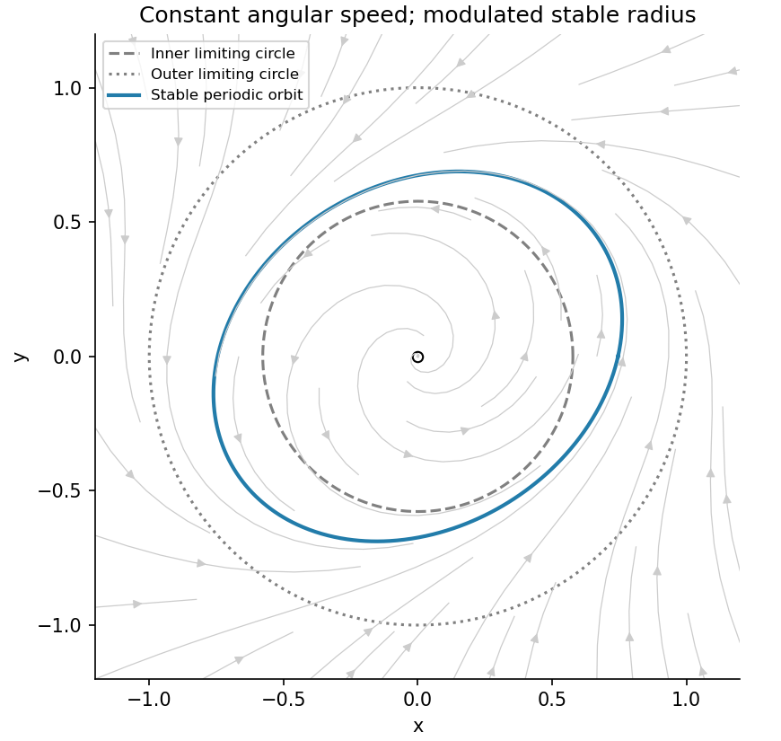

<h1 id="b/4/b/iii/solution">Solution</h1>

↑ **Parent:** [Iii](../iii.md)

The closed [annulus](../../../../../../annulus-mathematics.md) $1/\sqrt3\leq r\leq1$ is positively invariant by the radial signs, and $\dot\theta=2$ excludes [equilibria](../../../../../../equilibrium-point-of-a-dynamical-system.md) there. Poincaré-Bendixson therefore yields a [periodic orbit](../../../../../../periodic-orbit.md). Its stability can be established explicitly rather than inferred merely from trapping.

For the [exact anisotropic radial limit cycle](../../../../../../exact-anisotropic-radial-limit-cycle.md), set $w=r^{-2}$. Then $\dot w=-2w+4-2\cos2\theta$, or $dw/d\theta+w=2-\cos2\theta$. Its unique periodic solution is

$$
w_p(\theta)=2-\frac{\cos2\theta+2\sin2\theta}{5},\qquad\boxed{r_p(\theta)=\left[2-\frac{\cos2\theta+2\sin2\theta}{5}\right]^{-1/2}.}
$$

It is positive and stays within the trapping [annulus](../../../../../../annulus-mathematics.md). Any other solution at the same phase has $w-w_p=Ce^{-2t}$, proving radial attraction and uniqueness of the positive [periodic orbit](../../../../../../periodic-orbit.md). The full planar period is $\pi$, since a full angular revolution takes that time; the half-turn [symmetry](../../../../../../symmetry-physics.md) of the radius does not halve the period of the position vector. The nontrivial return [periodic-orbit multiplier](../../../../../../multiplier-of-a-periodic-orbit-of-an-iteration.md) is $e^{-2\pi}<1$. Thus **the [periodic orbit](../../../../../../periodic-orbit.md) is [asymptotically stable](../../../../../../asymptotic-stability.md)**, and all nonzero forward trajectories approach it up to phase.

**[Figure 4](#b/4/b/iii/image-the-trapping-annulus-and-the-explicitly-attracting-angularly-modulated-limit-cycle). The trapping annulus and the explicitly attracting angularly modulated limit cycle**.

## ↑ Ancestors (14)

1. [Iii](../iii.md)
2. [B](../../b.md)
3. [4](../../../4.md)
4. [B](../../../../b.md)
5. [2009](../../../../../2009-split.md)
6. [Past exam of the topics in applied mathematics course of the University of Oxford](../../../../../split.md)
7. [Topics in applied mathematics course of the University of Oxford](../../../../../../topics-in-applied-mathematics-course-of-the-university-of-oxford.md)
8. [Year 3 of the mathematics course of the University of Oxford](../../../../../../year-3-of-the-mathematics-course-of-the-university-of-oxford.md)
9. [Mathematics course of the University of Oxford](../../../../../../mathematics-course-of-the-university-of-oxford.md)
10. [Undergraduate course of the University of Oxford](../../../../../../undergraduate-course-of-the-university-of-oxford.md)
11. [Course of the University of Oxford](../../../../../../course-of-the-university-of-oxford.md)
12. [University of Oxford](../../../../../../university-of-oxford-split.md)
13. [List of universities](../../../../../../list-of-universities.md)
14. [Codex Wiki](../../../../../../split.md)
