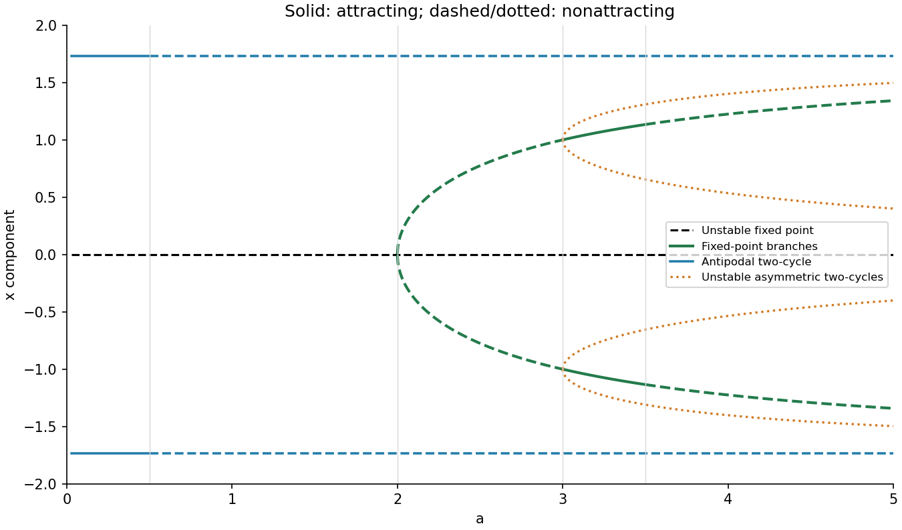

<h1 id="b/5/c/solution">Solution</h1>

↑ **Parent:** [C](../c.md)

The fixed-point branches are $x=0$ and $x=\pm\sqrt{3-6/a}$ beginning at $a=2$. Zero is a saddle before that threshold and repelling afterwards. The nonzero branches are saddles until $a=3$, attracting for $3<a<7/2$, and repelling beyond their resonant unit-circle crossing. Solid portions in the diagram mark attracting states; dashed portions mark saddles or repellers.

At $a=3$, the two asymmetric [two-cycles](../../../../../period-two-orbit.md) split from $x=\pm1$ with components $[\pm\sqrt{3+3/a}\pm\sqrt{3-9/a}]/2$, pairing the two values with the same first sign. These branches are always unstable. In addition, the antipodal [two-cycle](../../../../../period-two-orbit.md) occupies the constant component levels $x=\pm\sqrt3$ for every $a>0$, attracting only below $a=1/2$. It must be included for the actual printed map, even though the quadratic proposed in the previous part misses it. At a given parameter the two component levels represent one cycle, rather than two independent [fixed points](../../../../../fixed-point.md).

**[Figure 5](#b/5/c/image-fixed-point-branches-and-both-families-of-period-two-cycles-for-the-printed-two-dimensional-map). Fixed-point branches and both families of period-two cycles for the printed two-dimensional map**.

## ↑ Ancestors (13)

1. [C](../c.md)
2. [5](../../5.md)
3. [B](../../../b.md)
4. [2009](../../../../2009-split.md)
5. [Past exam of the topics in applied mathematics course of the University of Oxford](../../../../split.md)
6. [Topics in applied mathematics course of the University of Oxford](../../../../../topics-in-applied-mathematics-course-of-the-university-of-oxford.md)
7. [Year 3 of the mathematics course of the University of Oxford](../../../../../year-3-of-the-mathematics-course-of-the-university-of-oxford.md)
8. [Mathematics course of the University of Oxford](../../../../../mathematics-course-of-the-university-of-oxford.md)
9. [Undergraduate course of the University of Oxford](../../../../../undergraduate-course-of-the-university-of-oxford.md)
10. [Course of the University of Oxford](../../../../../course-of-the-university-of-oxford.md)
11. [University of Oxford](../../../../../university-of-oxford-split.md)
12. [List of universities](../../../../../list-of-universities.md)
13. [Codex Wiki](../../../../../split.md)
