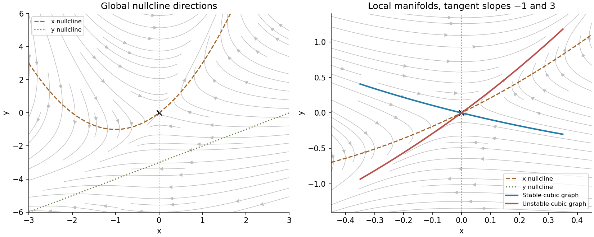

<h1 id="b/6/solution">Solution</h1>

↑ **Parent:** [6](../6.md)

For an [equilibrium](../../../../equilibrium-point-of-a-dynamical-system.md) at zero, the local [stable manifold](../../../../stable-manifold.md) consists of nearby points whose forward trajectories remain nearby and tend to zero; the local [unstable manifold](../../../../unstable-manifold.md) is defined by backward trajectories with the analogous property. For a smooth system $\dot z=Az+f(z)$ with $f(0)=0$, $Df(0)=0$ and no zero-real-part [eigenvalues](../../../../eigenvalue.md), the stable-manifold theorem gives manifolds tangent to the negative- and positive-real-part eigenspaces. Their dimensions are the corresponding [eigenvalue](../../../../eigenvalue.md) counts. Real distinct [eigenvalues](../../../../eigenvalue.md) alone are insufficient if one is zero; then a [centre equilibrium](../../../../center-equilibrium.md) direction requires additional analysis. In the saddle case each manifold is a curve, found by imposing invariance on a power-series graph through the relevant [eigenvector](../../../../eigenvector.md).

In this system, the $x$ [nullcline](../../../../nullcline.md) is $y=x^2+2x$ and the $y$ [nullclines](../../../../nullcline.md) are $x=0$ and $y=x-3$. Substituting the first into the second gives $x(x^2+x+3)=0$. Since the quadratic has [discriminant](../../../../discriminant.md) $-11$, **the origin is the only real [equilibrium](../../../../equilibrium-point-of-a-dynamical-system.md)**. Its [Jacobian matrix](../../../../jacobian-matrix.md) $\left(\begin{smallmatrix}-2&1\\3&0\end{smallmatrix}\right)$ has [eigenvalues](../../../../eigenvalue.md) $-3,1$, with [eigenvectors](../../../../eigenvector.md) $(1,-1)$ and $(1,3)$. It is therefore a hyperbolic saddle.

Set $y=h(x)$ for either manifold. Invariance requires

$$
h'(x)[-2x+h(x)-x^2]=3x+xh(x)-x^2.
$$

For $h=sx+bx^2+cx^3+O(x^4)$, matching the linear coefficient gives $s=-1$ or $s=3$. The quadratic and cubic coefficients respectively satisfy

$$
(3s-4)b=2s-1,\qquad(4s-6)c=b-2b(b-1).
$$

For the stable slope $s=-1$, this yields $b=3/7$, $c=-9/98$; for the unstable slope $s=3$, it gives $b=1$, $c=1/6$. Thus

$$
\boxed{W^s:\ y=-x+\frac37x^2-\frac9{98}x^3+O(x^4),\qquad W^u:\ y=3x+x^2+\frac16x^3+O(x^4).}
$$

Substituting back into $\dot x$ gives the reduced dynamics

$$
\boxed{\dot x|_{W^s}=-3x-\frac47x^2-\frac9{98}x^3+O(x^4),\qquad\dot x|_{W^u}=x+\frac16x^3+O(x^4).}
$$

The signs of the linear terms confirm attraction and repulsion along the respective curves.

In the [phase portrait](../../../../phase-portrait.md), $\dot x$ is positive above its parabolic [nullcline](../../../../nullcline.md) and negative below it; $\dot y$ has sign $x(3+y-x)$. The stable branches approach the saddle and the unstable branches leave it in opposite directions. There can be no [periodic orbit](../../../../periodic-orbit.md), since such an [orbit](../../../../orbit-dynamical-system.md) would require total enclosed [equilibrium](../../../../equilibrium-point-of-a-dynamical-system.md) index $+1$, while the only [equilibrium](../../../../equilibrium-point-of-a-dynamical-system.md) has index $-1$. There is no homoclinic excursion either: eliminating $y$ gives $\ddot x+(2+x)\dot x=x(x^2+x+3)$, so a positive turning point is a strict local minimum and a negative one a strict local maximum. A loop returning to zero would require the opposite extremum somewhere. Hence bounded forward trajectories lie on the [stable manifold](../../../../stable-manifold.md) and approach zero; other trajectories eventually leave [compact](../../../../compact-space.md) regions, without a claimed universal rate or infinite-time existence at infinity. The figure shows the global [nullclines](../../../../nullcline.md) and the local cubic manifold approximations; the latter are used only near zero.

**[Figure 6](#b/6/image-the-unique-saddle-its-nullclines-and-the-local-stable-and-unstable-manifold-approximations). The unique saddle, its nullclines and the local stable and unstable manifold approximations**.

## ↑ Ancestors (12)

1. [6](../6.md)
2. [B](../../b.md)
3. [2009](../../../2009-split.md)
4. [Past exam of the topics in applied mathematics course of the University of Oxford](../../../split.md)
5. [Topics in applied mathematics course of the University of Oxford](../../../../topics-in-applied-mathematics-course-of-the-university-of-oxford.md)
6. [Year 3 of the mathematics course of the University of Oxford](../../../../year-3-of-the-mathematics-course-of-the-university-of-oxford.md)
7. [Mathematics course of the University of Oxford](../../../../mathematics-course-of-the-university-of-oxford.md)
8. [Undergraduate course of the University of Oxford](../../../../undergraduate-course-of-the-university-of-oxford.md)
9. [Course of the University of Oxford](../../../../course-of-the-university-of-oxford.md)
10. [University of Oxford](../../../../university-of-oxford-split.md)
11. [List of universities](../../../../list-of-universities.md)
12. [Codex Wiki](../../../../split.md)
