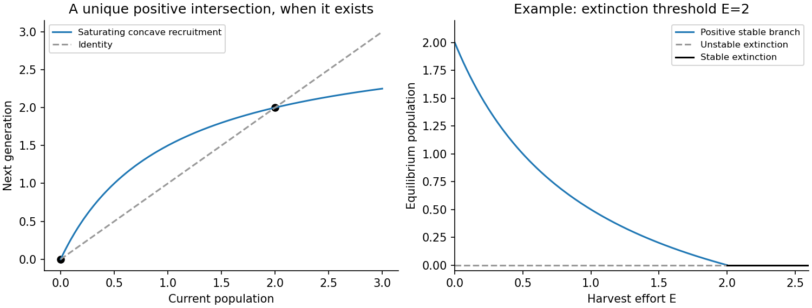

<h1 id="a/1/a/i/solution">Solution</h1>

↑ **Parent:** [I](../i.md)

For this [concave recruitment map](../../../../../../concave-recruitment-map.md), the extinction state is invariant because $g(0)=0$. Near extinction, $N_{t+1}=g'(0)N_t+O(N_t^2)$ with multiplier above one, so small positive populations initially grow. The [strict concavity](../../../../../../strict-concavity.md) $g''<0$ means marginal recruitment decreases as population increases. More precisely, for $N>0$,

$$
\frac{d}{dN}\frac{g(N)}N=\frac{Ng'(N)-g(N)}{N^2}<0,
$$

since $g(N)=\int_0^Ng'(s)\,ds>Ng'(N)$. Thus per-capita recruitment decreases and the graph bends downwards from an initial slope greater than that of the identity line.

A positive [fixed point](../../../../../../fixed-point.md), if present, is the unique positive intersection with $g(N)=N$: the strictly decreasing ratio can cross one at most once. The sketch shows the usual saturating example $g(N)=3N/(1+N)$, which crosses at $N=2$.

**The three assumptions alone do not guarantee this crossing.** For example $g(N)=2N+1-e^{-N}$ satisfies all three and remains strictly above $N$ for every $N>0$. An extra large-population restriction, such as $g(N)<N$ somewhere, supplies existence. Keeping this distinction avoids inventing a [carrying capacity](../../../../../../carrying-capacity.md) that is not implied by the printed hypotheses.

**[Figure 1](#a/1/a/i/image-concave-recruitment-and-the-identity-line-with-loss-of-the-positive-equilibrium-under-harvesting). Concave recruitment and the identity line, with loss of the positive equilibrium under harvesting**.

## ↑ Ancestors (14)

1. [I](../i.md)
2. [A](../../a.md)
3. [1](../../../1.md)
4. [A](../../../../a.md)
5. [2010](../../../../../2010-split.md)
6. [Past exam of the topics in applied mathematics course of the University of Oxford](../../../../../split.md)
7. [Topics in applied mathematics course of the University of Oxford](../../../../../../topics-in-applied-mathematics-course-of-the-university-of-oxford.md)
8. [Year 3 of the mathematics course of the University of Oxford](../../../../../../year-3-of-the-mathematics-course-of-the-university-of-oxford.md)
9. [Mathematics course of the University of Oxford](../../../../../../mathematics-course-of-the-university-of-oxford.md)
10. [Undergraduate course of the University of Oxford](../../../../../../undergraduate-course-of-the-university-of-oxford.md)
11. [Course of the University of Oxford](../../../../../../course-of-the-university-of-oxford.md)
12. [University of Oxford](../../../../../../university-of-oxford-split.md)
13. [List of universities](../../../../../../list-of-universities.md)
14. [Codex Wiki](../../../../../../split.md)
