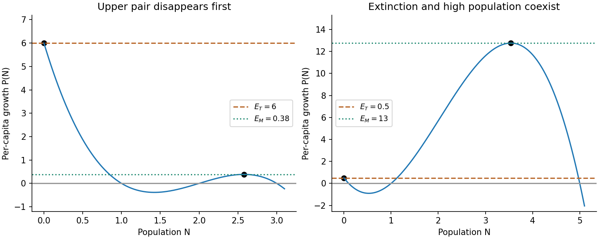

<h1 id="a/1/b/iii/solution">Solution</h1>

↑ **Parent:** [Iii](../iii.md)

Put $P(N)=(a_1-N)(a_2-N)(a_3-N)$. The harvested [vector field](../../../../../../vector-field.md) is $N[P(N)-E]$. Define the extinction threshold $E_T=P(0)=a_1a_2a_3$, and let $N_M\in(a_2,a_3)$ be the positive local maximum of $P$, with $E_M=P(N_M)>0$. Writing $s_1=a_1+a_2+a_3$, $s_2=a_1a_2+a_1a_3+a_2a_3$ gives

$$
N_M=\frac{s_1+\sqrt{s_1^2-3s_2}}3.
$$

Positive [equilibria](../../../../../../equilibrium-point-of-a-dynamical-system.md) are intersections of $P(N)$ with the horizontal line $E$. A lower stable branch in $(0,a_1)$ exists exactly for $0<E<E_T$. A pair in $(a_2,a_3)$ exists exactly for $0<E<E_M$: its smaller member has $P'>0$ and is unstable; its larger member has $P'<0$ and is stable. At a positive root the linear [eigenvalue](../../../../../../eigenvalue.md) is $NP'(N)$, which proves these claims. Extinction has [eigenvalue](../../../../../../eigenvalue.md) $E_T-E$, becoming stable for $E>E_T$.

The [harvested bistable population thresholds](../../../../../../harvested-bistable-population-thresholds.md) determine the behaviour. If $E_M<E_T$, the upper stable population and its unstable separator first disappear in a [saddle-node bifurcation](../../../../../../saddle-node-bifurcation.md). Populations then tend to the remaining lower stable state until that branch reaches extinction at $E_T$; beyond it extinction attracts every positive initial state. If $E_T<E_M$, the lower stable branch reaches extinction first. For $E_T<E<E_M$, extinction and the upper positive state are both stable, separated by the middle unstable root. Increasing effort through $E_M$ then destroys the remaining positive [attractor](../../../../../../attractor.md), causing a sudden collapse to extinction. If $E_T=E_M$, both events occur at the same effort at different populations.

At $E=E_T$, near zero the leading term is $P'(0)N^2<0$, so extinction attracts from the physical right side algebraically, despite its zero linear [eigenvalue](../../../../../../eigenvalue.md). At $E=E_M$, the double positive root is semistable: locally $\dot N\simeq-\tfrac12N_M|P''(N_M)|(N-N_M)^2$, attracting from above and repelling from below. These critical cases matter for exact initial data. The figure shows examples of both strict threshold orderings.

**[Figure 2](#a/1/b/iii/image-two-possible-orderings-of-the-extinction-and-saddle-node-harvesting-thresholds). Two possible orderings of the extinction and saddle-node harvesting thresholds**.

## ↑ Ancestors (14)

1. [Iii](../iii.md)
2. [B](../../b.md)
3. [1](../../../1.md)
4. [A](../../../../a.md)
5. [2010](../../../../../2010-split.md)
6. [Past exam of the topics in applied mathematics course of the University of Oxford](../../../../../split.md)
7. [Topics in applied mathematics course of the University of Oxford](../../../../../../topics-in-applied-mathematics-course-of-the-university-of-oxford.md)
8. [Year 3 of the mathematics course of the University of Oxford](../../../../../../year-3-of-the-mathematics-course-of-the-university-of-oxford.md)
9. [Mathematics course of the University of Oxford](../../../../../../mathematics-course-of-the-university-of-oxford.md)
10. [Undergraduate course of the University of Oxford](../../../../../../undergraduate-course-of-the-university-of-oxford.md)
11. [Course of the University of Oxford](../../../../../../course-of-the-university-of-oxford.md)
12. [University of Oxford](../../../../../../university-of-oxford-split.md)
13. [List of universities](../../../../../../list-of-universities.md)
14. [Codex Wiki](../../../../../../split.md)
