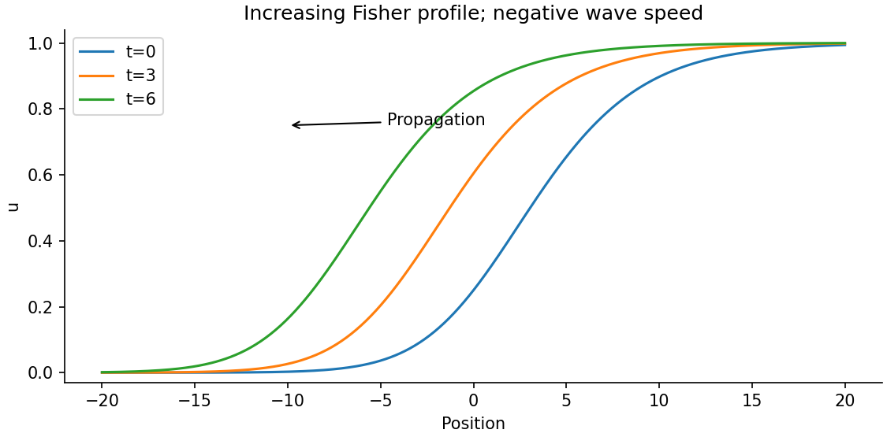

<h1 id="a/2/c/i/solution">Solution</h1>

↑ **Parent:** [I](../i.md)

The [equal-diffusivity Fisher reduction](../../../../../../equal-diffusivity-fisher-reduction.md) uses equal [diffusion coefficients](../../../../../../diffusion-coefficient.md) and the invariant relation $v=1-u$. The second equation then requires $u_\tau=\delta u(1-u)+u_{\xi\xi}$, while the first becomes $u_\tau=(1-\beta)u(1-u)+u_{\xi\xi}$. They agree when

$$
\boxed{\beta=1-\delta,\qquad v=1-u.}
$$

This reduction requires compatible initial and boundary data on that invariant relation. Tuning a parameter alone does not force arbitrary solutions of the two-field system onto it. For positive physical $\beta$, the displayed normalization also requires $0<\delta<1$. More generally the line $v=C(1-u)$ works when $\beta C=1-\delta$; the same positivity restriction remains for $C>0$.

Let $z=\xi-c\tau$ and $u=U(z)$ with $U(-\infty)=0$, $U(+\infty)=1$. The profile equation is $U''+cU'+\delta U(1-U)=0$. Multiplication by $U'$ and integration gives

$$
c\int_{-\infty}^\infty(U')^2\,dz=-\delta\int_0^1U(1-U)\,dU=-\frac\delta6.
$$

Consequently **$c<0$: the increasing front moves left**, with the $u=1$ state invading $u=0$. [Linearization](../../../../../../linearization.md) at its leading edge gives real monotone exponents only when $|c|\geq2\sqrt\delta$, yielding the usual Fisher front speed range. A convenient exact example is

$$
U(z)=\left(1+e^{-\sqrt{\delta/6}\,z}\right)^{-2},\qquad c=-5\sqrt{\delta/6}.
$$

Substitution verifies it and the figure shows its leftward displacement. The source uses $x$ for the end limits after defining $\xi$; they denote the same spatial coordinate here.

**[Figure 3](#a/2/c/i/image-an-increasing-fisher-front-translates-left-as-the-occupied-state-invades). An increasing Fisher front translates left as the occupied state invades**.

## ↑ Ancestors (14)

1. [I](../i.md)
2. [C](../../c.md)
3. [2](../../../2.md)
4. [A](../../../../a.md)
5. [2010](../../../../../2010-split.md)
6. [Past exam of the topics in applied mathematics course of the University of Oxford](../../../../../split.md)
7. [Topics in applied mathematics course of the University of Oxford](../../../../../../topics-in-applied-mathematics-course-of-the-university-of-oxford.md)
8. [Year 3 of the mathematics course of the University of Oxford](../../../../../../year-3-of-the-mathematics-course-of-the-university-of-oxford.md)
9. [Mathematics course of the University of Oxford](../../../../../../mathematics-course-of-the-university-of-oxford.md)
10. [Undergraduate course of the University of Oxford](../../../../../../undergraduate-course-of-the-university-of-oxford.md)
11. [Course of the University of Oxford](../../../../../../course-of-the-university-of-oxford.md)
12. [University of Oxford](../../../../../../university-of-oxford-split.md)
13. [List of universities](../../../../../../list-of-universities.md)
14. [Codex Wiki](../../../../../../split.md)
