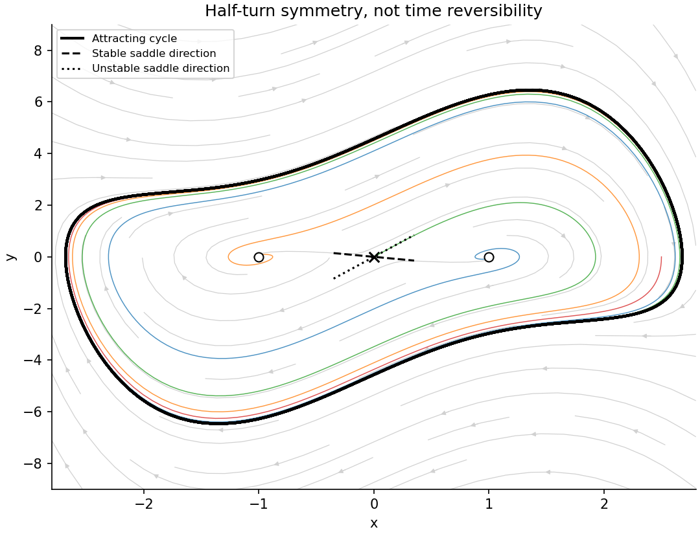

<h1 id="b/4/iv/solution">Solution</h1>

↑ **Parent:** [Iv](../iv.md)

At $\Omega=-2$, the origin has stable and unstable [eigenvalues](../../../../../eigenvalue.md) $1-\sqrt2$ and $1+\sqrt2$; the two nonzero [equilibria](../../../../../equilibrium-point-of-a-dynamical-system.md) are [repelling foci](../../../../../unstable-spiral.md) with [eigenvalues](../../../../../eigenvalue.md) $(1\pm i\sqrt7)/2$. A compatible portrait has one attracting closed orbit surrounding all three [equilibria](../../../../../equilibrium-point-of-a-dynamical-system.md). Its total enclosed index is $+1+1-1=+1$, as a [periodic orbit](../../../../../periodic-orbit.md) requires. Its half-turn image is also attracting, so uniqueness of the attracting cycle makes that cycle half-turn symmetric. Orbits spiral away from either [focus equilibrium](../../../../../focus-dynamical-systems.md) and approach the surrounding cycle; the stable separatrices approach the saddle instead. The figure integrates representative trajectories and shows the local saddle directions.

These trajectories cannot escape to infinity. A [Liénard boundedness function](../../../../../lienard-boundedness-function.md) supplies one explicit boundedness argument using the Liénard coordinate $z=y+F(x)$ with $F(x)=x^3/3-2x$ and $g(x)=x^3-x$. Then $\dot x=z-F(x)$ and $\dot z=-g(x)$. Put $V=x^4/4-x^2/2$ and $W=V+z^2/2-xz$. This function is coercive after addition of a constant. Its [derivative](../../../../../derivative.md) obeys

$$
\dot W=-gF-z^2+Fz+xg\leq-\tfrac12z^2-\frac5{18}x^6+\frac83x^4-x^2,
$$

using $Fz\leq(z^2+F^2)/2$. The right side is negative outside a [compact](../../../../../compact-space.md) region, yielding bounded forward motion.

In the displayed portrait, generic non-equilibrium initial states tend to the cycle; points on the saddle's [stable manifold](../../../../../stable-manifold.md) tend to the origin; and initial data exactly at a repelling [focus equilibrium](../../../../../focus-dynamical-systems.md) remain there. The [Poincaré-Bendixson theorem](../../../../../poincare-bendixson-theorem.md) excludes a chaotic [compact](../../../../../compact-space.md) limit set for this smooth planar flow. Strictly, the assumption gives uniqueness only of an attracting [periodic orbit](../../../../../periodic-orbit.md): it does not by itself exclude exceptional nonattracting periodic or separatrix limit sets. Those would need additional global information if one wanted a classification stronger than the compatible portrait requested.

**[Figure 4](#b/4/iv/image-a-compatible-attracting-cycle-repelling-foci-and-saddle-separatrices-at-omega-minus-two). A compatible attracting cycle, repelling foci and saddle separatrices at Omega minus two**.

## ↑ Ancestors (13)

1. [Iv](../iv.md)
2. [4](../../4.md)
3. [B](../../../b.md)
4. [2010](../../../../2010-split.md)
5. [Past exam of the topics in applied mathematics course of the University of Oxford](../../../../split.md)
6. [Topics in applied mathematics course of the University of Oxford](../../../../../topics-in-applied-mathematics-course-of-the-university-of-oxford.md)
7. [Year 3 of the mathematics course of the University of Oxford](../../../../../year-3-of-the-mathematics-course-of-the-university-of-oxford.md)
8. [Mathematics course of the University of Oxford](../../../../../mathematics-course-of-the-university-of-oxford.md)
9. [Undergraduate course of the University of Oxford](../../../../../undergraduate-course-of-the-university-of-oxford.md)
10. [Course of the University of Oxford](../../../../../course-of-the-university-of-oxford.md)
11. [University of Oxford](../../../../../university-of-oxford-split.md)
12. [List of universities](../../../../../list-of-universities.md)
13. [Codex Wiki](../../../../../split.md)
