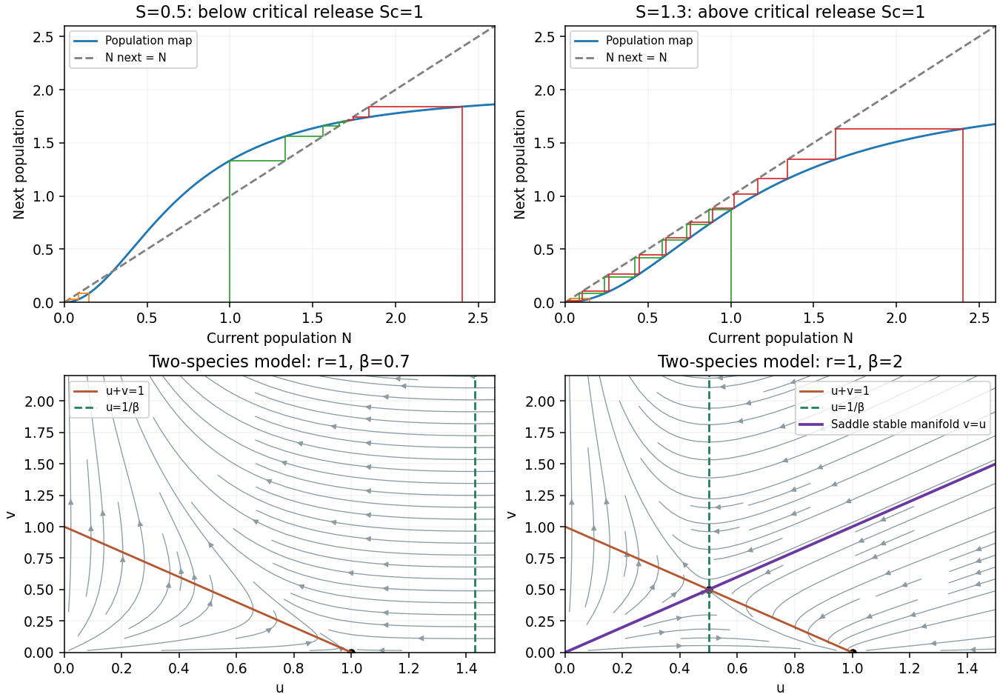
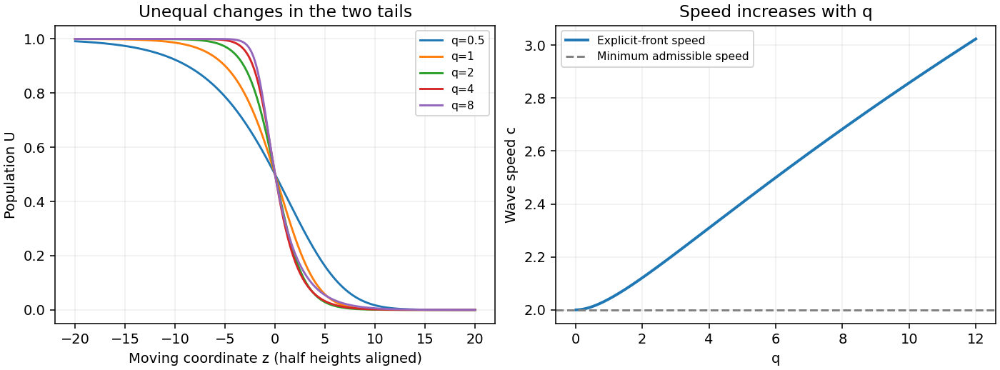
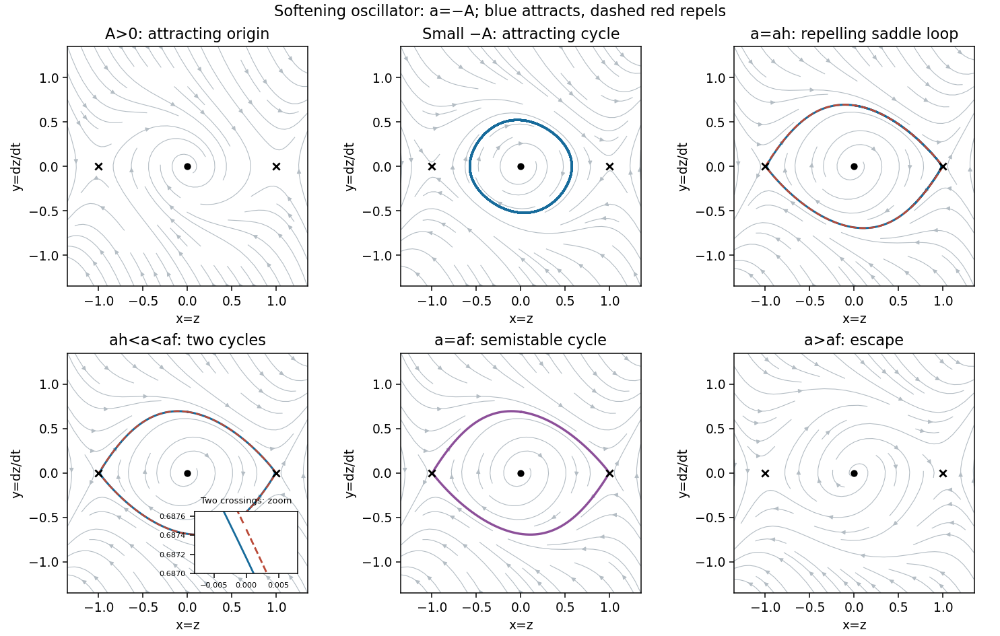

# 2011

↑ **Parent:** [Past exam of the topics in applied mathematics course of the University of Oxford](../past-exam-of-the-topics-in-applied-mathematics-course-of-the-university-of-oxford.md)

**Table of contents**

- [A](#a)
  - [1](#a/1)
    - [a](#a/1/a)
      - [i](#a/1/a/i)
        - [Solution](#a/1/a/i/solution)
      - [ii](#a/1/a/ii)
        - [Solution](#a/1/a/ii/solution)
    - [b](#a/1/b)
      - [i](#a/1/b/i)
        - [Solution](#a/1/b/i/solution)
      - [ii](#a/1/b/ii)
        - [Solution](#a/1/b/ii/solution)
      - [iii](#a/1/b/iii)
        - [Solution](#a/1/b/iii/solution)
  - [2](#a/2)
    - [a](#a/2/a)
      - [Solution](#a/2/a/solution)
    - [b](#a/2/b)
      - [Solution](#a/2/b/solution)
    - [c](#a/2/c)
      - [i](#a/2/c/i)
        - [Solution](#a/2/c/i/solution)
      - [ii](#a/2/c/ii)
        - [Solution](#a/2/c/ii/solution)
  - [3](#a/3)
    - [a](#a/3/a)
      - [Solution](#a/3/a/solution)
    - [b](#a/3/b)
      - [Solution](#a/3/b/solution)
    - [c](#a/3/c)
      - [Solution](#a/3/c/solution)
    - [d](#a/3/d)
      - [Solution](#a/3/d/solution)
- [B](#b)
  - [4](#b/4)
    - [a](#b/4/a)
      - [Solution](#b/4/a/solution)
    - [b](#b/4/b)
      - [Solution](#b/4/b/solution)
  - [5](#b/5)
    - [a](#b/5/a)
      - [i](#b/5/a/i)
        - [Solution](#b/5/a/i/solution)
      - [ii](#b/5/a/ii)
        - [Solution](#b/5/a/ii/solution)
      - [iii](#b/5/a/iii)
        - [Solution](#b/5/a/iii/solution)
    - [b](#b/5/b)
      - [Solution](#b/5/b/solution)
  - [6](#b/6)
    - [a](#b/6/a)
      - [Solution](#b/6/a/solution)
    - [b](#b/6/b)
      - [Solution](#b/6/b/solution)

## A

↑ **Parent:** [2011](2011.md)

<h3 id="a/1">1</h3>

↑ **Parent:** [A](#a)

<h4 id="a/1/a">a</h4>

↑ **Parent:** [1](#a/1)

<h5 id="a/1/a/i">i</h5>

↑ **Parent:** [A](#a/1/a)

<h6 id="a/1/a/i/solution">Solution</h6>

↑ **Parent:** [I](#a/1/a/i)

Write $f(N)=\alpha N^2/(\beta N^2+S)$. Its nonnegative [fixed points](../function.md#fixed-point) are $N=0$ and, when $\alpha^2\geq4\beta S$,

$$
\boxed{N_\pm=\frac{\alpha\pm\sqrt{\alpha^2-4\beta S}}{2\beta}.}
$$

Indeed a positive [fixed point](../function.md#fixed-point) satisfies $\beta N^2-\alpha N+S=0$. The [linear stability](../dynamical-systems.md#linear-stability) multiplier is

$$
f'(N)=\frac{2\alpha SN}{(\beta N^2+S)^2},\qquad f'(0)=0.
$$

At a positive [fixed point](../function.md#fixed-point), $\beta N^2+S=\alpha N$, hence

$$
\boxed{f'(N_\pm)=1\mp\frac{\sqrt{\alpha^2-4\beta S}}{\alpha}.}
$$

For strict discriminant positivity, $N_+$ is attracting and $N_-$ repelling; the extinction state is superstable. At equality the positive point has multiplier one. Since

$$
f(N)-N=-\frac{N(\beta N^2-\alpha N+S)}{\beta N^2+S},
$$

it attracts from above and repels from below at equality. This is a semistable [fixed point](../function.md#fixed-point), whose one-sided behavior requires the nonlinear calculation.

<h5 id="a/1/a/ii">ii</h5>

↑ **Parent:** [A](#a/1/a)

<h6 id="a/1/a/ii/solution">Solution</h6>

↑ **Parent:** [Ii](#a/1/a/ii)

The two positive [fixed points](../function.md#fixed-point) merge when

$$
\boxed{S_c=\frac{\alpha^2}{4\beta},\qquad N_c=\frac{\alpha}{2\beta}.}
$$

Here $f'(N_c)=1$, $f''(N_c)\ne0$, and increasing $S$ decreases $f$, so this is a [saddle-node bifurcation](../bifurcation-theory.md#saddle-node-bifurcation) of the map. For $S<S_c$, the cobweb descends to zero below $N_-$, rises towards $N_+$ between the positive [fixed points](../function.md#fixed-point), and descends towards $N_+$ above it. Monotonicity of $f$ prevents a trajectory from overshooting across the attracting [fixed point](../function.md#fixed-point). Thus $N_-$ is an extinction threshold.

For $S>S_c$, $f(N)<N$ for every $N>0$. The iterates decrease to a nonnegative [fixed point](../function.md#fixed-point), necessarily zero. At $S=S_c$, initial states below $N_c$ tend to zero and those above tend to $N_c$. The [sterile-release population threshold](../mathematical-biology.md#sterile-release-population-threshold) therefore combines bistability below the critical release with extinction above it.

**[Figure 1](#a/1/a/ii/image-cobwebs-for-sterile-release-and-phase-portraits-for-the-two-species-competition-model). Cobwebs for sterile release and phase portraits for the two-species competition model**.

<h4 id="a/1/b">b</h4>

↑ **Parent:** [1](#a/1)

<h5 id="a/1/b/i">i</h5>

↑ **Parent:** [B](#a/1/b)

<h6 id="a/1/b/i/solution">Solution</h6>

↑ **Parent:** [I](#a/1/b/i)

The term $ru$ is unrestricted growth of species $u$, and $-ru^2$ represents its density-dependent self-limitation, with scaled [carrying capacity](../mathematical-biology.md#carrying-capacity) one. The interaction $-ruv$ suppresses $u$ in the presence of species $v$.

Species $v$ has intrinsic growth $v$ and suppression $-\beta uv$ by $u$. Thus both interspecific effects are harmful: this is a [competition model](../mathematical-biology.md#competition-model), with no self-limitation term for $v$. Its unbounded growth when $u$ disappears is a consequence of that modeling choice. The parameter $r$ is the growth-time ratio, while $\beta$ measures the effect of $u$ on $v$.

<h5 id="a/1/b/ii">ii</h5>

↑ **Parent:** [B](#a/1/b)

<h6 id="a/1/b/ii/solution">Solution</h6>

↑ **Parent:** [Ii](#a/1/b/ii)

The [equilibrium points](../dynamical-systems.md#equilibrium-point-of-a-dynamical-system) are

$$
(0,0),\qquad(1,0),\qquad\left(\frac1\beta,1-\frac1\beta\right).
$$

The third is biologically interior only for $\beta>1$, and coincides with $(1,0)$ at $\beta=1$. The [Jacobian matrix](../multivariable-calculus.md#jacobian-matrix) is

$$
J=\begin{pmatrix}r(1-2u-v)&-ru\\-\beta v&1-\beta u\end{pmatrix}.
$$

At $(0,0)$ the [eigenvalues](../linear-operator-theory.md#eigenvalue) are $r,1$, so it is a repelling node. At $(1,0)$ they are $-r,1-\beta$, giving a stable node for $\beta>1$ and a saddle for $\beta<1$.

At the interior equilibrium,

$$
J_* =\begin{pmatrix}-r/\beta&-r/\beta\\-(\beta-1)&0\end{pmatrix},\qquad\det J_*=-\frac{r(\beta-1)}\beta<0,
$$

so coexistence is a saddle. The formal equilibrium with negative $v$ for $\beta<1$ is not a population state; there its trace is negative and [determinant](../multilinear-algebra.md#determinant) positive.

At $\beta=1$ the boundary equilibrium is nonhyperbolic. To determine its behavior into the positive quadrant, put $x=u-1$. A local [center manifold](../dynamical-systems.md#center-manifold) has $x=-v+v^2/r+O(v^3)$, so $\dot v=v^2+O(v^3)>0$ for small positive $v$. Thus it is unstable to introduction of species $v$, though attracting along the $v=0$ axis. The boundary/interior branches undergo a [transcritical bifurcation](../dynamical-systems.md#transcritical-bifurcation) at this parameter.

<h5 id="a/1/b/iii">iii</h5>

↑ **Parent:** [B](#a/1/b)

<h6 id="a/1/b/iii/solution">Solution</h6>

↑ **Parent:** [Iii](#a/1/b/iii)

The positive quadrant is invariant. The non-axis [nullclines](../dynamical-systems.md#nullcline) are $u+v=1$ and $u=1/\beta$. Below $u+v=1$, $u$ increases; above it, $u$ decreases. To the left of $u=1/\beta$, $v$ increases; to the right, it decreases.

For $\beta>1$, the [stable manifold](../dynamical-systems.md#stable-manifold) of the interior saddle separates trajectories tending to $(1,0)$ from those for which $u\to0$ and $v\to\infty$. Exactly on that manifold, the trajectory tends to the saddle. For the illustrated $r=1,\beta=2$, the separating manifold is exactly $v=u$, since the vector field preserves that diagonal.

For $\beta<1$, every strictly positive initial state ultimately has $u\to0$ and $v\to\infty$. Indeed $\dot u\leq ru(1-u)$ implies $\limsup u\leq1$, so eventually $1-\beta u$ is bounded below by a positive constant. Then $v$ grows exponentially, forcing $u$ down. At $\beta=1$, a positive $v$ eventually drives $u$ below one; thereafter $v$ increases. A finite positive limit for $v$ would force $u\to1$, inconsistent with $\dot u\to-rv<0$, so the same exclusion outcome holds.

There are no interior [periodic orbits](../dynamical-systems.md#periodic-orbit): the [Bendixson-Dulac criterion](../dynamical-systems.md#bendixson-dulac-theorem) with multiplier $1/(uv)$ gives

$$
\frac\partial{\partial u}\frac{r(1-u-v)}v+\frac\partial{\partial v}\frac{1-\beta u}u=-\frac rv<0.
$$

The [phase portraits](../dynamical-systems.md#phase-portrait) in the preceding figure show the threshold geometry and the absence of a bounded attracting coexistence state. Initial states on the axes retain the corresponding one-species dynamics.

<h3 id="a/2">2</h3>

↑ **Parent:** [A](#a)

<h4 id="a/2/a">a</h4>

↑ **Parent:** [2](#a/2)

<h5 id="a/2/a/solution">Solution</h5>

↑ **Parent:** [A](#a/2/a)

Let $J$ be population flux. For any fixed control volume $V\subseteq\Omega$, [mass conservation](../continuum-mechanics.md#mass-conservation) with local production gives

$$
\frac d{dt}\int_Vu\,dx=-\int_{\partial V}J\cdot\nu\,dS+\int_Vf(u)\,dx.
$$

Assume local, isotropic random dispersal, no imposed advection, and constant [diffusion coefficient](../brownian-motion.md#diffusion-coefficient) $D$. [Fick's first law](../diffusion-equation.md#fick-s-first-law) is $J=-D\nabla u$. The [divergence theorem](../multivariable-calculus.md#divergence-theorem) and arbitrariness of $V$ yield

$$
\boxed{u_t=D\nabla^2u+f(u).}
$$

The coefficient has units length squared per time; $f$ has units population density per time. Smoothness sufficient to pass from the integral balance to the local equation is understood. This is a [reaction-diffusion equation](../diffusion-equation.md#reaction-diffusion-system).

<h4 id="a/2/b">b</h4>

↑ **Parent:** [2](#a/2)

<h5 id="a/2/b/solution">Solution</h5>

↑ **Parent:** [B](#a/2/b)

The [travelling-wave reduction of a reaction-diffusion system](../analysis.md#travelling-wave-reduction-of-a-reaction-diffusion-system) of [Fisher's equation](../analysis.md#fisher-s-equation) is

$$
U''+cU'+U(1-U)=0,\qquad(U,U')(-\infty)=(1,0),\quad(U,U')(\infty)=(0,0).
$$

Multiplying by $U'$ and integrating gives $c\int_{\mathbb R}(U')^2dz=1/6$, so the decreasing invasion front has $c>0$. The [linearization](../algebra.md#linearization) at $U=0$ has spatial [eigenvalues](../linear-operator-theory.md#eigenvalue)

$$
\lambda_\pm=\frac{-c\pm\sqrt{c^2-4}}2.
$$

For $0<c<2$ they are complex: approaching zero spirals in the $(U,U')$ plane and changes the sign of $U$, which is inadmissible for a density. Thus $c\geq2$ is necessary.

It is also sufficient. Write $V=U'$ and choose $\ell=(c-\sqrt{c^2-4})/2>0$. The triangle

$$
0\leq U\leq1,\qquad-\ell U\leq V\leq0
$$

is forward invariant for $U'=V$, $V'=-cV-U(1-U)$. On $V=0$, $V'\leq0$. On $V=-\ell U$,

$$
(V+\ell U)'=[c\ell-\ell^2-1]U+U^2=U^2\geq0.
$$

The boundary $U=1$ points left, and the boundary at $U=0$ consists only of the origin. The unstable branch from the saddle $(1,0)$ enters this triangle, where $U$ decreases and remains nonnegative. Its limiting state must have $V=0$ and $U(1-U)=0$; since it has left $U=1$, it tends to $(0,0)$. Therefore a monotone positive front exists for every $c\geq2$, including the double-root endpoint:

$$
\boxed{c_{\min}=2.}
$$

This is the [Fisher-KPP minimum wave speed](../analysis.md#fisher-kpp-minimum-wave-speed), obtained with an explicit invariant-region existence argument.

<h4 id="a/2/c">c</h4>

↑ **Parent:** [2](#a/2)

<h5 id="a/2/c/i">i</h5>

↑ **Parent:** [C](#a/2/c)

<h6 id="a/2/c/i/solution">Solution</h6>

↑ **Parent:** [I](#a/2/c/i)

Set $Y=U^{q/2}$ and $k=2b/q$. The proposed profile with $a,b>0$ gives

$$
U'=-kU(1-Y),\qquad U''=k^2U(1-Y)[1-(1+q/2)Y].
$$

Substituting into $U''+cU'+U(1-U^q)=0$ and dividing in the interior by $U(1-Y)$ yields

$$
k^2[1-(1+q/2)Y]-ck+1+Y=0.
$$

Equating the constant and $Y$ coefficients gives

$$
\boxed{k=\sqrt{\frac2{q+2}},\qquad b=\frac q{\sqrt{2(q+2)}},\qquad c=\frac{q+4}{\sqrt{2(q+2)}}.}
$$

Hence the [exact generalized Fisher front](../analysis.md#exact-generalized-fisher-front) is

$$
\boxed{U(z)=(1+ae^{qz/\sqrt{2(q+2)}})^{-2/q},\qquad a>0.}
$$

The free positive $a$ translates the front. It connects one on the left to zero on the right and is strictly decreasing. At $q=1$, its speed is $5/\sqrt6$.

<h5 id="a/2/c/ii">ii</h5>

↑ **Parent:** [C](#a/2/c)

<h6 id="a/2/c/ii/solution">Solution</h6>

↑ **Parent:** [Ii](#a/2/c/ii)

The explicit [travelling wave](../analysis.md#travelling-wave) speed increases with $q$:

$$
c'(q)=\frac{q}{2\sqrt2(q+2)^{3/2}}>0,\qquad c(q)\to2\ (q\downarrow0),\quad c(q)\sim\sqrt{q/2}\ (q\to\infty).
$$

Its two tails change differently. Near the leading empty state, $U\sim a^{-2/q}e^{-kz}$ with $k=\sqrt{2/(q+2)}$ decreasing as $q$ grows: that tail lengthens. Near the filled state, $1-U\sim(2a/q)e^{bz}$, with $b=q/\sqrt{2(q+2)}$ increasing: that tail becomes steeper. Thus the change is not a uniform sharpening of the whole profile. For example the half-height slope is $-\tfrac{k}{2}(1-2^{-q/2})$.

For meaningful comparison, the figure aligns all fronts at $U(0)=1/2$ by choosing $a=2^{q/2}-1$. It displays the speed increase and the unequal changes of the two tails. Since $f'(0)=1$ for every $q$, the minimum admissible speed remains two; the explicit family has $c(q)>2$ for $q>0$. The invariant-triangle proof above extends with boundary [derivative](../calculus.md#derivative) $U^{q+1}\geq0$.

**[Figure 2](#a/2/c/ii/image-half-height-aligned-generalized-fisher-fronts-and-the-speed-of-the-explicit-front-family). Half-height-aligned generalized Fisher fronts and the speed of the explicit front family**.

<h3 id="a/3">3</h3>

↑ **Parent:** [A](#a)

<h4 id="a/3/a">a</h4>

↑ **Parent:** [3](#a/3)

<h5 id="a/3/a/solution">Solution</h5>

↑ **Parent:** [A](#a/3/a)

Let $r$ be bacterial intrinsic growth rate, $K$ carrying density, $\sigma$ chemical production per bacterial density per time, and $\mu$ chemical decay rate. The bacterial flux is

$$
J_N=-D_NN_x+\bar\chi NA_x,
$$

combining random [diffusion](../thermodynamics.md#diffusion) with [chemotaxis](../mathematical-biology.md#chemotaxis) up the chemical [gradient](../multivariable-calculus.md#gradient). Chemical flux is $J_A=-D_AA_x$. The two local balances give the [Keller--Segel model](../mathematical-biology.md#keller-segel-model) with logistic growth:

$$
\boxed{N_t=D_NN_{xx}-\bar\chi(NA_x)_x+rN(1-N/K),\qquad A_t=D_AA_{xx}+\sigma N-\mu A.}
$$

All transport and rate parameters are positive. The production rate is constant per cell, so total production is proportional to $N$.

<h4 id="a/3/b">b</h4>

↑ **Parent:** [3](#a/3)

<h5 id="a/3/b/solution">Solution</h5>

↑ **Parent:** [B](#a/3/b)

Choose any positive chemical concentration scale $A_0$ and set

$$
x=L\widehat x,\qquad t=\widehat t/r,\qquad N=Kn,\qquad A=A_0a.
$$

After dropping hats, substitution gives

$$
\boxed{n_t=D_nn_{xx}-\chi(na_x)_x+n(1-n),\qquad a_t=D_aa_{xx}+\alpha n-\beta a,}
$$

where

$$
\boxed{D_n=\frac{D_N}{rL^2},\quad D_a=\frac{D_A}{rL^2},\quad\chi=\frac{\bar\chi A_0}{rL^2},\quad\alpha=\frac{\sigma K}{rA_0},\quad\beta=\frac\mu r.}
$$

For explicit dimensional checks, write bacterial-density and chemical-concentration units as $\mathsf N,\mathsf A$. Then $[D_N]=[D_A]=L^2/T$, $[r]=[\mu]=T^{-1}$, $[\bar\chi]=L^2/(T\mathsf A)$ and $[\sigma]=\mathsf A/(T\mathsf N)$. Since $[K]=\mathsf N$ and $[A_0]=\mathsf A$, each displayed ratio has unit one. The new spatial domain is $[0,1]$.

<h4 id="a/3/c">c</h4>

↑ **Parent:** [3](#a/3)

<h5 id="a/3/c/solution">Solution</h5>

↑ **Parent:** [C](#a/3/c)

The nonzero homogeneous equilibrium is $\boxed{n_*=1,\ a_*=\alpha/\beta}$. Without transport its [Jacobian matrix](../multivariable-calculus.md#jacobian-matrix) is

$$
\begin{pmatrix}-1&0\\\alpha&-\beta\end{pmatrix},
$$

with negative [eigenvalues](../linear-operator-theory.md#eigenvalue) $-1,-\beta$.

Zero chemical flux gives $a_x=0$ at the endpoints; zero bacterial flux then gives $n_x=0$. Linear perturbations therefore have [Neumann boundary conditions](../differential-equation.md#neumann-boundary-condition) and modes $\cos(k_mx)$, $k_m=m\pi$. For each mode, the amplitude matrix is

$$
J_m=\begin{pmatrix}-1-D_nk_m^2&\chi k_m^2\\\alpha&-\beta-D_ak_m^2\end{pmatrix}.
$$

Its trace is always negative. Its [determinant](../multilinear-algebra.md#determinant) is

$$
\boxed{\Delta(k)=D_nD_ak^4+(D_a+\beta D_n-\alpha\chi)k^2+\beta.}
$$

A mode grows exactly when $\Delta(k_m)<0$. In particular, any nonzero mode is destabilized by sufficiently large $\chi$. For continuously variable $k$, a nonempty unstable band exists precisely when

$$
\boxed{\alpha\chi>(\sqrt{D_a}+\sqrt{\beta D_n})^2.}
$$

Writing $C=\alpha\chi-D_a-\beta D_n$, its squared-wavenumber endpoints are $[C\pm\sqrt{C^2-4\beta D_nD_a}]/(2D_nD_a)$. On the finite interval, at least one allowed $k_m^2$ must lie inside this band. The uniform $m=0$ mode stays stable. This is the [chemotactic pattern-instability criterion](../mathematical-biology.md#chemotactic-pattern-instability-criterion).

<h4 id="a/3/d">d</h4>

↑ **Parent:** [3](#a/3)

<h5 id="a/3/d/solution">Solution</h5>

↑ **Parent:** [D](#a/3/d)

[Chemotaxis](../mathematical-biology.md#chemotaxis) supplies positive feedback: a local increase in bacterial density produces more attractant, whose [gradient](../multivariable-calculus.md#gradient) draws in more bacteria. Ordinary cell [diffusion](../thermodynamics.md#diffusion) opposes aggregation. Chemical [diffusion](../thermodynamics.md#diffusion) spreads the signal and removes very sharp gradients, while decay and logistic growth stabilize the uniform kinetics.

The [dispersion relation](../dispersion-relation.md) from the preceding matrix makes the competition quantitative: the positive $D_nD_ak^4$ term stabilizes sufficiently short wavelengths, whereas the negative chemotactic contribution $-\alpha\chi k^2$ can destabilize intermediate wavelengths. Increasing cell diffusivity or chemical decay raises the attraction threshold. A growing allowed spatial mode produces correlated patterns in cell density and chemical concentration; the [eigenvector](../linear-operator-theory.md#eigenvector) relation $(\lambda+\beta+D_ak^2)\delta a=\alpha\delta n$ puts their peaks in phase for the growing real mode.

This predicts initial pattern formation. Nonlinear saturation and stability of the eventual pattern require the nonlinear equations, beyond the linear instability test.

<h2 id="b">B</h2>

↑ **Parent:** [2011](2011.md)

<h3 id="b/4">4</h3>

↑ **Parent:** [B](#b)

<h4 id="b/4/a">a</h4>

↑ **Parent:** [4](#b/4)

<h5 id="b/4/a/solution">Solution</h5>

↑ **Parent:** [A](#b/4/a)

The [Poincaré-Bendixson theorem](../dynamical-systems.md#poincare-bendixson-theorem) states that the omega-limit set of a forward orbit confined to a compact region of the plane, containing no [equilibrium points](../dynamical-systems.md#equilibrium-point-of-a-dynamical-system), is a [periodic orbit](../dynamical-systems.md#periodic-orbit).

Put $x=R\cos\theta$, $y=R\sin\theta$. Direct calculation gives

$$
\dot R=R[1-H(\theta)R^2],\quad H=1+\tfrac12\sin^2\theta-\sin^4\theta,\qquad\dot\theta=1+R^2\cos\theta\sin^3\theta.
$$

Here $1/2\leq H\leq17/16$ and $|\cos\theta\sin^3\theta|\leq3\sqrt3/16$. Thus on the inner circle $R=\sqrt3/2$ the radial velocity is positive, and on the outer circle $R=3/2$ it is negative. In their closed annulus,

$$
\dot\theta\geq1-\frac{27\sqrt3}{64}>0,
$$

so there is no equilibrium. The theorem gives a [periodic orbit](../dynamical-systems.md#periodic-orbit) in this trapping annulus.

It is asymptotically stable: the vector-field [divergence](../multivariable-calculus.md#divergence) is

$$
2-4x^2-3y^2\leq2-3R^2\leq-1/4
$$

throughout the annulus. Its nontrivial [Floquet multiplier](../dynamical-systems.md#floquet-multiplier) is $\exp\int_0^T\operatorname{div}F\,dt<1$. This proves **an attracting [periodic orbit](../dynamical-systems.md#periodic-orbit) exists**. There can be only one there: two such nested orbits would enclose an annular region with zero outward flux, contradicting the strictly negative [divergence](../multivariable-calculus.md#divergence) via the [divergence theorem](../multivariable-calculus.md#divergence-theorem).

<h4 id="b/4/b">b</h4>

↑ **Parent:** [4](#b/4)

<h5 id="b/4/b/solution">Solution</h5>

↑ **Parent:** [B](#b/4/b)

A positive equilibrium must have $v=u=s$. Let

$$
D=\sqrt{(1-a-d)^2+4d},\qquad\boxed{s=\frac{1-a-d+D}{2}\in(0,1).}
$$

It is the unique positive root of $(1-s)(s+d)=as$. At this point the [Jacobian matrix](../multivariable-calculus.md#jacobian-matrix) is

$$
J_* =\begin{pmatrix}L&-(1-s)\\b&-b\end{pmatrix},\qquad L=\frac{s(1-d-2s)}{s+d}.
$$

Consequently

$$
\boxed{\operatorname{tr}J_*=L-b,\qquad\det J_*=\frac{bsD}{s+d}>0.}
$$

It is linearly asymptotically stable when $b>L$, and unstable when $0<b<L$. In either region it is a node or focus according as $(L-b)^2-4bsD/(s+d)$ is nonnegative or negative. At $b=L>0$ the linear [eigenvalues](../linear-operator-theory.md#eigenvalue) are purely imaginary. If $L\leq0$, it is stable for every $b>0$.

The requested boundary follows from $1-d-2s=a-D$ and $s/(s+d)=(1-s)/a$:

$$
\boxed{b=L=\frac1{2a}(a-D)(1+a+d-D).}
$$

To prove a [limit cycle](../dynamical-systems.md#limit-cycle) exists in the unstable case, a compact trapping set must stay away from the singular boundary $u=0$. The following construction supplies it. Choose $M>1$ large enough to contain the positive equilibrium and the orbit being considered. On $u=M$, $\dot u<0$, and on $v=M$ with $u\leq M$, $\dot v\leq0$. Put $P=ue^{-v}$. Using $u+d\geq d$ and completing the square in $v$ gives

$$
\frac{\dot P}{P}=\frac{\dot u}u-\dot v\geq1-u-(a/d+b)v+\frac{bv^2}u\geq1-u\left[1+\frac{(a/d+b)^2}{4b}\right].
$$

Choose $\varepsilon>0$ so small that $\varepsilon e^M$ times the square bracket is less than $1/2$, and then choose $0<\eta<\varepsilon$. The set

$$
\mathcal K=\{u\leq M,\ \eta\leq v\leq M,\ ue^{-v}\geq\varepsilon\}
$$

is compact in the positive quadrant and forward invariant. On the curved boundary $P=\varepsilon$, $u\leq\varepsilon e^M$ and $\dot P>0$. On $v=\eta$, $u\geq\varepsilon>\eta$ gives $\dot v>0$. Its other boundaries were checked above. The constants can be chosen so the equilibrium is interior.

When $b<L$, the equilibrium is a hyperbolic repeller. Remove a sufficiently small outward-flow neighborhood of it from $\mathcal K$. This leaves a compact trapping region containing no equilibria. The [Poincaré-Bendixson theorem](../dynamical-systems.md#poincare-bendixson-theorem) gives a periodic omega-limit orbit of a nonequilibrium trajectory, hence a [limit cycle](../dynamical-systems.md#limit-cycle). The analytic vector field excludes an accumulating family of periodic return-map zeros unless the whole local return map is the identity, which is incompatible with the repelling equilibrium and the nonperiodic approaching trajectory. This is the [positive trapping construction for the Leslie-Gower model](../mathematical-biology.md#positive-trapping-construction-for-the-leslie-gower-model).

<h3 id="b/5">5</h3>

↑ **Parent:** [B](#b)

<h4 id="b/5/a">a</h4>

↑ **Parent:** [5](#b/5)

<h5 id="b/5/a/i">i</h5>

↑ **Parent:** [A](#b/5/a)

<h6 id="b/5/a/i/solution">Solution</h6>

↑ **Parent:** [I](#b/5/a/i)

A [periodic orbit](../dynamical-systems.md#periodic-orbit) of least period $k$ is a list of distinct points $x_0,\ldots,x_{k-1}$ satisfying $f(x_i)=x_{i+1}$ for $i<k-1$ and $f(x_{k-1})=x_0$. Equivalently $f^k(x_0)=x_0$, with no smaller positive iterate fixing $x_0$. For $k=1$ this is a [fixed point](../function.md#fixed-point).

<h5 id="b/5/a/ii">ii</h5>

↑ **Parent:** [A](#b/5/a)

<h6 id="b/5/a/ii/solution">Solution</h6>

↑ **Parent:** [Ii](#b/5/a/ii)

Follow a perturbation through one complete circuit. The chain rule gives

$$
\delta x_k=M\delta x_0+O(\|\delta x_0\|^2),\qquad M=Df(x_{k-1})\cdots Df(x_1)Df(x_0).
$$

After $m$ circuits the linear perturbation is $M^m\delta x_0$. With distinct [eigenvalues](../linear-operator-theory.md#eigenvalue), the [eigenvectors](../linear-operator-theory.md#eigenvector) span over the complex numbers, and each component is multiplied by $\lambda_j^m$. Thus the [periodic orbit](../dynamical-systems.md#periodic-orbit) is linearly asymptotically stable exactly when

$$
\boxed{|\lambda_j(M)|<1\quad\text{for every }j.}
$$

These are the orbit's discrete [Floquet multipliers](../dynamical-systems.md#floquet-multiplier). Any modulus greater than one causes instability; a unit modulus prevents decay in the linear system, and nonlinear stability then needs further analysis. The finitely many intermediate [derivative](../calculus.md#derivative) factors do not affect convergence to zero between complete circuits.

<h5 id="b/5/a/iii">iii</h5>

↑ **Parent:** [A](#b/5/a)

<h6 id="b/5/a/iii/solution">Solution</h6>

↑ **Parent:** [Iii](#b/5/a/iii)

A period-$k$ orbit of a [Poincaré map](../dynamical-systems.md#poincare-map) corresponds to a closed trajectory, hence a [periodic orbit](../dynamical-systems.md#periodic-orbit) of the underlying flow, meeting the chosen section at the $k$ distinct successive return points. Its time period is the sum of the $k$ return times, not necessarily $k$ times a single common time. Stability of the return-map orbit describes transverse stability of that closed trajectory; the flow itself also has the neutral time-translation direction.

<h4 id="b/5/b">b</h4>

↑ **Parent:** [5](#b/5)

<h5 id="b/5/b/solution">Solution</h5>

↑ **Parent:** [B](#b/5/b)

There is always the [fixed point](../function.md#fixed-point) $(0,0)$. For $P>0$, the first fixed-point equation gives $e^{-P}=1/r$, and the second gives $P=N(1-1/r)$. Thus for $r>1$ there is exactly one positive [fixed point](../function.md#fixed-point),

$$
\boxed{P_* =\log r,\qquad N_* =\frac{r\log r}{r-1}.}
$$

For $r=1$, every point $(N,0)$, $N\geq0$, is fixed. There are no other nonnegative [fixed points](../function.md#fixed-point).

At the origin the [Jacobian matrix](../multivariable-calculus.md#jacobian-matrix) has [eigenvalues](../linear-operator-theory.md#eigenvalue) $r,0$. It is asymptotically stable for $0<r<1$ and a saddle for $r>1$. For $r<1$, the bounds $N_{t+1}\leq rN_t$ and $P_{t+1}\leq N_t$ also prove global extinction in the nonnegative quadrant.

At the positive [fixed point](../function.md#fixed-point),

$$
J_* =\begin{pmatrix}1&-N_*\\(r-1)/r&N_*/r\end{pmatrix},\qquad\operatorname{tr}J_* =1+\frac{\log r}{r-1}<2,\qquad\det J_* =N_*>1.
$$

Here $\log r<r-1$ and $\log r>1-1/r$ for $r>1$. The discriminant is negative because the positive trace is less than two and [determinant](../multilinear-algebra.md#determinant) exceeds one. The conjugate multipliers have modulus $\sqrt{N_*}>1$, so **the positive [fixed point](../function.md#fixed-point) is always unstable**. This is the [instability of the Nicholson-Bailey equilibrium](../mathematical-biology.md#instability-of-the-nicholson-bailey-equilibrium).

For completeness, on the $r=1$ fixed line,

$$
J(N,0)=\begin{pmatrix}1&-N\\0&N\end{pmatrix}.
$$

For $0\leq N<1$, linear perturbations are bounded but have a neutral component along the fixed line; there is no asymptotic stability of an individual point. For $N>1$ there is transverse instability. At $N=1$, the repeated unit [eigenvalue](../linear-operator-theory.md#eigenvalue) has a nontrivial [Jordan block](../linear-operator-theory.md#jordan-block), so powers have an unbounded off-diagonal entry and the linearized system is unstable. This degenerate case is not covered by a distinct-[eigenvalue](../linear-operator-theory.md#eigenvalue) assumption.

<h3 id="b/6">6</h3>

↑ **Parent:** [B](#b)

<h4 id="b/6/a">a</h4>

↑ **Parent:** [6](#b/6)

<h5 id="b/6/a/solution">Solution</h5>

↑ **Parent:** [A](#b/6/a)

For uniform nearest-neighbor bonds of strength $K_0$ on a ring with $N\geq3$, retain the normalization of the given model:

$$
\boxed{\dot\theta_i=\omega_i+\frac{K_0}{N}\bigl[\sin(\theta_{i-1}-\theta_i)+\sin(\theta_{i+1}-\theta_i)\bigr],}
$$

with indices interpreted modulo $N$. On an open chain the interior equations are the same, while

$$
\dot\theta_1=\omega_1+\frac{K_0}{N}\sin(\theta_2-\theta_1),\qquad\dot\theta_N=\omega_N+\frac{K_0}{N}\sin(\theta_{N-1}-\theta_N).
$$

For nonuniform bonds, replace each $K_0$ by the corresponding $K_{ij}$. A convention without the factor $1/N$ is obtained by rescaling the bond strengths; it is not silently substituted here.

For all-to-all coupling define the [Kuramoto order parameter](../dynamical-systems.md#kuramoto-order-parameter)

$$
\boxed{re^{i\psi}=\frac1N\sum_{j=1}^Ne^{i\theta_j}.}
$$

It is the centroid of unit phase vectors: $r$ measures phase coherence and $\psi$ the mean phase. Multiplying by $e^{-i\theta_i}$ and taking imaginary parts gives

$$
\boxed{\dot\theta_i=\omega_i+Kr\sin(\psi-\theta_i).}
$$

Thus only the two components of the [Kuramoto order parameter](../dynamical-systems.md#kuramoto-order-parameter) mediate interaction.

For the symmetric stationary continuum branch, choose the rotating frame with $\psi=0$. Oscillators with $|\omega|\leq Kr$ lock at $\theta=\arcsin(\omega/(Kr))$, choosing $\cos\theta>0$ for stability. Those with $|\omega|>Kr$ drift, with stationary phase density proportional to $|\omega-Kr\sin\theta|^{-1}$. Their real contribution to the order parameter vanishes, since the integral of $\cos\theta/(\omega-Kr\sin\theta)$ over a period is the change of a periodic logarithm. Their imaginary contributions cancel between $\omega$ and $-\omega$ because $g$ is symmetric.

The locked oscillators therefore give the real self-consistency relation

$$
r=\int_{-Kr}^{Kr}\sqrt{1-\frac{\omega^2}{K^2r^2}}\,g(\omega)\,d\omega.
$$

Set $\omega=Kr\sin\theta$ and divide by $r>0$ to obtain

$$
\boxed{1=K\int_{-\pi/2}^{\pi/2}\cos^2\theta\,g(Kr\sin\theta)\,d\theta.}
$$

This is the [Kuramoto self-consistency equation](../dynamical-systems.md#kuramoto-self-consistency-equation) for partial synchronization. The incoherent state $r=0$ must be considered before this division. If $g$ is continuous at zero with $0<g(0)<\infty$, the branch meets incoherence at $K_c=2/[\pi g(0)]$.

<h4 id="b/6/b">b</h4>

↑ **Parent:** [6](#b/6)

<h5 id="b/6/b/solution">Solution</h5>

↑ **Parent:** [B](#b/6/b)

Put $x=z$, $y=\dot z$. The system is

$$
\dot x=y,\qquad\dot y=x^3-x-Ay-y^3.
$$

Its equilibria are $\boxed{(0,0),(1,0),(-1,0)}$. At $(\pm1,0)$, the [eigenvalues](../linear-operator-theory.md#eigenvalue) are $(-A\pm\sqrt{A^2+8})/2$, of opposite signs, so these are saddles for every $A$.

At the origin, the [eigenvalues](../linear-operator-theory.md#eigenvalue) are $(-A\pm\sqrt{A^2-4})/2$. It is a [stable focus](../dynamical-systems.md#stable-spiral) for $0<A<2$, a stable node for $A>2$, an [unstable focus](../dynamical-systems.md#unstable-spiral) for $-2<A<0$, and an unstable node for $A<-2$. At $A=\pm2$ it is the corresponding repeated-[eigenvalue](../linear-operator-theory.md#eigenvalue) improper node. At $A=0$, [linearization](../algebra.md#linearization) gives a center, but nonlinear damping matters: with

$$
E=\frac{y^2}2+\frac{x^2}2-\frac{x^4}4,\qquad\boxed{\dot E=-Ay^2-y^4,}
$$

small closed energy sublevels are invariant and $\dot E=-y^4$ forces convergence to the origin. Thus it is a weak attracting focus, not a nonlinear center.

**Local bifurcation.** Write $a=-A$. Averaging the radial equation near the origin, or eliminating nonresonant cubic terms, gives

$$
\dot R=\frac a2R-\frac38R^3+O(aR^3+R^5).
$$

The $x^3$ restoring term has zero average radial contribution, while $\langle y^4\rangle=3R^4/8$. Thus $A=0$ is a [supercritical Hopf bifurcation](../bifurcation-theory.md#supercritical-hopf-bifurcation) as $a$ increases: a stable cycle appears for small $a>0$, with leading amplitude $R\simeq\sqrt{4a/3}$.

**Global changes.** Two further bifurcations must be retained. Define $a_h$ as the parameter where the upper unstable branch from $(-1,0)$ reaches $(1,0)$. Central symmetry supplies the lower connection in the opposite direction, forming a [heteroclinic cycle](../dynamical-systems.md#heteroclinic-cycle). Define $a_f>a_h$ as the subsequent collision of an inner attracting and an outer repelling [periodic orbit](../dynamical-systems.md#periodic-orbit). The complete [phase portraits](../dynamical-systems.md#phase-portrait) for $|A|<1$ are:

- $0<A<1$: an attracting origin between the two saddles; no [periodic orbit](../dynamical-systems.md#periodic-orbit), since $\dot E<0$ off the zero-velocity axis.
- $0<a<a_h$: a repelling origin surrounded by one attracting cycle. Appropriate inward saddle branches approach that cycle; trajectories outside its basin escape the central potential well.
- $a=a_h$: the attracting cycle persists inside a repelling two-saddle heteroclinic loop.
- $a_h<a<a_f$: an inner attracting cycle and an outer repelling cycle coexist. The outer cycle separates the bounded oscillations from escape.
- $a=a_f$: the two cycles merge into a semistable cycle, attracting from its inside and repelling from its outside.
- $a_f<a<1$: no [periodic orbit](../dynamical-systems.md#periodic-orbit) remains; generic nonstationary trajectories escape, with the saddle stable manifolds as exceptional trajectories.

Here escape means leaving the central well and becoming unbounded; it is not an additional finite equilibrium. The [softening Rayleigh-Duffing phase portrait](../dynamical-systems.md#softening-rayleigh-duffing-phase-portrait) in the figure includes the two critical cases.

The return-map calculation underlying this classification is useful because the two global critical parameters are very close. On the section $x=0,y>0$, let $H_a(p)$ be minus the velocity at the next crossing of $x=0$, so a symmetric cycle is a root of $H_a(p)-p$. Any [periodic orbit](../dynamical-systems.md#periodic-orbit) must have its extrema inside $-1<x<1$, since at a positive maximum $y=0$ requires $x^3-x<0$. Its index is one, so it surrounds the origin and neither saddle. Every such cycle is centrally symmetric: its reflected image cannot be a distinct nonintersecting cycle of equal enclosed area. Thus this half-return test detects all central cycles. A [fixed point](../function.md#fixed-point) with $H_a'<1$ is attracting and one with $H_a'>1$ repelling; the full-return multiplier is $(H_a')^2$.

For the saddle connection, let $p_L(a)$ be the upper velocity at $x=0$ from the left saddle's unstable branch and $p_R(a)$ the upper velocity at $x=0$ on the right saddle's stable branch. While $y>0$, their shooting equation is

$$
\frac{dy}{dx}=\frac{x^3-x}{y}+a-y^2.
$$

Comparison shows $p_L$ increases with $a$ and $p_R$ decreases. At $a=0$, energy dissipation gives $p_L<1/\sqrt2<p_R$. At $a=1$, the lower comparison curve $y=(x+1)/2$ on $[-1,0]$ gives $p_L>1/2$, while the upper comparison curve $y=(1-x^2)/2$ on $[0,1]$ gives $p_R<1/2$. The latter follows from

$$
\left[\frac{x^3-x}{y}+1-y^2-y'\right]_{y=(1-x^2)/2}=\frac{(1-x)(x^3+x^2-x+3)}4>0,
$$

and the stable-branch expansion $y=(1-x)-3(1-x)^2/4+\cdots$ near $x=1$. Hence there is a unique $a_h\in(0,1)$ with $p_L=p_R$.

At that connection the saddle [eigenvalues](../linear-operator-theory.md#eigenvalue) are $\lambda_u=(a_h+\sqrt{a_h^2+8})/2$ and $\lambda_s=(a_h-\sqrt{a_h^2+8})/2$, so $|\lambda_s|/\lambda_u<1$. The loop is therefore repelling. In particular, the attracting Hopf cycle cannot simply disappear in that connection. Near the upper endpoint $p_R$, the half-return map has

$$
H_a(p)=p_L(a)-C[p_R(a)-p]^{\nu}+\cdots,\qquad0<\nu=|\lambda_s|/\lambda_u<1.
$$

For $a$ just above $a_h$, this produces a second, repelling [fixed point](../function.md#fixed-point) near the endpoint, in addition to the attracting inner one. Continuing the two roots of $H_a(p)-p$ makes their collision criterion explicit:

$$
\boxed{H_{a_f}(p_f)=p_f,\qquad H_{a_f}'(p_f)=1.}
$$

This is a [saddle-node bifurcation of periodic orbits](../bifurcation-theory.md#saddle-node-bifurcation-of-periodic-orbits), not a disappearance of the [equilibrium points](../dynamical-systems.md#equilibrium-point-of-a-dynamical-system).

For a reproducible numerical check of the global sketches, event-based integration of this half-return map and its variational equation gives

$$
a_h\simeq0.33144619,\qquad a_f\simeq0.33147066,\qquad p_f\simeq0.68733571.
$$

These values are computed by shooting the stated equations; their precision is unnecessary for the requested sketches. They explain why a coarse parameter sweep can miss the two-cycle interval entirely. The three bifurcation types are therefore **Hopf at $A=0$, a two-saddle heteroclinic connection at $A=-a_h$, and a fold of cycles at $A=-a_f$**. There is no pitchfork of equilibria because their locations remain fixed for every $A$.

**[Figure 3](#b/6/b/image-softening-oscillator-phase-portraits-including-the-narrow-coexistence-interval-and-the-fold-of-cycles). Softening oscillator phase portraits, including the narrow coexistence interval and the fold of cycles**.

## ↑ Ancestors (9)

1. [Past exam of the topics in applied mathematics course of the University of Oxford](../past-exam-of-the-topics-in-applied-mathematics-course-of-the-university-of-oxford.md)
2. [Topics in applied mathematics course of the University of Oxford](../university-of-oxford.md#topics-in-applied-mathematics-course-of-the-university-of-oxford)
3. [Year 3 of the mathematics course of the University of Oxford](../university-of-oxford.md#year-3-of-the-mathematics-course-of-the-university-of-oxford)
4. [Mathematics course of the University of Oxford](../university-of-oxford.md#mathematics-course-of-the-university-of-oxford)
5. [Undergraduate course of the University of Oxford](../university-of-oxford.md#undergraduate-course-of-the-university-of-oxford)
6. [Course of the University of Oxford](../university-of-oxford.md#course-of-the-university-of-oxford)
7. [University of Oxford](../university-of-oxford.md)
8. [List of universities](../README.md#list-of-universities)
9. [Codex Wiki](../README.md)
