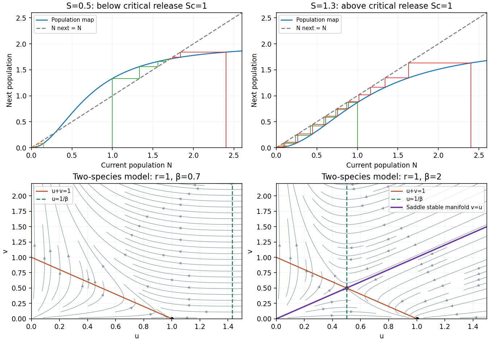

<h1 id="a/1/a/ii/solution">Solution</h1>

↑ **Parent:** [Ii](../ii.md)

The two positive [fixed points](../../../../../../fixed-point.md) merge when

$$
\boxed{S_c=\frac{\alpha^2}{4\beta},\qquad N_c=\frac{\alpha}{2\beta}.}
$$

Here $f'(N_c)=1$, $f''(N_c)\ne0$, and increasing $S$ decreases $f$, so this is a [saddle-node bifurcation](../../../../../../saddle-node-bifurcation.md) of the map. For $S<S_c$, the cobweb descends to zero below $N_-$, rises towards $N_+$ between the positive [fixed points](../../../../../../fixed-point.md), and descends towards $N_+$ above it. Monotonicity of $f$ prevents a trajectory from overshooting across the attracting [fixed point](../../../../../../fixed-point.md). Thus $N_-$ is an extinction threshold.

For $S>S_c$, $f(N)<N$ for every $N>0$. The iterates decrease to a nonnegative [fixed point](../../../../../../fixed-point.md), necessarily zero. At $S=S_c$, initial states below $N_c$ tend to zero and those above tend to $N_c$. The [sterile-release population threshold](../../../../../../sterile-release-population-threshold.md) therefore combines bistability below the critical release with extinction above it.

**[Figure 1](#a/1/a/ii/image-cobwebs-for-sterile-release-and-phase-portraits-for-the-two-species-competition-model). Cobwebs for sterile release and phase portraits for the two-species competition model**.

## ↑ Ancestors (14)

1. [Ii](../ii.md)
2. [A](../../a.md)
3. [1](../../../1.md)
4. [A](../../../../a.md)
5. [2011](../../../../../2011-split.md)
6. [Past exam of the topics in applied mathematics course of the University of Oxford](../../../../../split.md)
7. [Topics in applied mathematics course of the University of Oxford](../../../../../../topics-in-applied-mathematics-course-of-the-university-of-oxford.md)
8. [Year 3 of the mathematics course of the University of Oxford](../../../../../../year-3-of-the-mathematics-course-of-the-university-of-oxford.md)
9. [Mathematics course of the University of Oxford](../../../../../../mathematics-course-of-the-university-of-oxford.md)
10. [Undergraduate course of the University of Oxford](../../../../../../undergraduate-course-of-the-university-of-oxford.md)
11. [Course of the University of Oxford](../../../../../../course-of-the-university-of-oxford.md)
12. [University of Oxford](../../../../../../university-of-oxford-split.md)
13. [List of universities](../../../../../../list-of-universities.md)
14. [Codex Wiki](../../../../../../split.md)
