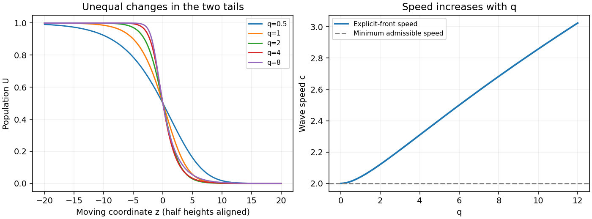

<h1 id="a/2/c/ii/solution">Solution</h1>

↑ **Parent:** [Ii](../ii.md)

The explicit [travelling wave](../../../../../../travelling-wave.md) speed increases with $q$:

$$
c'(q)=\frac{q}{2\sqrt2(q+2)^{3/2}}>0,\qquad c(q)\to2\ (q\downarrow0),\quad c(q)\sim\sqrt{q/2}\ (q\to\infty).
$$

Its two tails change differently. Near the leading empty state, $U\sim a^{-2/q}e^{-kz}$ with $k=\sqrt{2/(q+2)}$ decreasing as $q$ grows: that tail lengthens. Near the filled state, $1-U\sim(2a/q)e^{bz}$, with $b=q/\sqrt{2(q+2)}$ increasing: that tail becomes steeper. Thus the change is not a uniform sharpening of the whole profile. For example the half-height slope is $-\tfrac{k}{2}(1-2^{-q/2})$.

For meaningful comparison, the figure aligns all fronts at $U(0)=1/2$ by choosing $a=2^{q/2}-1$. It displays the speed increase and the unequal changes of the two tails. Since $f'(0)=1$ for every $q$, the minimum admissible speed remains two; the explicit family has $c(q)>2$ for $q>0$. The invariant-triangle proof above extends with boundary [derivative](../../../../../../derivative.md) $U^{q+1}\geq0$.

**[Figure 2](#a/2/c/ii/image-half-height-aligned-generalized-fisher-fronts-and-the-speed-of-the-explicit-front-family). Half-height-aligned generalized Fisher fronts and the speed of the explicit front family**.

## ↑ Ancestors (14)

1. [Ii](../ii.md)
2. [C](../../c.md)
3. [2](../../../2.md)
4. [A](../../../../a.md)
5. [2011](../../../../../2011-split.md)
6. [Past exam of the topics in applied mathematics course of the University of Oxford](../../../../../split.md)
7. [Topics in applied mathematics course of the University of Oxford](../../../../../../topics-in-applied-mathematics-course-of-the-university-of-oxford.md)
8. [Year 3 of the mathematics course of the University of Oxford](../../../../../../year-3-of-the-mathematics-course-of-the-university-of-oxford.md)
9. [Mathematics course of the University of Oxford](../../../../../../mathematics-course-of-the-university-of-oxford.md)
10. [Undergraduate course of the University of Oxford](../../../../../../undergraduate-course-of-the-university-of-oxford.md)
11. [Course of the University of Oxford](../../../../../../course-of-the-university-of-oxford.md)
12. [University of Oxford](../../../../../../university-of-oxford-split.md)
13. [List of universities](../../../../../../list-of-universities.md)
14. [Codex Wiki](../../../../../../split.md)
