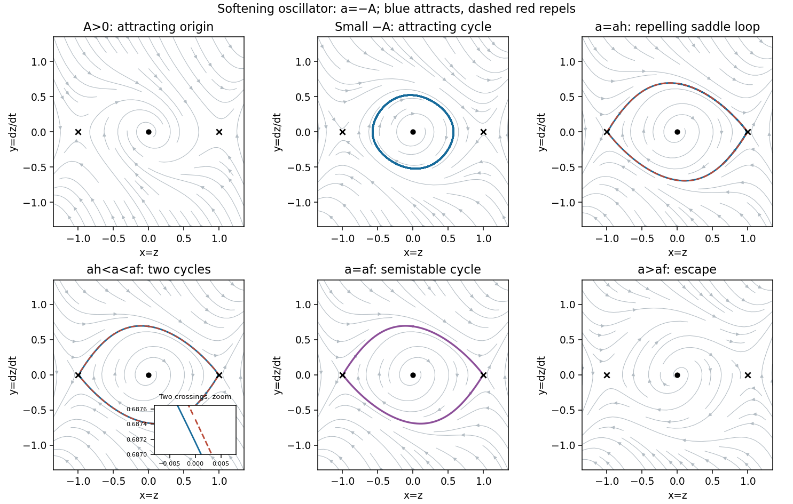

<h1 id="b/6/b/solution">Solution</h1>

↑ **Parent:** [B](../b.md)

Put $x=z$, $y=\dot z$. The system is

$$
\dot x=y,\qquad\dot y=x^3-x-Ay-y^3.
$$

Its equilibria are $\boxed{(0,0),(1,0),(-1,0)}$. At $(\pm1,0)$, the [eigenvalues](../../../../../eigenvalue.md) are $(-A\pm\sqrt{A^2+8})/2$, of opposite signs, so these are saddles for every $A$.

At the origin, the [eigenvalues](../../../../../eigenvalue.md) are $(-A\pm\sqrt{A^2-4})/2$. It is a [stable focus](../../../../../stable-spiral.md) for $0<A<2$, a stable node for $A>2$, an [unstable focus](../../../../../unstable-spiral.md) for $-2<A<0$, and an unstable node for $A<-2$. At $A=\pm2$ it is the corresponding repeated-[eigenvalue](../../../../../eigenvalue.md) improper node. At $A=0$, [linearization](../../../../../linearization.md) gives a center, but nonlinear damping matters: with

$$
E=\frac{y^2}2+\frac{x^2}2-\frac{x^4}4,\qquad\boxed{\dot E=-Ay^2-y^4,}
$$

small closed energy sublevels are invariant and $\dot E=-y^4$ forces convergence to the origin. Thus it is a weak attracting focus, not a nonlinear center.

**Local bifurcation.** Write $a=-A$. Averaging the radial equation near the origin, or eliminating nonresonant cubic terms, gives

$$
\dot R=\frac a2R-\frac38R^3+O(aR^3+R^5).
$$

The $x^3$ restoring term has zero average radial contribution, while $\langle y^4\rangle=3R^4/8$. Thus $A=0$ is a [supercritical Hopf bifurcation](../../../../../supercritical-hopf-bifurcation.md) as $a$ increases: a stable cycle appears for small $a>0$, with leading amplitude $R\simeq\sqrt{4a/3}$.

**Global changes.** Two further bifurcations must be retained. Define $a_h$ as the parameter where the upper unstable branch from $(-1,0)$ reaches $(1,0)$. Central symmetry supplies the lower connection in the opposite direction, forming a [heteroclinic cycle](../../../../../heteroclinic-cycle.md). Define $a_f>a_h$ as the subsequent collision of an inner attracting and an outer repelling [periodic orbit](../../../../../periodic-orbit.md). The complete [phase portraits](../../../../../phase-portrait.md) for $|A|<1$ are:

- $0<A<1$: an attracting origin between the two saddles; no [periodic orbit](../../../../../periodic-orbit.md), since $\dot E<0$ off the zero-velocity axis.
- $0<a<a_h$: a repelling origin surrounded by one attracting cycle. Appropriate inward saddle branches approach that cycle; trajectories outside its basin escape the central potential well.
- $a=a_h$: the attracting cycle persists inside a repelling two-saddle heteroclinic loop.
- $a_h<a<a_f$: an inner attracting cycle and an outer repelling cycle coexist. The outer cycle separates the bounded oscillations from escape.
- $a=a_f$: the two cycles merge into a semistable cycle, attracting from its inside and repelling from its outside.
- $a_f<a<1$: no [periodic orbit](../../../../../periodic-orbit.md) remains; generic nonstationary trajectories escape, with the saddle stable manifolds as exceptional trajectories.

Here escape means leaving the central well and becoming unbounded; it is not an additional finite equilibrium. The [softening Rayleigh-Duffing phase portrait](../../../../../softening-rayleigh-duffing-phase-portrait.md) in the figure includes the two critical cases.

The return-map calculation underlying this classification is useful because the two global critical parameters are very close. On the section $x=0,y>0$, let $H_a(p)$ be minus the velocity at the next crossing of $x=0$, so a symmetric cycle is a root of $H_a(p)-p$. Any [periodic orbit](../../../../../periodic-orbit.md) must have its extrema inside $-1<x<1$, since at a positive maximum $y=0$ requires $x^3-x<0$. Its index is one, so it surrounds the origin and neither saddle. Every such cycle is centrally symmetric: its reflected image cannot be a distinct nonintersecting cycle of equal enclosed area. Thus this half-return test detects all central cycles. A [fixed point](../../../../../fixed-point.md) with $H_a'<1$ is attracting and one with $H_a'>1$ repelling; the full-return multiplier is $(H_a')^2$.

For the saddle connection, let $p_L(a)$ be the upper velocity at $x=0$ from the left saddle's unstable branch and $p_R(a)$ the upper velocity at $x=0$ on the right saddle's stable branch. While $y>0$, their shooting equation is

$$
\frac{dy}{dx}=\frac{x^3-x}{y}+a-y^2.
$$

Comparison shows $p_L$ increases with $a$ and $p_R$ decreases. At $a=0$, energy dissipation gives $p_L<1/\sqrt2<p_R$. At $a=1$, the lower comparison curve $y=(x+1)/2$ on $[-1,0]$ gives $p_L>1/2$, while the upper comparison curve $y=(1-x^2)/2$ on $[0,1]$ gives $p_R<1/2$. The latter follows from

$$
\left[\frac{x^3-x}{y}+1-y^2-y'\right]_{y=(1-x^2)/2}=\frac{(1-x)(x^3+x^2-x+3)}4>0,
$$

and the stable-branch expansion $y=(1-x)-3(1-x)^2/4+\cdots$ near $x=1$. Hence there is a unique $a_h\in(0,1)$ with $p_L=p_R$.

At that connection the saddle [eigenvalues](../../../../../eigenvalue.md) are $\lambda_u=(a_h+\sqrt{a_h^2+8})/2$ and $\lambda_s=(a_h-\sqrt{a_h^2+8})/2$, so $|\lambda_s|/\lambda_u<1$. The loop is therefore repelling. In particular, the attracting Hopf cycle cannot simply disappear in that connection. Near the upper endpoint $p_R$, the half-return map has

$$
H_a(p)=p_L(a)-C[p_R(a)-p]^{\nu}+\cdots,\qquad0<\nu=|\lambda_s|/\lambda_u<1.
$$

For $a$ just above $a_h$, this produces a second, repelling [fixed point](../../../../../fixed-point.md) near the endpoint, in addition to the attracting inner one. Continuing the two roots of $H_a(p)-p$ makes their collision criterion explicit:

$$
\boxed{H_{a_f}(p_f)=p_f,\qquad H_{a_f}'(p_f)=1.}
$$

This is a [saddle-node bifurcation of periodic orbits](../../../../../saddle-node-bifurcation-of-periodic-orbits.md), not a disappearance of the [equilibrium points](../../../../../equilibrium-point-of-a-dynamical-system.md).

For a reproducible numerical check of the global sketches, event-based integration of this half-return map and its variational equation gives

$$
a_h\simeq0.33144619,\qquad a_f\simeq0.33147066,\qquad p_f\simeq0.68733571.
$$

These values are computed by shooting the stated equations; their precision is unnecessary for the requested sketches. They explain why a coarse parameter sweep can miss the two-cycle interval entirely. The three bifurcation types are therefore **Hopf at $A=0$, a two-saddle heteroclinic connection at $A=-a_h$, and a fold of cycles at $A=-a_f$**. There is no pitchfork of equilibria because their locations remain fixed for every $A$.

**[Figure 3](#b/6/b/image-softening-oscillator-phase-portraits-including-the-narrow-coexistence-interval-and-the-fold-of-cycles). Softening oscillator phase portraits, including the narrow coexistence interval and the fold of cycles**.

## ↑ Ancestors (13)

1. [B](../b.md)
2. [6](../../6.md)
3. [B](../../../b.md)
4. [2011](../../../../2011-split.md)
5. [Past exam of the topics in applied mathematics course of the University of Oxford](../../../../split.md)
6. [Topics in applied mathematics course of the University of Oxford](../../../../../topics-in-applied-mathematics-course-of-the-university-of-oxford.md)
7. [Year 3 of the mathematics course of the University of Oxford](../../../../../year-3-of-the-mathematics-course-of-the-university-of-oxford.md)
8. [Mathematics course of the University of Oxford](../../../../../mathematics-course-of-the-university-of-oxford.md)
9. [Undergraduate course of the University of Oxford](../../../../../undergraduate-course-of-the-university-of-oxford.md)
10. [Course of the University of Oxford](../../../../../course-of-the-university-of-oxford.md)
11. [University of Oxford](../../../../../university-of-oxford-split.md)
12. [List of universities](../../../../../list-of-universities.md)
13. [Codex Wiki](../../../../../split.md)
