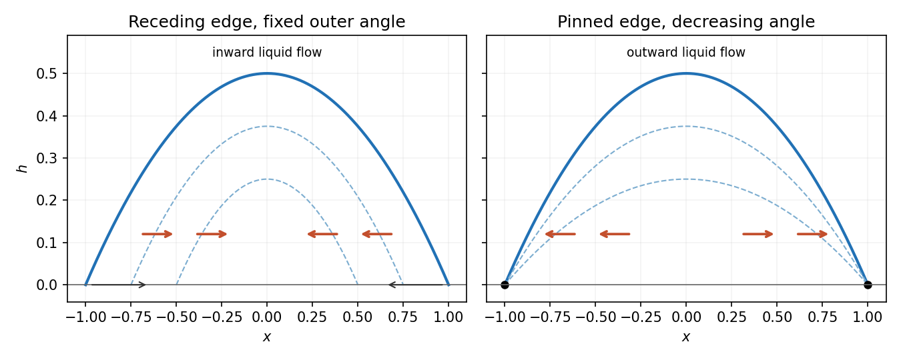

# 2008

↑ **Parent:** [Past exam of the topics in fluid mechanics course of the University of Oxford](../past-exam-of-the-topics-in-fluid-mechanics-course-of-the-university-of-oxford.md)

Original solutions to the paper released at [the source request](https://www.whatdotheyknow.com/request/maths_past_papers_3). The complete editable transcription is retained in the private examination archive.

**Table of contents**

- [1](#1)
  - [Solution](#1/solution)
- [2](#2)
  - [i](#2/i)
  - [ii](#2/ii)
  - [iii](#2/iii)
  - [iv](#2/iv)
- [3](#3)
  - [a](#3/a)
    - [Solution](#3/a/solution)
  - [b](#3/b)
    - [Solution](#3/b/solution)
  - [c](#3/c)
    - [Solution](#3/c/solution)
- [4](#4)
  - [Solution](#4/solution)

## 1

↑ **Parent:** [2008](2008.md)

<h3 id="1/solution">Solution</h3>

↑ **Parent:** [1](#1)

The four dimensional equations express [mass conservation](../continuum-mechanics.md#mass-conservation), [momentum balance](../momentum.md#momentum-conservation) with [pressure](../pressure.md), [gravity](../physics.md#gravity) and [viscous stress](../dynamic-viscosity.md#viscous-stress-tensor), heat advection and conduction, and a linear thermal-expansion [equation of state](../pressure.md#equation-of-state). For heating from below, suitable plate conditions are $\mathbf u=0$ and $T=T_0+\Delta T$ at $z=0$, and $\mathbf u=0$, $T=T_0$ at $z=d$. [No slip](../viscous-fluid-flow.md#no-slip-boundary-condition) and [thermal insulation](../heat.md#thermal-insulation) on the sidewall provide one suitable lateral completion; prescribed lateral [temperatures](../temperature.md) would be another specified thermal setup.

Let $\kappa=k/(\rho_0c_p)$ be [thermal diffusivity](../heat.md#thermal-diffusivity) and $\nu=\mu/\rho_0$ [kinematic viscosity](../dynamic-viscosity.md#kinematic-viscosity). Use $d$, $d^2/\kappa$, $\kappa/d$ and $\Delta T$ as length, time, [velocity](../classical-mechanics.md#velocity) and [temperature](../temperature.md) scales. Subtract the static reference [pressure](../pressure.md) $p_H$ with $\nabla p_H=-\rho_0g\mathbf k$ and scale its remainder by $\mu\kappa/d^2$. Then

$$
\boxed{B=\alpha\Delta T,\qquad Pr=\nu/\kappa,\qquad Ra=\frac{g\alpha\Delta T d^3}{\nu\kappa}.}
$$

[Density](../fluid-mechanics.md#density) becomes $\rho_0(1-BT)$. Substitution and division by the corresponding diffusion/viscous scales give

$$
-BT_t+\nabla\cdot[(1-BT)\mathbf u]=0,\qquad
Pr^{-1}(1-BT)(\mathbf u_t+\mathbf u\cdot\nabla\mathbf u)=-\nabla p+Ra\,T\mathbf k+\Delta\mathbf u,
$$

$$
(1-BT)(T_t+\mathbf u\cdot\nabla T)=\Delta T.
$$

In the Boussinesq small-[density](../fluid-mechanics.md#density)-contrast limit retain [buoyancy](../fluid-mechanics.md#buoyancy) while neglecting the other $B$ factors. At infinite [Prandtl number](../heat.md#prandtl-number), after any fast initial adjustment, the equations are

$$
\boxed{\nabla\cdot\mathbf u=0,\qquad0=-\nabla p+Ra\,T\mathbf k+\Delta\mathbf u,\qquad T_t+\mathbf u\cdot\nabla T=\Delta T.}
$$

The [velocity](../classical-mechanics.md#velocity) is instantaneously constrained by a viscous elliptic balance; the [temperature](../temperature.md) still evolves.

Take the [divergence](../multivariable-calculus.md#divergence) of the [vector Poisson equation](../partial-differential-equation.md#poisson-s-equation). Derivatives commute, and [divergence](../multivariable-calculus.md#divergence) of a [curl](../multivariable-calculus.md#curl) is zero, so $\Delta(\nabla\cdot\mathbf A)=0$. Its boundary value is zero, hence the [maximum principle](../partial-differential-equation.md#maximum-principle) gives $\nabla\cdot\mathbf A=0$ throughout $D$. The vector identity now gives $\operatorname{curl}\operatorname{curl}\mathbf A=\operatorname{curl}\mathbf u$, or

$$
\operatorname{curl}(\operatorname{curl}\mathbf A-\mathbf u)=0.
$$

The layer domain is [simply connected](../algebraic-topology.md#simply-connected-space) because its horizontal section is [simply connected](../algebraic-topology.md#simply-connected-space). For a [curl](../multivariable-calculus.md#curl)-free field on such a domain, define $\chi(x)$ as its [line integral](../multivariable-calculus.md#line-integral) from a fixed base point to $x$. Contractibility of loops and [Stokes theorem](../multivariable-calculus.md#stokes-theorem) make the [integral](../integral.md) [path independent](../multivariable-calculus.md#path-independence), and differentiation gives its [gradient](../multivariable-calculus.md#gradient) equal to the field. Thus $\operatorname{curl}\mathbf A-\mathbf u=\nabla\chi$.

[Incompressibility](../fluid-mechanics.md#incompressible-flow) then gives $\Delta\chi=0$, while the prescribed normal [curl](../multivariable-calculus.md#curl) gives $\partial_n\chi=0$. [Green's identity](../partial-differential-equation.md#green-s-first-identity) yields

$$
\int_D|\nabla\chi|^2\,dV=\int_{\partial D}\chi\partial_n\chi\,dS-\int_D\chi\Delta\chi\,dV=0.
$$

Hence $\chi$ is constant on the connected domain and $\boxed{\operatorname{curl}\mathbf A=\mathbf u}$. The extra condition $\mathbf A\cdot\mathbf n=0$ belongs to the stated potential boundary problem; the reconstruction argument above uses the [divergence](../multivariable-calculus.md#divergence) and normal-[curl](../multivariable-calculus.md#curl) conditions. On a multiply connected domain a [curl](../multivariable-calculus.md#curl)-free field need not be a globally single-valued [gradient](../multivariable-calculus.md#gradient).

Finally $\operatorname{curl}(T\mathbf k)=(T_y,-T_x,0)$. Taking the [curl](../multivariable-calculus.md#curl) of the infinite-Prandtl [momentum balance](../momentum.md#momentum-conservation) and using $\operatorname{curl}\mathbf u=-\Delta\mathbf A$ gives

$$
0=Ra(T_y\mathbf i-T_x\mathbf j)-\Delta^2\mathbf A,\qquad
\boxed{\nabla^4\mathbf A+Ra(T_x\mathbf j-T_y\mathbf i)=0.}
$$

The derivation is an instance of [velocity reconstruction from a mixed-boundary vector Poisson problem](../multivariable-calculus.md#velocity-reconstruction-from-a-mixed-boundary-vector-poisson-problem).

## 2

↑ **Parent:** [2008](2008.md)

The official course archive advertises [an answer for this question](https://courses.maths.ox.ac.uk/mod/resource/view.php?id=44720). Its four parts are omitted from the original solutions under the existing-answer policy.

<h3 id="2/i">i</h3>

↑ **Parent:** [2](#2)

<h3 id="2/ii">ii</h3>

↑ **Parent:** [2](#2)

<h3 id="2/iii">iii</h3>

↑ **Parent:** [2](#2)

<h3 id="2/iv">iv</h3>

↑ **Parent:** [2](#2)

## 3

↑ **Parent:** [2008](2008.md)

<h3 id="3/a">a</h3>

↑ **Parent:** [3](#3)

<h4 id="3/a/solution">Solution</h4>

↑ **Parent:** [A](#3/a)

Define $\chi_1$ to be one in [phase](../wave.md#phase-waves) 1 and zero in [phase](../wave.md#phase-waves) 2, including its dependence on both transverse coordinates even though the averaged fields depend only on $x,t$. With no interphase [mass transfer](../fluid-mechanics.md#interphase-mass-transfer), its distributional [phase](../wave.md#phase-waves)-mass equation is $\partial_t(\rho\chi_1)+\nabla\cdot(\rho\mathbf v\chi_1)=0$. At a pipe [cross section](../physics.md#cross-section-physics) $\Sigma$ of area $A$, set

$$
\boxed{\alpha=\frac1A\int_\Sigma\chi_1\,dA,\quad
\rho_1=\frac1{A\alpha}\int_\Sigma\rho\chi_1\,dA,\quad
u_1=\frac{\int_\Sigma\rho v_x\chi_1\,dA}{A\alpha\rho_1}.}
$$

Thus $\rho_1$ is an intrinsic [phase](../wave.md#phase-waves) [density](../fluid-mechanics.md#density) and $u_1$ is the [density-weighted mean](../arithmetic.md#density-weighted-mean) axial [velocity](../classical-mechanics.md#velocity). This weighting is necessary when [density](../fluid-mechanics.md#density) varies within the [phase](../wave.md#phase-waves); it becomes the ordinary intrinsic mean for an incompressible [phase](../wave.md#phase-waves) of constant [density](../fluid-mechanics.md#density).

Integrate over the [cross section](../physics.md#cross-section-physics). The transverse [divergence](../multivariable-calculus.md#divergence) contributes no boundary mass [flux](../mathematical-physics.md#flux) at the impermeable pipe wall, and the material interface has no mass leakage. The section area is constant, so

$$
\boxed{\partial_t(\rho_1\alpha)+\partial_x(\rho_1\alpha u_1)=0.}
$$

For [phase](../wave.md#phase-waves) 2 use $\chi_2=1-\chi_1$ and fraction $1-\alpha$, with the analogous intrinsic [density](../fluid-mechanics.md#density) and [density](../fluid-mechanics.md#density)-weighted [velocity](../classical-mechanics.md#velocity):

$$
\boxed{\partial_t[\rho_2(1-\alpha)]+\partial_x[\rho_2(1-\alpha)u_2]=0.}
$$

The intrinsic quantities are defined where their [phase](../wave.md#phase-waves) fraction is nonzero. These are the [intrinsic phase averages in a two-fluid pipe model](../fluid-mechanics.md#intrinsic-phase-averages-in-a-two-fluid-pipe-model).

<h3 id="3/b">b</h3>

↑ **Parent:** [3](#3)

<h4 id="3/b/solution">Solution</h4>

↑ **Parent:** [B](#3/b)

Freeze a uniform state with $0<\alpha<1$, $\rho_i>0$, and seek a finite [characteristic speed](../transport-equation.md#characteristic-speed) $c$. Denote its perturbation amplitudes by $a,v_1,v_2,\pi$. The two [phase](../wave.md#phase-waves)-mass equations and two momentum equations give

$$
(u_1-c)a+\alpha v_1=0,\qquad-(u_2-c)a+(1-\alpha)v_2=0,
$$

$$
\rho_1(u_1-c)v_1+\pi=0,\qquad\rho_2(u_2-c)v_2+\pi=0.
$$

Eliminating the amplitudes gives

$$
\rho_1(1-\alpha)(u_1-c)^2+\rho_2\alpha(u_2-c)^2=0.
$$

With $s^2=\rho_1(1-\alpha)/(\rho_2\alpha)>0$, factor the quadratic over the complex numbers to obtain

$$
\boxed{c_\pm=\frac{u_2\pm is u_1}{1\pm is}=\frac{u_2+s^2u_1}{1+s^2}\pm i\frac{s(u_1-u_2)}{1+s^2}.}
$$

For nonzero relative [velocity](../classical-mechanics.md#velocity) the speeds are a nonreal conjugate pair. A [Fourier perturbation](../fourier-analysis.md#fourier-mode) $e^{ik(x-ct)}$ on the growing branch has magnitude $e^{|k|\,|\operatorname{Im}c|t}$. Arbitrarily short waves therefore grow arbitrarily quickly, preventing a continuous dependence estimate in the usual finite-order [Sobolev norms](../sobolev-space.md#sobolev-norm). This generic slip state is [ill-posed](../partial-differential-equation.md#ill-posed-problem) as an [initial value problem](../differential-equation.md#initial-value-problem).

The [pressure](../pressure.md) has no independent time-evolution equation; it enforces the incompressible [volume](../geometry-and-topology.md#volume) [constraint](../classical-mechanics.md#constraint-mechanics), so the request concerns the finite [characteristic speeds](../transport-equation.md#characteristic-speed) rather than a freely propagating [pressure](../pressure.md) mode. At $u_1=u_2$ the two speeds coincide and this particular nonreal-speed argument disappears; further degeneracy analysis is needed there, rather than calling coincident real speeds complex. The issue is [complex characteristic speeds of a pressure-coupled two-fluid model](../fluid-mechanics.md#complex-characteristic-speeds-of-a-pressure-coupled-two-fluid-model).

<h3 id="3/c">c</h3>

↑ **Parent:** [3](#3)

<h4 id="3/c/solution">Solution</h4>

↑ **Parent:** [C](#3/c)

For constant [phase](../wave.md#phase-waves) [density](../fluid-mechanics.md#density), let $u_1$ be the intrinsic mean axial speed and define

$$
\boxed{D_1=\frac{\int_\Sigma\chi_1v_x^2\,dA}{A\alpha u_1^2}.}
$$

The profile coefficient measures the momentum [flux](../mathematical-physics.md#flux) relative to a uniform [velocity](../classical-mechanics.md#velocity) profile with the same mean. Cauchy-Schwarz gives $D_1\geq1$ where the mean is nonzero, with equality for a uniform [phase](../wave.md#phase-waves) profile. At zero mean it is safer to retain the [second moment](../expected-value.md#second-moment) itself rather than divide by $u_1^2$.

In the stated common-[pressure](../pressure.md), no-extra-force closure, the averaged conservative momentum equation is

$$
\rho_1[\partial_t(\alpha u_1)+\partial_x(\alpha D_1u_1^2)]+\alpha p_x=0.
$$

For constant $D_1$, expand its derivatives and use $\alpha_t+u_1\alpha_x+\alpha(u_1)_x=0$. The terms combine as

$$
\partial_t(\alpha u_1)+\partial_x(\alpha D_1u_1^2)=\alpha(u_1)_t+(2D_1-1)\alpha u_1(u_1)_x+(D_1-1)u_1^2\alpha_x.
$$

Therefore

$$
\boxed{\rho_1\{\alpha(u_1)_t+(2D_1-1)\alpha u_1(u_1)_x+(D_1-1)u_1^2\alpha_x\}+\alpha p_x=0.}
$$

This is the [phase momentum profile coefficient](../fluid-mechanics.md#phase-momentum-profile-coefficient) correction. It accounts for the [second moment](../expected-value.md#second-moment) of [velocity](../classical-mechanics.md#velocity), not merely a rescaling of the convective speed. A variable coefficient would also produce $\rho_1\alpha u_1^2(D_1)_x$.

## 4

↑ **Parent:** [2008](2008.md)

<h3 id="4/solution">Solution</h3>

↑ **Parent:** [4](#4)

Stretch $z=\delta Z$ and write $f=\delta h$, $w=\delta W$, with horizontal [velocity](../classical-mechanics.md#velocity) and time left order one. The longitudinal viscous term is $\delta^{-2}u_{ZZ}$, so set $P=\delta^2p$. For $Re\,\delta^2\ll1$, the leading bulk equations are $P_Z=0$, $u_{ZZ}=P_x$ and $u_x+W_Z=0$.

The normal-stress condition gives $P=-\delta^3\widehat C\,h_{xx}$ at leading order, and the tangential condition gives $u_Z(h)=0$. Hence

$$
\boxed{\beta=3,\qquad C=\delta^3\widehat C,\qquad P=-Ch_{xx}.}
$$

[No slip](../viscous-fluid-flow.md#no-slip-boundary-condition) at the bed, $u(0)=0$, yields $u=P_x(Z^2/2-hZ)$. Averaging through the depth gives

$$
\boxed{\overline u=-\frac{h^2}{3}P_x=\frac C3h^2h_{xxx}.}
$$

The kinematic condition becomes $h_t+u(h)h_x-W(h)=-\widehat\epsilon/\delta$ at leading order. Integration of continuity from the impermeable bed then gives

$$
\boxed{h_t+(h\overline u)_x=-\epsilon,\qquad\epsilon=\widehat\epsilon/\delta.}
$$

A nonzero contact speed or evaporative [flux](../mathematical-physics.md#flux) is singular in the strictly no-slip sharp-contact-line model with mobility proportional to $h^3$. A finite nonzero limiting $\overline u$ would require $h_{xxx}=3\overline u/(Ch^2)$, which is singular for a linearly vanishing height and generally incompatible with a prescribed finite slope at the exact line. Thus a dynamic finite-contact-angle condition needs microscopic regularization, such as slip or a [precursor film](../viscous-fluid-flow.md#precursor-film). In the slow-drying limit a fixed [contact angle](../surface-tension.md#contact-angle) can instead be used for the leading quasistatic outer profile; it is not an exact regular finite-rate contact-line solution.

At leading quasistatic order $h_{xxx}=0$, so the symmetric profile satisfying the imposed outer angle is

$$
h(x,T)=\frac\theta{2s(T)}(s(T)^2-x^2),\qquad T=\epsilon t.
$$

Its cross-sectional [volume](../geometry-and-topology.md#volume) is $V=\int_{-s}^sh\,dx=2\theta s^2/3$. The moving endpoints contribute no boundary-height term, and the end [flux](../mathematical-physics.md#flux) vanishes, giving $V_t=-2\epsilon s$. Consequently

$$
\boxed{\frac{ds}{dT}=-\frac3{2\theta},\qquad s(T)=s_0-\frac{3T}{2\theta},\qquad T_{\rm dry}=\frac{2\theta s_0}3.}
$$

These are leading slow-time results up to extinction; the approximation need not remain uniform at the final vanishing scale.

To recover the small [velocity](../classical-mechanics.md#velocity), differentiate the quasistatic profile using $s_t=-3\epsilon/(2\theta)$:

$$
h_t=-\frac{3\epsilon}{4}(1+x^2/s^2),\quad
(h\overline u)_x=\frac\epsilon4(-1+3x^2/s^2).
$$

[Symmetry](../physics.md#symmetry-physics) makes the [flux](../mathematical-physics.md#flux) zero at the centre, so $h\overline u=-\epsilon x(s^2-x^2)/(4s^2)$. Division by the height gives

$$
\boxed{\overline u=-\frac{\epsilon x}{2s\theta}.}
$$

The flow is inward on both sides, suggesting transport of suspended matter toward a central deposit rather than a perimeter ring. Coffee commonly leaves the opposite, ring-like pattern. A possible missing ingredient is [contact-line pinning](../surface-tension.md#contact-line-pinning): holding the perimeter fixed makes [evaporation](../critical-phenomenon.md#evaporation) require outward replenishment, and stronger [evaporation](../critical-phenomenon.md#evaporation) near the edge reinforces that transport. Receding constant-angle and pinned [contact lines](../surface-tension.md#contact-line) therefore have qualitatively different deposit mechanisms.

For comparison, the same uniform-[evaporation](../critical-phenomenon.md#evaporation) parabolic model with fixed $s$ gives $\theta_t=-3\epsilon/s$ and $\overline u=\epsilon x/(s\theta)$, an outward [velocity](../classical-mechanics.md#velocity). This comparison isolates the boundary assumption even before adding edge-enhanced [evaporation](../critical-phenomenon.md#evaporation).

**[Figure 1](#4/image-leading-parabolic-drop-models-predict-inward-flow-for-a-receding-fixed-angle-contact-line-and-outward-flow-for-a-pinned-contact-line). Leading parabolic-drop models predict inward flow for a receding fixed-angle contact line and outward flow for a pinned contact line**.

The receding solution is the [quasistatic evaporation of a receding parabolic drop](../viscous-fluid-flow.md#quasistatic-evaporation-of-a-receding-parabolic-drop).

## ↑ Ancestors (9)

1. [Past exam of the topics in fluid mechanics course of the University of Oxford](../past-exam-of-the-topics-in-fluid-mechanics-course-of-the-university-of-oxford.md)
2. [Topics in fluid mechanics course of the University of Oxford](../university-of-oxford.md#topics-in-fluid-mechanics-course-of-the-university-of-oxford)
3. [Year 4 of the mathematics course of the University of Oxford](../university-of-oxford.md#year-4-of-the-mathematics-course-of-the-university-of-oxford)
4. [Mathematics course of the University of Oxford](../university-of-oxford.md#mathematics-course-of-the-university-of-oxford)
5. [Undergraduate course of the University of Oxford](../university-of-oxford.md#undergraduate-course-of-the-university-of-oxford)
6. [Course of the University of Oxford](../university-of-oxford.md#course-of-the-university-of-oxford)
7. [University of Oxford](../university-of-oxford.md)
8. [List of universities](../README.md#list-of-universities)
9. [Codex Wiki](../README.md)
