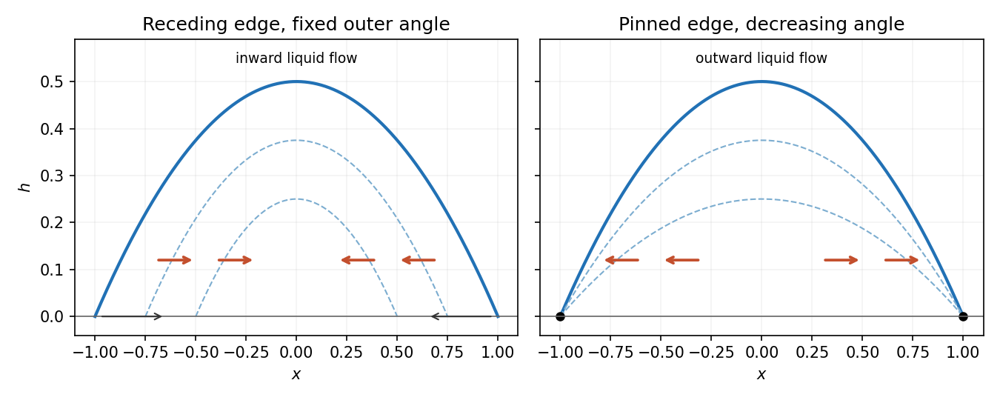

<h1 id="4/solution">Solution</h1>

↑ **Parent:** [4](../4.md)

Stretch $z=\delta Z$ and write $f=\delta h$, $w=\delta W$, with horizontal [velocity](../../../velocity.md) and time left order one. The longitudinal viscous term is $\delta^{-2}u_{ZZ}$, so set $P=\delta^2p$. For $Re\,\delta^2\ll1$, the leading bulk equations are $P_Z=0$, $u_{ZZ}=P_x$ and $u_x+W_Z=0$.

The normal-stress condition gives $P=-\delta^3\widehat C\,h_{xx}$ at leading order, and the tangential condition gives $u_Z(h)=0$. Hence

$$
\boxed{\beta=3,\qquad C=\delta^3\widehat C,\qquad P=-Ch_{xx}.}
$$

[No slip](../../../no-slip-boundary-condition.md) at the bed, $u(0)=0$, yields $u=P_x(Z^2/2-hZ)$. Averaging through the depth gives

$$
\boxed{\overline u=-\frac{h^2}{3}P_x=\frac C3h^2h_{xxx}.}
$$

The kinematic condition becomes $h_t+u(h)h_x-W(h)=-\widehat\epsilon/\delta$ at leading order. Integration of continuity from the impermeable bed then gives

$$
\boxed{h_t+(h\overline u)_x=-\epsilon,\qquad\epsilon=\widehat\epsilon/\delta.}
$$

A nonzero contact speed or evaporative [flux](../../../flux.md) is singular in the strictly no-slip sharp-contact-line model with mobility proportional to $h^3$. A finite nonzero limiting $\overline u$ would require $h_{xxx}=3\overline u/(Ch^2)$, which is singular for a linearly vanishing height and generally incompatible with a prescribed finite slope at the exact line. Thus a dynamic finite-contact-angle condition needs microscopic regularization, such as slip or a [precursor film](../../../precursor-film.md). In the slow-drying limit a fixed [contact angle](../../../contact-angle.md) can instead be used for the leading quasistatic outer profile; it is not an exact regular finite-rate contact-line solution.

At leading quasistatic order $h_{xxx}=0$, so the symmetric profile satisfying the imposed outer angle is

$$
h(x,T)=\frac\theta{2s(T)}(s(T)^2-x^2),\qquad T=\epsilon t.
$$

Its cross-sectional [volume](../../../volume.md) is $V=\int_{-s}^sh\,dx=2\theta s^2/3$. The moving endpoints contribute no boundary-height term, and the end [flux](../../../flux.md) vanishes, giving $V_t=-2\epsilon s$. Consequently

$$
\boxed{\frac{ds}{dT}=-\frac3{2\theta},\qquad s(T)=s_0-\frac{3T}{2\theta},\qquad T_{\rm dry}=\frac{2\theta s_0}3.}
$$

These are leading slow-time results up to extinction; the approximation need not remain uniform at the final vanishing scale.

To recover the small [velocity](../../../velocity.md), differentiate the quasistatic profile using $s_t=-3\epsilon/(2\theta)$:

$$
h_t=-\frac{3\epsilon}{4}(1+x^2/s^2),\quad
(h\overline u)_x=\frac\epsilon4(-1+3x^2/s^2).
$$

[Symmetry](../../../symmetry-physics.md) makes the [flux](../../../flux.md) zero at the centre, so $h\overline u=-\epsilon x(s^2-x^2)/(4s^2)$. Division by the height gives

$$
\boxed{\overline u=-\frac{\epsilon x}{2s\theta}.}
$$

The flow is inward on both sides, suggesting transport of suspended matter toward a central deposit rather than a perimeter ring. Coffee commonly leaves the opposite, ring-like pattern. A possible missing ingredient is [contact-line pinning](../../../contact-line-pinning.md): holding the perimeter fixed makes [evaporation](../../../evaporation.md) require outward replenishment, and stronger [evaporation](../../../evaporation.md) near the edge reinforces that transport. Receding constant-angle and pinned [contact lines](../../../contact-line.md) therefore have qualitatively different deposit mechanisms.

For comparison, the same uniform-[evaporation](../../../evaporation.md) parabolic model with fixed $s$ gives $\theta_t=-3\epsilon/s$ and $\overline u=\epsilon x/(s\theta)$, an outward [velocity](../../../velocity.md). This comparison isolates the boundary assumption even before adding edge-enhanced [evaporation](../../../evaporation.md).

**[Figure 1](#4/image-leading-parabolic-drop-models-predict-inward-flow-for-a-receding-fixed-angle-contact-line-and-outward-flow-for-a-pinned-contact-line). Leading parabolic-drop models predict inward flow for a receding fixed-angle contact line and outward flow for a pinned contact line**.

The receding solution is the [quasistatic evaporation of a receding parabolic drop](../../../quasistatic-evaporation-of-a-receding-parabolic-drop.md).

## ↑ Ancestors (11)

1. [4](../4.md)
2. [2008](../../2008-split.md)
3. [Past exam of the topics in fluid mechanics course of the University of Oxford](../../split.md)
4. [Topics in fluid mechanics course of the University of Oxford](../../../topics-in-fluid-mechanics-course-of-the-university-of-oxford.md)
5. [Year 4 of the mathematics course of the University of Oxford](../../../year-4-of-the-mathematics-course-of-the-university-of-oxford.md)
6. [Mathematics course of the University of Oxford](../../../mathematics-course-of-the-university-of-oxford.md)
7. [Undergraduate course of the University of Oxford](../../../undergraduate-course-of-the-university-of-oxford.md)
8. [Course of the University of Oxford](../../../course-of-the-university-of-oxford.md)
9. [University of Oxford](../../../university-of-oxford-split.md)
10. [List of universities](../../../list-of-universities.md)
11. [Codex Wiki](../../../split.md)
