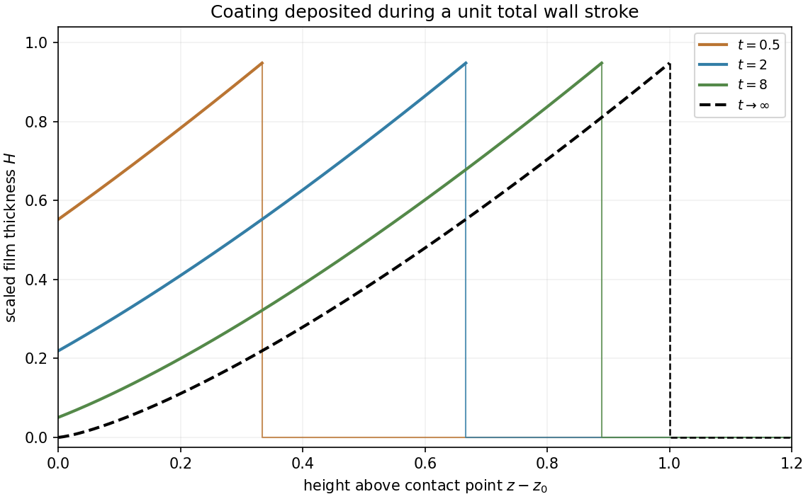

# 2009

↑ **Parent:** [Past exam of the topics in fluid mechanics course of the University of Oxford](../past-exam-of-the-topics-in-fluid-mechanics-course-of-the-university-of-oxford.md)

Original solutions to the paper released at [the source request](https://www.whatdotheyknow.com/request/maths_past_papers_3). The complete editable transcription is retained in the private examination archive.

**Table of contents**

- [1](#1)
  - [i](#1/i)
    - [Solution](#1/i/solution)
  - [ii](#1/ii)
    - [Solution](#1/ii/solution)
  - [iii](#1/iii)
    - [Solution](#1/iii/solution)
- [2](#2)
  - [i](#2/i)
    - [Solution](#2/i/solution)
  - [ii](#2/ii)
    - [Solution](#2/ii/solution)
- [3](#3)

## 1

↑ **Parent:** [2009](2009.md)

<h3 id="1/i">i</h3>

↑ **Parent:** [1](#1)

<h4 id="1/i/solution">Solution</h4>

↑ **Parent:** [I](#1/i)

[Hydrostatic pressure](../fluid-mechanics.md#hydrostatic-pressure) varies with height as $p_l-p_{\rm atm}=-\rho gz$ when the far flat bath is the zero-height reference. [Surface tension](../surface-tension.md) balances that pressure jump by [curvature](../differential-geometry.md#curvature); with the [curvature](../differential-geometry.md#curvature) sign chosen in the equation this becomes $\rho gz=\sigma\kappa$. Here $\rho$ is liquid [mass density](../fluid-mechanics.md#density), $g$ [gravitational acceleration](../newton-s-law-of-universal-gravitation.md#gravitational-acceleration), $\sigma$ [surface tension](../surface-tension.md) and $\kappa$ the signed planar [curvature](../differential-geometry.md#curvature). The [capillary length](../surface-tension.md#capillary-length) $\ell_c=\sqrt{\sigma/(\rho g)}$ balances these effects. Scale both physical $z$ and $h$ by $\ell_c$ to obtain

$$
\boxed{z=h_{zz}(1+h_z^2)^{-3/2}.}
$$

For the wall-rising [meniscus](../surface-tension.md#meniscus-liquid) $h$ decreases as $z$ rises. At the distant bath, $z\downarrow0$, $h\to\infty$ and $h_z\to-\infty$, because the free surface becomes horizontal when expressed as $z(x)$. In the first integral this gives $\boxed{A=-1}$.

At zero wall [contact angle](../surface-tension.md#contact-angle) the interface is tangent to the vertical wall. In the representation $x=h(z)$ this means $h(z_0)=0$ and $h_z(z_0)=0$, so $z_0^2/2-1=0$. The rising contact point is $\boxed{z_0=\sqrt2}$. Put $q=z^2/2-1$. Then $h_z=q/\sqrt{1-q^2}=\sqrt2(z-z_0)+O((z-z_0)^2)$. Integration from the contact point gives

$$
\boxed{h(z)\sim\frac{(z-z_0)^2}{\sqrt2}.}
$$

The sign of $h_z$ is negative on the approach from below, while $h$ is positive, as required by the geometry. This local quadratic shape is the [zero-contact-angle wall meniscus](../surface-tension.md#zero-contact-angle-wall-meniscus) matching law.

<h3 id="1/ii">ii</h3>

↑ **Parent:** [1](#1)

<h4 id="1/ii/solution">Solution</h4>

↑ **Parent:** [Ii](#1/ii)

Put $z-z_0=\epsilon\bar z$, with physical transverse thickness $h=\delta H$. Matching the preceding quadratic [meniscus](../surface-tension.md#meniscus-liquid) gives $\delta=\epsilon^2$ when the inner amplitude is normalized as $H\sim\bar z^2/\sqrt2$. After multiplying the transformed film equation by $\epsilon$, its two capillary/gravity coefficients are $\delta^3\widehat C\epsilon^{-3}$ and $\delta^2\widehat C$. Setting the [curvature](../differential-geometry.md#curvature) coefficient to one therefore gives

$$
\boxed{\epsilon=\widehat C^{-1/3},\qquad\delta=\widehat C^{-2/3},\qquad\delta^2\widehat C=\epsilon.}
$$

Thus the inner equation is exactly the stated $\epsilon H_t+v_0H_{\bar z}+[H^3(H_{\bar z\bar z\bar z}+\epsilon)/3]_{\bar z}=0$. The leading matching conditions are $H\sim\bar z^2/\sqrt2$ as $\bar z\to-\infty$ and a bounded film, with vanishing derivatives, as $\bar z\to+\infty$. They connect the static bath-side [meniscus](../surface-tension.md#meniscus-liquid) to a uniform entrained film.

For positive wall speed varying on the outer time scale, neglect the order-$\epsilon$ terms at leading order and set

$$
H=v_0^{2/3}g(\zeta),\qquad\zeta=\bar z/v_0^{1/3}.
$$

The parabolic matching coefficient is unchanged because $v_0^{2/3}/v_0^{2/3}=1$. Both remaining differential terms scale as $v_0^{4/3}$, reducing the equation to $3g_\zeta+(g^3g_{\zeta\zeta\zeta})_\zeta=0$. The supplied universal solution therefore yields the [quasisteady drag-out matching law](../surface-tension.md#quasisteady-drag-out-matching-law)

$$
\boxed{H\longrightarrow C_0v_0^{2/3},\qquad C_0=0.948,\quad\bar z\to+\infty.}
$$

Above the turn-around region, $H$ and its outer derivatives are order one, while $\delta^3\widehat C=\epsilon^3$ and $\delta^2\widehat C=\epsilon$. Hence the leading outer equation and inflow condition are

$$
\boxed{H_t+v_0(t)H_z=0,\qquad H(z_0^+,t)=C_0[v_0(t)]^{2/3}.}
$$

The boundary value comes from matching, not from setting the film to zero at the wall contact point.

<h3 id="1/iii">iii</h3>

↑ **Parent:** [1](#1)

<h4 id="1/iii/solution">Solution</h4>

↑ **Parent:** [Iii](#1/iii)

Along a [characteristic](../algebra.md#characteristic-of-a-field), $\dot z=(1+t)^{-2}$ and $\dot H=0$. Integration gives $z+1/(1+t)=\xi$, so $\boxed{H=F(\xi)}$. A [characteristic](../algebra.md#characteristic-of-a-field) entering through $z=z_0$ at time $\tau$ has $\xi=z_0+1/(1+\tau)$ and carries $H=C_0(1+\tau)^{-4/3}$. Thus the boundary-fed and initially dry portions give

$$
\boxed{F(\xi)=\begin{cases}C_0(\xi-z_0)^{4/3},&z_0<\xi\leq z_0+1,\\0,&\xi>z_0+1.\end{cases}}
$$

Values at $\xi\leq z_0$ are never sampled in the finite-time physical region and need not be prescribed. The moving coating front is $z=z_0+t/(1+t)$. Explicitly,

$$
\boxed{H(z,t)=\begin{cases}C_0\left(z-z_0+\dfrac1{1+t}\right)^{4/3},&0\leq z-z_0\leq\dfrac{t}{1+t},\\0,&z-z_0>\dfrac{t}{1+t}.\end{cases}}
$$

The incompatible initial corner creates a jump at the leading coating front; a trace convention at the jump does not affect the transported volume. The wall's total stroke is $\int_0^\infty v_0\,dt=1$, so within this leading transport model the final profile is

$$
\boxed{H_\infty(z)=\begin{cases}C_0(z-z_0)^{4/3},&0<z-z_0<1,\\0,&z-z_0>1.\end{cases}}
$$

Earlier-deposited fluid is thicker and sits farther up the finite coated interval. Its total scaled volume is $3C_0/7$, agreeing with $\int_0^\infty v_0H(z_0,t)\,dt=C_0\int_0^\infty(1+t)^{-10/3}dt$. This is a [finite-stroke coating profile](../viscous-fluid-flow.md#finite-stroke-coating-profile) for the leading matched model.

**[Figure 1](#1/iii/image-transported-coating-profiles-during-a-finite-wall-stroke). Transported coating profiles during a finite wall stroke**.

## 2

↑ **Parent:** [2009](2009.md)

<h3 id="2/i">i</h3>

↑ **Parent:** [2](#2)

<h4 id="2/i/solution">Solution</h4>

↑ **Parent:** [I](#2/i)

Let $\chi_1(\mathbf x,t)$ equal one in phase one and zero in phase two; its interface value is immaterial for area integrals. In the absence of phase change or interfacial [mass](../classical-mechanics.md#mass) transfer, the distributional phase [mass conservation](../continuum-mechanics.md#mass-conservation) is $\partial_t(\chi_1\rho)+\nabla\cdot(\chi_1\rho\mathbf u)=0$. For a cross-section $S$ of area $A$, define

$$
\boxed{\alpha=\frac1A\int_S\chi_1\,dA,\qquad
\rho_1=\frac1{A\alpha}\int_S\chi_1\rho\,dA,\qquad
u_1=\frac{\int_S\chi_1\rho u_x\,dA}{A\alpha\rho_1}.}
$$

Here the symbol $u_x$ in the integral denotes the axial velocity component, not a derivative. Integrating through an arbitrary axial slice and using zero normal flux at the rigid pipe wall gives

$$
\boxed{\partial_t(\rho_1\alpha)+\partial_x(\rho_1\alpha u_1)=0.}
$$

The velocity is [mass](../classical-mechanics.md#mass) weighted, so the averaged [mass flux](../mathematical-physics.md#mass-flux) factors exactly; an unweighted phase mean would not in general have this property. This is the [cross-section averaged phase mass balance](../fluid-mechanics.md#cross-section-averaged-phase-mass-balance).

For phase two use $\chi_2=1-\chi_1$, [volume fraction](../continuum-mechanics.md#volume-fraction) $1-\alpha$, and

$$
\rho_2=\frac{\int_S\chi_2\rho\,dA}{A(1-\alpha)},\qquad
u_2=\frac{\int_S\chi_2\rho u_x\,dA}{A(1-\alpha)\rho_2}.
$$

Then $\boxed{\partial_t[\rho_2(1-\alpha)]+\partial_x[\rho_2(1-\alpha)u_2]=0}$. Mean quantities in a phase that is absent are unnecessary; the products giving conserved masses and fluxes remain the meaningful variables.

<h3 id="2/ii">ii</h3>

↑ **Parent:** [2](#2)

<h4 id="2/ii/solution">Solution</h4>

↑ **Parent:** [Ii](#2/ii)

A spherical bubble displaces liquid volume $4\pi a^3/3$. Neglect its own weight compared with the liquid [buoyancy](../fluid-mechanics.md#buoyancy), as required by the stated gas/liquid approximation. Equating $4\pi a^3\rho_lg/3$ with the quadratic drag gives

$$
\boxed{(u_1-u_2)|u_1-u_2|=\frac{4ag}{3C_D}.}
$$

Retaining a nonnegligible [gas density](../fluid-mechanics.md#gas-density) would add the factor $1-\rho_g/\rho_l$. Let $V_s=\sqrt{4ag/(3C_D)}>0$, so the upward slip is $u_1-u_2=V_s$.

With constant phase densities, adding the two volume balances gives $\partial_x[\alpha u_1+(1-\alpha)u_2]=0$. The closed lower end fixes the total volume flux to zero. Solving it together with the slip relation yields

$$
\boxed{u_1=V_s(1-\alpha),\quad u_2=-V_s\alpha,\quad\alpha_t+V_s[\alpha(1-\alpha)]_x=0.}
$$

Individual bubbles move upward for $0\leq\alpha<1$, while small phase-fraction disturbances move at the [characteristic speed](../transport-equation.md#characteristic-speed) $q'(\alpha)=V_s(1-2\alpha)$. The latter is negative when $\alpha>1/2$: wave speed and bubble speed are different quantities.

A cleared region starts at the closed bottom, with $\alpha_L=0$ and $\alpha_R=3/4$. Its [Rankine-Hugoniot condition](../transport-equation.md#rankine-hugoniot-conditions) speed is $[q]/[\alpha]=V_s/4$. The intended clearing solution is therefore

$$
\boxed{\alpha(x,t)=\begin{cases}0,&0<x<V_st/4,\\3/4,&V_st/4<x<1,\end{cases}\qquad0<t<4/V_s.}
$$

It is an [entropy shock](../transport-equation.md#entropy-shock) for the concave [conservation law flux](../transport-equation.md#conservation-law-flux), since $q'(0)=V_s>V_s/4>q'(3/4)=-V_s/2$. Its speed also equals the bubble speed on its uncleared side, so it follows the last layer of bubbles. Under this continuation the last bubble reaches the outlet when

$$
\boxed{t_{\rm clear}=\frac4{V_s}=\sqrt{\frac{12C_D}{ag}},}
$$

after which $\alpha=0$ throughout the pipe.

There is a boundary qualification for this dense initial mixture. The [characteristics](../algebra.md#characteristic-of-a-field) in the uncleared state point into the pipe from the top. To continue the displayed solution all the way to the stated clearance time, its incoming top trace must remain $\alpha(1^-,t)=3/4$ until clearing. Initial [characteristics](../algebra.md#characteristic-of-a-field) alone cover the [shock](../transport-equation.md#shock-wave) only until $t=4/(3V_s)$, when its backward right-state [characteristic](../algebra.md#characteristic-of-a-field) first meets the top boundary. Atmospheric pressure by itself is not a [boundary condition](../differential-equation.md#boundary-condition) for this scalar phase-fraction equation. Thus the displayed formula and printed clearance time give the intended maintained-trace branch; a different top phase-fraction closure could change the later evolution. This is the [incoming boundary condition in dense bubble clearing](../fluid-mechanics.md#incoming-boundary-condition-in-dense-bubble-clearing), and is separate from the local derivation of the [conservation law](../mathematical-physics.md#conservation-law).

## 3

↑ **Parent:** [2009](2009.md)

**Existing answer advertised.** Oxford’s [Topics in Fluid Mechanics archive](https://courses.maths.ox.ac.uk/course/view.php?id=4049) lists “fhs 2009 q3 answer”, linked to [the exact Question 3 answer resource](https://courses.maths.ox.ac.uk/mod/resource/view.php?id=44721). All three source subparts of this question are skipped under the existing-answer policy. The advertisement was readable; the resource fetch failed, so its contents were not inspected.

## ↑ Ancestors (9)

1. [Past exam of the topics in fluid mechanics course of the University of Oxford](../past-exam-of-the-topics-in-fluid-mechanics-course-of-the-university-of-oxford.md)
2. [Topics in fluid mechanics course of the University of Oxford](../university-of-oxford.md#topics-in-fluid-mechanics-course-of-the-university-of-oxford)
3. [Year 4 of the mathematics course of the University of Oxford](../university-of-oxford.md#year-4-of-the-mathematics-course-of-the-university-of-oxford)
4. [Mathematics course of the University of Oxford](../university-of-oxford.md#mathematics-course-of-the-university-of-oxford)
5. [Undergraduate course of the University of Oxford](../university-of-oxford.md#undergraduate-course-of-the-university-of-oxford)
6. [Course of the University of Oxford](../university-of-oxford.md#course-of-the-university-of-oxford)
7. [University of Oxford](../university-of-oxford.md)
8. [List of universities](../README.md#list-of-universities)
9. [Codex Wiki](../README.md)
