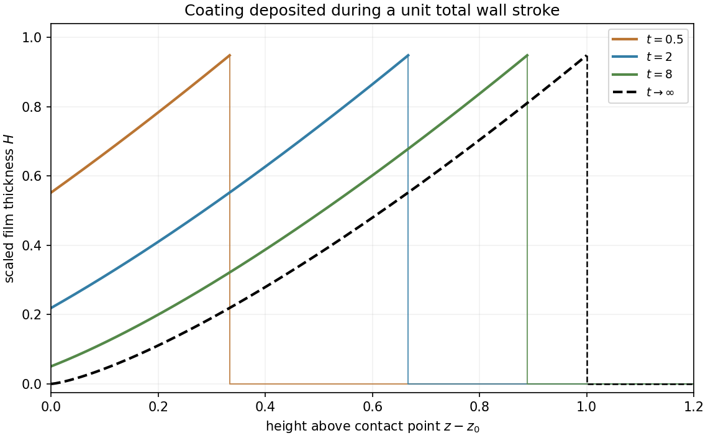

<h1 id="1/iii/solution">Solution</h1>

↑ **Parent:** [Iii](../iii.md)

Along a [characteristic](../../../../characteristic-of-a-field.md), $\dot z=(1+t)^{-2}$ and $\dot H=0$. Integration gives $z+1/(1+t)=\xi$, so $\boxed{H=F(\xi)}$. A [characteristic](../../../../characteristic-of-a-field.md) entering through $z=z_0$ at time $\tau$ has $\xi=z_0+1/(1+\tau)$ and carries $H=C_0(1+\tau)^{-4/3}$. Thus the boundary-fed and initially dry portions give

$$
\boxed{F(\xi)=\begin{cases}C_0(\xi-z_0)^{4/3},&z_0<\xi\leq z_0+1,\\0,&\xi>z_0+1.\end{cases}}
$$

Values at $\xi\leq z_0$ are never sampled in the finite-time physical region and need not be prescribed. The moving coating front is $z=z_0+t/(1+t)$. Explicitly,

$$
\boxed{H(z,t)=\begin{cases}C_0\left(z-z_0+\dfrac1{1+t}\right)^{4/3},&0\leq z-z_0\leq\dfrac{t}{1+t},\\0,&z-z_0>\dfrac{t}{1+t}.\end{cases}}
$$

The incompatible initial corner creates a jump at the leading coating front; a trace convention at the jump does not affect the transported volume. The wall's total stroke is $\int_0^\infty v_0\,dt=1$, so within this leading transport model the final profile is

$$
\boxed{H_\infty(z)=\begin{cases}C_0(z-z_0)^{4/3},&0<z-z_0<1,\\0,&z-z_0>1.\end{cases}}
$$

Earlier-deposited fluid is thicker and sits farther up the finite coated interval. Its total scaled volume is $3C_0/7$, agreeing with $\int_0^\infty v_0H(z_0,t)\,dt=C_0\int_0^\infty(1+t)^{-10/3}dt$. This is a [finite-stroke coating profile](../../../../finite-stroke-coating-profile.md) for the leading matched model.

**[Figure 1](#1/iii/image-transported-coating-profiles-during-a-finite-wall-stroke). Transported coating profiles during a finite wall stroke**.

## ↑ Ancestors (12)

1. [Iii](../iii.md)
2. [1](../../1.md)
3. [2009](../../../2009-split.md)
4. [Past exam of the topics in fluid mechanics course of the University of Oxford](../../../split.md)
5. [Topics in fluid mechanics course of the University of Oxford](../../../../topics-in-fluid-mechanics-course-of-the-university-of-oxford.md)
6. [Year 4 of the mathematics course of the University of Oxford](../../../../year-4-of-the-mathematics-course-of-the-university-of-oxford.md)
7. [Mathematics course of the University of Oxford](../../../../mathematics-course-of-the-university-of-oxford.md)
8. [Undergraduate course of the University of Oxford](../../../../undergraduate-course-of-the-university-of-oxford.md)
9. [Course of the University of Oxford](../../../../course-of-the-university-of-oxford.md)
10. [University of Oxford](../../../../university-of-oxford-split.md)
11. [List of universities](../../../../list-of-universities.md)
12. [Codex Wiki](../../../../split.md)
