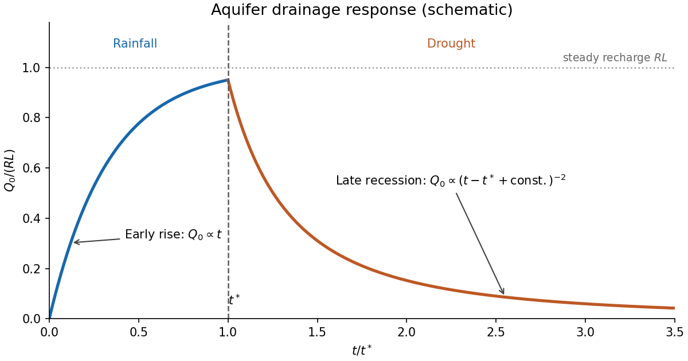

<h1 id="2/c/iii/solution">Solution</h1>

↑ **Parent:** [Iii](../iii.md)

Let $J_X=\lim_{x\downarrow0}X(x)X'(x)>0$. The spatial [ordinary differential equation](../../../../../ordinary-differential-equation.md) gives $(XX')'=-\lambda X$, so its leading outlet behavior is

$$
\boxed{X(x)\sim\sqrt{2J_Xx},\qquad
X'(x)\sim\sqrt{\frac{J_X}{2x}}.}
$$

Again this is a [square-root drainage boundary](../../../../../square-root-drainage-boundary.md). For the [separable aquifer drawdown](../../../../../separable-aquifer-drawdown.md), the dimensional drainage flux is

$$
\boxed{Q_0(t)=KT(t)^2J_X
=\frac{KJ_X}{[1+(K\lambda/\phi)(t-t^*)]^2}.}
$$

Equivalently, with $\tau_d=\phi/(K\lambda)$, it is $Q_0(t^*)[1+(t-t^*)/\tau_d]^{-2}$ for an exact separated profile. Integrating the spatial [ordinary differential equation](../../../../../ordinary-differential-equation.md) gives $J_X=\lambda\int_0^LX\,dx$. This verifies the global [mass conservation](../../../../../mass-conservation.md) check

$$
\frac d{dt}\left(\phi T\int_0^LX\,dx\right)=-KJ_XT^2=-Q_0(t).
$$

Thus the late drainage flux follows an inverse-square [power law](../../../../../power-law.md), while stored water decays inversely with time.

The [aquifer drainage hydrograph](../../../../../aquifer-drainage-hydrograph.md) starts at zero, rises linearly in the early rainfall [similarity solution](../../../../../similarity-solution.md), and approaches the total recharge $RL$ if rainfall lasts long enough for a finite-length [steady state](../../../../../steady-state.md). Indeed, steady [mass conservation](../../../../../mass-conservation.md) gives $q_x=R$ and $q(L)=0$, hence $Q_0=RL$. At $t^*$, the outlet flux stays continuous for a regular inherited flux profile, then recedes as water drains; the eventual decay is proportional to $(t-t^*+\text{constant})^{-2}$. An arbitrary transition requires the full time-dependent [partial differential equation](../../../../../partial-differential-equation-split.md), so matching an early rainfall formula directly to a separated drought formula is only a schematic approximation.

**[Figure 1](#2/c/iii/image-schematic-aquifer-drainage-response-during-rainfall-and-drought). Schematic aquifer drainage response during rainfall and drought**.

The curve illustrates these regimes and a possible $t^*$. Its numerical shape and the relative duration of the regimes are schematic; the early rainfall and late drought formulas apply in their respective asymptotic ranges.

## ↑ Ancestors (13)

1. [Iii](../iii.md)
2. [C](../../c.md)
3. [2](../../../2.md)
4. [2023](../../../../2023-split.md)
5. [Past exam of the topics in fluid mechanics course of the University of Oxford](../../../../split.md)
6. [Topics in fluid mechanics course of the University of Oxford](../../../../../topics-in-fluid-mechanics-course-of-the-university-of-oxford.md)
7. [Year 4 of the mathematics course of the University of Oxford](../../../../../year-4-of-the-mathematics-course-of-the-university-of-oxford.md)
8. [Mathematics course of the University of Oxford](../../../../../mathematics-course-of-the-university-of-oxford.md)
9. [Undergraduate course of the University of Oxford](../../../../../undergraduate-course-of-the-university-of-oxford.md)
10. [Course of the University of Oxford](../../../../../course-of-the-university-of-oxford.md)
11. [University of Oxford](../../../../../university-of-oxford-split.md)
12. [List of universities](../../../../../list-of-universities.md)
13. [Codex Wiki](../../../../../split.md)
