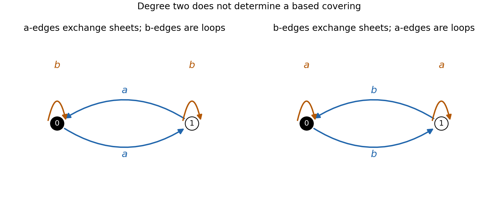
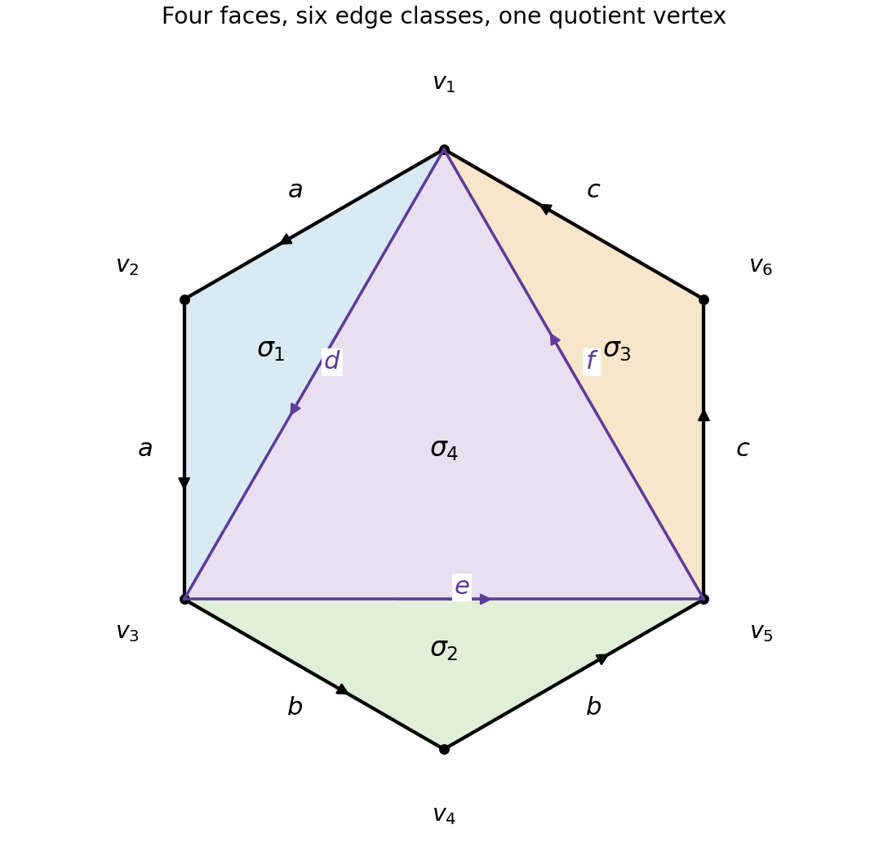

# 2007

↑ **Parent:** [Past exam of the topology and Groups and Algebraic Topology course of the University of Oxford](../past-exam-of-the-topology-and-groups-and-algebraic-topology-course-of-the-university-of-oxford.md)

Topology, Groups and Algebraic Topology, Mathematics Parts C and B and Mathematics and Philosophy Part C; Wednesday 30 May 2007, 9.30am–12.30pm. The complete five-page source and both sections are privately transcribed from original Part C bundle pages 15–19, supplied through [the past-papers disclosure](https://www.whatdotheyknow.com/request/maths_past_papers_3). No exact worked-answer advertisement was found in the bounded availability check. Homology and cohomology use integer coefficients unless another coefficient group is stated.

**Table of contents**

- [A](#a)
  - [1](#a/1)
    - [Solution](#a/1/solution)
  - [2](#a/2)
    - [Solution](#a/2/solution)
  - [3](#a/3)
    - [Solution](#a/3/solution)
  - [4](#a/4)
    - [Solution](#a/4/solution)
    - [i](#a/4/i)
      - [Solution](#a/4/i/solution)
    - [ii](#a/4/ii)
      - [Solution](#a/4/ii/solution)
- [B](#b)
  - [5](#b/5)
    - [Solution](#b/5/solution)
  - [6](#b/6)
    - [Solution](#b/6/solution)
  - [7](#b/7)
    - [Solution](#b/7/solution)
  - [8](#b/8)
    - [Solution](#b/8/solution)
    - [i](#b/8/i)
      - [Solution](#b/8/i/solution)
    - [ii](#b/8/ii)
      - [Solution](#b/8/ii/solution)
    - [iii](#b/8/iii)
      - [Solution](#b/8/iii/solution)
    - [iv](#b/8/iv)
      - [Solution](#b/8/iv/solution)
    - [v](#b/8/v)
      - [Solution](#b/8/v/solution)

## A

↑ **Parent:** [2007](2007.md)

<h3 id="a/1">1</h3>

↑ **Parent:** [A](#a)

<h4 id="a/1/solution">Solution</h4>

↑ **Parent:** [1](#a/1)

A [homotopy](../homotopy.md) from $g$ to $h$ is a continuous $H:X\times[0,1]\to Y$ with $H(x,0)=g(x)$ and $H(x,1)=h(x)$. Precomposing gives $(w,t)\mapsto H(f(w),t)$, a [homotopy](../homotopy.md) from $gf$ to $hf$; postcomposing gives $(x,t)\mapsto k(H(x,t))$, a [homotopy](../homotopy.md) from $kg$ to $kh$.

A [homotopy equivalence](../homotopy.md#homotopy-equivalence) consists of maps $u:X\to Y$ and $v:Y\to X$ with $vu\simeq\operatorname{id}_X$ and $uv\simeq\operatorname{id}_Y$. Identity maps prove reflexivity, and exchanging $u,v$ proves symmetry. For equivalences $X\leftrightarrows Y$ and $Y\leftrightarrows Z$, compose their forward maps and compose their inverse maps in reverse order. The two compositions with these candidate inverses are homotopic to the respective identities by the pre- and postcomposition result. Concatenating the homotopies proves transitivity.

For the first listed space, radial projection onto the unit sphere gives a strong [deformation retraction](../homotopy.md#deformation-retraction):

$$
H_t(x)=\left(1-t+\frac t{\|x\|}\right)x.
$$

The scalar is positive, so a point outside the two coordinate axes never enters either removed axis. Their intersection with the sphere is the four points $\pm e_1,\pm e_2$. The allowed homeomorphism statement therefore identifies this retract with the four-punctured sphere in the list.

[Stereographic projection](../riemann-surfaces.md#stereographic-projection) from one puncture identifies that sphere with the plane minus three points. Remove small disjoint open disks around the punctures and choose a larger enclosing disk. Radial motions in the three punctured disks push their remaining points to the small boundary circles, while the exterior pushes to the large boundary circle. This reduces the space to a [compact](../topology.md#compact-space) disk with three holes. It has a spine consisting of three loops [connected](../geometry-and-topology.md#connected-space) by a tree of arcs; cutting along those arcs gives a disk and collapsing its collar gives the retraction onto the spine. Collapsing a maximal tree in the spine is a [homotopy equivalence](../homotopy.md#homotopy-equivalence) onto a wedge of three circles.

Finally the three parallel removed lines give the product

$$
\bigl(\mathbb R^2\setminus\{(1,0),(2,0),(3,0)\}\bigr)\times\mathbb R.
$$

The [homotopy](../homotopy.md) $(x,y,z)\mapsto(x,y,(1-t)z)$ retracts this onto the [punctured plane](../riemann-surfaces.md#punctured-complex-plane), hence onto the same rank-three [graph](../graph.md). Composing these maps and [homotopy](../homotopy.md) inverses proves **all four listed spaces have the same [homotopy](../homotopy.md) type**. The two intersecting axes produce four spherical punctures, which is why three loops appear rather than two.

<h3 id="a/2">2</h3>

↑ **Parent:** [A](#a)

<h4 id="a/2/solution">Solution</h4>

↑ **Parent:** [2](#a/2)

Use letters $x_i$ and their formal inverses. An elementary contraction deletes an adjacent pair $x_ix_i^{-1}$ or $x_i^{-1}x_i$. A [reduced word](../geometric-group-theory.md#reduced-word-in-a-free-group) has no such pair. Repeated contraction terminates because each step reduces length by two, so every word has a reduced descendant.

For uniqueness, two possible first contractions either occur on disjoint pairs, when performing both yields a common descendant, or overlap in three letters $aa^{-1}a$, when either contraction produces the same remaining letter. Induct on word length: the shorter descendants of both first contractions therefore have the same eventual [reduced word](../geometric-group-theory.md#reduced-word-in-a-free-group). This proves every contraction sequence from a given word ends at the same [reduced word](../geometric-group-theory.md#reduced-word-in-a-free-group). An insertion or deletion of an inverse pair preserves that reduced result. Since the word model of the [free group](../geometric-group-theory.md#free-group) identifies words exactly under finite sequences of these moves, every [group](../group.md) element has **a unique reduced representative**.

To define the requested [homomorphism](../algebra.md#homomorphism), substitute $w_i$ for $x_i$ and $w_i^{-1}$ for $x_i^{-1}$ in any word. Inverse-pair insertions or deletions map to inverse words that cancel, so substitution is well defined on [group](../group.md) elements and respects concatenation. This proves the universal property of the [free group](../geometric-group-theory.md#free-group) in this case.

For an [automorphism](../algebra.md#automorphism) of order four, take $\phi(x_1)=x_2$ and $\phi(x_2)=x_1^{-1}$. Its iterates on $x_1$ are $x_2,x_1^{-1},x_2^{-1},x_1$; its fourth iterate also fixes $x_2$. Unique reduced representatives show the first three iterates on $x_1$ differ from $x_1$. Hence **its order is exactly four**.

For the final map, every iterate of $x_2$ is a positive word and contains an $x_2$. Substituting once replaces each occurrence of $x_2$ by $x_2w$ and leaves each $x_1$ unchanged. If $\ell=|w|\ge1$, its length consequently increases by at least $\ell$ on every iteration. No cancellation occurs in a positive word, so $|\phi^n(x_2)|\ge1+n\ell>1$. It cannot equal $x_2$, proving **no positive iterate of this [endomorphism](../algebra.md#endomorphism) is the identity**. Surjectivity of this last [endomorphism](../algebra.md#endomorphism) is not assumed.

This uses [positive-word growth under a free-group endomorphism](../geometric-group-theory.md#positive-word-growth-under-a-free-group-endomorphism).

<h3 id="a/3">3</h3>

↑ **Parent:** [A](#a)

<h4 id="a/3/solution">Solution</h4>

↑ **Parent:** [3](#a/3)

One standard five-operation version of the [Tietze transformations](../geometric-group-theory.md#tietze-transformations) is: invert a relator; conjugate a relator by a word; multiply a relator on either side by another relator; insert or delete the empty relator; and introduce or eliminate a generator together with a defining relation $y=w$, where $w$ uses the other generators and an eliminated generator occurs nowhere else. The elementary relator operations are reversible. Renaming and reordering the generators and relators is harmless. The Tietze theorem states that two finite presentations define isomorphic groups exactly when they are related by a finite sequence of these transformations.

For a [connected](../geometry-and-topology.md#connected-space) cell complex with one vertex, take one generator for each oriented one-cell and one relator from the attaching loop of each two-cell. Higher-dimensional cells do not change the [fundamental group](../algebraic-topology.md#fundamental-group). This is the cellular presentation theorem, obtained by applying van Kampen to the two-skeleton. Conversely a finite presentation is realized by a bouquet of its generator circles with one disk attached along each relator word, giving a finite [connected](../geometry-and-topology.md#connected-space) complex with the required [fundamental group](../algebraic-topology.md#fundamental-group).

Triangulate each relator polygon by adding diagonals from one boundary vertex. Each diagonal is a new one-cell, and every triangular two-cell has an attaching word of length at most three. Algebraically, for a word $s_1\cdots s_\ell$ with $\ell\ge4$, introduce successive partial-product generators $y_2,\ldots,y_{\ell-2}$. Use relators

$$
s_1s_2y_2^{-1},\qquad y_{j-1}s_jy_j^{-1}\ (3\le j\le\ell-2),\qquad y_{\ell-2}s_{\ell-1}s_\ell.
$$

Eliminating the new generators recovers the original word; words already of length at most three need no change. This proves the triangular-presentation claim geometrically and algebraically.

For the [free abelian group](../group-theory.md#free-abelian-group) of rank two, use

$$
\boxed{\langle a,b,c\mid abc^{-1},\ ca^{-1}b^{-1}\rangle}.
$$

Its two relations say $c=ab=ba$. For the requested transformation sequence, replace the second relator by the product of the first and second, freely reducing it to $aba^{-1}b^{-1}$. Invert the first relator, giving $cb^{-1}a^{-1}$, the definition $c=ab$. Eliminate $c$ together with this defining relation. The remaining presentation is exactly the stated two-generator [commutator](../lie-algebra.md#commutator) presentation.

The construction is a [triangular group presentation](../geometric-group-theory.md#triangular-group-presentation).

<h3 id="a/4">4</h3>

↑ **Parent:** [A](#a)

<h4 id="a/4/solution">Solution</h4>

↑ **Parent:** [4](#a/4)

The based lifting criterion is

$$
\boxed{f_*\pi_1(Y,y_0)\subseteq p_*\pi_1(\widetilde X,\widetilde b)}.
$$

Under the stated [path-connected](../geometry-and-topology.md#path-connected-space) and [locally path-connected](../geometry-and-topology.md#locally-path-connected-space) domain hypotheses, it is necessary and sufficient for a continuous based lift. Two based coverings are equivalent if a homeomorphism between their total spaces takes one chosen basepoint to the other and commutes with their projections.

For the usual classification by subgroups, total spaces are taken to be [connected](../geometry-and-topology.md#connected-space). They are then [path-connected](../geometry-and-topology.md#path-connected-space) and [locally path-connected](../geometry-and-topology.md#locally-path-connected-space) because they cover a [locally path-connected](../geometry-and-topology.md#locally-path-connected-space) base. If two such coverings have the same subgroup $H$, apply the lifting criterion to each projection to obtain based maps $F:\widetilde X\to\widetilde X'$ and $G:\widetilde X'\to\widetilde X$ over $X$. Their composites and the identity maps are based lifts of the same projections. Uniqueness of lifts on a [connected](../geometry-and-topology.md#connected-space) domain gives $GF=\operatorname{id}$ and $FG=\operatorname{id}$. Thus $F$ is an equivalence, proving **at most one [connected](../geometry-and-topology.md#connected-space) based covering realizes a given subgroup**.

The [connected](../geometry-and-topology.md#connected-space)-total-space qualification is necessary. If arbitrary disconnected coverings are allowed, the identity cover of a circle and the disjoint union of two identity covers have the same subgroup at a basepoint in the first component, yet are inequivalent. The subgroup only records the chosen component in that setting.

The degree is the cardinality of a fibre. Over a [path-connected](../geometry-and-topology.md#path-connected-space) base this is independent of the basepoint, by path lifting. For a [connected](../geometry-and-topology.md#connected-space) total space it equals the [subgroup index](../group.md#index-of-a-subgroup) $[\pi_1(X,b):H]$, and it may be infinite.

<h4 id="a/4/i">i</h4>

↑ **Parent:** [4](#a/4)

<h5 id="a/4/i/solution">Solution</h5>

↑ **Parent:** [I](#a/4/i)

On the [torus](../topological-surface.md#torus) with basepoint $(1,1)$ take $p(z,w)=(z^2,w)$ and $p'(z,w)=(z,w^2)$. Both are [connected](../geometry-and-topology.md#connected-space) two-sheeted coverings. Their induced subgroups of $\pi_1(S^1\times S^1)=\mathbb Z^2$ are $2\mathbb Z\times\mathbb Z$ and $\mathbb Z\times2\mathbb Z$, which are different. Equivalence over the fixed base would force equal based subgroups. Thus **the two degree-two covers are inequivalent**.

<h4 id="a/4/ii">ii</h4>

↑ **Parent:** [4](#a/4)

<h5 id="a/4/ii/solution">Solution</h5>

↑ **Parent:** [Ii](#a/4/ii)

Write the wedge's [fundamental group](../algebraic-topology.md#fundamental-group) as the [free group](../geometric-group-theory.md#free-group) on $a,b$. Use the index-two subgroups

$$
H=\ker(a\mapsto1,b\mapsto0),\qquad H'=\ker(a\mapsto0,b\mapsto1),
$$

where each map has target $\mathbb Z/2$. Explicitly, the first cover has two vertices, two directed lifts of $a$ exchanging the vertices, and a $b$-loop at each vertex. The second interchanges the roles of $a,b$. Each vertex has exactly one incoming and one outgoing lift of each labelled edge, so these are genuine two-sheeted [graph](../graph.md) coverings. They are [connected](../geometry-and-topology.md#connected-space), and a chosen vertex gives a based cover.

The subgroups differ because $a$ belongs to $H'$ but not $H$, while $b$ belongs to $H$ but not $H'$. Hence **the covers have the same degree and are inequivalent**.

**[Figure 1](#a/4/ii/image-two-inequivalent-double-covers-of-a-two-circle-wedge). Two inequivalent double covers of a two-circle wedge**. In one cover the a-edges exchange the sheets and the b-edges are loops; in the other the roles are reversed. The left vertex is the chosen basepoint in each.

## B

↑ **Parent:** [2007](2007.md)

<h3 id="b/5">5</h3>

↑ **Parent:** [B](#b)

<h4 id="b/5/solution">Solution</h4>

↑ **Parent:** [5](#b/5)

Choose an [orientation](../algebraic-topology.md#orientation-of-a-simplex) for each [simplex](../algebraic-topology.md#simplex). The chain [group](../group.md) $C_k$ is the [free abelian group](../group-theory.md#free-abelian-group) on the oriented $k$-simplices, with [orientation](../algebraic-topology.md#orientation-of-a-simplex) reversal changing sign. On an ordered [simplex](../algebraic-topology.md#simplex) set

$$
\partial_k[v_0,\ldots,v_k]=\sum_{i=0}^k(-1)^i[v_0,\ldots,\widehat v_i,\ldots,v_k].
$$

Its face maps respect the identifications in a [Delta-complex](../algebraic-topology.md#delta-complex). In $\partial_{k-1}\partial_k$, deleting any pair of vertices occurs in the two possible orders with signs $(-1)^{i+j-1}$ and $(-1)^{i+j}$, which cancel. Hence $\partial^2=0$. The groups of [homological cycles](../homology.md#chain-cycle) and boundaries are $Z_k=\ker\partial_k$ and $B_k=\operatorname{im}\partial_{k+1}$; the identity just proved gives $B_k\subseteq Z_k$, so $H_k=Z_k/B_k$ is defined. Mod-two [homology](../homology.md) uses the same [chain complex](../homology.md#chain-complex) with coefficients reduced modulo two.

Here the edge identifications put all six vertices into one vertex class. Let the three boundary edge classes be $a,b,c$ in cyclic order, and orient the internal diagonals as $d=[v_1,v_3]$, $e=[v_3,v_5]$, $f=[v_5,v_1]$. With the four face orientations listed in the source, the boundaries are

$$
\partial\sigma_1=2a-d,\quad\partial\sigma_2=2b-e,\quad\partial\sigma_3=2c-f,\quad\partial\sigma_4=d+e+f.
$$

Thus $C_2=\mathbb Z^4$, $C_1=\mathbb Z^6$, $C_0=\mathbb Z$, and $\partial_1=0$. The [Euler characteristic](../homology.md#euler-characteristic) is

$$
\boxed{\chi=1-6+4=-1}.
$$

The face-boundary map is injective over the integers: coefficients of $a,b,c$ force the first three face coefficients to vanish, after which the diagonal coefficients force the fourth to vanish. Its cokernel eliminates $d,e,f$ and leaves generators $a,b,c$ with the single relation $2(a+b+c)=0$. Since $a+b+c$ is primitive in $\mathbb Z^3$, this cokernel is $\mathbb Z^2\oplus\mathbb Z/2$. Therefore

$$
\boxed{H_k=\begin{cases}\mathbb Z,&k=0,\\\mathbb Z^2\oplus\mathbb Z/2,&k=1,\\0,&k\ge2.\end{cases}}
$$

Modulo two the first three face-boundary columns are $d,e,f$, and the last is their sum. The rank is three, the kernel is one-dimensional, and the edge quotient has dimension three. Consequently

$$
\boxed{H_k(-;\mathbb Z/2)=\begin{cases}\mathbb Z/2,&k=0,2,\\(\mathbb Z/2)^3,&k=1,\\0,&k\ge3.\end{cases}}
$$

The top mod-two class is the sum of all four faces. Integral [homology](../homology.md) has no such top class, reflecting nonorientability.

**[Figure 2](#b/5/image-the-hexagon-complex-and-its-face-boundaries). The hexagon complex and its face boundaries**. Paired boundary edges have labels a, b, c. The three internal diagonal classes are d, e, f; all displayed vertices become one vertex after identification.

<h3 id="b/6">6</h3>

↑ **Parent:** [B](#b)

<h4 id="b/6/solution">Solution</h4>

↑ **Parent:** [6](#b/6)

For an open cover $X=U\cup V$, the [Mayer–Vietoris theorem](../algebraic-topology.md#mayer-vietoris-sequence) gives the [long exact sequence](../homology.md#long-exact-sequence)

$$
\cdots\to H_k(U\cap V)\xrightarrow{(i_*,-j_*)}H_k(U)\oplus H_k(V)
\xrightarrow{k_*+\ell_*}H_k(X)\xrightarrow{\delta}H_{k-1}(U\cap V)\to\cdots.
$$

It ends in $H_0(U\cap V)\to H_0(U)\oplus H_0(V)\to H_0(X)\to0$. To prove it, let $C_*^{U,V}(X)$ be the subcomplex generated by singular simplices lying wholly in $U$ or wholly in $V$. There is a [short exact sequence](../module-theory.md#short-exact-sequence) of chain complexes

$$
0\to C_*(U\cap V)\xrightarrow{c\mapsto(c,-c)}C_*(U)\oplus C_*(V)
\xrightarrow{(a,b)\mapsto a+b}C_*^{U,V}(X)\to0.
$$

Exactness follows from the singular-[simplex](../algebraic-topology.md#simplex) bases: the intersection of the two chain subgroups consists exactly of simplices lying in both sets. The [small-chain locality theorem for singular homology](../homology.md#small-chain-locality-theorem-for-singular-homology) says the inclusion of this small-[chain complex](../homology.md#chain-complex) into $C_*(X)$ induces an isomorphism on [homology](../homology.md); [barycentric subdivision](../homology.md#barycentric-subdivision) is its standard justification. The [long exact sequence](../homology.md#long-exact-sequence) of a [short exact sequence](../module-theory.md#short-exact-sequence) of chain complexes now proves the theorem. For a [homological cycle](../homology.md#chain-cycle) represented as $a+b$, the connecting map is $[a+b]\mapsto[\partial a]$, since $\partial a=-\partial b$ lies in the intersection. This also identifies the displayed maps and their signs.

For the glued solid tori, use open collar enlargements of the two halves. Each retracts to a circle; the overlap retracts to their boundary [torus](../topological-surface.md#torus). Thus the halves have $H_0=H_1=\mathbb Z$ and higher [homology](../homology.md) zero, while the overlap has $H_0=H_2=\mathbb Z$ and $H_1=\mathbb Z^2$. In the overlap choose [longitude](../multivariable-calculus.md#longitude) and [meridian](../euclidean-geometry.md#meridian-of-a-sphere) generators. The [meridian](../euclidean-geometry.md#meridian-of-a-sphere) bounds a disk in each [solid torus](../topological-surface.md#solid-torus) and the [longitude](../multivariable-calculus.md#longitude) generates each first [homology](../homology.md), so the map on $H_1$ is

$$
(a,b)\longmapsto(a,-a).
$$

Its kernel is the [meridian](../euclidean-geometry.md#meridian-of-a-sphere) copy of $\mathbb Z$ and its cokernel is $\mathbb Z$. The map on $H_0$ is the injective map $z\mapsto(z,-z)$. Exactness therefore gives $H_2(X)=\mathbb Z$ and $H_1(X)=\mathbb Z$. The preceding segment is $0\to H_3(X)\to H_2(U\cap V)\to0$, giving $H_3(X)=\mathbb Z$. [Connectedness](../geometry-and-topology.md#connected-space) gives $H_0(X)=\mathbb Z$, and all higher groups vanish. Hence

$$
\boxed{H_k(X)=\mathbb Z\ (k=0,1,2,3),\qquad H_k(X)=0\ (k\ge4)}.
$$

As a geometric check, the identity boundary gluing identifies the product with $S^1\times(D^2\cup_{S^1}D^2)=S^1\times S^2$.

<h3 id="b/7">7</h3>

↑ **Parent:** [B](#b)

<h4 id="b/7/solution">Solution</h4>

↑ **Parent:** [7](#b/7)

For ordered simplicial cochains, define the Alexander-Whitney [cup product](../cohomology.md#cup-product) by

$$
(\phi\smile\psi)[v_0,\ldots,v_{i+j}]
=\phi[v_0,\ldots,v_i]\,\psi[v_i,\ldots,v_{i+j}],
$$

using the front and back faces of each characteristic [simplex](../algebraic-topology.md#simplex). Write $\delta$ for the [coboundary](../homological-algebra.md#coboundary), $\delta\phi=\phi\partial$. Expanding the face-boundary formula gives the graded Leibniz identity

$$
\delta(\phi\smile\psi)=\delta\phi\smile\psi+(-1)^i\phi\smile\delta\psi.
$$

In this expansion, face omissions on the front and back portions supply the two displayed terms, and their extra terms at the shared vertex cancel with opposite signs. Hence the cup of cocycles is a [cocycle](../homological-algebra.md#cocycle). If $\phi$ changes by $\delta a$, its product with a [cocycle](../homological-algebra.md#cocycle) changes by $\delta(a\smile\psi)$; changing $\psi$ by $\delta b$ changes it by $(-1)^i\delta(\phi\smile b)$. The product therefore descends to [cohomology](../cohomology.md). It is associative by the three consecutive-face formula and has the constant degree-zero [cochain](../cohomology.md#singular-cochain) as unit.

In the wedge, every positive-dimensional [simplex](../algebraic-topology.md#simplex) belongs to exactly one factor. Restricting positive-degree cochains therefore gives a direct sum of the two [cochain](../cohomology.md#singular-cochain) groups and splits the coboundaries in degrees above one. In degree one, the same splitting of coboundaries holds: any pair of degree-zero cochains on the factors can have their values at the glued vertices made equal by adding a constant to one factor, which does not change its [coboundary](../homological-algebra.md#coboundary). Thus restriction induces

$$
\boxed{H^n(X\vee Y)\cong H^n(X)\oplus H^n(Y)\quad(n>0)}.
$$

Represent classes from the two factors by cochains extended by zero on the other factor. If both degrees are positive, a [simplex](../algebraic-topology.md#simplex) lies wholly in one factor, so one of the front or back evaluations is zero. Their [cup product](../cohomology.md#cup-product) is already zero as a [cochain](../cohomology.md#singular-cochain). This proves all the stated mixed products vanish.

For the indicated wedge there is one unit in degree zero, two generators $a,b$ in degree one, and one generator $c$ in degree two; higher groups vanish. Every product of positive-degree elements is zero. Its ring is therefore

$$
\boxed{\mathbb Z\oplus(\mathbb Za\oplus\mathbb Zb\oplus\mathbb Zc),\qquad |a|=|b|=1,\ |c|=2,\quad(a,b,c)^2=0}.
$$

The [torus](../topological-surface.md#torus) has the same additive groups, but its degree-one generators have nonzero [cup product](../cohomology.md#cup-product) generating degree two. The two graded rings are not isomorphic. Since a [homotopy equivalence](../homotopy.md#homotopy-equivalence) induces a [cohomology](../cohomology.md)-ring isomorphism, **the [torus](../topological-surface.md#torus) and this wedge are not [homotopy](../homotopy.md) equivalent**.

<h3 id="b/8">8</h3>

↑ **Parent:** [B](#b)

<h4 id="b/8/solution">Solution</h4>

↑ **Parent:** [8](#b/8)

With the usual second-countability convention, an $n$-[manifold](../topological-manifold.md) is a [Hausdorff](../topology.md#hausdorff-space) second-countable space in which every point has a neighbourhood homeomorphic to an open subset of $\mathbb R^n$. A [local orientation of a manifold](../cohomology.md#local-orientation-of-a-manifold) at $x$ is a choice of generator of

$$
H_n(M,M\setminus\{x\};\mathbb Z)\cong\mathbb Z.
$$

Excision and a coordinate ball identify this relative [group](../group.md) with $H_n(\mathbb R^n,\mathbb R^n\setminus\{0\})$. An [orientation of a topological manifold](../topological-manifold.md#orientation-of-a-topological-manifold) is a coherent choice of such generators: near each point the choices are induced by one relative class on a neighbourhood, equivalently by an atlas with [orientation](../algebraic-topology.md#orientation-of-a-simplex)-preserving transition maps.

For a [connected](../geometry-and-topology.md#connected-space) closed oriented [manifold](../topological-manifold.md), its [fundamental class](../cohomology.md#fundamental-class) $[M]\in H_n(M;\mathbb Z)$ is the unique class mapping to every chosen local generator. Here closed means [compact](../topology.md#compact-space) without boundary. [Poincare duality](../cohomology.md#poincare-duality) states that cap product with this class is an isomorphism

$$
\boxed{-\frown[M]:H^k(M;\mathbb Z)\xrightarrow{\ \cong\ }H_{n-k}(M;\mathbb Z)}.
$$

Over rational coefficients it gives $b_k=b_{n-k}$. Therefore

$$
\chi(M)=\sum_k(-1)^kb_k=(-1)^n\sum_k(-1)^kb_k.
$$

When $n$ is odd this says $\chi=-\chi$, so **$\chi(M)=0$**. Torsion does not contribute to the Betti numbers or this [Euler characteristic](../homology.md#euler-characteristic).

<h4 id="b/8/i">i</h4>

↑ **Parent:** [8](#b/8)

<h5 id="b/8/i/solution">Solution</h5>

↑ **Parent:** [I](#b/8/i)

**Yes**, for a nonnegative integer $g$: the closed [orientable surface](../differential-geometry.md#orientable-surface) of [genus](../topological-surface.md#genus-of-a-surface) $g$ has precisely these groups. A standard polygon cell structure has one vertex, $2g$ one-cells and one two-cell attached by a product of commutators. Its integral cellular boundary maps are zero, because each generator occurs once in each [orientation](../algebraic-topology.md#orientation-of-a-simplex) in the attaching word. Thus $H_0=H_2=\mathbb Z$ and $H_1=\mathbb Z^{2g}$. At [genus](../topological-surface.md#genus-of-a-surface) zero use the sphere.

<h4 id="b/8/ii">ii</h4>

↑ **Parent:** [8](#b/8)

<h5 id="b/8/ii/solution">Solution</h5>

↑ **Parent:** [Ii](#b/8/ii)

**No.** Its top nonzero [group](../group.md) would force dimension three. [Poincare duality](../cohomology.md#poincare-duality) requires $H_2\cong H^1$, and the [universal coefficient theorem](../homology.md#universal-coefficient-theorem) gives $H^1\cong\operatorname{Hom}(H_1,\mathbb Z)=\mathbb Z$, since $H_0$ is free. This contradicts the proposed vanishing of $H_2$. Equivalently its listed Betti numbers give [Euler characteristic](../homology.md#euler-characteristic) $-1$, impossible for a closed oriented odd-dimensional [manifold](../topological-manifold.md).

<h4 id="b/8/iii">iii</h4>

↑ **Parent:** [8](#b/8)

<h5 id="b/8/iii/solution">Solution</h5>

↑ **Parent:** [Iii](#b/8/iii)

**Yes:** for $n\ge1$, the sphere $S^n$ is [connected](../geometry-and-topology.md#connected-space), closed and oriented, with $H_0=H_n=\mathbb Z$ and no intermediate [homology](../homology.md). These groups do not require the [manifold](../topological-manifold.md) to be homeomorphic to a sphere, but the sphere provides the requested example.

<h4 id="b/8/iv">iv</h4>

↑ **Parent:** [8](#b/8)

<h5 id="b/8/iv/solution">Solution</h5>

↑ **Parent:** [Iv](#b/8/iv)

**No.** The dimension would again be three. The [universal coefficient theorem](../homology.md#universal-coefficient-theorem) gives $H^1=0$, since both $\operatorname{Hom}(H_1,\mathbb Z)$ and $\operatorname{Ext}(H_0,\mathbb Z)$ vanish. [Poincare duality](../cohomology.md#poincare-duality) then forces $H_2=0$, contradicting the proposed [torsion group](../group-theory.md#torsion-group). In general the second integral [homology](../homology.md) of a [connected](../geometry-and-topology.md#connected-space) closed oriented three-[manifold](../topological-manifold.md) is free abelian, being dual to its first [homology](../homology.md).

<h4 id="b/8/v">v</h4>

↑ **Parent:** [8](#b/8)

<h5 id="b/8/v/solution">Solution</h5>

↑ **Parent:** [V](#b/8/v)

**Yes:** real projective three-space $\mathbb{RP}^3$ has these groups. Its usual cell structure has one cell in each dimension zero through three, with boundary maps $\partial_1=0$, $\partial_2=2$ and $\partial_3=0$. Hence its integral [homology](../homology.md) is $\mathbb Z$ in degrees zero and three, $\mathbb Z/2$ in degree one, and zero in degree two. It is a [connected](../geometry-and-topology.md#connected-space) closed oriented [manifold](../topological-manifold.md): the [antipodal map](../homology.md#antipodal-map) on $S^3$ preserves [orientation](../algebraic-topology.md#orientation-of-a-simplex), so the sphere's [orientation](../algebraic-topology.md#orientation-of-a-simplex) descends to the quotient.

## ↑ Ancestors (9)

1. [Past exam of the topology and Groups and Algebraic Topology course of the University of Oxford](../past-exam-of-the-topology-and-groups-and-algebraic-topology-course-of-the-university-of-oxford.md)
2. [Topology and Groups and Algebraic Topology course of the University of Oxford](../university-of-oxford.md#topology-and-groups-and-algebraic-topology-course-of-the-university-of-oxford)
3. [Year 4 of the mathematics course of the University of Oxford](../university-of-oxford.md#year-4-of-the-mathematics-course-of-the-university-of-oxford)
4. [Mathematics course of the University of Oxford](../university-of-oxford.md#mathematics-course-of-the-university-of-oxford)
5. [Undergraduate course of the University of Oxford](../university-of-oxford.md#undergraduate-course-of-the-university-of-oxford)
6. [Course of the University of Oxford](../university-of-oxford.md#course-of-the-university-of-oxford)
7. [University of Oxford](../university-of-oxford.md)
8. [List of universities](../README.md#list-of-universities)
9. [Codex Wiki](../README.md)
