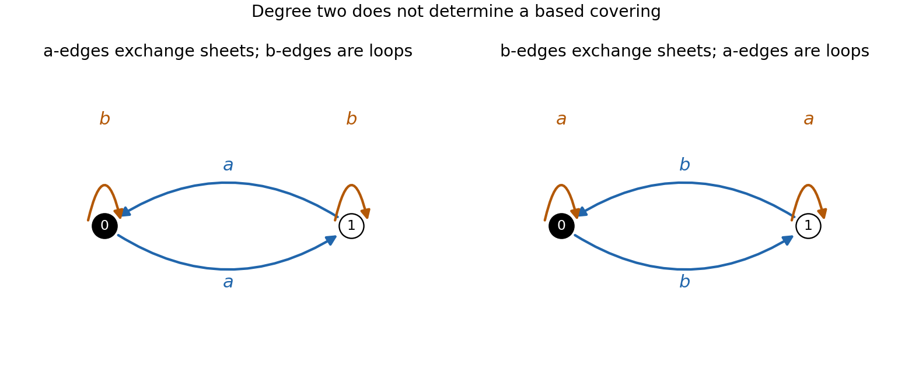

<h1 id="a/4/ii/solution">Solution</h1>

↑ **Parent:** [Ii](../ii.md)

Write the wedge's [fundamental group](../../../../../fundamental-group.md) as the [free group](../../../../../free-group.md) on $a,b$. Use the index-two subgroups

$$
H=\ker(a\mapsto1,b\mapsto0),\qquad H'=\ker(a\mapsto0,b\mapsto1),
$$

where each map has target $\mathbb Z/2$. Explicitly, the first cover has two vertices, two directed lifts of $a$ exchanging the vertices, and a $b$-loop at each vertex. The second interchanges the roles of $a,b$. Each vertex has exactly one incoming and one outgoing lift of each labelled edge, so these are genuine two-sheeted [graph](../../../../../graph-split.md) coverings. They are [connected](../../../../../connected-space.md), and a chosen vertex gives a based cover.

The subgroups differ because $a$ belongs to $H'$ but not $H$, while $b$ belongs to $H$ but not $H'$. Hence **the covers have the same degree and are inequivalent**.

**[Figure 1](#a/4/ii/image-two-inequivalent-double-covers-of-a-two-circle-wedge). Two inequivalent double covers of a two-circle wedge**. In one cover the a-edges exchange the sheets and the b-edges are loops; in the other the roles are reversed. The left vertex is the chosen basepoint in each.

## ↑ Ancestors (13)

1. [Ii](../ii.md)
2. [4](../../4.md)
3. [A](../../../a.md)
4. [2007](../../../../2007-split.md)
5. [Past exam of the topology and Groups and Algebraic Topology course of the University of Oxford](../../../../split.md)
6. [Topology and Groups and Algebraic Topology course of the University of Oxford](../../../../../topology-and-groups-and-algebraic-topology-course-of-the-university-of-oxford.md)
7. [Year 4 of the mathematics course of the University of Oxford](../../../../../year-4-of-the-mathematics-course-of-the-university-of-oxford.md)
8. [Mathematics course of the University of Oxford](../../../../../mathematics-course-of-the-university-of-oxford.md)
9. [Undergraduate course of the University of Oxford](../../../../../undergraduate-course-of-the-university-of-oxford.md)
10. [Course of the University of Oxford](../../../../../course-of-the-university-of-oxford.md)
11. [University of Oxford](../../../../../university-of-oxford-split.md)
12. [List of universities](../../../../../list-of-universities.md)
13. [Codex Wiki](../../../../../split.md)
