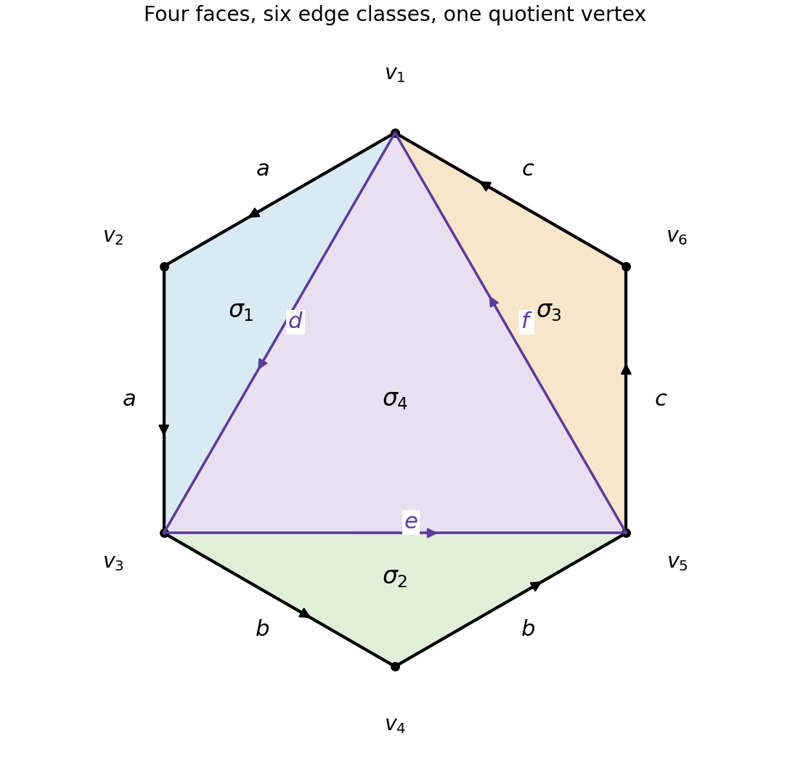

<h1 id="b/5/solution">Solution</h1>

↑ **Parent:** [5](../5.md)

Choose an [orientation](../../../../orientation-of-a-simplex.md) for each [simplex](../../../../simplex.md). The chain [group](../../../../group-split.md) $C_k$ is the [free abelian group](../../../../free-abelian-group.md) on the oriented $k$-simplices, with [orientation](../../../../orientation-of-a-simplex.md) reversal changing sign. On an ordered [simplex](../../../../simplex.md) set

$$
\partial_k[v_0,\ldots,v_k]=\sum_{i=0}^k(-1)^i[v_0,\ldots,\widehat v_i,\ldots,v_k].
$$

Its face maps respect the identifications in a [Delta-complex](../../../../delta-complex.md). In $\partial_{k-1}\partial_k$, deleting any pair of vertices occurs in the two possible orders with signs $(-1)^{i+j-1}$ and $(-1)^{i+j}$, which cancel. Hence $\partial^2=0$. The groups of [homological cycles](../../../../chain-cycle.md) and boundaries are $Z_k=\ker\partial_k$ and $B_k=\operatorname{im}\partial_{k+1}$; the identity just proved gives $B_k\subseteq Z_k$, so $H_k=Z_k/B_k$ is defined. Mod-two [homology](../../../../homology-split.md) uses the same [chain complex](../../../../chain-complex.md) with coefficients reduced modulo two.

Here the edge identifications put all six vertices into one vertex class. Let the three boundary edge classes be $a,b,c$ in cyclic order, and orient the internal diagonals as $d=[v_1,v_3]$, $e=[v_3,v_5]$, $f=[v_5,v_1]$. With the four face orientations listed in the source, the boundaries are

$$
\partial\sigma_1=2a-d,\quad\partial\sigma_2=2b-e,\quad\partial\sigma_3=2c-f,\quad\partial\sigma_4=d+e+f.
$$

Thus $C_2=\mathbb Z^4$, $C_1=\mathbb Z^6$, $C_0=\mathbb Z$, and $\partial_1=0$. The [Euler characteristic](../../../../euler-characteristic.md) is

$$
\boxed{\chi=1-6+4=-1}.
$$

The face-boundary map is injective over the integers: coefficients of $a,b,c$ force the first three face coefficients to vanish, after which the diagonal coefficients force the fourth to vanish. Its cokernel eliminates $d,e,f$ and leaves generators $a,b,c$ with the single relation $2(a+b+c)=0$. Since $a+b+c$ is primitive in $\mathbb Z^3$, this cokernel is $\mathbb Z^2\oplus\mathbb Z/2$. Therefore

$$
\boxed{H_k=\begin{cases}\mathbb Z,&k=0,\\\mathbb Z^2\oplus\mathbb Z/2,&k=1,\\0,&k\ge2.\end{cases}}
$$

Modulo two the first three face-boundary columns are $d,e,f$, and the last is their sum. The rank is three, the kernel is one-dimensional, and the edge quotient has dimension three. Consequently

$$
\boxed{H_k(-;\mathbb Z/2)=\begin{cases}\mathbb Z/2,&k=0,2,\\(\mathbb Z/2)^3,&k=1,\\0,&k\ge3.\end{cases}}
$$

The top mod-two class is the sum of all four faces. Integral [homology](../../../../homology-split.md) has no such top class, reflecting nonorientability.

**[Figure 2](#b/5/image-the-hexagon-complex-and-its-face-boundaries). The hexagon complex and its face boundaries**. Paired boundary edges have labels a, b, c. The three internal diagonal classes are d, e, f; all displayed vertices become one vertex after identification.

## ↑ Ancestors (12)

1. [5](../5.md)
2. [B](../../b.md)
3. [2007](../../../2007-split.md)
4. [Past exam of the topology and Groups and Algebraic Topology course of the University of Oxford](../../../split.md)
5. [Topology and Groups and Algebraic Topology course of the University of Oxford](../../../../topology-and-groups-and-algebraic-topology-course-of-the-university-of-oxford.md)
6. [Year 4 of the mathematics course of the University of Oxford](../../../../year-4-of-the-mathematics-course-of-the-university-of-oxford.md)
7. [Mathematics course of the University of Oxford](../../../../mathematics-course-of-the-university-of-oxford.md)
8. [Undergraduate course of the University of Oxford](../../../../undergraduate-course-of-the-university-of-oxford.md)
9. [Course of the University of Oxford](../../../../course-of-the-university-of-oxford.md)
10. [University of Oxford](../../../../university-of-oxford-split.md)
11. [List of universities](../../../../list-of-universities.md)
12. [Codex Wiki](../../../../split.md)
