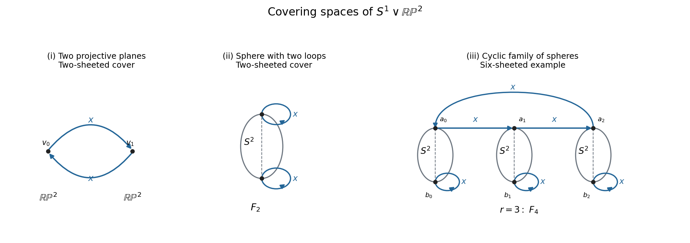

# 2009

↑ **Parent:** [Past exam of the topology and Groups and Algebraic Topology course of the University of Oxford](../past-exam-of-the-topology-and-groups-and-algebraic-topology-course-of-the-university-of-oxford.md)

Topology and Groups and Algebraic Topology, Trinity Term; Wednesday 3 June 2009, 2.30pm–5.30pm. The intact cover lists Mathematics Part B, Mathematics Part C, and Mathematics and Philosophy Part C under the same module code. Both sections and all six questions are covered here. The full five-page source is retained in a private editable transcription. It was supplied through [the past-papers disclosure](https://www.whatdotheyknow.com/request/maths_past_papers_3), in original Part C bundle pages 222–226. No exact worked-answer advertisement was found in the bounded check.

**Table of contents**

- [A](#a)
  - [1](#a/1)
    - [Solution](#a/1/solution)
  - [2](#a/2)
    - [Solution](#a/2/solution)
  - [3](#a/3)
    - [Solution](#a/3/solution)
    - [i](#a/3/i)
      - [Solution](#a/3/i/solution)
    - [ii](#a/3/ii)
      - [Solution](#a/3/ii/solution)
    - [iii](#a/3/iii)
      - [Solution](#a/3/iii/solution)
- [B](#b)
  - [4](#b/4)
    - [a](#b/4/a)
      - [Solution](#b/4/a/solution)
    - [b](#b/4/b)
      - [Solution](#b/4/b/solution)
    - [c](#b/4/c)
      - [Solution](#b/4/c/solution)
  - [5](#b/5)
    - [a](#b/5/a)
      - [Solution](#b/5/a/solution)
    - [b](#b/5/b)
      - [Solution](#b/5/b/solution)
  - [6](#b/6)
    - [Solution](#b/6/solution)
    - [i](#b/6/i)
      - [Solution](#b/6/i/solution)
    - [ii](#b/6/ii)
      - [Solution](#b/6/ii/solution)
    - [iii](#b/6/iii)
      - [Solution](#b/6/iii/solution)

## A

↑ **Parent:** [2009](2009.md)

<h3 id="a/1">1</h3>

↑ **Parent:** [A](#a)

<h4 id="a/1/solution">Solution</h4>

↑ **Parent:** [1](#a/1)

An [edge loop](../algebraic-topology.md#edge-loop) is a finite sequence of vertices $v_0,\ldots,v_m$, starting and ending at $b$, in which consecutive distinct vertices span an edge. Two such sequences are equivalent when related by finitely many elementary edge homotopies, with endpoints fixed: insert or delete a repeated vertex, cancel or insert a spur $(u,v,u)$, and replace $(u,v,w)$ by $(u,w)$ or conversely when the vertices lie in one [simplex](../algebraic-topology.md#simplex). Repetitions are allowed in this last convention; a nondegenerate move uses a triangle.

The [edge-loop group](../algebraic-topology.md#edge-loop-group) $E(K,b)$ consists of these equivalence classes, with product given by concatenating the sequences at $b$. Elementary moves remain valid inside a longer concatenation, so this product is well defined. Concatenation is associative after the harmless repeated base vertex is removed; the constant [edge loop](../algebraic-topology.md#edge-loop) is the identity. Reversing a sequence gives its inverse, because a sequence followed by its reverse cancels by successive spurs. Thus these operations do form a group.

Realize an [edge loop](../algebraic-topology.md#edge-loop) as a piecewise linear path in the [geometric realization](../algebraic-topology.md#geometric-realization-of-a-simplicial-complex) $|K|$. A spur contracts in an edge, and a triangle move is a [homotopy](../homotopy.md) across that triangle, always fixing endpoints. Hence realization gives a well-defined map $\theta$ to the [fundamental group](../algebraic-topology.md#fundamental-group). Realization respects concatenation up to endpoint-preserving reparametrization, so $\theta$ is a [homomorphism](../algebra.md#homomorphism).

The relative [Simplicial approximation theorem](../algebraic-topology.md#simplicial-approximation-theorem) says that a continuous map from a finite complex to a [geometric realization](../algebraic-topology.md#geometric-realization-of-a-simplicial-complex) is homotopic, after sufficiently fine subdivision of its domain, to a simplicial map, with a chosen already simplicial subcomplex kept fixed. Apply its based-[circle](../topology.md#circle) version to a loop, keeping its marked vertex at $b$. The resulting subdivided simplicial [circle](../topology.md#circle) traverses edges, so every [based homotopy](../algebraic-topology.md#based-homotopy) class has an edge-loop representative. Thus **$\theta$ is surjective**.

For the full two-skeleton, use the triangles through $b$ to replace each edge $(u,v)$ of a loop by $(u,b,v)$. Degenerate cases use repeated-vertex or spur moves. The resulting path contracts by spurs, so its [edge-loop group](../algebraic-topology.md#edge-loop-group), and therefore its [fundamental group](../algebraic-topology.md#fundamental-group), is trivial. This also covers one or two vertices, when only repeated vertices and spurs are needed.

If the deleted triangle has vertices $u,v,w$, choose a fourth vertex $t$. Its boundary is filled by the three present triangles $(t,u,v)$, $(t,v,w)$ and $(t,w,u)$: their union is the cone from $t$ on that boundary. Every elementary [homotopy](../homotopy.md) that formerly crossed the missing triangle can therefore be replaced by a [homotopy](../homotopy.md) through these three triangles, staying in $|L|$. Since the one-skeleton has not changed, the same contraction of any [edge loop](../algebraic-topology.md#edge-loop) is available in $L$. Surjectivity of its realization map gives

$$
\boxed{\pi_1(|K|,b)=1,\qquad\pi_1(|L|,b)=1\quad(n\geq4\text{ for }L)}.
$$

<h3 id="a/2">2</h3>

↑ **Parent:** [A](#a)

<h4 id="a/2/solution">Solution</h4>

↑ **Parent:** [2](#a/2)

A [canonical presentation of a group](../geometric-group-theory.md#canonical-presentation-of-a-group) uses a symbol $[g]$ for each $g\in G$ and relations $[g][h]=[gh]$ for every pair. Evaluation to $G$ is surjective, and $g\mapsto[g]$ is its inverse [homomorphism](../algebra.md#homomorphism); the relation with $g=h=1$ implies $[1]=1$. Thus this presentation recovers any group.

The [pushout](../category.md#pushout) of the two homomorphisms is

$$
G=(G_1*G_2)/\left\langle\!\left\langle\phi_1(g)\phi_2(g)^{-1}:g\in G_0\right\rangle\!\right\rangle.
$$

Here $*$ is the [free product](../algebraic-topology.md#free-product), and the denominator is the [normal closure](../group-theory.md#normal-closure). Its canonical maps $j_i:G_i\to G$ satisfy $j_1\phi_1=j_2\phi_2$. The [universal property](../category-theory.md#universal-property) says that maps $u_i:G_i\to H$ agreeing on $G_0$ factor uniquely as $u_i=u j_i$ for one [homomorphism](../algebra.md#homomorphism) $u:G\to H$. The free-product [universal property](../category-theory.md#universal-property) first gives the map before quotienting, and agreement makes it kill precisely the imposed relations, proving this property.

Suppose $G_0$ is generated by $s_1,\ldots,s_r$, and $G_i=\langle S_i\mid R_i\rangle$ are finite presentations with disjoint generator sets. Choose words $w_{ij}$ representing $\phi_i(s_j)$. Then

$$
\boxed{G=\langle S_1\sqcup S_2\mid R_1,R_2,\ w_{1j}w_{2j}^{-1}\ (1\leq j\leq r)\rangle}.
$$

Agreement on these generators implies agreement on every word in $G_0$, so these finitely many extra relations suffice by the [universal property](../category-theory.md#universal-property). No [finite presentation](../module-theory.md#finite-presentation-of-a-module) for $G_0$ is required.

The [Seifert-van Kampen theorem](../algebraic-topology.md#seifert-van-kampen-theorem) states that for a space covered by [path-connected](../geometry-and-topology.md#path-connected-space) open sets $U,V$ with [path-connected](../geometry-and-topology.md#path-connected-space) nonempty intersection and basepoint in that intersection, $\pi_1(U\cup V)$ is the [pushout](../category.md#pushout) of $\pi_1(U)\leftarrow\pi_1(U\cap V)\to\pi_1(V)$.

To see the two bands in the [Klein bottle](../topological-surface.md#klein-bottle) model, take one region to be $1/4\leq y\leq3/4$ and the other to be the outer strips $0\leq y\leq1/4$, $3/4\leq y\leq1$, joined along the top-bottom identification. Each is an interval bundle over the horizontal [circle](../topology.md#circle), and going once around reverses its transverse coordinate. For the middle band use the coordinate $y-1/2$; for the outer band use the signed coordinate about zero modulo one. Both are therefore [Möbius bands](../topological-surface.md#mobius-band). Their common boundary is the one [circle](../topology.md#circle) represented by the lines $y=1/4,3/4$, joined at the identified vertical sides. They cover the whole bottle and are glued along that [circle](../topology.md#circle).

A [Möbius band](../topological-surface.md#mobius-band) deformation retracts onto its core [circle](../topology.md#circle), so its [fundamental group](../algebraic-topology.md#fundamental-group) is infinite cyclic. Going once around its boundary traverses the core twice: one pass along one boundary edge changes sides, and the second pass returns. After choosing core generators and consistent boundary [orientation](../algebraic-topology.md#orientation-of-a-simplex), the two inclusion maps from the common [circle](../topology.md#circle) send its generator to $x^2$ and $y^2$. Thicken the bands slightly so their overlap is an annular neighbourhood of their common boundary. [Seifert-van Kampen theorem](../algebraic-topology.md#seifert-van-kampen-theorem) then gives

$$
\boxed{\pi_1(K)=\langle x,y\mid x^2=y^2\rangle}.
$$

Reversing a chosen generator absorbs an opposite boundary parametrization, so the presentation is independent of that sign choice.

<h3 id="a/3">3</h3>

↑ **Parent:** [A](#a)

<h4 id="a/3/solution">Solution</h4>

↑ **Parent:** [3](#a/3)

A [lift](../lift-force.md) of $f:Y\to X$ is a continuous map $\widetilde f:Y\to\widetilde X$ satisfying $p\widetilde f=f$. The [covering homotopy theorem](../algebraic-topology.md#homotopy-lifting-theorem-for-a-covering-map) says that a [homotopy](../homotopy.md) $H:Y\times I\to X$ has a unique [lift](../lift-force.md) once a continuous [lift](../lift-force.md) of its initial map $H(-,0)$ is prescribed. No additional local connectivity assumption on $Y$ is needed for this [homotopy](../homotopy.md)-lifting statement.

To prove injectivity on fundamental groups, let a loop $\widetilde\gamma$ based at $\widetilde b$ project to a based null-homotopic loop. [Lift](../lift-force.md) its null-[homotopy](../homotopy.md), starting with $\widetilde\gamma$. The two endpoint tracks [lift](../lift-force.md) constant paths at $b$ starting at $\widetilde b$, so remain at $\widetilde b$ by uniqueness of path lifting. The final path lies in the discrete fibre over $b$ and starts at $\widetilde b$, so it is constant. Thus the lifted [homotopy](../homotopy.md) contracts $\widetilde\gamma$ relative its basepoint, proving

$$
\boxed{p_*:\pi_1(\widetilde X,\widetilde b)\hookrightarrow\pi_1(X,b)}.
$$

In the following constructions, take $x$ around the [circle](../topology.md#circle) factor and $y$ around the projective-plane factor. Above each sheet point, the [circle](../topology.md#circle) has one incoming and one outgoing lifted $x$ edge. A fixed sheet for $y$ carries an identity cover of $\mathbb{RP}^2$; a transposed pair of sheets is joined as the antipodal fibre of a [sphere](../euclidean-geometry.md#sphere) covering $\mathbb{RP}^2$. These pieces give genuine covering neighbourhoods at the wedge point as well as away from it.

<h4 id="a/3/i">i</h4>

↑ **Parent:** [3](#a/3)

<h5 id="a/3/i/solution">Solution</h5>

↑ **Parent:** [I](#a/3/i)

Use two sheet points $v_0,v_1$. Attach a copy of $\mathbb{RP}^2$ at each, each mapping identically onto the projective-plane summand. Put an oriented $x$ edge from $v_0$ to $v_1$ and another from $v_1$ to $v_0$, each mapping once along the cut-open [circle](../topology.md#circle). This is a [connected](../geometry-and-topology.md#connected-space) two-sheeted cover.

Its underlying two-edge [circle](../topology.md#circle) contributes one infinite cyclic free factor, and its two attached projective planes contribute two factors of order two. Collapsing one of the connecting edges, or applying [Seifert-van Kampen theorem](../algebraic-topology.md#seifert-van-kampen-theorem), gives

$$
\pi_1(\widetilde X,v_0)\cong\mathbb Z*C_2*C_2.
$$

Choose the first $x$ edge as a tree path to $v_1$. The [circle](../topology.md#circle) loop projects to $x^2$, and the two projective-plane generators project to $y$ and $xyx^{-1}$. By injectivity from the preceding proof,

$$
\boxed{\langle x^2,\ y,\ xyx^{-1}\rangle\cong\mathbb Z*C_2*C_2}.
$$

The order-two relations come from the respective projective planes; there are no additional relations between these free factors.

<h4 id="a/3/ii">ii</h4>

↑ **Parent:** [3](#a/3)

<h5 id="a/3/ii/solution">Solution</h5>

↑ **Parent:** [Ii](#a/3/ii)

Take the [sphere](../euclidean-geometry.md#sphere) double cover $S^2\to\mathbb{RP}^2$ and denote the two points above the wedge point by $v_0,v_1$. Attach one $x$ [circle](../topology.md#circle) at each point, mapping identically onto the [circle](../topology.md#circle) summand. At both points there is one incoming and one outgoing $x$ branch, so this is a [connected](../geometry-and-topology.md#connected-space) two-sheeted cover of the wedge.

The [sphere](../euclidean-geometry.md#sphere) is simply [connected](../geometry-and-topology.md#connected-space), while each attached [circle](../topology.md#circle) supplies one generator. Join the two attachment points by an arc in the [sphere](../euclidean-geometry.md#sphere) and collapse that contractible arc; the [fundamental group](../algebraic-topology.md#fundamental-group) is the [free product](../algebraic-topology.md#free-product) of the two [circle](../topology.md#circle) groups, hence free of rank two. A [lift](../lift-force.md) of $y$ joins $v_0$ to $v_1$. The two loop generators therefore project to

$$
\boxed{x,\qquad yxy^{-1}=yxy}.
$$

Injectivity of the [covering map](../algebraic-topology.md#covering-space) identifies their subgroup with the **[free group](../geometric-group-theory.md#free-group) on these two generators**.

<h4 id="a/3/iii">iii</h4>

↑ **Parent:** [3](#a/3)

<h5 id="a/3/iii/solution">Solution</h5>

↑ **Parent:** [Iii](#a/3/iii)

Put $r=n-1$. Take $r$ spheres, each mapping by the double cover onto $\mathbb{RP}^2$, and write their antipodal sheet points as $a_j,b_j$ for $0\leq j<r$. Add an oriented $x$ edge from $a_j$ to $a_{j+1}$, with indices modulo $r$, and add an $x$ loop at each $b_j$. Every sheet point has the required two [circle](../topology.md#circle) branches, so the resulting space is a $2r$-sheeted cover. It is [connected](../geometry-and-topology.md#connected-space) because the $a_j$ edges form a cycle and each [sphere](../euclidean-geometry.md#sphere) connects its own two sheet points.

Choose a connecting arc from $a_j$ to $b_j$ in each [sphere](../euclidean-geometry.md#sphere). Collapsing these arcs leaves the spheres simply [connected](../geometry-and-topology.md#connected-space), and leaves a graph with $r$ vertices, one cyclic edge at each step through the $a_j$, and one additional loop per vertex. This graph has $2r$ edges and rank $2r-r+1=r+1=n$. The [sphere](../euclidean-geometry.md#sphere) summands add no fundamental-group generators. Thus the cover has free [fundamental group](../algebraic-topology.md#fundamental-group) of rank $n$.

Based at $a_0$, choose the first $r-1$ cyclic $x$ edges as a [spanning tree](../tree-graph-theory.md#spanning-tree). The closing cycle projects to $x^r$. To traverse the loop at $b_j$, travel along the tree by $x^j$, use the [sphere](../euclidean-geometry.md#sphere) connector projecting to $y$, traverse its $x$ loop, and return. The resulting free basis in the base group is

$$
\boxed{\left\{x^{n-1}\right\}\ \cup\ \left\{x^j yxyx^{-j}:0\leq j\leq n-2\right\}}.
$$

There are exactly $n$ elements. For $n=2$ this is the previous pair $x,yxy$. Again injectivity of a covering's induced map makes these actual subgroups with the claimed free bases, rather than just quotient presentations.

**[Figure 1](#a/3/iii/image-coverings-of-a-circle-wedged-with-a-projective-plane). Coverings of a circle wedged with a projective plane**. Blue arrows lift the circle generator. Each sphere joins two points over the wedge point and maps by its antipodal double cover. The family shown on the right has three spheres and gives a free subgroup of rank four.

This realizes [Free subgroups of every finite rank in the free product of Z and C2](../algebraic-topology.md#free-subgroups-of-every-finite-rank-in-the-free-product-of-z-and-c2).

## B

↑ **Parent:** [2009](2009.md)

<h3 id="b/4">4</h3>

↑ **Parent:** [B](#b)

<h4 id="b/4/a">a</h4>

↑ **Parent:** [4](#b/4)

<h5 id="b/4/a/solution">Solution</h5>

↑ **Parent:** [A](#b/4/a)

For $n\geq1$, the integral [singular homology](../homology.md#singular-homology) of the [sphere](../euclidean-geometry.md#sphere) is $H_0(S^n)=\mathbb Z$, $H_n(S^n)=\mathbb Z$, and zero in other degrees. For $S^0$ there are two components, so $H_0(S^0)=\mathbb Z^2$. Choose an [orientation](../algebraic-topology.md#orientation-of-a-simplex) generator $[S^n]$ for positive dimension. The [degree of a map](../homology.md#degree-of-a-continuous-mapping) is the integer satisfying

$$
\boxed{f_*[S^n]=\deg(f)[S^n]}.
$$

To define a [local degree of a continuous map](../homology.md#local-degree-of-a-continuous-map) at $x$ over $y=f(x)$, require $x$ to be isolated in that fibre. A small neighbourhood $U$ contains no other preimage of $y$, so $f$ maps $(U,U\setminus\{x\})$ to $(S^n,S^n\setminus\{y\})$. By [excision](../homology.md#excision-theorem) their local top homology groups are both $\mathbb Z$, with generators fixed by the orientations. Multiplication by an integer in this induced map defines $\deg_xf$. Without fibre isolation, this particular local-degree definition is not in general available.

If $f^{-1}(y)=\{x_1,\ldots,x_r\}$ is finite, the local-degree formula is

$$
\boxed{\deg(f)=\sum_{j=1}^r\deg_{x_j}f}.
$$

Indeed [excision](../homology.md#excision-theorem) identifies $H_n(S^n,S^n\setminus f^{-1}(y))$ with the direct sum of the local groups at the $x_j$. The global [fundamental class](../cohomology.md#fundamental-class) maps to the vector of their local [orientation](../algebraic-topology.md#orientation-of-a-simplex) generators, namely $(1,\ldots,1)$. Naturality of the map of pairs sends that vector to $\sum_j\deg_{x_j}f$ in the local group at $y$. The other route through the naturality diagram sends the global class by $f_*$ first and therefore gives $\deg(f)$. The map from the target [sphere](../euclidean-geometry.md#sphere)'s top homology to its [local homology](../homology.md#local-homology) is an [isomorphism](../algebra.md#isomorphism), so the two integers agree. Empty fibres give degree zero by the same argument. Standard approximation by a homotopic smooth map permits the formula to be used with regular values when an original continuous map has no convenient finite fibre.

<h4 id="b/4/b">b</h4>

↑ **Parent:** [4](#b/4)

<h5 id="b/4/b/solution">Solution</h5>

↑ **Parent:** [B](#b/4/b)

Identify $S^1$ with the unit complex numbers and put $\alpha_d(z)=z^d$ for any integer $d$, including the constant map for $d=0$. A [lift](../lift-force.md) of its angular coordinate to the real line is $t\mapsto dt$, so it sends the oriented [circle](../topology.md#circle)'s [fundamental class](../cohomology.md#fundamental-class) to $d$ times itself. Thus $\deg(\alpha_d)=d$.

The natural [suspension isomorphism](../algebraic-topology.md#suspension-isomorphism) in [reduced homology](../homology.md#reduced-homology) identifies $\widetilde H_{j+1}(\Sigma X)$ with $\widetilde H_j(X)$ and intertwines a map with its suspension. This [isomorphism](../algebra.md#isomorphism) follows from [Mayer-Vietoris sequence](../algebraic-topology.md#mayer-vietoris-sequence) for the two contractible suspension cones, and its naturality gives the intertwining. Since $\Sigma S^j\cong S^{j+1}$, suspending a [sphere](../euclidean-geometry.md#sphere) self-map preserves degree. Repeating this construction gives

$$
\boxed{\text{a self-map of }S^n\text{ of every degree }d\in\mathbb Z,\quad n\geq1}.
$$

The positive-dimension convention is necessary for the arbitrary-degree assertion; self-maps of the two-point space do not realize arbitrary integers on [reduced homology](../homology.md#reduced-homology).

<h4 id="b/4/c">c</h4>

↑ **Parent:** [4](#b/4)

<h5 id="b/4/c/solution">Solution</h5>

↑ **Parent:** [C](#b/4/c)

Let $a(x)=-x$ be the [antipodal map](../homology.md#antipodal-map), whose degree is $(-1)^{n+1}$. The invariance condition is $f\circ a=f$. Multiplicativity of degree gives $\deg(f)(-1)^{n+1}=\deg(f)$, so if $n$ is even,

$$
\boxed{\deg(f)=0}.
$$

For odd $n$, factor the invariant map uniquely through the quotient $q:S^n\to\mathbb{RP}^n$, writing $f=gq$. The standard orientability and homology facts for [Real projective space](../algebraic-topology.md#real-projective-space) are that $\mathbb{RP}^n$ is orientable in odd dimension and has top integral homology $\mathbb Z$. With compatible [orientation](../algebraic-topology.md#orientation-of-a-simplex) the double cover $q$ has degree two: both local sheets preserve [orientation](../algebraic-topology.md#orientation-of-a-simplex) because the [antipodal map](../homology.md#antipodal-map) does. Thus $g_*$ is multiplication by an integer $k$ and $\deg(f)=2k$.

Every such integer occurs. In the oriented projective space, choose a small oriented closed ball and collapse its exterior to a point. The resulting map $c:\mathbb{RP}^n\to S^n$ has degree one, because a point in the interior image has one [orientation](../algebraic-topology.md#orientation-of-a-simplex)-preserving preimage. Composing it with a degree-$k$ [sphere](../euclidean-geometry.md#sphere) map from part (b) gives

$$
f=\alpha_k\circ c\circ q,\qquad\boxed{\deg(f)=2k}.
$$

Here $\alpha_k$ denotes the dimension-$n$ map constructed by suspension. The factorization through $q$ makes the resulting map antipodally invariant.

<h3 id="b/5">5</h3>

↑ **Parent:** [B](#b)

<h4 id="b/5/a">a</h4>

↑ **Parent:** [5](#b/5)

<h5 id="b/5/a/solution">Solution</h5>

↑ **Parent:** [A](#b/5/a)

A [CW complex](../algebraic-topology.md#cw-complex) is built from a discrete set of zero-cells by attaching $k$-discs along maps of their boundary spheres into the previous skeleton. Its topology is the weak topology determined by the characteristic maps, and each cell closure meets only finitely many cells. The [k-skeleton](../algebraic-topology.md#skeleton-of-a-cw-complex) $X^k$ is the union of cells of dimension at most $k$, with $X^{-1}=\varnothing$.

Set $C_k^{CW}(X)=H_k(X^k,X^{k-1};\mathbb Z)$. This is the free abelian group on the $k$-cells. The [cellular boundary map](../homology.md#cellular-boundary) is $\partial_k=q_{k-1}\delta_k$ with the maps in the question. In the long exact sequence of the pair $(X^{k-1},X^{k-2})$, the consecutive maps are

$$
H_{k-1}(X^{k-1})\xrightarrow{q_{k-1}}H_{k-1}(X^{k-1},X^{k-2})\xrightarrow{\delta_{k-1}}H_{k-2}(X^{k-2}).
$$

Exactness gives $\delta_{k-1}q_{k-1}=0$. Hence

$$
\boxed{\partial_{k-1}\partial_k=q_{k-2}\delta_{k-1}q_{k-1}\delta_k=0}.
$$

At the lowest indices put negative chain groups equal to zero.

The [cellular homology](../homology.md#cellular-chain-complex) is $H_n^{CW}(X)=\ker\partial_n/\operatorname{im}\partial_{n+1}$. For a field $\mathbb F$, use $C_k^{CW}(X;\mathbb F)=H_k(X^k,X^{k-1};\mathbb F)$, the vector space with basis the $k$-cells, with the same connecting-and-quotient construction. Its homology is $H_n^{CW}(X;\mathbb F)$. Equivalently tensor the integral free [cellular chain complex](../homology.md#cellular-chain-complex) with $\mathbb F$. The [cellular homology theorem](../homology.md#cellular-homology-theorem) identifies these with [singular homology](../homology.md#singular-homology) using the same coefficients.

<h4 id="b/5/b">b</h4>

↑ **Parent:** [5](#b/5)

<h5 id="b/5/b/solution">Solution</h5>

↑ **Parent:** [B](#b/5/b)

The identifications yield one vertex, $g$ one-cells and one two-cell, whose boundary word is $a_1^2\cdots a_g^2$. Thus the integral [cellular chain complex](../homology.md#cellular-chain-complex), in degrees two, one and zero, has

$$
C_2=\mathbb Z,\quad C_1=\mathbb Z^g,\quad C_0=\mathbb Z,\qquad
\partial_2(1)=(2,\ldots,2),\quad\partial_1=0.
$$

For $g\geq1$ the first map is injective. The vector $(1,\ldots,1)$ is primitive and extends to an integral basis, so quotienting by twice that vector gives

$$
\boxed{H_k(N_g;\mathbb Z)=\begin{cases}
\mathbb Z,&k=0,\\
\mathbb Z^{g-1}\oplus\mathbb Z/2,&k=1,\\
0,&k\geq2.
\end{cases}}
$$

With $\mathbb F_2=\mathbb Z/2\mathbb Z$, every boundary map vanishes. Hence

$$
\boxed{H_k(N_g;\mathbb F_2)=\begin{cases}
\mathbb F_2,&k=0,2,\\
\mathbb F_2^g,&k=1,\\
0,&k>2.
\end{cases}}
$$

For [cohomology](../cohomology.md), dualize the free cellular complex. The only nonzero possible coboundary over $\mathbb Z$ is $\delta^1:\mathbb Z^g\to\mathbb Z$, $(v_1,\ldots,v_g)\mapsto2\sum_i v_i$. Its kernel is free of rank $g-1$ and its image is $2\mathbb Z$. Thus

$$
\boxed{H^k(N_g;\mathbb Z)=\begin{cases}
\mathbb Z,&k=0,\\
\mathbb Z^{g-1},&k=1,\\
\mathbb Z/2,&k=2,\\
0,&k>2.
\end{cases}}
$$

Over $\mathbb F_2$ the cochain maps are zero too, giving $H^0=H^2=\mathbb F_2$, $H^1=\mathbb F_2^g$, and zero higher groups. In particular the integral top homology and top [cohomology](../cohomology.md) differ, as their explicit complexes show. Finally the cell count gives

$$
\boxed{\chi(N_g)=1-g+1=2-g}.
$$

<h3 id="b/6">6</h3>

↑ **Parent:** [B](#b)

<h4 id="b/6/solution">Solution</h4>

↑ **Parent:** [6](#b/6)

A [closed manifold](../smooth-manifold.md#closed-manifold) is a compact [manifold](../topological-manifold.md) without boundary. Here $M$ is Hausdorff and every point has a neighbourhood homeomorphic to an open subset of $\mathbb R^n$; the usual countability condition is included in the [manifold](../topological-manifold.md) convention. Compactness also gives a finite atlas and hence second countability.

A [local orientation](../cohomology.md#local-orientation-of-a-manifold) at $x$ is a choice of generator of $H_n(M,M\setminus\{x\};\mathbb Z)\cong\mathbb Z$. An [orientation of a manifold](../topological-manifold.md#orientation-of-a-topological-manifold) is a compatible choice of these generators as $x$ varies: locally they are induced by the same coordinate-ball [orientation](../algebraic-topology.md#orientation-of-a-simplex), or equivalently by a local [relative homology](../homology.md#relative-homology) class. For an oriented [closed manifold](../smooth-manifold.md#closed-manifold), the [fundamental class](../cohomology.md#fundamental-class) $[M]\in H_n(M;\mathbb Z)$ is the unique class mapping to the chosen generator at every point. On disconnected closed manifolds this is the sum of the fundamental classes of their finitely many components.

For a triangulated or [Delta complex](../algebraic-topology.md#delta-complex) description, orient the top-dimensional simplices compatibly with the local [orientation](../algebraic-topology.md#orientation-of-a-simplex) and sum them with their corresponding signs. Each codimension-one face appears twice with opposite induced orientations, so the sum is a cycle. At a point inside any top [simplex](../algebraic-topology.md#simplex) its image is the prescribed local generator, so this cycle represents $[M]$. In the [connected](../geometry-and-topology.md#connected-space) case $H_n(M)=\mathbb Z$ generated by this class.

The homology conclusions below use the opening closed-[manifold](../topological-manifold.md) hypothesis for $M_1,M_2$. That hypothesis is necessary if their later description is read independently: removing a ball from $\mathbb R^n$ for $n\geq2$ creates a nonzero $(n-1)$st homology group, so the claimed [isomorphism](../algebra.md#isomorphism) would fail without closedness.

<h4 id="b/6/i">i</h4>

↑ **Parent:** [6](#b/6)

<h5 id="b/6/i/solution">Solution</h5>

↑ **Parent:** [I](#b/6/i)

Remove the ball interiors. Each remaining piece inherits an [orientation of a manifold](../topological-manifold.md#orientation-of-a-topological-manifold) and hence a boundary [orientation](../algebraic-topology.md#orientation-of-a-simplex). Choose the [orientation](../algebraic-topology.md#orientation-of-a-simplex) on the second piece, reversing its original choice if necessary, so that the gluing map identifies these boundary orientations oppositely. Its two possible [orientation](../algebraic-topology.md#orientation-of-a-simplex) signs are accommodated by this choice.

Near a glued point, the two half-space collar charts combine to give a full Euclidean chart. The opposite induced boundary orientations make the two interior orientations agree in this chart. Away from the seam, keep the orientations already chosen on the two pieces. These fit together globally, so **the [connected](../geometry-and-topology.md#connected-space) sum is orientable**. This does not require that an arbitrarily chosen gluing preserve both initially specified orientations unchanged.

<h4 id="b/6/ii">ii</h4>

↑ **Parent:** [6](#b/6)

<h5 id="b/6/ii/solution">Solution</h5>

↑ **Parent:** [Ii](#b/6/ii)

Write $M$ for either [connected](../geometry-and-topology.md#connected-space) closed oriented [manifold](../topological-manifold.md) and $D$ for its embedded closed ball. A precise relative form of [Poincare duality](../cohomology.md#poincare-duality) for a compact locally contractible subset is

$$
H_j(M,M\setminus D;\mathbb Z)\cong H^{n-j}(D;\mathbb Z).
$$

This is [Poincaré-Alexander duality](../cohomology.md#poincare-alexander-duality). It applies to the printed closed-ball complement without replacing $D$ by its interior. Since $D$ is contractible, the relative group is $\mathbb Z$ at $j=n$ and zero otherwise. Naturality identifies $H_n(M)\to H_n(M,M\setminus D)$ with restriction $H^0(M)\to H^0(D)$, which is an [isomorphism](../algebra.md#isomorphism) because both spaces are [connected](../geometry-and-topology.md#connected-space). Equivalently, the [fundamental class](../cohomology.md#fundamental-class) restricts to the relative [orientation](../algebraic-topology.md#orientation-of-a-simplex) generator on the ball.

In the [long exact sequence of a pair](../homology.md#long-exact-sequence-in-relative-homology), the only potentially exceptional part is therefore

$$
0\to H_n(M\setminus D)\to H_n(M)\xrightarrow{\cong}\mathbb Z
\to H_{n-1}(M\setminus D)\to H_{n-1}(M)\to0.
$$

Exactness gives $H_n(M\setminus D)=0$ and the desired [isomorphism](../algebra.md#isomorphism) in degree $n-1$. In every lower degree both adjacent relative terms are zero, so the same exact sequence gives the remaining isomorphisms. Thus

$$
\boxed{H_k(M_i\setminus D_i)\cong H_k(M_i),\qquad0\leq k<n}.
$$

For the pieces $M_i\setminus\operatorname{int}D_i$ used in the gluing, the same conclusion follows from [excision](../homology.md#excision-theorem) and the pair $(D^n,S^{n-1})$, or from the radial deformation of a punctured ball to its boundary. These pieces also have zero top homology, and the image of their boundary [sphere](../euclidean-geometry.md#sphere)'s [fundamental class](../cohomology.md#fundamental-class) is zero: it is the boundary of their relative oriented fundamental chain.

<h4 id="b/6/iii">iii</h4>

↑ **Parent:** [6](#b/6)

<h5 id="b/6/iii/solution">Solution</h5>

↑ **Parent:** [Iii](#b/6/iii)

Let $N=M_1\mathbin{\#}M_2$ and $A_i=M_i\setminus\operatorname{int}D_i$. Use open thickenings of the two pieces, whose intersection deformation retracts onto $S^{n-1}$. The [Mayer-Vietoris sequence](../algebraic-topology.md#mayer-vietoris-sequence) then has terms from $H_k(A_1)\oplus H_k(A_2)$ and $H_k(S^{n-1})$.

For $n\geq2$, the pieces and intersection are [connected](../geometry-and-topology.md#connected-space). The map on $H_0$ from the intersection is $1\mapsto(1,-1)$ and is injective; it gives $H_0(N)=\mathbb Z$ and contributes no extra degree-one class. In intermediate degrees the [sphere](../euclidean-geometry.md#sphere) has no homology, except potentially at $n-1$. At that degree its map to $H_{n-1}(A_1)\oplus H_{n-1}(A_2)$ is zero because each oriented boundary [sphere](../euclidean-geometry.md#sphere) bounds the punctured piece's relative fundamental chain. Using $H_n(A_i)=0$, the top part of the sequence therefore gives $H_n(N)\cong\mathbb Z$ and $H_{n-1}(N)\cong H_{n-1}(A_1)\oplus H_{n-1}(A_2)$. The $H_0$ injection just noted handles the adjacent term when $n=2$.

Together with part (ii), the answer is

$$
\boxed{H_k(N;\mathbb Z)\cong\begin{cases}
\mathbb Z,&k=0\text{ or }k=n,\\
H_k(M_1;\mathbb Z)\oplus H_k(M_2;\mathbb Z),&0<k<n,\\
0,&k>n.
\end{cases}}
$$

For $n=1$, each [connected](../geometry-and-topology.md#connected-space) [closed manifold](../smooth-manifold.md#closed-manifold) is a [circle](../topology.md#circle) and each punctured piece is an interval. The intersection is $S^0$ with two components: its $H_0$ map to the two interval components has rank one and kernel $\mathbb Z$. Mayer-Vietoris gives $H_1(N)=H_0(N)=\mathbb Z$, so the same displayed formula holds, with no intermediate degrees. The usual [connected](../geometry-and-topology.md#connected-space)-sum construction here uses positive dimension.

## ↑ Ancestors (9)

1. [Past exam of the topology and Groups and Algebraic Topology course of the University of Oxford](../past-exam-of-the-topology-and-groups-and-algebraic-topology-course-of-the-university-of-oxford.md)
2. [Topology and Groups and Algebraic Topology course of the University of Oxford](../university-of-oxford.md#topology-and-groups-and-algebraic-topology-course-of-the-university-of-oxford)
3. [Year 4 of the mathematics course of the University of Oxford](../university-of-oxford.md#year-4-of-the-mathematics-course-of-the-university-of-oxford)
4. [Mathematics course of the University of Oxford](../university-of-oxford.md#mathematics-course-of-the-university-of-oxford)
5. [Undergraduate course of the University of Oxford](../university-of-oxford.md#undergraduate-course-of-the-university-of-oxford)
6. [Course of the University of Oxford](../university-of-oxford.md#course-of-the-university-of-oxford)
7. [University of Oxford](../university-of-oxford.md)
8. [List of universities](../README.md#list-of-universities)
9. [Codex Wiki](../README.md)
