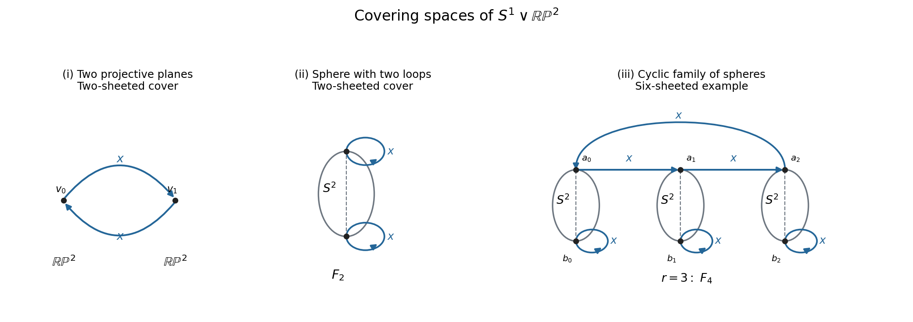

<h1 id="a/3/iii/solution">Solution</h1>

↑ **Parent:** [Iii](../iii.md)

Put $r=n-1$. Take $r$ spheres, each mapping by the double cover onto $\mathbb{RP}^2$, and write their antipodal sheet points as $a_j,b_j$ for $0\leq j<r$. Add an oriented $x$ edge from $a_j$ to $a_{j+1}$, with indices modulo $r$, and add an $x$ loop at each $b_j$. Every sheet point has the required two [circle](../../../../../circle.md) branches, so the resulting space is a $2r$-sheeted cover. It is [connected](../../../../../connected-space.md) because the $a_j$ edges form a cycle and each [sphere](../../../../../sphere.md) connects its own two sheet points.

Choose a connecting arc from $a_j$ to $b_j$ in each [sphere](../../../../../sphere.md). Collapsing these arcs leaves the spheres simply [connected](../../../../../connected-space.md), and leaves a graph with $r$ vertices, one cyclic edge at each step through the $a_j$, and one additional loop per vertex. This graph has $2r$ edges and rank $2r-r+1=r+1=n$. The [sphere](../../../../../sphere.md) summands add no fundamental-group generators. Thus the cover has free [fundamental group](../../../../../fundamental-group.md) of rank $n$.

Based at $a_0$, choose the first $r-1$ cyclic $x$ edges as a [spanning tree](../../../../../spanning-tree.md). The closing cycle projects to $x^r$. To traverse the loop at $b_j$, travel along the tree by $x^j$, use the [sphere](../../../../../sphere.md) connector projecting to $y$, traverse its $x$ loop, and return. The resulting free basis in the base group is

$$
\boxed{\left\{x^{n-1}\right\}\ \cup\ \left\{x^j yxyx^{-j}:0\leq j\leq n-2\right\}}.
$$

There are exactly $n$ elements. For $n=2$ this is the previous pair $x,yxy$. Again injectivity of a covering's induced map makes these actual subgroups with the claimed free bases, rather than just quotient presentations.

**[Figure 1](#a/3/iii/image-coverings-of-a-circle-wedged-with-a-projective-plane). Coverings of a circle wedged with a projective plane**. Blue arrows lift the circle generator. Each sphere joins two points over the wedge point and maps by its antipodal double cover. The family shown on the right has three spheres and gives a free subgroup of rank four.

This realizes [Free subgroups of every finite rank in the free product of Z and C2](../../../../../free-subgroups-of-every-finite-rank-in-the-free-product-of-z-and-c2.md).

## ↑ Ancestors (13)

1. [Iii](../iii.md)
2. [3](../../3.md)
3. [A](../../../a.md)
4. [2009](../../../../2009-split.md)
5. [Past exam of the topology and Groups and Algebraic Topology course of the University of Oxford](../../../../split.md)
6. [Topology and Groups and Algebraic Topology course of the University of Oxford](../../../../../topology-and-groups-and-algebraic-topology-course-of-the-university-of-oxford.md)
7. [Year 4 of the mathematics course of the University of Oxford](../../../../../year-4-of-the-mathematics-course-of-the-university-of-oxford.md)
8. [Mathematics course of the University of Oxford](../../../../../mathematics-course-of-the-university-of-oxford.md)
9. [Undergraduate course of the University of Oxford](../../../../../undergraduate-course-of-the-university-of-oxford.md)
10. [Course of the University of Oxford](../../../../../course-of-the-university-of-oxford.md)
11. [University of Oxford](../../../../../university-of-oxford-split.md)
12. [List of universities](../../../../../list-of-universities.md)
13. [Codex Wiki](../../../../../split.md)
