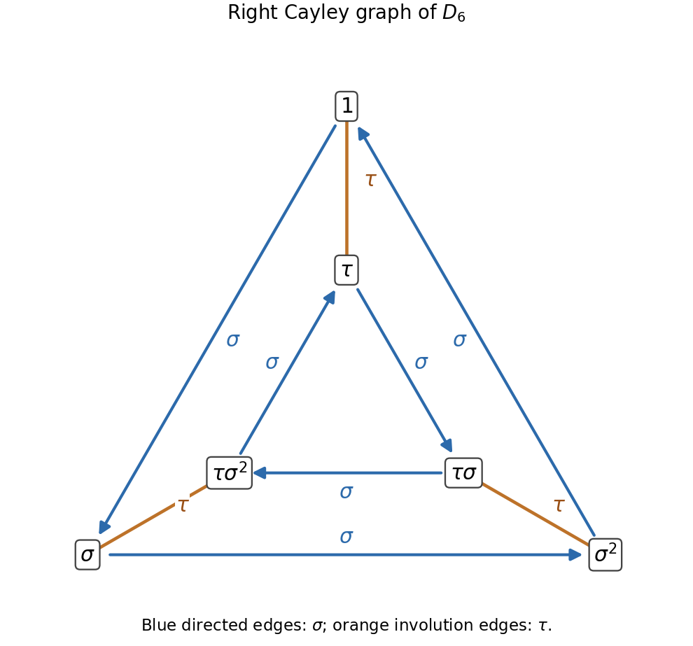
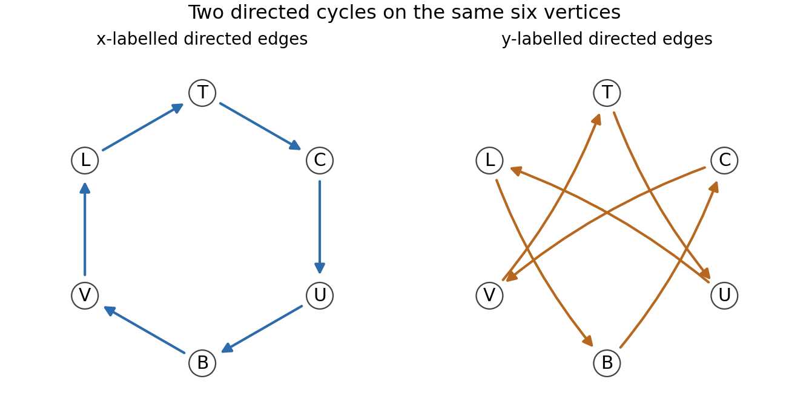

# 2010

↑ **Parent:** [Past exam of the topology and groups course of the University of Oxford](../past-exam-of-the-topology-and-groups-course-of-the-university-of-oxford.md)

Topology and Groups, Tuesday 1 June 2010, 2.30pm–4.00pm. The cover cross-lists Mathematics and Mathematics and Philosophy Parts B and C under the printed label C3.1a. This complete four-page scanned paper was supplied through [the past-papers disclosure](https://www.whatdotheyknow.com/request/maths_past_papers_3), in original Part C bundle pages 317–320. Every source page and the labelled covering graph were read directly; the private editable transcription includes all text and an editable reconstruction of that graph. No exact worked-answer advertisement was found in the bounded availability check.

**Table of contents**

- [1](#1)
  - [Solution](#1/solution)
- [2](#2)
  - [Solution](#2/solution)
- [3](#3)
  - [Solution](#3/solution)

## 1

↑ **Parent:** [2010](2010.md)

<h3 id="1/solution">Solution</h3>

↑ **Parent:** [1](#1)

A [homotopy](../homotopy.md) from $f_0:Y\to X$ to $f_1:Y\to X$ is a [continuous map](../topology.md#continuous-map) $H:Y\times[0,1]\to X$ with $H(y,0)=f_0(y)$ and $H(y,1)=f_1(y)$ for every $y$. A [covering map](../algebraic-topology.md#covering-space) $p:\widetilde X\to X$ is a surjective [continuous map](../topology.md#continuous-map) for which every $x\in X$ has an open neighborhood $U$ whose inverse image is a disjoint union of open sets, each mapped homeomorphically onto $U$. A [lift](../lift-force.md) of $f:Y\to X$ is a [continuous map](../topology.md#continuous-map) $\widetilde f:Y\to\widetilde X$ satisfying $p\circ\widetilde f=f$.

The [path lifting theorem](../algebraic-topology.md#path-lifting-theorem) says that a [path](../geometry-and-topology.md#continuous-path) $\gamma:[0,1]\to X$ and a point $\widetilde x_0\in p^{-1}(\gamma(0))$ determine a unique [path](../geometry-and-topology.md#continuous-path) $\widetilde\gamma:[0,1]\to\widetilde X$ with $p\widetilde\gamma=\gamma$ and $\widetilde\gamma(0)=\widetilde x_0$.

On $S^1\setminus\{1\}$ there is a continuous branch $\operatorname{Arg}_{(0,2\pi)}$ of the [complex argument](../complex-analysis.md#argument-complex-analysis), taking values in $(0,2\pi)$. If $f$ avoids $1$, set $\theta(z)=\operatorname{Arg}_{(0,2\pi)}f(z)$. Then the explicit [homotopy](../homotopy.md)

$$
\boxed{H(z,s)=\exp\big(i((1-s)\theta(z)+s\pi)\big)}
$$

starts at $f$ and ends at the constant map $-1$. It is continuous because the chosen argument branch is continuous on the whole image. More generally, a map omitting any $w\in S^1$ is [null-homotopic](../homotopy.md#null-homotopic-map): apply the formula to $\overline w f$ and multiply the resulting [homotopy](../homotopy.md) by $w$.

For the based injective map, use the standard [covering map](../algebraic-topology.md#covering-space) $E(t)=e^{2\pi it}$. [Lift](../lift-force.md) the [path](../geometry-and-topology.md#continuous-path) $t\mapsto g(E(t))$ on $[0,1]$ to a real-valued [path](../geometry-and-topology.md#continuous-path) $G$ with $G(0)=0$. Since $g(1)=1$, its endpoint $d=G(1)$ is an integer. On $[0,1)$, $G$ is injective: equality $G(s)=G(t)$ implies $g(E(s))=g(E(t))$, then $E(s)=E(t)$ by injectivity, and hence $s=t$ in this half-open [interval](../real-analysis.md#interval-mathematics). A continuous injective [real-valued function](../function.md#real-valued-function) on an [interval](../real-analysis.md#interval-mathematics) is strictly monotone.

If $G$ is increasing, $d>0$. It cannot be at least $2$, because the [intermediate value theorem](../calculus.md#intermediate-value-theorem) would produce $t\in(0,1)$ with $G(t)=1$, giving $g(E(t))=g(1)$ while $E(t)\neq1$. Thus $d=1$. If $G$ is decreasing, the same reasoning gives $d=-1$. Now define

$$
\boxed{K(E(t),s)=\exp\big(2\pi i((1-s)G(t)+sdt)\big).}
$$

At $t=0$ and $t=1$ this has the same value $1$ for every $s$, since $d$ is an integer. Therefore the formula descends continuously from $[0,1]\times[0,1]$ to $S^1\times[0,1]$. At $s=0$ it is $g$; at $s=1$ it is $z\mapsto z^d$. Hence **$g$ is homotopic to the identity or to [complex conjugation](../complex-analysis.md#complex-conjugation)**, with degree $1$ or $-1$. This is the key property of an [injective self-map of a circle](../topology.md#injective-self-map-of-a-circle).

Finally, let $h$ be any continuous injective [circle](../topology.md#circle) self-map. Normalize it to $g(z)=\overline{h(1)}h(z)$, which is injective and fixes $1$. If $h$ were not surjective, it would omit some [circle](../topology.md#circle) point, so the explicit missing-point construction would make $h$ [null-homotopic](../homotopy.md#null-homotopic-map). Multiplying this [homotopy](../homotopy.md) by $\overline{h(1)}$ would make $g$ [null-homotopic](../homotopy.md#null-homotopic-map) too. But $g$ is homotopic to the identity or conjugation, neither of which is [null-homotopic](../homotopy.md#null-homotopic-map) by the permitted fact. This contradiction proves **every continuous injective [circle](../topology.md#circle) self-map is surjective**. The lifting argument did not assume surjectivity, so the reasoning is not circular.

## 2

↑ **Parent:** [2010](2010.md)

<h3 id="2/solution">Solution</h3>

↑ **Parent:** [2](#2)

The [normal closure](../group-theory.md#normal-closure) $\langle\!\langle B\rangle\!\rangle_G$ is the smallest [normal subgroup](../group-theory.md#normal-subgroup) of $G$ containing $B$, equivalently the intersection of all normal subgroups containing $B$. Any such [normal subgroup](../group-theory.md#normal-subgroup) contains every $gb^{\pm1}g^{-1}$ and hence every finite product of these elements. Thus $N\subseteq\langle\!\langle B\rangle\!\rangle_G$.

Include the empty product so that $1\in N$, in particular when $B=\varnothing$. Products of elements of $N$ are obtained by concatenating their factor lists. Inversion reverses the list and replaces $\epsilon_i$ by $-\epsilon_i$, so $N$ is closed under inverses. For any $k\in G$,

$$
k\left(\prod_i g_i b_i^{\epsilon_i}g_i^{-1}\right)k^{-1}
=\prod_i(kg_i)b_i^{\epsilon_i}(kg_i)^{-1}\in N.
$$

Therefore $N$ is a [normal subgroup](../group-theory.md#normal-subgroup) and it contains $B$. Minimality of the [normal closure](../group-theory.md#normal-closure) gives the reverse inclusion, proving

$$
\boxed{N=\langle\!\langle B\rangle\!\rangle_G.}
$$

The notation $n\in\mathbb N$ in a finite-product description is understood to allow the empty product; otherwise the empty generating subset would require a separate identity convention.

In a [group presentation](../geometric-group-theory.md#group-presentation), $X$ is a set of formal generators and $R$ is a subset of the [free group](../geometric-group-theory.md#free-group) $F(X)$, consisting of relators which are required to become the identity. The presented [group](../group.md) is

$$
\boxed{\langle X\mid R\rangle=F(X)/\langle\!\langle R\rangle\!\rangle_{F(X)}.}
$$

The [universal property of a group presentation](../geometric-group-theory.md#universal-property-of-a-group-presentation) says that a function $X\to H$ extends to a [group homomorphism](../group-theory.md#group-homomorphism) from the presented [group](../group.md) precisely when every [relator](../geometric-group-theory.md#relator) evaluates to $1$ in $H$: first extend freely to $F(X)$, then factor through the quotient because its [kernel](../kernel-of-a-linear-map.md) contains the [normal closure](../group-theory.md#normal-closure) of $R$.

A [rotation](../riemannian-geometry.md#rotation-mathematics) $\alpha$ by $2\pi/n$ and a [reflection](../linear-algebra.md#reflection-mathematics) $\beta$ of a regular $n$-gon satisfy

$$
\alpha^n=1,\qquad\beta^2=1,\qquad\beta\alpha\beta=\alpha^{-1}.
$$

The last identity holds because [reflection](../linear-algebra.md#reflection-mathematics) reverses the sense of [rotation](../riemannian-geometry.md#rotation-mathematics), and it implies $\alpha\beta\alpha\beta=1$. Hence all defining relators vanish, giving a homomorphism $\theta:D_{2n}\to M_n$ with $\theta(\sigma)=\alpha$ and $\theta(\tau)=\beta$.

To prove it is an [isomorphism](../algebra.md#isomorphism) without presupposing the order of the presented [group](../group.md), use $\sigma\tau=\tau\sigma^{-1}$. Move every occurrence of $\tau$ to the left, cancel pairs by $\tau^2=1$, and reduce exponents modulo $n$. Every element has one of the forms

$$
\sigma^j\quad\text{or}\quad\tau\sigma^j,\qquad0\leq j<n.
$$

Thus $|D_{2n}|\leq2n$. For the usual [regular polygon](../euclidean-geometry.md#regular-polygon) with $n\geq3$, the $n$ rotations $\alpha^j$ are distinct and the $n$ reflections $\beta\alpha^j$ are distinct; no [rotation](../riemannian-geometry.md#rotation-mathematics) is a [reflection](../linear-algebra.md#reflection-mathematics), since their planar [orientation](../algebraic-topology.md#orientation-of-a-simplex) behavior differs. The supplied description says these exhaust $M_n$, so $|M_n|=2n$, and every one lies in the image of $\theta$. Surjectivity and the order bound force $|D_{2n}|=2n$ and trivial [kernel](../kernel-of-a-linear-map.md). Thus **$\theta$ is an [isomorphism](../algebra.md#isomorphism)**.

For the requested [Cayley graph](../geometric-group-theory.md#cayley-graph), use right multiplication by the generators. The $\sigma$ edges are the two directed 3-cycles

$$
1\to\sigma\to\sigma^2\to1,
\qquad
\tau\to\tau\sigma\to\tau\sigma^2\to\tau.
$$

The $\tau$ edges are the undirected pairs

$$
1\leftrightarrow\tau,\qquad
\sigma\leftrightarrow\tau\sigma^2,\qquad
\sigma^2\leftrightarrow\tau\sigma.
$$

These pairs use $\sigma^j\tau=\tau\sigma^{-j}$. Thus the underlying [graph](../graph.md) is a [triangular prism](../euclidean-geometry.md#triangular-prism), with the two [rotation](../riemannian-geometry.md#rotation-mathematics) cycles oriented oppositely when [reflection](../linear-algebra.md#reflection-mathematics) pairs are drawn as radial edges.

**[Figure 1](#2/image-the-cayley-graph-of-the-dihedral-group-of-order-six). The Cayley graph of the dihedral group of order six**. Blue arrows are right multiplication by sigma. Orange undirected edges are right multiplication by the involution tau.

## 3

↑ **Parent:** [2010](2010.md)

<h3 id="3/solution">Solution</h3>

↑ **Parent:** [3](#3)

A [deck transformation](../algebraic-topology.md#deck-transformation) of a covering $p:\widetilde X\to X$ is a [homeomorphism](../topology.md#homeomorphism) $d:\widetilde X\to\widetilde X$ with $p\circ d=p$. A connected covering is a [regular covering map](../riemann-surfaces.md#regular-covering-map) if its [deck transformation group](../algebraic-topology.md#deck-transformation-group) acts transitively on each [fiber](../function.md#fiber-of-a-function); for a [path](../geometry-and-topology.md#continuous-path)-connected base, transitivity on the [fiber](../function.md#fiber-of-a-function) over the chosen basepoint is equivalent.

Write $H=p_*\pi_1(\widetilde X,\widetilde b)$ and $G=\pi_1(X,b)$. A based loop represents an element of $H$ exactly when its [lift](../lift-force.md) starting at $\widetilde b$ is closed. Indeed a closed [lift](../lift-force.md) itself projects to a representative of an image element; conversely the image of a closed [path](../geometry-and-topology.md#continuous-path) lifts to that [path](../geometry-and-topology.md#continuous-path), and the closed-endpoint property is unchanged by [based homotopy](../algebraic-topology.md#based-homotopy).

Suppose the covering is regular, let $h\in H$, and let $g\in G$. [Lift](../lift-force.md) a representative of $g$ from $\widetilde b$ to an endpoint $v$. By regularity some [deck transformation](../algebraic-topology.md#deck-transformation) sends $\widetilde b$ to $v$. Applying it to the closed [lift](../lift-force.md) of $h$ gives a closed [lift](../lift-force.md) of $h$ at $v$, by uniqueness in the [path lifting theorem](../algebraic-topology.md#path-lifting-theorem). The concatenation of the [lift](../lift-force.md) of $g$, that closed [lift](../lift-force.md) of $h$, and the reverse [lift](../lift-force.md) of $g$ is therefore a closed [lift](../lift-force.md) of $ghg^{-1}$. Thus $gHg^{-1}\subseteq H$; applying the same argument to $g^{-1}$ gives equality. Hence **a regular covering has a normal image [subgroup](../group.md#subgroup)**.

For the explicit cover, label the bottom [vertex](../graph.md#vertex-graph-theory) $B=\widetilde b$, the top $T$, the left $L$, the right $C=c$, and the rear/front equatorial vertices $U,V$, respectively. Reading the arrows gives the complete monodromy table:

| Start | After $x$ | After $y$ |
| --- | --- | --- |
| $B$ | $V$ | $C$ |
| $V$ | $L$ | $T$ |
| $L$ | $T$ | $B$ |
| $T$ | $C$ | $U$ |
| $C$ | $U$ | $V$ |
| $U$ | $B$ | $L$ |

Thus the $x$ edges form the cycle $B,V,L,T,C,U,B$, and the $y$ edges form the cycle $B,C,V,T,U,L,B$. In particular every [vertex](../graph.md#vertex-graph-theory) has one incoming and one outgoing [edge](../graph-theory.md#edge-of-a-graph) of each label, as a covering of the two-[circle](../topology.md#circle) wedge requires. All word paths below are traversed from left to right.

**[Figure 2](#3/image-the-two-directed-cycles-describing-the-octahedral-covering). The two directed cycles describing the octahedral covering**. Both panels use the same six named vertices. Their union is the covering graph; following x or y gives the monodromy table.

Choose the [spanning tree](../tree-graph-theory.md#spanning-tree) consisting of the first five $x$ edges from $B$ to $U$. The tree paths to $B,V,L,T,C,U$ have labels $1,x,x^2,x^3,x^4,x^5$. For every directed non-tree [edge](../graph-theory.md#edge-of-a-graph) $v\xrightarrow{z}w$, the [path](../geometry-and-topology.md#continuous-path) from $B$ along the tree to $v$, then along the [edge](../graph-theory.md#edge-of-a-graph), then back along the tree from $w$, has label $t_vzt_w^{-1}$. Collapsing a [spanning tree](../tree-graph-theory.md#spanning-tree) turns a [connected graph](../graph.md#connected-graph) into a wedge of circles, so these paths form a free basis of its [fundamental group](../algebraic-topology.md#fundamental-group). There are seven non-tree edges, since $12-6+1=7$. Their projected labels give the explicit [generating set](../set.md#generating-set)

$$
\boxed{H=\left\langle
x^6,\ yx^{-4},\ xyx^{-3},\ x^2y,\ x^3yx^{-5},\ x^4yx^{-1},\ x^5yx^{-2}
\right\rangle.}
$$

The [covering map](../algebraic-topology.md#covering-space) induces an [injection](../algebra.md#injective-function) on fundamental groups, so these seven generators are also a free basis for the image [subgroup](../group.md#subgroup). The first comes from the remaining $x$ [edge](../graph-theory.md#edge-of-a-graph) $U\to B$; the other six come from the outgoing $y$ [edge](../graph-theory.md#edge-of-a-graph) at each [vertex](../graph.md#vertex-graph-theory) in the table.

Now the word $h=yx^2$ lifts at $B$ around the triangle

$$
B\xrightarrow yC\xrightarrow xU\xrightarrow xB,
$$

so $h\in H$. Starting at $C$, however, its [lift](../lift-force.md) is

$$
C\xrightarrow yV\xrightarrow xL\xrightarrow xT,
$$

which is not closed. A [deck transformation](../algebraic-topology.md#deck-transformation) sending $B$ to $C$ would take the first closed [path](../geometry-and-topology.md#continuous-path) to a closed [lift](../lift-force.md) of the same word at $C$, contradicting uniqueness of lifts and the displayed nonclosed [path](../geometry-and-topology.md#continuous-path). **No such [deck transformation](../algebraic-topology.md#deck-transformation) exists.** This is also the closed-[lift](../lift-force.md) obstruction expressed by the [deck transformation group as a monodromy centralizer](../algebraic-topology.md#deck-transformation-group-as-a-monodromy-centralizer).

For a connected covering of a connected, locally [path](../geometry-and-topology.md#continuous-path)-connected, [semilocally simply connected space](../algebraic-topology.md#semilocally-simply-connected-space), the [classification of connected covering spaces](../algebraic-topology.md#classification-of-connected-covering-spaces) says that the image [subgroup](../group.md#subgroup) is normal if and only if the covering is regular. The two-[circle](../topology.md#circle) wedge and this connected finite [graph](../graph.md) satisfy those hypotheses. Since regularity fails, $H$ is not normal in the base [group](../group.md) $\pi_1(X,b)\cong F(x,y)$. All normality comparisons here are in that base [group](../group.md).

Finally take

$$
\boxed{g=y,\qquad h=yx^2.}
$$

The [lift](../lift-force.md) of $ghg^{-1}=y^2x^2y^{-1}$ from $B$ follows

$$
B\xrightarrow yC\xrightarrow yV\xrightarrow xL\xrightarrow xT\xrightarrow{y^{-1}}V.
$$

It ends at $V\neq B$, so $ghg^{-1}\notin H$. This is the required explicit witness, and independently proves the failure of normality.

## ↑ Ancestors (9)

1. [Past exam of the topology and groups course of the University of Oxford](../past-exam-of-the-topology-and-groups-course-of-the-university-of-oxford.md)
2. [Topology and groups course of the University of Oxford](../university-of-oxford.md#topology-and-groups-course-of-the-university-of-oxford)
3. [Year 3 of the mathematics course of the University of Oxford](../university-of-oxford.md#year-3-of-the-mathematics-course-of-the-university-of-oxford)
4. [Mathematics course of the University of Oxford](../university-of-oxford.md#mathematics-course-of-the-university-of-oxford)
5. [Undergraduate course of the University of Oxford](../university-of-oxford.md#undergraduate-course-of-the-university-of-oxford)
6. [Course of the University of Oxford](../university-of-oxford.md#course-of-the-university-of-oxford)
7. [University of Oxford](../university-of-oxford.md)
8. [List of universities](../README.md#list-of-universities)
9. [Codex Wiki](../README.md)
