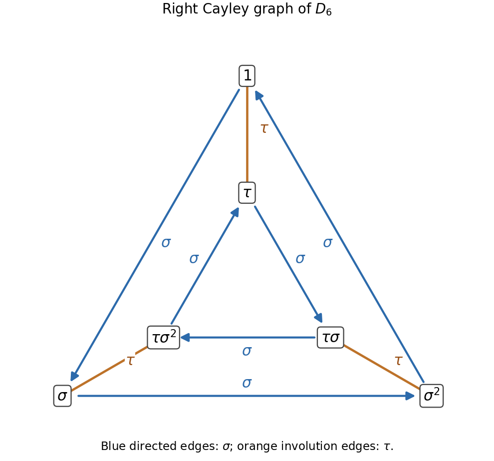

<h1 id="2/solution">Solution</h1>

↑ **Parent:** [2](../2.md)

The [normal closure](../../../normal-closure.md) $\langle\!\langle B\rangle\!\rangle_G$ is the smallest [normal subgroup](../../../normal-subgroup.md) of $G$ containing $B$, equivalently the intersection of all normal subgroups containing $B$. Any such [normal subgroup](../../../normal-subgroup.md) contains every $gb^{\pm1}g^{-1}$ and hence every finite product of these elements. Thus $N\subseteq\langle\!\langle B\rangle\!\rangle_G$.

Include the empty product so that $1\in N$, in particular when $B=\varnothing$. Products of elements of $N$ are obtained by concatenating their factor lists. Inversion reverses the list and replaces $\epsilon_i$ by $-\epsilon_i$, so $N$ is closed under inverses. For any $k\in G$,

$$
k\left(\prod_i g_i b_i^{\epsilon_i}g_i^{-1}\right)k^{-1}
=\prod_i(kg_i)b_i^{\epsilon_i}(kg_i)^{-1}\in N.
$$

Therefore $N$ is a [normal subgroup](../../../normal-subgroup.md) and it contains $B$. Minimality of the [normal closure](../../../normal-closure.md) gives the reverse inclusion, proving

$$
\boxed{N=\langle\!\langle B\rangle\!\rangle_G.}
$$

The notation $n\in\mathbb N$ in a finite-product description is understood to allow the empty product; otherwise the empty generating subset would require a separate identity convention.

In a [group presentation](../../../group-presentation.md), $X$ is a set of formal generators and $R$ is a subset of the [free group](../../../free-group.md) $F(X)$, consisting of relators which are required to become the identity. The presented [group](../../../group-split.md) is

$$
\boxed{\langle X\mid R\rangle=F(X)/\langle\!\langle R\rangle\!\rangle_{F(X)}.}
$$

The [universal property of a group presentation](../../../universal-property-of-a-group-presentation.md) says that a function $X\to H$ extends to a [group homomorphism](../../../group-homomorphism.md) from the presented [group](../../../group-split.md) precisely when every [relator](../../../relator.md) evaluates to $1$ in $H$: first extend freely to $F(X)$, then factor through the quotient because its [kernel](../../../kernel-of-a-linear-map-split.md) contains the [normal closure](../../../normal-closure.md) of $R$.

A [rotation](../../../rotation-mathematics.md) $\alpha$ by $2\pi/n$ and a [reflection](../../../reflection-mathematics.md) $\beta$ of a regular $n$-gon satisfy

$$
\alpha^n=1,\qquad\beta^2=1,\qquad\beta\alpha\beta=\alpha^{-1}.
$$

The last identity holds because [reflection](../../../reflection-mathematics.md) reverses the sense of [rotation](../../../rotation-mathematics.md), and it implies $\alpha\beta\alpha\beta=1$. Hence all defining relators vanish, giving a homomorphism $\theta:D_{2n}\to M_n$ with $\theta(\sigma)=\alpha$ and $\theta(\tau)=\beta$.

To prove it is an [isomorphism](../../../isomorphism.md) without presupposing the order of the presented [group](../../../group-split.md), use $\sigma\tau=\tau\sigma^{-1}$. Move every occurrence of $\tau$ to the left, cancel pairs by $\tau^2=1$, and reduce exponents modulo $n$. Every element has one of the forms

$$
\sigma^j\quad\text{or}\quad\tau\sigma^j,\qquad0\leq j<n.
$$

Thus $|D_{2n}|\leq2n$. For the usual [regular polygon](../../../regular-polygon.md) with $n\geq3$, the $n$ rotations $\alpha^j$ are distinct and the $n$ reflections $\beta\alpha^j$ are distinct; no [rotation](../../../rotation-mathematics.md) is a [reflection](../../../reflection-mathematics.md), since their planar [orientation](../../../orientation-of-a-simplex.md) behavior differs. The supplied description says these exhaust $M_n$, so $|M_n|=2n$, and every one lies in the image of $\theta$. Surjectivity and the order bound force $|D_{2n}|=2n$ and trivial [kernel](../../../kernel-of-a-linear-map-split.md). Thus **$\theta$ is an [isomorphism](../../../isomorphism.md)**.

For the requested [Cayley graph](../../../cayley-graph.md), use right multiplication by the generators. The $\sigma$ edges are the two directed 3-cycles

$$
1\to\sigma\to\sigma^2\to1,
\qquad
\tau\to\tau\sigma\to\tau\sigma^2\to\tau.
$$

The $\tau$ edges are the undirected pairs

$$
1\leftrightarrow\tau,\qquad
\sigma\leftrightarrow\tau\sigma^2,\qquad
\sigma^2\leftrightarrow\tau\sigma.
$$

These pairs use $\sigma^j\tau=\tau\sigma^{-j}$. Thus the underlying [graph](../../../graph-split.md) is a [triangular prism](../../../triangular-prism.md), with the two [rotation](../../../rotation-mathematics.md) cycles oriented oppositely when [reflection](../../../reflection-mathematics.md) pairs are drawn as radial edges.

**[Figure 1](#2/image-the-cayley-graph-of-the-dihedral-group-of-order-six). The Cayley graph of the dihedral group of order six**. Blue arrows are right multiplication by sigma. Orange undirected edges are right multiplication by the involution tau.

## ↑ Ancestors (11)

1. [2](../2.md)
2. [2010](../../2010-split.md)
3. [Past exam of the topology and groups course of the University of Oxford](../../split.md)
4. [Topology and groups course of the University of Oxford](../../../topology-and-groups-course-of-the-university-of-oxford.md)
5. [Year 3 of the mathematics course of the University of Oxford](../../../year-3-of-the-mathematics-course-of-the-university-of-oxford.md)
6. [Mathematics course of the University of Oxford](../../../mathematics-course-of-the-university-of-oxford.md)
7. [Undergraduate course of the University of Oxford](../../../undergraduate-course-of-the-university-of-oxford.md)
8. [Course of the University of Oxford](../../../course-of-the-university-of-oxford.md)
9. [University of Oxford](../../../university-of-oxford-split.md)
10. [List of universities](../../../list-of-universities.md)
11. [Codex Wiki](../../../split.md)
