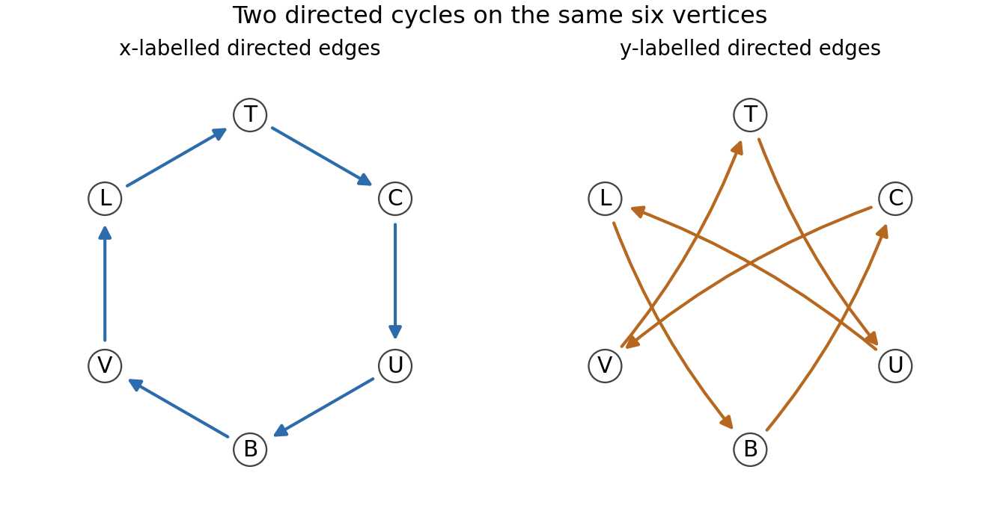

<h1 id="3/solution">Solution</h1>

↑ **Parent:** [3](../3.md)

A [deck transformation](../../../deck-transformation.md) of a covering $p:\widetilde X\to X$ is a [homeomorphism](../../../homeomorphism.md) $d:\widetilde X\to\widetilde X$ with $p\circ d=p$. A connected covering is a [regular covering map](../../../regular-covering-map.md) if its [deck transformation group](../../../deck-transformation-group.md) acts transitively on each [fiber](../../../fiber-of-a-function.md); for a [path](../../../continuous-path.md)-connected base, transitivity on the [fiber](../../../fiber-of-a-function.md) over the chosen basepoint is equivalent.

Write $H=p_*\pi_1(\widetilde X,\widetilde b)$ and $G=\pi_1(X,b)$. A based loop represents an element of $H$ exactly when its [lift](../../../lift-force-split.md) starting at $\widetilde b$ is closed. Indeed a closed [lift](../../../lift-force-split.md) itself projects to a representative of an image element; conversely the image of a closed [path](../../../continuous-path.md) lifts to that [path](../../../continuous-path.md), and the closed-endpoint property is unchanged by [based homotopy](../../../based-homotopy.md).

Suppose the covering is regular, let $h\in H$, and let $g\in G$. [Lift](../../../lift-force-split.md) a representative of $g$ from $\widetilde b$ to an endpoint $v$. By regularity some [deck transformation](../../../deck-transformation.md) sends $\widetilde b$ to $v$. Applying it to the closed [lift](../../../lift-force-split.md) of $h$ gives a closed [lift](../../../lift-force-split.md) of $h$ at $v$, by uniqueness in the [path lifting theorem](../../../path-lifting-theorem.md). The concatenation of the [lift](../../../lift-force-split.md) of $g$, that closed [lift](../../../lift-force-split.md) of $h$, and the reverse [lift](../../../lift-force-split.md) of $g$ is therefore a closed [lift](../../../lift-force-split.md) of $ghg^{-1}$. Thus $gHg^{-1}\subseteq H$; applying the same argument to $g^{-1}$ gives equality. Hence **a regular covering has a normal image [subgroup](../../../subgroup.md)**.

For the explicit cover, label the bottom [vertex](../../../vertex-graph-theory.md) $B=\widetilde b$, the top $T$, the left $L$, the right $C=c$, and the rear/front equatorial vertices $U,V$, respectively. Reading the arrows gives the complete monodromy table:

| Start | After $x$ | After $y$ |
| --- | --- | --- |
| $B$ | $V$ | $C$ |
| $V$ | $L$ | $T$ |
| $L$ | $T$ | $B$ |
| $T$ | $C$ | $U$ |
| $C$ | $U$ | $V$ |
| $U$ | $B$ | $L$ |

Thus the $x$ edges form the cycle $B,V,L,T,C,U,B$, and the $y$ edges form the cycle $B,C,V,T,U,L,B$. In particular every [vertex](../../../vertex-graph-theory.md) has one incoming and one outgoing [edge](../../../edge-of-a-graph.md) of each label, as a covering of the two-[circle](../../../circle.md) wedge requires. All word paths below are traversed from left to right.

**[Figure 2](#3/image-the-two-directed-cycles-describing-the-octahedral-covering). The two directed cycles describing the octahedral covering**. Both panels use the same six named vertices. Their union is the covering graph; following x or y gives the monodromy table.

Choose the [spanning tree](../../../spanning-tree.md) consisting of the first five $x$ edges from $B$ to $U$. The tree paths to $B,V,L,T,C,U$ have labels $1,x,x^2,x^3,x^4,x^5$. For every directed non-tree [edge](../../../edge-of-a-graph.md) $v\xrightarrow{z}w$, the [path](../../../continuous-path.md) from $B$ along the tree to $v$, then along the [edge](../../../edge-of-a-graph.md), then back along the tree from $w$, has label $t_vzt_w^{-1}$. Collapsing a [spanning tree](../../../spanning-tree.md) turns a [connected graph](../../../connected-graph.md) into a wedge of circles, so these paths form a free basis of its [fundamental group](../../../fundamental-group.md). There are seven non-tree edges, since $12-6+1=7$. Their projected labels give the explicit [generating set](../../../generating-set.md)

$$
\boxed{H=\left\langle
x^6,\ yx^{-4},\ xyx^{-3},\ x^2y,\ x^3yx^{-5},\ x^4yx^{-1},\ x^5yx^{-2}
\right\rangle.}
$$

The [covering map](../../../covering-space.md) induces an [injection](../../../injective-function.md) on fundamental groups, so these seven generators are also a free basis for the image [subgroup](../../../subgroup.md). The first comes from the remaining $x$ [edge](../../../edge-of-a-graph.md) $U\to B$; the other six come from the outgoing $y$ [edge](../../../edge-of-a-graph.md) at each [vertex](../../../vertex-graph-theory.md) in the table.

Now the word $h=yx^2$ lifts at $B$ around the triangle

$$
B\xrightarrow yC\xrightarrow xU\xrightarrow xB,
$$

so $h\in H$. Starting at $C$, however, its [lift](../../../lift-force-split.md) is

$$
C\xrightarrow yV\xrightarrow xL\xrightarrow xT,
$$

which is not closed. A [deck transformation](../../../deck-transformation.md) sending $B$ to $C$ would take the first closed [path](../../../continuous-path.md) to a closed [lift](../../../lift-force-split.md) of the same word at $C$, contradicting uniqueness of lifts and the displayed nonclosed [path](../../../continuous-path.md). **No such [deck transformation](../../../deck-transformation.md) exists.** This is also the closed-[lift](../../../lift-force-split.md) obstruction expressed by the [deck transformation group as a monodromy centralizer](../../../deck-transformation-group-as-a-monodromy-centralizer.md).

For a connected covering of a connected, locally [path](../../../continuous-path.md)-connected, [semilocally simply connected space](../../../semilocally-simply-connected-space.md), the [classification of connected covering spaces](../../../classification-of-connected-covering-spaces.md) says that the image [subgroup](../../../subgroup.md) is normal if and only if the covering is regular. The two-[circle](../../../circle.md) wedge and this connected finite [graph](../../../graph-split.md) satisfy those hypotheses. Since regularity fails, $H$ is not normal in the base [group](../../../group-split.md) $\pi_1(X,b)\cong F(x,y)$. All normality comparisons here are in that base [group](../../../group-split.md).

Finally take

$$
\boxed{g=y,\qquad h=yx^2.}
$$

The [lift](../../../lift-force-split.md) of $ghg^{-1}=y^2x^2y^{-1}$ from $B$ follows

$$
B\xrightarrow yC\xrightarrow yV\xrightarrow xL\xrightarrow xT\xrightarrow{y^{-1}}V.
$$

It ends at $V\neq B$, so $ghg^{-1}\notin H$. This is the required explicit witness, and independently proves the failure of normality.

## ↑ Ancestors (11)

1. [3](../3.md)
2. [2010](../../2010-split.md)
3. [Past exam of the topology and groups course of the University of Oxford](../../split.md)
4. [Topology and groups course of the University of Oxford](../../../topology-and-groups-course-of-the-university-of-oxford.md)
5. [Year 3 of the mathematics course of the University of Oxford](../../../year-3-of-the-mathematics-course-of-the-university-of-oxford.md)
6. [Mathematics course of the University of Oxford](../../../mathematics-course-of-the-university-of-oxford.md)
7. [Undergraduate course of the University of Oxford](../../../undergraduate-course-of-the-university-of-oxford.md)
8. [Course of the University of Oxford](../../../course-of-the-university-of-oxford.md)
9. [University of Oxford](../../../university-of-oxford-split.md)
10. [List of universities](../../../list-of-universities.md)
11. [Codex Wiki](../../../split.md)
