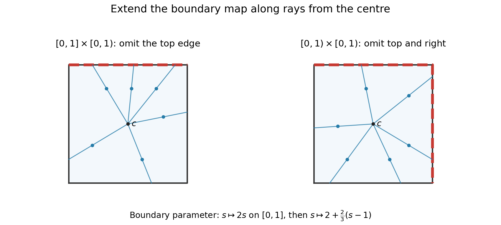
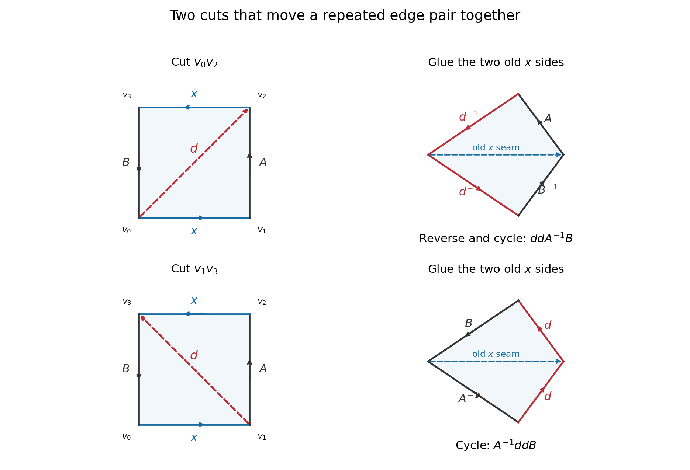

# 2014

↑ **Parent:** [Past exam of the topology course of the University of Oxford](../past-exam-of-the-topology-course-of-the-university-of-oxford.md)

Source paper: [Mathematics Part A FOI release](https://www.whatdotheyknow.com/request/maths_papers_2/response/1850333/attach/3/FOI%2020210708%201%20Data.zip?cookie_passthrough=1), member `FOI-20210708-1 - Data/4324.pdf`. The original cover identifies [Topology](../topology.md), A5, formal code 4324, Wednesday 25 June 2014, 9.30am to 11.00am. All three source pages are readable.

**Table of contents**

- [1](#1)
  - [a](#1/a)
    - [i](#1/a/i)
      - [Solution](#1/a/i/solution)
    - [ii](#1/a/ii)
      - [Solution](#1/a/ii/solution)
  - [b](#1/b)
    - [i](#1/b/i)
      - [Solution](#1/b/i/solution)
    - [ii](#1/b/ii)
      - [Solution](#1/b/ii/solution)
    - [iii](#1/b/iii)
      - [Solution](#1/b/iii/solution)
    - [iv](#1/b/iv)
      - [Solution](#1/b/iv/solution)
  - [c](#1/c)
    - [i](#1/c/i)
      - [Solution](#1/c/i/solution)
    - [ii](#1/c/ii)
      - [Solution](#1/c/ii/solution)
- [2](#2)
  - [a](#2/a)
    - [i](#2/a/i)
      - [Solution](#2/a/i/solution)
    - [ii](#2/a/ii)
      - [Solution](#2/a/ii/solution)
  - [b](#2/b)
    - [i](#2/b/i)
      - [Solution](#2/b/i/solution)
    - [ii](#2/b/ii)
      - [Solution](#2/b/ii/solution)
- [3](#3)
  - [a](#3/a)
    - [i](#3/a/i)
      - [Solution](#3/a/i/solution)
    - [ii](#3/a/ii)
      - [Solution](#3/a/ii/solution)
    - [iii](#3/a/iii)
      - [Solution](#3/a/iii/solution)
  - [b](#3/b)
    - [i](#3/b/i)
      - [Solution](#3/b/i/solution)
    - [ii](#3/b/ii)
      - [Solution](#3/b/ii/solution)

## 1

↑ **Parent:** [2014](2014.md)

<h3 id="1/a">a</h3>

↑ **Parent:** [1](#1)

<h4 id="1/a/i">i</h4>

↑ **Parent:** [A](#1/a)

<h5 id="1/a/i/solution">Solution</h5>

↑ **Parent:** [I](#1/a/i)

The [closure](../topology.md#closure-topology) $\overline A$ is the [intersection](../set.md#set-intersection) of every [closed subset](../topology.md#closed-set) of $X$ containing $A$. Thus it is the smallest such [closed subset](../topology.md#closed-set). Equivalently,

$$
\boxed{x\in\overline A\iff\text{every open neighbourhood of }x\text{ meets }A.}
$$

For equivalence, if an [open neighbourhood](../topology.md#open-neighbourhood) misses $A$, its [complement](../set.md#complement-of-a-set) is a [closed](../topology.md#closed-set) superset of $A$ missing $x$. Conversely, a [closed](../topology.md#closed-set) superset missing $x$ has an [open](../topology.md#open-set) [complement](../set.md#complement-of-a-set) that is a neighbourhood of $x$ disjoint from $A$.

<h4 id="1/a/ii">ii</h4>

↑ **Parent:** [A](#1/a)

<h5 id="1/a/ii/solution">Solution</h5>

↑ **Parent:** [Ii](#1/a/ii)

Suppose $f$ is [continuous](../calculus.md#continuous-function) and $x\in\overline A$. Every [open neighbourhood](../topology.md#open-neighbourhood) $V$ of $f(x)$ has an [open](../topology.md#open-set) [preimage](../set-theory.md#preimage) containing $x$, which meets $A$. Hence $V$ meets $f(A)$, proving $f(x)\in\overline{f(A)}$.

Conversely, suppose the indicated inclusion holds for every subset. To prove [continuity](../calculus.md#continuous-function), take any [closed set](../topology.md#closed-set) $C\subseteq Y$ and put $A=f^{-1}(C)$. Since $f(A)\subseteq C$ and $C$ is [closed](../topology.md#closed-set),

$$
f(\overline A)\subseteq\overline{f(A)}\subseteq C.
$$

Thus $\overline A\subseteq f^{-1}(C)=A$, so $A$ is [closed](../topology.md#closed-set). Every [closed set](../topology.md#closed-set) has [closed](../topology.md#closed-set) [preimage](../set-theory.md#preimage), which is the closed-set characterization of [continuity](../calculus.md#continuous-function).

$$
\boxed{f\text{ continuous}\iff f(\overline A)\subseteq\overline{f(A)}\text{ for every }A\subseteq X.}
$$

This is the [closure characterization of continuity](../topology.md#closure-characterization-of-continuity); it requires no [Hausdorff](../topology.md#hausdorff-space) or [metric](../topological-analysis.md#metric) hypothesis.

<h3 id="1/b">b</h3>

↑ **Parent:** [1](#1)

<h4 id="1/b/i">i</h4>

↑ **Parent:** [B](#1/b)

<h5 id="1/b/i/solution">Solution</h5>

↑ **Parent:** [I](#1/b/i)

A proper [closed subset](../topology.md#closed-set) in the [cofinite topology](../topology.md#cofinite-topology) is finite, so cannot contain the infinite subset $A$. Its only [closed](../topology.md#closed-set) superset is therefore the whole space:

$$
\boxed{\overline A=X.}
$$

In particular, every infinite subset is [dense](../topology.md#dense-set) in this [topology](../topology.md).

<h4 id="1/b/ii">ii</h4>

↑ **Parent:** [B](#1/b)

<h5 id="1/b/ii/solution">Solution</h5>

↑ **Parent:** [Ii](#1/b/ii)

Because $f$ is [surjective](../algebra.md#surjective-function), $f^{-1}(B)$ is infinite whenever $B$ is infinite; a finite [preimage](../set-theory.md#preimage) could have only finitely many [image](../set-theory.md#image-of-a-function) points. By part (i), its [closure](../topology.md#closure-topology) is $X$. Apply part (a)(ii):

$$
Y=f(X)=f\bigl(\overline{f^{-1}(B)}\bigr)
\subseteq\overline{f(f^{-1}(B))}=\overline B.
$$

The other inclusion is automatic, so

$$
\boxed{\overline B=Y\quad\text{for every infinite }B\subseteq Y.}
$$

Both [continuity](../calculus.md#continuous-function) and [surjectivity](../algebra.md#surjective-function) enter the argument.

<h4 id="1/b/iii">iii</h4>

↑ **Parent:** [B](#1/b)

<h5 id="1/b/iii/solution">Solution</h5>

↑ **Parent:** [Iii](#1/b/iii)

Any proper [closed subset](../topology.md#closed-set) $F$ of $Y$ must be finite: if it were infinite, part (ii) would give $F=\overline F=Y$. Therefore every nonempty [open subset](../topology.md#open-set) of $Y$, being the [complement](../set.md#complement-of-a-set) of a proper [closed set](../topology.md#closed-set), is cofinite.

$$
\boxed{\mathcal T_Y\subseteq\mathcal T_{\mathrm{cofinite}}.}
$$

The empty set belongs to both topologies. Inclusion need not be equality; the target may have fewer [open](../topology.md#open-set) sets.

<h4 id="1/b/iv">iv</h4>

↑ **Parent:** [B](#1/b)

<h5 id="1/b/iv/solution">Solution</h5>

↑ **Parent:** [Iv](#1/b/iv)

Any two nonempty [open](../topology.md#open-set) sets of $Y$ are cofinite by part (iii). Their complements have [finite union](../set.md#finite-union), so the two sets must intersect because $Y$ is infinite. Thus $Y$ is a [hyperconnected space](../topology.md#hyperconnected-space).

A [Hausdorff space](../topology.md#hausdorff-space) with at least two points has disjoint nonempty [open](../topology.md#open-set) neighbourhoods of two distinct points. This is impossible here. Therefore **$Y$ is not [Hausdorff](../topology.md#hausdorff-space)**.

<h3 id="1/c">c</h3>

↑ **Parent:** [1](#1)

<h4 id="1/c/i">i</h4>

↑ **Parent:** [C](#1/c)

<h5 id="1/c/i/solution">Solution</h5>

↑ **Parent:** [I](#1/c/i)

The [quotient set](../set-theory.md#quotient-set) $X/\mathcal R$ consists of the [equivalence classes](../set-theory.md#equivalence-class). Let $p(x)=[x]$. Equip that set with the [quotient topology](../topology.md#quotient-topology)

$$
\boxed{U\subseteq X/\mathcal R\text{ open}\iff p^{-1}(U)\text{ open in }X.}
$$

Preimages preserve the empty set, whole set, arbitrary unions and finite intersections, so this is a [topology](../topology.md). The canonical projection is [continuous](../calculus.md#continuous-function) and [surjective](../algebra.md#surjective-function), and the displayed equivalence specifies the [quotient space](../topology.md#quotient-topological-space) completely.

<h4 id="1/c/ii">ii</h4>

↑ **Parent:** [C](#1/c)

<h5 id="1/c/ii/solution">Solution</h5>

↑ **Parent:** [Ii](#1/c/ii)

For a nonempty [open subset](../topology.md#open-set) $U$ of the quotient, $p^{-1}(U)$ is nonempty and [open](../topology.md#open-set) in the cofinite space. Therefore

$$
p^{-1}\bigl((X/\mathcal R)\setminus U\bigr)=X\setminus p^{-1}(U)
$$

is finite. [Surjectivity](../algebra.md#surjective-function) implies that $(X/\mathcal R)\setminus U$ is finite as well: it is the [image](../set-theory.md#image-of-a-function) of that finite [preimage](../set-theory.md#preimage). Hence every quotient-open set is cofinite or empty, proving the desired inclusion.

**Equality is not necessary.** Give $X=\mathbb Z$ its [cofinite topology](../topology.md#cofinite-topology) and use two equivalence classes, the even and odd integers. Neither singleton of the quotient is [open](../topology.md#open-set), since its [preimage](../set-theory.md#preimage) and its [complement](../set.md#complement-of-a-set) are both infinite. The quotient is the two-point [indiscrete topology](../topology.md#indiscrete-topology), whereas the [cofinite topology](../topology.md#cofinite-topology) on a finite two-point set is discrete.

$$
\boxed{\mathcal T_{\mathrm{quotient}}\subsetneq\mathcal T_{\mathrm{cofinite}}\text{ can occur}.}
$$

This is the [quotient topology of a cofinite space](../topology.md#quotient-topology-of-a-cofinite-space) phenomenon, not a failure of [continuity](../calculus.md#continuous-function) of the projection.

## 2

↑ **Parent:** [2014](2014.md)

<h3 id="2/a">a</h3>

↑ **Parent:** [2](#2)

<h4 id="2/a/i">i</h4>

↑ **Parent:** [A](#2/a)

<h5 id="2/a/i/solution">Solution</h5>

↑ **Parent:** [I](#2/a/i)

The [product topology](../geometry-and-topology.md#product-topology) has [basis](../vector-space.md#basis)

$$
\boxed{\{U\times V:U\subseteq X\text{ open},\ V\subseteq Y\text{ open}\}.}
$$

[Open](../topology.md#open-set) subsets of the product are arbitrary unions of these rectangles. The rectangles cover the product and their finite intersections are rectangles, so they satisfy the [basis](../vector-space.md#basis) axioms. Equivalently, this is the smallest [topology](../topology.md) making both coordinate projections [continuous](../calculus.md#continuous-function).

<h4 id="2/a/ii">ii</h4>

↑ **Parent:** [A](#2/a)

<h5 id="2/a/ii/solution">Solution</h5>

↑ **Parent:** [Ii](#2/a/ii)

First assume **both factors are nonempty**. If the product is [compact](../topology.md#compact-space), its [continuous](../calculus.md#continuous-function) coordinate projections are onto, so each factor is [compact](../topology.md#compact-space) by the [continuous image of a compact space](../topology.md#continuous-image-of-a-compact-space) theorem.

For the converse, let $X,Y$ be [compact](../topology.md#compact-space) and let $(W_\lambda)$ be an [open](../topology.md#open-set) cover of their product. Fix $x\in X$. For every $y\in Y$, choose a [basis](../vector-space.md#basis) rectangle $U_{x,y}\times V_{x,y}$ containing $(x,y)$ and lying in a cover member $W_{\lambda(x,y)}$. [Compactness](../topology.md#compact-space) of $Y$ gives finitely many $V_{x,y_j}$ covering $Y$. Then

$$
U_x=\bigcap_jU_{x,y_j}
$$

is an [open neighbourhood](../topology.md#open-neighbourhood) of $x$, and $U_x\times Y$ is covered by the corresponding finitely many $W_{\lambda(x,y_j)}$.

The sets $U_x$ cover $X$. [Compactness](../topology.md#compact-space) gives finitely many of them covering $X$, and the finitely many cover members associated to these choices now cover $X\times Y$. Hence the product is [compact](../topology.md#compact-space). This is the finite-product [Tychonoff theorem](../geometry-and-topology.md#tychonoff-s-theorem) proof, with the [finite intersection](../set.md#finite-intersection) creating a uniform neighbourhood along each fibre.

As printed, the assertion omits the nonempty hypothesis. If $X=\varnothing$ and $Y=\mathbb R$, the product is [compact](../topology.md#compact-space) while $Y$ is not. The fully correct version without any nonemptiness assumption is

$$
\boxed{X\times Y\text{ compact}\iff X=\varnothing\text{ or }Y=\varnothing\text{ or both factors are compact}.}
$$

<h3 id="2/b">b</h3>

↑ **Parent:** [2](#2)

<h4 id="2/b/i">i</h4>

↑ **Parent:** [B](#2/b)

<h5 id="2/b/i/solution">Solution</h5>

↑ **Parent:** [I](#2/b/i)

The interval $[0,1]$ is [compact](../topology.md#compact-space) by the [Heine-Borel theorem](../topology.md#heine-borel-theorem), so its square is [compact](../topology.md#compact-space) by part (a). The half-open interval $[0,1)$ is not [compact](../topology.md#compact-space) because it is not [closed](../topology.md#closed-set) in the real line.

Each of the other two products has a [continuous](../calculus.md#continuous-function) [surjective](../algebra.md#surjective-function) coordinate projection onto $[0,1)$. If either product were [compact](../topology.md#compact-space), that [image](../set-theory.md#image-of-a-function) would be [compact](../topology.md#compact-space), a contradiction. [Compactness](../topology.md#compact-space) is preserved by [homeomorphisms](../topology.md#homeomorphism), so **neither product is homeomorphic to the [closed](../topology.md#closed-set) square**.

<h4 id="2/b/ii">ii</h4>

↑ **Parent:** [B](#2/b)

<h5 id="2/b/ii/solution">Solution</h5>

↑ **Parent:** [Ii](#2/b/ii)

A [boundary](../topology.md#boundary-of-a-set) reparameterization gives an explicit [homeomorphism](../topology.md#homeomorphism). Let $Q=[0,1]^2$, with centre $c=(1/2,1/2)$, and parametrize its [boundary](../topology.md#boundary-of-a-set) once by

$$
b(s)=\begin{cases}(s,1),&0\leq s\leq1,\\(1,2-s),&1\leq s\leq2,\\(3-s,0),&2\leq s\leq3,\\(0,s-3),&3\leq s\leq4.\end{cases}
$$

Here $b(0)=b(4)$. The omitted top edge of $[0,1]\times[0,1)$ is $b([0,1])$. The omitted top and right edges of $[0,1)^2$ are $b([0,2])$.

Use the increasing [boundary](../topology.md#boundary-of-a-set) parameter map

$$
\phi(s)=\begin{cases}2s,&0\leq s\leq1,\\2+\frac23(s-1),&1\leq s\leq4.\end{cases}
$$

It takes $[0,4]$ bijectively onto itself, respects the identified endpoints, and maps the first omitted arc exactly onto the second. Extend it radially:

$$
\boxed{H(c)=c,\qquad H\bigl(c+r(b(s)-c)\bigr)=c+r\bigl(b(\phi(s))-c\bigr),\quad0<r\leq1.}
$$

Every noncentral point has a unique [boundary](../topology.md#boundary-of-a-set) ray and a unique radial parameter $r=2\|q-c\|_\infty$; the only duplicate [boundary](../topology.md#boundary-of-a-set) parameters are zero and four, whose images agree. The inverse uses $\phi^{-1}$ by the same construction. Both maps are [continuous](../calculus.md#continuous-function) off the centre, and at the centre their radial distances tend to zero. Thus $H$ is a [homeomorphism](../topology.md#homeomorphism) of the whole [closed](../topology.md#closed-set) square.

It carries the first omitted edge precisely onto the second omitted pair of edges, so restriction gives

$$
\boxed{H:[0,1]\times[0,1)\ \cong\ [0,1)\times[0,1).}
$$

This is the [radial extension of a square boundary homeomorphism](../topology.md#radial-extension-of-a-square-boundary-homeomorphism); it avoids any need to treat corners as topologically distinguished points.

**[Figure 1](#2/b/ii/image-a-boundary-reparameterization-joins-two-omitted-edges-into-the-image-of-one). A boundary reparameterization joins two omitted edges into the image of one**. Red boundary arcs are omitted from the respective spaces. Corresponding rays from the centre show the radial extension; the two blue ray families are related by the explicit piecewise linear boundary parameter map.

## 3

↑ **Parent:** [2014](2014.md)

<h3 id="3/a">a</h3>

↑ **Parent:** [3](#3)

<h4 id="3/a/i">i</h4>

↑ **Parent:** [A](#3/a)

<h5 id="3/a/i/solution">Solution</h5>

↑ **Parent:** [I](#3/a/i)

An [abstract simplicial complex](../algebraic-topology.md#simplicial-complex) $K=(V,\Sigma)$ consists of a [vertex](../graph.md#vertex-graph-theory) set $V$ and a collection $\Sigma$ of finite nonempty subsets containing every singleton and every nonempty subset of each member. A member with $n+1$ vertices is an $n$-simplex.

Its [topological realization](../algebraic-topology.md#geometric-realization-of-a-simplicial-complex) glues a standard geometric [simplex](../algebraic-topology.md#simplex) for each member along common faces. A concrete model is

$$
|K|=\left\{(t_v)_{v\in V}:t_v\geq0,\ \sum_vt_v=1,\ \{v:t_v>0\}\in\Sigma\right\},
$$

with finite support and the [weak topology of a simplicial realization](../algebraic-topology.md#weak-topology-of-a-simplicial-realization): a set is [closed](../topology.md#closed-set) precisely when its [intersection](../set.md#set-intersection) with every [simplex](../algebraic-topology.md#simplex) is [closed](../topology.md#closed-set). This agrees with the [quotient topology](../topology.md#quotient-topology) of the gluing construction. Specifying this [topology](../topology.md) matters for complexes with infinitely many vertices.

<h4 id="3/a/ii">ii</h4>

↑ **Parent:** [A](#3/a)

<h5 id="3/a/ii/solution">Solution</h5>

↑ **Parent:** [Ii](#3/a/ii)

The [open star in a simplicial complex](../algebraic-topology.md#open-star-in-a-simplicial-complex) of a [vertex](../graph.md#vertex-graph-theory) $v$ is the [union](../set.md#set-union) of the relative interiors of the simplices containing $v$. In barycentric coordinates it is

$$
\boxed{\operatorname{st}(v)=\{p\in|K|:t_v(p)>0\}.}
$$

Let $L$ be the [subcomplex](../algebraic-topology.md#simplicial-subcomplex) consisting of all simplices not containing $v$. The [complement](../set.md#complement-of-a-set) of the star is exactly $|L|$: the positive-coordinate support of a point misses $v$ precisely when it is a [simplex](../algebraic-topology.md#simplex) of $L$. By the allowed closed-subcomplex theorem, $|L|$ is [closed](../topology.md#closed-set) in $|K|$. Hence the star is [open](../topology.md#open-set).

This is the open-star convention required by the question. The [closed](../topology.md#closed-set) star, which also includes the opposite faces, is a different subset and need not be [open](../topology.md#open-set).

<h4 id="3/a/iii">iii</h4>

↑ **Parent:** [A](#3/a)

<h5 id="3/a/iii/solution">Solution</h5>

↑ **Parent:** [Iii](#3/a/iii)

The [vertex](../graph.md#vertex-graph-theory) stars form an [open](../topology.md#open-set) cover of $|K|$: every point has a nonempty positive-coordinate support, and therefore belongs to the star of at least one [vertex](../graph.md#vertex-graph-theory). At a [vertex](../graph.md#vertex-graph-theory) $w$ itself, only its own barycentric coordinate is positive. Thus $w$ belongs to its own star and to no other [vertex](../graph.md#vertex-graph-theory) star.

Any finite selection of stars omits every [vertex](../graph.md#vertex-graph-theory) not among their finitely many labels. Infinitely many vertices therefore prevent a finite subcover, proving

$$
\boxed{|V|=\infty\Longrightarrow |K|\text{ is not compact}.}
$$

No local-finiteness hypothesis is needed for this [vertex-star cover obstruction to compactness](../algebraic-topology.md#vertex-star-cover-obstruction-to-compactness).

<h3 id="3/b">b</h3>

↑ **Parent:** [3](#3)

<h4 id="3/b/i">i</h4>

↑ **Parent:** [B](#3/b)

<h5 id="3/b/i/solution">Solution</h5>

↑ **Parent:** [I](#3/b/i)

Label the endpoints around the original polygon by $v_0,v_1,v_2,v_3$ so that the successive [boundary](../topology.md#boundary-of-a-set) arcs are

$$
v_0\xrightarrow{x}v_1\xrightarrow{A}v_2\xrightarrow{x}v_3\xrightarrow{B}v_0.
$$

The two occurrences of $x$ have the same boundary-traversal direction, as prescribed by the word. We use cutting along a new diagonal followed by gluing the old $x$ sides. Cutting introduces two copies of the diagonal with opposite orientations, so rejoining them later exactly recovers the original quotient.

**First move.** Draw a diagonal $d$ from $v_0$ to $v_2$. The two pieces have [boundary](../topology.md#boundary-of-a-set) words $xAd^{-1}$ and $dxB$. Glue them along their $x$ sides, turning one piece over in the planar drawing to match the arrows. Reading the outside [boundary](../topology.md#boundary-of-a-set) of the joined disk gives

$$
Ad^{-1}d^{-1}B^{-1}.
$$

Reverse the orientation of this entire disk and change the starting point of its [boundary](../topology.md#boundary-of-a-set) word. The same side-paired disk then has word $ddA^{-1}B$. Renaming the new paired edge $d$ as $x$ yields

$$
\boxed{xAxB\sim xxA^{-1}B.}
$$

**Second move.** Instead cut along $d$ from $v_1$ to $v_3$. The pieces now have words $xdB$ and $Axd^{-1}$. Gluing along the old $x$ sides gives outside word $dBA^{-1}d$. A cyclic change of starting point gives $A^{-1}ddB$, and renaming $d$ yields

$$
\boxed{xAxB\sim A^{-1}xxB.}
$$

All side identifications inside the strings $A$ and $B$ are carried along unchanged; reversing a piece reverses the order of its string and inverts each letter. The construction therefore gives homeomorphic quotients, not merely an equality of Euler characteristics. This is the [crosscap extraction move for a polygonal word](../topological-surface.md#crosscap-extraction-move-for-a-polygonal-word).

**[Figure 2](#3/b/i/image-cutting-a-diagonal-and-gluing-the-old-paired-sides-extracts-a-crosscap). Cutting a diagonal and gluing the old paired sides extracts a crosscap**. Each row uses one of the two diagonals. The right-hand joined disks keep the old x seam inside and expose a new paired diagonal on the boundary. Reversing or cyclically reading that boundary gives the two required word forms.

<h4 id="3/b/ii">ii</h4>

↑ **Parent:** [B](#3/b)

<h5 id="3/b/ii/solution">Solution</h5>

↑ **Parent:** [Ii](#3/b/ii)

Apply the first extraction move to the two outer occurrences of $x$, then cyclically rotate the word to expose the two occurrences of $y^{-1}$:

$$
\begin{aligned}
xyzzyx
&\sim xx\,y^{-1}z^{-1}z^{-1}y^{-1}\\
&\sim y^{-1}z^{-1}z^{-1}y^{-1}xx\\
&\sim y^{-1}y^{-1}zzxx\\
&\sim xx\,y^{-1}y^{-1}zz.
\end{aligned}
$$

In the third line the repeated letter for the move is $y^{-1}$, and the intervening string is $z^{-1}z^{-1}$, whose inverse is $zz$. Rename $y^{-1}$ as a new edge label. The final word has the standard form $aabbcc$.

Each same-direction repeated pair represents a projective-plane summand, so the [classification theorem for surfaces](../geometry-and-topology.md#classification-theorem-for-surfaces) identifies this word with the [connected sum](../smooth-manifold.md#connected-sum-of-oriented-manifolds) of three real projective planes:

$$
\boxed{S\cong\mathbb{RP}^2\mathbin{\#}\mathbb{RP}^2\mathbin{\#}\mathbb{RP}^2.}
$$

Thus the surface has [crosscap number](../geometry-and-topology.md#crosscap-number) three. As a check, the original identifications make all six polygon vertices equivalent, leaving one [vertex](../graph.md#vertex-graph-theory), three edges and one face. Its [Euler characteristic](../homology.md#euler-characteristic) is $1-3+1=-1=2-3$, consistent with that crosscap count.

## ↑ Ancestors (9)

1. [Past exam of the topology course of the University of Oxford](../past-exam-of-the-topology-course-of-the-university-of-oxford.md)
2. [Topology course of the University of Oxford](../university-of-oxford.md#topology-course-of-the-university-of-oxford)
3. [Year 2 of the mathematics course of the University of Oxford](../university-of-oxford.md#year-2-of-the-mathematics-course-of-the-university-of-oxford)
4. [Mathematics course of the University of Oxford](../university-of-oxford.md#mathematics-course-of-the-university-of-oxford)
5. [Undergraduate course of the University of Oxford](../university-of-oxford.md#undergraduate-course-of-the-university-of-oxford)
6. [Course of the University of Oxford](../university-of-oxford.md#course-of-the-university-of-oxford)
7. [University of Oxford](../university-of-oxford.md)
8. [List of universities](../README.md#list-of-universities)
9. [Codex Wiki](../README.md)
