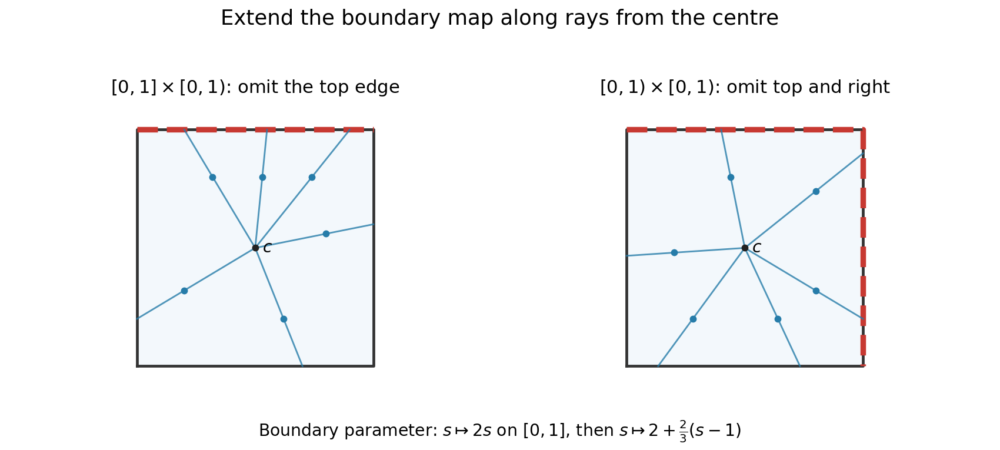

<h1 id="2/b/ii/solution">Solution</h1>

↑ **Parent:** [Ii](../ii.md)

A [boundary](../../../../../boundary-of-a-set.md) reparameterization gives an explicit [homeomorphism](../../../../../homeomorphism.md). Let $Q=[0,1]^2$, with centre $c=(1/2,1/2)$, and parametrize its [boundary](../../../../../boundary-of-a-set.md) once by

$$
b(s)=\begin{cases}(s,1),&0\leq s\leq1,\\(1,2-s),&1\leq s\leq2,\\(3-s,0),&2\leq s\leq3,\\(0,s-3),&3\leq s\leq4.\end{cases}
$$

Here $b(0)=b(4)$. The omitted top edge of $[0,1]\times[0,1)$ is $b([0,1])$. The omitted top and right edges of $[0,1)^2$ are $b([0,2])$.

Use the increasing [boundary](../../../../../boundary-of-a-set.md) parameter map

$$
\phi(s)=\begin{cases}2s,&0\leq s\leq1,\\2+\frac23(s-1),&1\leq s\leq4.\end{cases}
$$

It takes $[0,4]$ bijectively onto itself, respects the identified endpoints, and maps the first omitted arc exactly onto the second. Extend it radially:

$$
\boxed{H(c)=c,\qquad H\bigl(c+r(b(s)-c)\bigr)=c+r\bigl(b(\phi(s))-c\bigr),\quad0<r\leq1.}
$$

Every noncentral point has a unique [boundary](../../../../../boundary-of-a-set.md) ray and a unique radial parameter $r=2\|q-c\|_\infty$; the only duplicate [boundary](../../../../../boundary-of-a-set.md) parameters are zero and four, whose images agree. The inverse uses $\phi^{-1}$ by the same construction. Both maps are [continuous](../../../../../continuous-function.md) off the centre, and at the centre their radial distances tend to zero. Thus $H$ is a [homeomorphism](../../../../../homeomorphism.md) of the whole [closed](../../../../../closed-set.md) square.

It carries the first omitted edge precisely onto the second omitted pair of edges, so restriction gives

$$
\boxed{H:[0,1]\times[0,1)\ \cong\ [0,1)\times[0,1).}
$$

This is the [radial extension of a square boundary homeomorphism](../../../../../radial-extension-of-a-square-boundary-homeomorphism.md); it avoids any need to treat corners as topologically distinguished points.

**[Figure 1](#2/b/ii/image-a-boundary-reparameterization-joins-two-omitted-edges-into-the-image-of-one). A boundary reparameterization joins two omitted edges into the image of one**. Red boundary arcs are omitted from the respective spaces. Corresponding rays from the centre show the radial extension; the two blue ray families are related by the explicit piecewise linear boundary parameter map.

## ↑ Ancestors (13)

1. [Ii](../ii.md)
2. [B](../../b.md)
3. [2](../../../2.md)
4. [2014](../../../../2014-split.md)
5. [Past exam of the topology course of the University of Oxford](../../../../split.md)
6. [Topology course of the University of Oxford](../../../../../topology-course-of-the-university-of-oxford.md)
7. [Year 2 of the mathematics course of the University of Oxford](../../../../../year-2-of-the-mathematics-course-of-the-university-of-oxford.md)
8. [Mathematics course of the University of Oxford](../../../../../mathematics-course-of-the-university-of-oxford.md)
9. [Undergraduate course of the University of Oxford](../../../../../undergraduate-course-of-the-university-of-oxford.md)
10. [Course of the University of Oxford](../../../../../course-of-the-university-of-oxford.md)
11. [University of Oxford](../../../../../university-of-oxford-split.md)
12. [List of universities](../../../../../list-of-universities.md)
13. [Codex Wiki](../../../../../split.md)
