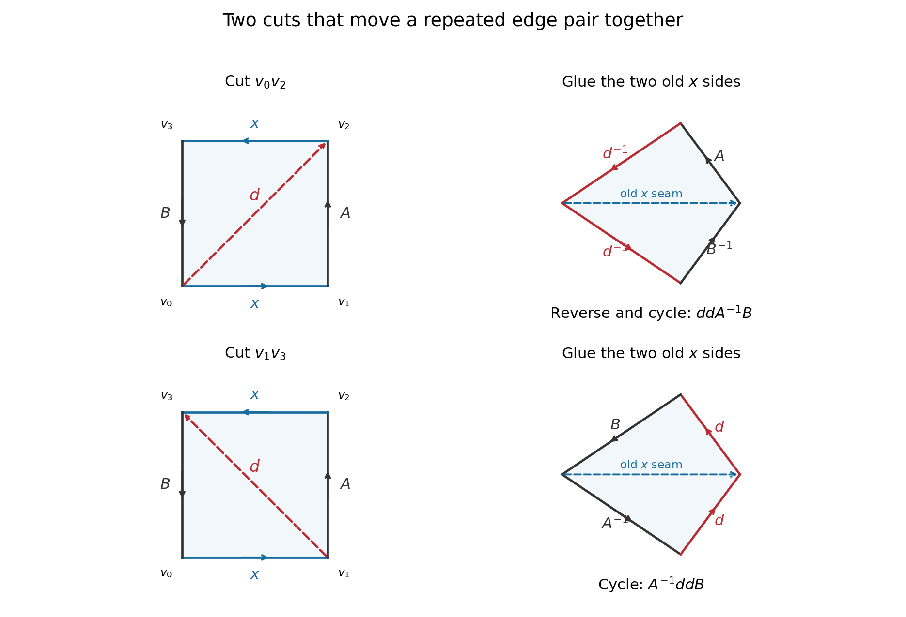

<h1 id="3/b/i/solution">Solution</h1>

↑ **Parent:** [I](../i.md)

Label the endpoints around the original polygon by $v_0,v_1,v_2,v_3$ so that the successive [boundary](../../../../../boundary-of-a-set.md) arcs are

$$
v_0\xrightarrow{x}v_1\xrightarrow{A}v_2\xrightarrow{x}v_3\xrightarrow{B}v_0.
$$

The two occurrences of $x$ have the same boundary-traversal direction, as prescribed by the word. We use cutting along a new diagonal followed by gluing the old $x$ sides. Cutting introduces two copies of the diagonal with opposite orientations, so rejoining them later exactly recovers the original quotient.

**First move.** Draw a diagonal $d$ from $v_0$ to $v_2$. The two pieces have [boundary](../../../../../boundary-of-a-set.md) words $xAd^{-1}$ and $dxB$. Glue them along their $x$ sides, turning one piece over in the planar drawing to match the arrows. Reading the outside [boundary](../../../../../boundary-of-a-set.md) of the joined disk gives

$$
Ad^{-1}d^{-1}B^{-1}.
$$

Reverse the orientation of this entire disk and change the starting point of its [boundary](../../../../../boundary-of-a-set.md) word. The same side-paired disk then has word $ddA^{-1}B$. Renaming the new paired edge $d$ as $x$ yields

$$
\boxed{xAxB\sim xxA^{-1}B.}
$$

**Second move.** Instead cut along $d$ from $v_1$ to $v_3$. The pieces now have words $xdB$ and $Axd^{-1}$. Gluing along the old $x$ sides gives outside word $dBA^{-1}d$. A cyclic change of starting point gives $A^{-1}ddB$, and renaming $d$ yields

$$
\boxed{xAxB\sim A^{-1}xxB.}
$$

All side identifications inside the strings $A$ and $B$ are carried along unchanged; reversing a piece reverses the order of its string and inverts each letter. The construction therefore gives homeomorphic quotients, not merely an equality of Euler characteristics. This is the [crosscap extraction move for a polygonal word](../../../../../crosscap-extraction-move-for-a-polygonal-word.md).

**[Figure 2](#3/b/i/image-cutting-a-diagonal-and-gluing-the-old-paired-sides-extracts-a-crosscap). Cutting a diagonal and gluing the old paired sides extracts a crosscap**. Each row uses one of the two diagonals. The right-hand joined disks keep the old x seam inside and expose a new paired diagonal on the boundary. Reversing or cyclically reading that boundary gives the two required word forms.

## ↑ Ancestors (13)

1. [I](../i.md)
2. [B](../../b.md)
3. [3](../../../3.md)
4. [2014](../../../../2014-split.md)
5. [Past exam of the topology course of the University of Oxford](../../../../split.md)
6. [Topology course of the University of Oxford](../../../../../topology-course-of-the-university-of-oxford.md)
7. [Year 2 of the mathematics course of the University of Oxford](../../../../../year-2-of-the-mathematics-course-of-the-university-of-oxford.md)
8. [Mathematics course of the University of Oxford](../../../../../mathematics-course-of-the-university-of-oxford.md)
9. [Undergraduate course of the University of Oxford](../../../../../undergraduate-course-of-the-university-of-oxford.md)
10. [Course of the University of Oxford](../../../../../course-of-the-university-of-oxford.md)
11. [University of Oxford](../../../../../university-of-oxford-split.md)
12. [List of universities](../../../../../list-of-universities.md)
13. [Codex Wiki](../../../../../split.md)
