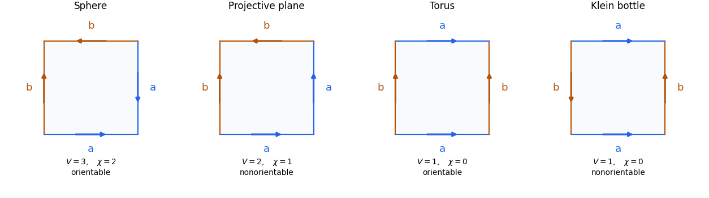

# 2015

↑ **Parent:** [Past exam of the topology course of the University of Oxford](../past-exam-of-the-topology-course-of-the-university-of-oxford.md)

Source paper: [released examination archive](https://www.whatdotheyknow.com/request/ba_computer_science_past_papers/response/2577745/attach/2/202402%20183%20CS%20Papers.zip?cookie_passthrough=1), member `2014/T/a13757w1.pdf`. The original cover dates the examination to **24 June 2015**, 9.30am to 11.00am. The folder name is not the examination year.

The complete three-page replacement is in [the Mathematics Part A FOI release](https://www.whatdotheyknow.com/request/maths_papers_2/response/1850333/attach/3/FOI%2020210708%201%20Data.zip?cookie_passthrough=1), member `FOI-20210708-1 - Data/a13757w1 (5).pdf`. Its intact pages 2–3 establish the complete three-question tree. The answers below replace the provisional fragments with full solutions to all 23 verified leaves, including the previously unavailable simplicial-complex and surface-classification material. The original archive link above is retained for provenance.

**Table of contents**

- [1](#1)
  - [a](#1/a)
    - [i](#1/a/i)
      - [Solution](#1/a/i/solution)
    - [ii](#1/a/ii)
      - [Solution](#1/a/ii/solution)
    - [iii](#1/a/iii)
      - [Solution](#1/a/iii/solution)
  - [b](#1/b)
    - [i](#1/b/i)
      - [Solution](#1/b/i/solution)
    - [ii](#1/b/ii)
      - [Solution](#1/b/ii/solution)
    - [iii](#1/b/iii)
      - [Solution](#1/b/iii/solution)
    - [iv](#1/b/iv)
      - [Solution](#1/b/iv/solution)
- [2](#2)
  - [a](#2/a)
    - [i](#2/a/i)
      - [Solution](#2/a/i/solution)
    - [ii](#2/a/ii)
      - [Solution](#2/a/ii/solution)
  - [b](#2/b)
    - [i](#2/b/i)
      - [Solution](#2/b/i/solution)
    - [ii](#2/b/ii)
      - [Solution](#2/b/ii/solution)
  - [c](#2/c)
    - [i](#2/c/i)
      - [Solution](#2/c/i/solution)
    - [ii](#2/c/ii)
      - [Solution](#2/c/ii/solution)
    - [iii](#2/c/iii)
      - [Solution](#2/c/iii/solution)
    - [iv](#2/c/iv)
      - [Solution](#2/c/iv/solution)
    - [v](#2/c/v)
      - [Solution](#2/c/v/solution)
- [3](#3)
  - [a](#3/a)
    - [i](#3/a/i)
      - [Solution](#3/a/i/solution)
    - [ii](#3/a/ii)
      - [Solution](#3/a/ii/solution)
    - [iii](#3/a/iii)
      - [Solution](#3/a/iii/solution)
    - [iv](#3/a/iv)
      - [Solution](#3/a/iv/solution)
  - [b](#3/b)
    - [i](#3/b/i)
      - [Solution](#3/b/i/solution)
    - [ii](#3/b/ii)
      - [Solution](#3/b/ii/solution)
    - [iii](#3/b/iii)
      - [Solution](#3/b/iii/solution)

## 1

↑ **Parent:** [2015](2015.md)

<h3 id="1/a">a</h3>

↑ **Parent:** [1](#1)

<h4 id="1/a/i">i</h4>

↑ **Parent:** [A](#1/a)

<h5 id="1/a/i/solution">Solution</h5>

↑ **Parent:** [I](#1/a/i)

A [topological space](../topology.md#topological-space) is [connected](../geometry-and-topology.md#connected-space) if it has no [separation](../set-theory.md#axiom-schema-of-specification): two disjoint nonempty [open sets](../topology.md#open-set) whose union is the whole space. Equivalently, its only [subsets](../set.md#subset) that are both [open](../topology.md#open-set) and [closed](../topology.md#closed-set) are the [empty set](../set.md#empty-set) and the whole space.

A [subset](../set.md#subset) is [connected](../geometry-and-topology.md#connected-space) when its [subspace topology](../topology.md#subspace-topology) has this property. Thus the sets in a proposed [separation](../set-theory.md#axiom-schema-of-specification) of a subset need only be relatively [open](../topology.md#open-set), rather than [open](../topology.md#open-set) in the ambient space.

$$
\boxed{A\text{ connected}\iff A\text{ has no separation in its subspace topology}.}
$$

<h4 id="1/a/ii">ii</h4>

↑ **Parent:** [A](#1/a)

<h5 id="1/a/ii/solution">Solution</h5>

↑ **Parent:** [Ii](#1/a/ii)

Suppose $A\cup B=U\cup V$ were a [separation](../set-theory.md#axiom-schema-of-specification). By [connectedness](../geometry-and-topology.md#connected-space), all of $A$ lies on one side, say $U$: otherwise $A\cap U,A\cap V$ would separate $A$. A point of $A\cap B$ then lies in $B\cap U$, so [connectedness](../geometry-and-topology.md#connected-space) of $B$ forces all of $B$ into $U$ as well. This makes $V$ empty, a contradiction.

Therefore **the union of two intersecting [connected subsets](../geometry-and-topology.md#connected-subset) is [connected](../geometry-and-topology.md#connected-space)**. The argument also proves the [connected union with a connected hub](../geometry-and-topology.md#connected-union-with-a-connected-hub) rule for arbitrarily many connected pieces meeting one connected subset.

<h4 id="1/a/iii">iii</h4>

↑ **Parent:** [A](#1/a)

<h5 id="1/a/iii/solution">Solution</h5>

↑ **Parent:** [Iii](#1/a/iii)

If $f(A)=U\cup V$ were a [separation](../set-theory.md#axiom-schema-of-specification), then

$$
A\cap f^{-1}(U),\qquad A\cap f^{-1}(V)
$$

would be disjoint nonempty relatively [open sets](../topology.md#open-set) covering $A$. They are relatively [open](../topology.md#open-set) by [continuity](../calculus.md#continuous-function) of the restriction $f|_A:A\to f(A)$. This contradicts [connectedness](../geometry-and-topology.md#connected-space) of $A$.

$$
\boxed{A\text{ connected},\ f\text{ continuous}\ \Longrightarrow\ f(A)\text{ connected}.}
$$

This is the [continuous image of a connected space](../geometry-and-topology.md#continuous-image-of-a-connected-space) theorem; no separation property of the target is required.

<h3 id="1/b">b</h3>

↑ **Parent:** [1](#1)

<h4 id="1/b/i">i</h4>

↑ **Parent:** [B](#1/b)

<h5 id="1/b/i/solution">Solution</h5>

↑ **Parent:** [I](#1/b/i)

Use the [basis of a topology](../topology.md#basis-of-a-topology) consisting of open rectangles:

$$
\boxed{\mathcal B=\{U\times V:U\in\mathcal T_X,\ V\in\mathcal T_Y\}.}
$$

It covers $X\times Y$, since $X\times Y\in\mathcal B$. Whenever a point lies in two basis rectangles, their [intersection](../set.md#set-intersection) is another basis rectangle containing it:

$$
(U_1\times V_1)\cap(U_2\times V_2)=(U_1\cap U_2)\times(V_1\cap V_2).
$$

These are precisely the two [basis of a topology](../topology.md#basis-of-a-topology) axioms. Arbitrary [unions](../set.md#set-union) of the rectangles therefore form a [topology](../topology.md), the [product topology](../geometry-and-topology.md#product-topology). To check the finite-intersection axiom directly, distribute the intersection of two unions over all pairs of rectangles and use the displayed formula. The empty union gives the [empty set](../set.md#empty-set).

<h4 id="1/b/ii">ii</h4>

↑ **Parent:** [B](#1/b)

<h5 id="1/b/ii/solution">Solution</h5>

↑ **Parent:** [Ii](#1/b/ii)

If both factors are [Hausdorff](../topology.md#hausdorff-space), two distinct product points differ in at least one coordinate. Disjoint [open neighbourhoods](../topology.md#open-neighbourhood) in that coordinate, multiplied by the other whole factor, give disjoint [open neighbourhoods](../topology.md#open-neighbourhood) of the product points. Thus the product is [Hausdorff](../topology.md#hausdorff-space).

Conversely, assume the product is [Hausdorff](../topology.md#hausdorff-space). Fix $y_0\in Y$, using nonemptiness. For $x\ne x'$, choose disjoint [open neighbourhoods](../topology.md#open-neighbourhood) of $(x,y_0)$ and $(x',y_0)$ and refine them to basis rectangles $U\times V$ and $U'\times V'$. Since $y_0\in V\cap V'$, their disjointness forces $U\cap U'=\varnothing$. These separate $x,x'$, proving that $X$ is [Hausdorff](../topology.md#hausdorff-space). Fixing a point of $X$ proves the same for $Y$.

$$
\boxed{X\times Y\text{ Hausdorff}\iff X,Y\text{ Hausdorff},\quad X,Y\ne\varnothing.}
$$

The nonempty hypothesis is essential: a product with the [empty set](../set.md#empty-set) is empty regardless of the other factor. This is the [Hausdorff property of a nonempty product](../geometry-and-topology.md#hausdorff-property-of-a-nonempty-product).

<h4 id="1/b/iii">iii</h4>

↑ **Parent:** [B](#1/b)

<h5 id="1/b/iii/solution">Solution</h5>

↑ **Parent:** [Iii](#1/b/iii)

Choose $x_0\in X\setminus A$ and $y_0\in Y\setminus B$, possible because the two subsets are proper. The cross

$$
H=(X\times\{y_0\})\cup(\{x_0\}\times Y)
$$

lies in the indicated complement. Its two arms are [homeomorphic](../topology.md#homeomorphism) to the [connected](../geometry-and-topology.md#connected-space) factors and meet at $(x_0,y_0)$, so $H$ is [connected](../geometry-and-topology.md#connected-space) by part (a)(ii).

For any remaining point $(x,y)$, either $x\notin A$ or $y\notin B$. In the first case the whole [connected subset](../geometry-and-topology.md#connected-subset) $\{x\}\times Y$ lies in the complement and meets $H$ at $(x,y_0)$. In the second case use $X\times\{y\}$, which meets $H$ at $(x_0,y)$. These connected fibres together with $H$ cover the complement. The [connected union with a connected hub](../geometry-and-topology.md#connected-union-with-a-connected-hub) argument therefore gives

$$
\boxed{(X\times Y)\setminus(A\times B)\text{ is connected}.}
$$

Neither proper subset needs to be [open](../topology.md#open-set), [closed](../topology.md#closed-set), or [connected](../geometry-and-topology.md#connected-space).

<h4 id="1/b/iv">iv</h4>

↑ **Parent:** [B](#1/b)

<h5 id="1/b/iv/solution">Solution</h5>

↑ **Parent:** [Iv](#1/b/iv)

Every [topological subspace](../topology.md#topological-subspace) $S\subseteq X$ again has the [cofinite topology](../topology.md#cofinite-topology): its nonempty [open subsets](../topology.md#open-set) have finite complements in $S$, and every finite exclusion is obtained by intersecting with a cofinite open subset of $X$. As usual, the [empty set](../set.md#empty-set) is also open; this exception is implicit in the paper's shorthand definition.

If $S$ is infinite, any two nonempty relatively [open sets](../topology.md#open-set) intersect, since their complements are finite. Hence $S$ is [hyperconnected space](../topology.md#hyperconnected-space) and therefore [connected](../geometry-and-topology.md#connected-space). If $S$ is finite, its [cofinite topology](../topology.md#cofinite-topology) is [discrete topology](../topology.md#discrete-space). It is then [connected](../geometry-and-topology.md#connected-space) exactly when it has at most one point. Thus

$$
\boxed{S\text{ connected}\iff |S|\leq1\text{ or }S\text{ is infinite}.}
$$

There are also **infinite disconnected subsets of the product**. Choose distinct $a,b\in X$ and put $D=\{a,b\}\times X$. This is infinite. The traces on $D$ of the ambient [open sets](../topology.md#open-set)

$$
(X\setminus\{b\})\times X,\qquad (X\setminus\{a\})\times X
$$

are respectively $\{a\}\times X$ and $\{b\}\times X$. They are disjoint, nonempty and cover $D$, giving a [separation](../set-theory.md#axiom-schema-of-specification). This answers the infinite-subset question, rather than only producing two isolated product points.

## 2

↑ **Parent:** [2015](2015.md)

<h3 id="2/a">a</h3>

↑ **Parent:** [2](#2)

<h4 id="2/a/i">i</h4>

↑ **Parent:** [A](#2/a)

<h5 id="2/a/i/solution">Solution</h5>

↑ **Parent:** [I](#2/a/i)

A [topological space](../topology.md#topological-space) is [compact](../topology.md#compact-space) if every [open cover](../topology.md#open-cover) has a [finite subcover](../topology.md#finite-subcover):

$$
\boxed{X=\bigcup_{i\in I}U_i,\ U_i\text{ open}\ \Longrightarrow\ X=U_{i_1}\cup\cdots\cup U_{i_n}\text{ for finitely many indices}.}
$$

There is no [Hausdorff](../topology.md#hausdorff-space) requirement in this definition.

<h4 id="2/a/ii">ii</h4>

↑ **Parent:** [A](#2/a)

<h5 id="2/a/ii/solution">Solution</h5>

↑ **Parent:** [Ii](#2/a/ii)

Let $(V_i)$ be an [open cover](../topology.md#open-cover) of $Y$. By [continuity](../calculus.md#continuous-function), the [inverse images](../set-theory.md#preimage) $f^{-1}(V_i)$ are [open](../topology.md#open-set) in $X$; by [surjectivity](../algebra.md#surjective-function), they cover $X$. [Compactness](../topology.md#compact-space) supplies finitely many covering $X$. Applying $f$ and using $f(X)=Y$ shows that the corresponding finitely many $V_i$ cover $Y$.

Thus **a continuous [surjective function](../algebra.md#surjective-function) from a [compact space](../topology.md#compact-space) has [compact](../topology.md#compact-space) target**. This is the [continuous image of a compact space](../topology.md#continuous-image-of-a-compact-space) theorem.

<h3 id="2/b">b</h3>

↑ **Parent:** [2](#2)

<h4 id="2/b/i">i</h4>

↑ **Parent:** [B](#2/b)

<h5 id="2/b/i/solution">Solution</h5>

↑ **Parent:** [I](#2/b/i)

For the [canonical projection of a quotient set](../set-theory.md#canonical-projection-of-a-quotient-set) $p$, define

$$
\boxed{\mathcal T_q=\{U\subseteq X/\mathcal R:p^{-1}(U)\in\mathcal T\}.}
$$

The [inverse images](../set-theory.md#preimage) of the [empty set](../set.md#empty-set) and whole target are $\varnothing$ and $X$. Inverse images commute with arbitrary [unions](../set.md#set-union) and finite [intersections](../set.md#set-intersection), so the topology axioms follow from those of $\mathcal T$. This is the [quotient topology](../topology.md#quotient-topology), and it makes $p$ [continuous](../calculus.md#continuous-function) by definition.

The crucial criterion is an equivalence: $U$ is open precisely when $p^{-1}(U)$ is open. This is stronger than continuity alone and is what makes the next part work.

<h4 id="2/b/ii">ii</h4>

↑ **Parent:** [B](#2/b)

<h5 id="2/b/ii/solution">Solution</h5>

↑ **Parent:** [Ii](#2/b/ii)

If $g$ is [continuous](../calculus.md#continuous-function), then so is $g\circ p$, as a [composition of continuous functions](../calculus.md#composition-of-continuous-functions). Conversely, suppose $g\circ p$ is continuous. For an [open subset](../topology.md#open-set) $W\subseteq Z$,

$$
p^{-1}(g^{-1}(W))=(g\circ p)^{-1}(W)
$$

is open in $X$. The [quotient topology](../topology.md#quotient-topology) criterion therefore says $g^{-1}(W)$ is open in $X/\mathcal R$. This proves continuity of $g$.

$$
\boxed{g\text{ continuous}\iff g\circ p\text{ continuous}.}
$$

This is the [universal property of the quotient topology](../topology.md#universal-property-of-the-quotient-topology).

<h3 id="2/c">c</h3>

↑ **Parent:** [2](#2)

<h4 id="2/c/i">i</h4>

↑ **Parent:** [C](#2/c)

<h5 id="2/c/i/solution">Solution</h5>

↑ **Parent:** [I](#2/c/i)

Since $K$ misses $A$, the open set $U=X\setminus K$ contains the whole collapsed [equivalence class](../set-theory.md#equivalence-class) $A$. Every other [equivalence class](../set-theory.md#equivalence-class) is a [singleton](../set.md#singleton-mathematics), so $U$ is saturated under the [saturation of a subset](../topology.md#saturation-of-a-subset) operation:

$$
p^{-1}(p(U))=U.
$$

Its preimage is open, so the [quotient topology](../topology.md#quotient-topology) gives

$$
\boxed{p(X\setminus K)\text{ is open in }X_A.}
$$

The hypothesis $K\cap A=\varnothing$ is exactly what prevents the [saturation of a subset](../topology.md#saturation-of-a-subset) from adding missing points of the collapsed class.

<h4 id="2/c/ii">ii</h4>

↑ **Parent:** [C](#2/c)

<h5 id="2/c/ii/solution">Solution</h5>

↑ **Parent:** [Ii](#2/c/ii)

Use $F:[0,1]\to S^1$, $F(t)=e^{2\pi it}$. This is [continuous](../calculus.md#continuous-function), identifies the two endpoints, and is otherwise injective. Its fibres are exactly the [equivalence classes](../set-theory.md#equivalence-class) for [collapsing a subset to a point](../topology.md#collapsing-a-subset-to-a-point) with $A=\{0,1\}$. Hence it factors uniquely through a [bijection](../function.md#bijection)

$$
\overline F:X_A\longrightarrow S^1,\qquad\overline F([t])=e^{2\pi it}.
$$

By the [universal property of the quotient topology](../topology.md#universal-property-of-the-quotient-topology), $\overline F$ is [continuous](../calculus.md#continuous-function). The interval is [compact](../topology.md#compact-space), so its quotient $X_A$ is compact. The [unit circle](../complex-analysis.md#complex-unit-circle) is [Hausdorff](../topology.md#hausdorff-space). The [compact-to-Hausdorff continuous bijection theorem](../topology.md#compact-to-hausdorff-continuous-bijection-theorem) now shows that $\overline F$ is a [homeomorphism](../topology.md#homeomorphism):

$$
\boxed{[0,1]/\{0\sim1\}\cong S^1.}
$$

Indeed the theorem makes the inverse continuous because images of closed subsets of a compact space are compact and hence closed in a Hausdorff target.

<h4 id="2/c/iii">iii</h4>

↑ **Parent:** [C](#2/c)

<h5 id="2/c/iii/solution">Solution</h5>

↑ **Parent:** [Iii](#2/c/iii)

Every quotient class has a representative in $[0,1]$: the collapsed class has representatives $0,1$, and the others are the points of $(0,1)$. Thus $p|_{[0,1]}$ is a continuous surjection from a [compact interval](../real-analysis.md#compact-interval) onto $X_A$. It follows that **$X_A$ is [compact](../topology.md#compact-space)**, despite the noncompact original space.

Define the continuous map

$$
F(x)=\begin{cases}e^{2\pi ix},&0\leq x\leq1,\\1,&x\leq0\text{ or }x\geq1.\end{cases}
$$

The formulas agree at both junctions, and its fibres are exactly the required [equivalence classes](../set-theory.md#equivalence-class). It induces a continuous bijection $X_A\to S^1$, which is a [homeomorphism](../topology.md#homeomorphism) by compactness and the [Hausdorff condition](../topology.md#hausdorff-space) on the [circle](../topology.md#circle).

$$
\boxed{\mathbb R/\bigl(({-\infty},0]\cup[1,\infty)\bigr)\cong S^1.}
$$

The quotient notation means that the displayed entire subset becomes one point.

<h4 id="2/c/iv">iv</h4>

↑ **Parent:** [C](#2/c)

<h5 id="2/c/iv/solution">Solution</h5>

↑ **Parent:** [Iv](#2/c/iv)

**Collapsing the integers gives a [Hausdorff space](../topology.md#hausdorff-space).** For two distinct noninteger points, choose disjoint small open intervals around them that avoid $\mathbb Z$. Each interval is saturated under the [saturation of a subset](../topology.md#saturation-of-a-subset) operation, so its image is an open neighbourhood of its class. For a noninteger $x$ and the collapsed class, choose $0<r<\operatorname{dist}(x,\mathbb Z)$. The disjoint open sets

$$
U=(x-r,x+r),\qquad V=\mathbb R\setminus[x-r,x+r]
$$

are saturated; $U$ contains $x$ and $V$ contains all integers. Their images separate the two quotient points. These exhaust all pairs of distinct classes.

**Collapsing the rationals does not give a [Hausdorff space](../topology.md#hausdorff-space).** The preimage of the singleton collapsed point is $\mathbb Q$, which is not [closed](../topology.md#closed-set) in $\mathbb R$. Therefore that quotient singleton is not closed, whereas every singleton of a [Hausdorff space](../topology.md#hausdorff-space) is closed.

$$
\boxed{X_{\mathbb Z}\text{ is Hausdorff},\qquad X_{\mathbb Q}\text{ is not Hausdorff}.}
$$

Equivalently, every nonempty saturated open subset of $\mathbb R$ meets the [dense set](../topology.md#dense-set) $\mathbb Q$ and therefore contains it all. Every nonempty quotient open set contains the collapsed point, making separation from any other quotient point impossible.

<h4 id="2/c/v">v</h4>

↑ **Parent:** [C](#2/c)

<h5 id="2/c/v/solution">Solution</h5>

↑ **Parent:** [V](#2/c/v)

**No countable subset works.** For any [countable set](../cardinal-number.md#countable-set) $A\subseteq\mathbb R$, choose $b_n\in(n,n+1/2)\setminus A$: each nonempty interval is [uncountable](../cardinal-number.md#uncountable-set). The sequence tends to infinity, so every tail

$$
K_n=\{b_k:k\geq n\}
$$

is [closed](../topology.md#closed-set) in $\mathbb R$ and disjoint from $A$. By part (i), $p(\mathbb R\setminus K_n)$ is open in $X_A$. These sets increase and cover $X_A$, since no point belongs to every tail. But any finite selection is contained in its largest member, which still misses every quotient point $p(b_k)$ in that member's remaining tail. The $b_k$ represent distinct singleton classes.

This is an [open cover](../topology.md#open-cover) without a [finite subcover](../topology.md#finite-subcover), proving

$$
\boxed{A\text{ countable}\ \Longrightarrow\ \mathbb R_A\text{ is not compact}.}
$$

The argument does not assume that $A$ is closed, bounded, or discrete. It is the [noncompactness after collapsing a countable real subset](../topology.md#noncompactness-after-collapsing-a-countable-real-subset) obstruction.

## 3

↑ **Parent:** [2015](2015.md)

<h3 id="3/a">a</h3>

↑ **Parent:** [3](#3)

<h4 id="3/a/i">i</h4>

↑ **Parent:** [A](#3/a)

<h5 id="3/a/i/solution">Solution</h5>

↑ **Parent:** [I](#3/a/i)

The [standard simplex](../homotopy.md#standard-simplex) of dimension $n$ is

$$
\boxed{\Delta^n=\{(t_0,\ldots,t_n)\in\mathbb R^{n+1}:t_j\geq0,\ \sum_jt_j=1\}.}
$$

It is the [convex hull](../convex-set.md#convex-hull) of the coordinate vectors, and its [faces of a simplex](../algebraic-topology.md#face-of-a-simplex) arise by setting selected coordinates to zero.

An [abstract simplicial complex](../algebraic-topology.md#simplicial-complex) is a pair $(V,\Sigma)$ where $V$ is the vertex set and $\Sigma$ consists of finite nonempty subsets of $V$, contains every singleton, and contains every nonempty subset of each member. A member with $n+1$ vertices is an $n$-[simplex](../algebraic-topology.md#simplex).

Its [geometric realization](../algebraic-topology.md#geometric-realization-of-a-simplicial-complex) is obtained by gluing one [standard simplex](../homotopy.md#standard-simplex) for each member along the faces specified by common vertex subsets. Equivalently, its points have [barycentric coordinates](../algebraic-topology.md#barycentric-coordinate-system) $(t_v)_{v\in V}$ with finite support, nonnegative entries summing to one, and support a simplex of $K$. Use the topology induced by this gluing, equivalently the [weak topology of a simplicial realization](../algebraic-topology.md#weak-topology-of-a-simplicial-realization).

<h4 id="3/a/ii">ii</h4>

↑ **Parent:** [A](#3/a)

<h5 id="3/a/ii/solution">Solution</h5>

↑ **Parent:** [Ii](#3/a/ii)

List the finite vertex set as $V=\{v_1,\ldots,v_N\}$. Map a point to its [barycentric coordinates](../algebraic-topology.md#barycentric-coordinate-system):

$$
\boxed{f:|K|\longrightarrow\mathbb R^N,\qquad f\left(\sum_jt_jv_j\right)=(t_1,\ldots,t_N).}
$$

On each simplex this is an [affine map](../geometry-and-topology.md#affine-map) and therefore [continuous](../calculus.md#continuous-function). The definitions agree on every common face, so the [quotient topology](../topology.md#quotient-topology) defining the realization makes $f$ continuous on all of $|K|$. Barycentric coordinates are unique after zero coordinates are added, so $f$ is [injective](../algebra.md#injective-function).

Since [Euclidean space](../normed-vector-space.md#euclidean-norm) is [Hausdorff](../topology.md#hausdorff-space), distinct images have disjoint open neighbourhoods. Their inverse images separate the original points. Hence **$|K|$ is [Hausdorff](../topology.md#hausdorff-space)**. A continuous injection into a Hausdorff space is enough for this conclusion; no prior Hausdorff assumption on the domain is being used.

<h4 id="3/a/iii">iii</h4>

↑ **Parent:** [A](#3/a)

<h5 id="3/a/iii/solution">Solution</h5>

↑ **Parent:** [Iii](#3/a/iii)

An $n$-dimensional [topological manifold](../topological-manifold.md) is a [Hausdorff](../topology.md#hausdorff-space), [second countable](../topology.md#second-countable-space) topological space in which every point has an open neighbourhood [homeomorphic](../topology.md#homeomorphism) to an open subset of $\mathbb R^n$. Equivalently, charts can be chosen onto open balls. This is the without-boundary convention.

A [topological surface](../topological-surface.md) is a two-dimensional topological manifold. When connectedness is included in the convention for a surface, impose it as well; in the classification statement below the surface is explicitly connected. A [closed surface](../smooth-manifold.md#closed-surface) means a compact surface without boundary, rather than merely a closed subset of another space.

<h4 id="3/a/iv">iv</h4>

↑ **Parent:** [A](#3/a)

<h5 id="3/a/iv/solution">Solution</h5>

↑ **Parent:** [Iv](#3/a/iv)

Here is an explicit [simplicial complex](../algebraic-topology.md#simplicial-complex) on six vertices. Take every subset of one of the following ten triangular facets:

$$
\boxed{123,\ 124,\ 135,\ 146,\ 156,\ 236,\ 245,\ 256,\ 345,\ 346.}
$$

For example, $135$ denotes $\{1,3,5\}$, with all its edges and vertices included. Its [one-skeleton](../algebraic-topology.md#1-skeleton) has all fifteen edges of the [complete graph](../graph-theory.md#complete-graph). Every edge belongs to exactly two triangles. The [links of a simplex](../algebraic-topology.md#link-of-a-simplex) at the six vertices are the following cycles, with the first vertex understood to repeat at the end:

$$
\begin{array}{c|c}
\text{vertex}&\text{link cycle}\\\hline
1&2,3,5,6,4\\
2&1,3,6,5,4\\
3&1,2,6,4,5\\
4&1,2,5,3,6\\
5&1,3,4,2,6\\
6&1,4,3,2,5
\end{array}
$$

Thus every vertex has a disk neighbourhood, as do edge and face interior points. The realization is a compact connected [surface](../topological-surface.md) without boundary. Its [Euler characteristic](../homology.md#euler-characteristic) is

$$
\chi=V-E+F=6-15+10=1.
$$

The [classification theorem for surfaces](../geometry-and-topology.md#classification-theorem-for-surfaces) identifies the unique closed connected surface with this Euler characteristic as the [real projective plane](../differential-geometry.md#real-projective-plane). Consequently **this complex triangulates $\mathbb{RP}^2$**. The explicit facet and link checks make this a genuine [simplicial complex](../algebraic-topology.md#simplicial-complex), not a polygon whose boundary identifications have been mistaken for simplicial faces.

<h3 id="3/b">b</h3>

↑ **Parent:** [3](#3)

<h4 id="3/b/i">i</h4>

↑ **Parent:** [B](#3/b)

<h5 id="3/b/i/solution">Solution</h5>

↑ **Parent:** [I](#3/b/i)

A [polygon with a complete set of side-identifications](../topological-surface.md#polygon-with-a-complete-set-of-side-identifications) consists of a closed polygonal disk, a pairing of all its boundary sides, and a specified endpoint-matching homeomorphism for each paired pair. Form the quotient by these side maps, leaving interior points distinct. A convenient encoding labels paired sides by the same letter and gives them arrows; traversal in the arrow direction contributes $a$, and traversal against it contributes $a^{-1}$ to the boundary word. Every letter occurs exactly twice.

The orientations determine whether matched endpoints are identified in the same or reverse boundary-traversal order. This endpoint data is essential: pairing the same geometric sides with different directions can produce nonhomeomorphic surfaces. Subdividing the disk and the paired sides gives a [triangulation](../algebraic-topology.md#triangulation) of the resulting [surface](../topological-surface.md).

<h4 id="3/b/ii">ii</h4>

↑ **Parent:** [B](#3/b)

<h5 id="3/b/ii/solution">Solution</h5>

↑ **Parent:** [Ii](#3/b/ii)

The [classification theorem for surfaces](../geometry-and-topology.md#classification-theorem-for-surfaces) states that every connected [closed combinatorial surface](../topological-surface.md#closed-combinatorial-surface) is [homeomorphic](../topology.md#homeomorphism) to exactly one of:

- the [two-sphere](../euclidean-geometry.md#two-sphere);
- an [orientable surface](../differential-geometry.md#orientable-surface) of [orientable genus](../geometry-and-topology.md#orientable-genus) $g\geq1$, the [connected sum](../smooth-manifold.md#connected-sum-of-oriented-manifolds) of $g$ [tori](../topological-surface.md#torus);
- a [nonorientable surface](../topological-surface.md#non-orientable-surface) of [crosscap number](../geometry-and-topology.md#crosscap-number) $h\geq1$, the [connected sum](../smooth-manifold.md#connected-sum-of-oriented-manifolds) of $h$ [real projective planes](../differential-geometry.md#real-projective-plane).

The orientable family has [Euler characteristic](../homology.md#euler-characteristic) $2-2g$; the nonorientable family has Euler characteristic $2-h$. Orientability together with Euler characteristic distinguishes the entries.

Boundary words giving the required [polygonal schemas](../topological-surface.md#polygonal-schema) are

$$
\boxed{\begin{aligned}
S^2:&\quad aa^{-1},\\
\Sigma_g:&\quad a_1b_1a_1^{-1}b_1^{-1}\cdots a_gb_ga_g^{-1}b_g^{-1},\\
N_h:&\quad a_1a_1a_2a_2\cdots a_ha_h.
\end{aligned}}
$$

A two-sided polygon here means a disk with its boundary split into two arcs; subdivision produces an ordinary polygon with more sides without changing the quotient. Alternatively the square word $aa^{-1}bb^{-1}$ represents the sphere. Each four-letter block in the orientable word adds a torus handle; each repeated-letter block in the nonorientable word adds a projective-plane summand.

<h4 id="3/b/iii">iii</h4>

↑ **Parent:** [B](#3/b)

<h5 id="3/b/iii/solution">Solution</h5>

↑ **Parent:** [Iii](#3/b/iii)

There are **exactly four homeomorphism types**: the [two-sphere](../euclidean-geometry.md#two-sphere), [real projective plane](../differential-geometry.md#real-projective-plane), [torus](../topological-surface.md#torus), and [Klein bottle](../topological-surface.md#klein-bottle).

For completeness, enumerate all pairings. Four sides have three pairings; each pair can be matched in either direction, giving twelve signed pairings before symmetries. Up to cyclic relabelling, the repeated labels are either adjacent, of form $aa^sbb^t$, or alternating, of form $aba^sb^t$, where $s,t\in\{1,-1\}$. The second adjacent pattern $abba$ rotates to the first. Endpoint identification gives the following table:

$$
\begin{array}{c|c|c|c|c}
\text{pattern}&(s,t)&V&\chi=V-1&\text{surface}\\\hline
\text{adjacent}&(-1,-1)&3&2&S^2\\
\text{adjacent}&(1,-1)\text{ or }(-1,1)&2&1&\mathbb{RP}^2\\
\text{adjacent}&(1,1)&1&0&\text{Klein bottle}\\
\text{alternating}&(-1,-1)&1&0&\text{torus}\\
\text{alternating}&(1,-1)\text{ or }(-1,1)&1&0&\text{Klein bottle}\\
\text{alternating}&(1,1)&2&1&\mathbb{RP}^2
\end{array}
$$

Here the quotient always has two edge classes and one face, so its [Euler characteristic](../homology.md#euler-characteristic) is $V-2+1=V-1$. To reproduce the vertex count, label consecutive square vertices $0,1,2,3$. For paired sides $i,j$, a same-direction pairing identifies $i$ with $j$ and $i+1$ with $j+1$; a reversed-direction pairing identifies $i$ with $j+1$ and $i+1$ with $j$, with indices modulo four. Taking the generated equivalence classes gives exactly the displayed values of $V$.

The quotient is [orientable](../differential-geometry.md#orientable-surface) precisely when each label is traversed once positively and once negatively around the boundary: then the face orientation extends across every paired edge. A same-direction pair obstructs such an orientation. Thus the two $\chi=0$ possibilities are distinguished as the orientable [torus](../topological-surface.md#torus) and nonorientable [Klein bottle](../topological-surface.md#klein-bottle); the other rows are fixed by [Euler characteristic](../homology.md#euler-characteristic) and the [classification theorem for surfaces](../geometry-and-topology.md#classification-theorem-for-surfaces).

Explicit square representatives are

$$
\boxed{S^2:aa^{-1}bb^{-1},\quad\mathbb{RP}^2:aabb^{-1},\quad T^2:aba^{-1}b^{-1},\quad K:aba^{-1}b.}
$$

All edge interior points have disk neighbourhoods by joining two half-disks, and each identified vertex has a cyclic sequence of corner sectors, again a disk neighbourhood. There are no leftover boundary edges. The enumeration therefore describes closed surfaces, and the twelve signed pairings leave no additional cases.

**[Figure 1](#3/b/iii/image-four-closed-surfaces-obtained-by-pairing-the-sides-of-a-square). Four closed surfaces obtained by pairing the sides of a square**. Arrows and labels specify complete side-identifications. The examples realize the sphere, real projective plane, torus and Klein bottle; vertex counts and orientability distinguish their types.

## ↑ Ancestors (9)

1. [Past exam of the topology course of the University of Oxford](../past-exam-of-the-topology-course-of-the-university-of-oxford.md)
2. [Topology course of the University of Oxford](../university-of-oxford.md#topology-course-of-the-university-of-oxford)
3. [Year 2 of the mathematics course of the University of Oxford](../university-of-oxford.md#year-2-of-the-mathematics-course-of-the-university-of-oxford)
4. [Mathematics course of the University of Oxford](../university-of-oxford.md#mathematics-course-of-the-university-of-oxford)
5. [Undergraduate course of the University of Oxford](../university-of-oxford.md#undergraduate-course-of-the-university-of-oxford)
6. [Course of the University of Oxford](../university-of-oxford.md#course-of-the-university-of-oxford)
7. [University of Oxford](../university-of-oxford.md)
8. [List of universities](../README.md#list-of-universities)
9. [Codex Wiki](../README.md)
